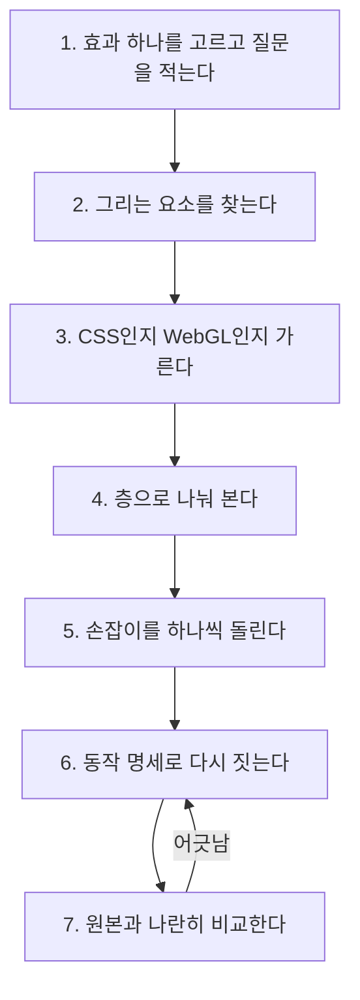

> Vishwas Gopinath의 글 「[How to reverse engineer a website with AI](https://www.builder.io/blog/reverse-engineer-website)」(Builder.io, 2026.11)를 바탕으로 재구성한 노트다. `/remix` 스킬의 동작은 [공식 저장소의 스킬 정의](https://github.com/BuilderIO/agent-native/tree/main/skills/remix)로 확인했다.

## UI 리버스 엔지니어링이란

**UI 리버스 엔지니어링**은 다른 사이트에서 돌아가는 UI 효과(배경 애니메이션, 메뉴, 가격표, 호버 상태)를 뜯어 원리를 알아내고, 내 프로젝트에 새 코드로 다시 짓는 일이다. 브라우저로 내려온 HTML·CSS·JavaScript·셰이더는 압축(minify)돼 있어도 모두 읽을 수 있으므로, 화면에 보이는 효과는 원칙적으로 전부 분석 대상이다.

사람과 에이전트가 맡는 일이 다르다.

| 맡는 쪽 | 하는 일 |
| --- | --- |
| 사람 + DevTools | 효과를 **어느 요소가** 그리는지, **어떤 방식**(CSS·Canvas·WebGL)으로 그리는지 가려낸다 |
| 코딩 에이전트 | 압축된 코드와 셰이더를 읽어 효과를 층으로 분해하고, 새 코드로 다시 짓고, 원본과 비교한다 |

셰이더를 직접 읽을 줄 몰라도 된다. 에이전트가 층마다 손잡이(knob)가 달린 라이브 데모를 만들어 주면, 값을 바꿔 보면서 각 층이 무슨 일을 하는지 익힌다.



## 준비물

| 준비물 | 설명 |
| --- | --- |
| 배울 효과가 있는 사이트 | 페이지 전체가 아니라 효과 하나 |
| Chrome | DevTools 콘솔과 애니메이션 패널을 쓴다 |
| 코딩 에이전트 | Claude Code, Codex, Cursor 등. 자기 브라우저로 사이트를 열 수 있어야 한다 |
| `/remix` 스킬 | 분해(`/remix explain`)와 재구축(`/remix`)을 맡는 오픈소스 스킬 |
| 내 프로젝트 | 6번에서 효과를 옮겨 지을 곳 |

`/remix`는 프로젝트 폴더에서 설치한다.

```bash
npx @agent-native/core@latest skills add remix
```

스킬과 함께 Agent-Native Design 커넥터가 연결된다. Agent-Native Design은 브라우저에서 도는 캔버스 도구로, 분해 결과를 보드로 보여 준다. 보드는 로그인 없이 만들어지고, 공유하거나 계정에 저장할 때만 로그인이 필요하다. Design을 쓰지 않아도 스킬은 동작한다(아래 4번·6번).

## 1. 효과 하나를 고르고 질문을 적는다

**대상은 페이지가 아니라 효과 하나다.** 고른 뒤 알고 싶은 것을 글로 적어 둔다. 예를 들어 stripe.com 첫 화면의 물결이라면 「어떻게 움직이나」, 「색이 왜 섞여 보이나」다.

처음에는 스스로 움직이거나 호버에 반응하는 효과가 좋다. 눈으로 봐서는 구조를 읽기 가장 어려운 종류라 뜯어 볼 때 얻는 것이 많다.

## 2. 그리는 요소를 찾는다

물결 같은 배경 애니메이션은 대개 `<canvas>`에 그린다. 이런 캔버스는 글자 뒤에 깔리고 `pointer-events: none`이 걸려 있어 클릭이 통과한다. 그래서 Inspect로 화면을 찍으면 애니메이션이 아니라 그 앞의 글자가 잡힌다([[css-cursor-pointer#상호작용 끄기: pointer-events|pointer-events]]).

콘솔(`Cmd+Option+J`, Windows는 `Ctrl+Shift+J`)에서 페이지의 캔버스를 모두 나열하면 바로 찾는다.

```js
[...document.querySelectorAll('canvas')].map((c) => {
  const { width, height } = c.getBoundingClientRect()
  return {
    className: c.className,
    size: `${Math.round(width)}×${Math.round(height)}`,
    pointerEvents: getComputedStyle(c).pointerEvents,
  }
})
```

- stripe.com 홈페이지(2026년 11월 기준)에서는 `single-wave__canvas`가 `pointerEvents: "none"`으로 가장 먼저 잡힌다. 크기는 창 너비에 따라 달라진다.
- 목록이 비어 있으면 캔버스에 그린 효과가 아니다. Inspect로 요소를 직접 고른다.

## 3. CSS인지 WebGL인지 가른다

그리는 방식에 따라 읽는 도구가 달라진다.

| 방식 | 그리는 주체 | 읽는 방법 |
| --- | --- | --- |
| CSS 애니메이션·트랜지션, Web Animations | 브라우저의 애니메이션 엔진 | DevTools **애니메이션 패널**에서 속도를 늦추고 타이밍과 이징을 읽는다([[devtools-elements-css#애니메이션 검사\|애니메이션 검사]]) |
| Canvas 2D | JavaScript가 매 프레임 다시 그린다 | 애니메이션 패널에 잡히지 않는다. 그리는 코드를 읽어야 한다 |
| WebGL | GPU에서 도는 셰이더가 매 프레임 픽셀마다 색을 계산한다([[webgl-shaders\|WebGL과 셰이더]]) | 애니메이션 패널에 잡히지 않는다. 셰이더 코드는 압축돼 있어 에이전트에게 읽힌다 |

2번에서 찾은 클래스 이름으로 캔버스의 컨텍스트 종류를 확인한다.

```js
const canvas = document.querySelector('.single-wave__canvas')
const kinds = ['webgl2', 'webgl', 'webgpu', '2d', 'bitmaprenderer']
const context = kinds.find((kind) => {
  try {
    return canvas.getContext(kind) !== null
  } catch {
    return false
  }
})
console.log({ context, animations: document.getAnimations().length })
```

stripe.com의 물결은 `context: "webgl2"`가 나온다. 애니메이션 패널이 비어 있는 이유다.

결과를 읽을 때 알아 둘 점은 다음과 같다.

- **캔버스 하나는 컨텍스트를 한 종류만 가진다.** `getContext()`는 이미 쓰고 있는 종류를 물으면 그 컨텍스트를 돌려주고, 다른 종류를 물으면 `null`을 돌려준다. 그래서 차례로 물어 처음 `null`이 아닌 것이 답이다. `'webgl2'` 하나만 확인하면 WebGL 1이나 WebGPU로 그린 캔버스를 놓친다.
- **컨텍스트가 아직 없는 캔버스에 물으면 그 자리에서 새로 만들어진다.** 이미 무언가를 그리고 있는 캔버스에만 쓴다.
- `context`가 `undefined`면 다섯 종류 어느 것으로도 컨텍스트를 얻지 못한 것이다. 선택자가 틀려 `canvas`가 `null`일 때도 같은 결과가 나오므로 클래스 이름부터 확인한다. 그다음으로 흔한 경우가 `transferControlToOffscreen()`으로 워커에 넘긴 캔버스로, 이때 `getContext()`는 예외를 던진다([[canvas-2d#OffscreenCanvas: 워커에서 그리기|OffscreenCanvas]]).
- `animations`가 0보다 크다는 것은 **페이지 어딘가에** CSS 애니메이션·트랜지션이나 Web Animations가 있다는 뜻일 뿐이다. stripe.com은 이 값이 0이 아니지만 물결은 WebGL이 그린다.

## 4. 층으로 나눠 본다

에이전트에 분해를 시킨다.

```text
/remix explain the hero background on stripe.com
```

에이전트는 자기 브라우저로 사이트를 열어 스크롤·호버·클릭·리사이즈로 효과를 돌려 보고, HTML·CSS·JavaScript, 네트워크로 받은 자산, 캔버스 루프, 셰이더와 유니폼, 이벤트 리스너, 애니메이션 라이브러리를 읽는다. 그런 다음 Agent-Native Design에 보드를 연다.

| 보드 구성 | 내용 |
| --- | --- |
| Original | 원본 화면 |
| How it works | 기법의 단계마다 하나씩, 3~5개의 라이브 데모(형태, 움직임, 카메라, 음영, 색). 데모마다 손잡이가 달린다 |

`explain`은 내 프로젝트의 코드를 바꾸지 않는다. Design을 쓸 수 없는 환경에서는 같은 손잡이가 달린 로컬 설명 페이지와 캡처로 대신한다.

stripe.com 물결은 다음 세 층으로 나뉜다(예시).

| 층 | 맡는 것 | 손잡이 |
| --- | --- | --- |
| 접힌 면(folded sheet) | 물결이 그려지는 평평한 면 | Displace, Twist가 면을 구부린다 |
| 비틀림과 잔물결(twist and ripple) | 움직임. 가장자리가 가운데보다 크게 움직인다 | Twist 손잡이마다 면을 다른 축으로 돌린다 |
| 음영과 마감(shade and finish) | 겉모습 | Glow, Fibre, Hue shift가 모양은 두고 빛과 색만 바꾼다 |

## 5. 손잡이를 하나씩 돌린다

속도, 세기, 색, 크기 같은 손잡이를 **한 번에 하나만** 돌리고, 다음 것으로 넘어가기 전에 원래 값으로 돌려놓는다. 변수 하나만 바꿔야 그 층이 맡은 일이 드러난다.

손잡이마다 무엇이 바뀌는지를 1번에서 적은 질문 옆에 적는다. 이 메모가 6번에서 다시 지을 때의 기준이 된다.

## 6. 동작 명세로 다시 짓는다

```text
/remix the hero background from stripe.com into my homepage, but make it blue
```

재구축은 두 단계로 나뉜다. **원본 코드는 증거이지 옮겨 적을 재료가 아니다.**

1. **동작 명세(behavior spec)를 쓴다.** 관찰한 동작을 자기 말로 적는다. 기하, 수식, 수치 파라미터, 타이밍과 이징, 스크롤·포인터와의 대응, 층 구성, 반응형 규칙, 자산의 성격을 기록하고, 확실하지 않은 것은 추측하지 않고 불확실하다고 적는다. 명세와 캡처는 프로젝트 저장소 밖에 둔다.
2. **명세에서 구현한다.** 내 프로젝트의 컴포넌트·관례·구조에 맞춰 새 코드를 쓴다.

| 구분 | 대상 |
| --- | --- |
| 그대로 맞춘다 | 형태, 구성, 크기, 배치, 질감, 움직임, 타이밍. 수치와 수식, 관찰되는 동작은 원본과 똑같이 쓴다 |
| 내 것으로 바꾼다 | 브랜드 층: 색, 폰트, 아이콘, 로고, 문구. 내 프로젝트의 토큰(CSS 변수, Tailwind 테마, 디자인 시스템)에 대응시킨다 |
| 가져오지 않는다 | 원본의 코드, 셰이더 소스, 주석, 식별자, 파일 구조, 압축된 코드 조각, 폰트, 로고, 이미지, 3D 모델. 원본이 소유한 텍스처 같은 자산은 절차적으로 만들거나 공개 라이선스 자산으로 바꾸고 출처를 기록한다 |
| 손잡이로 내놓는다 | 속도, 세기, 색, 크기 같은 파라미터를 기본값이 있는 타입 지정 props나 CSS 커스텀 프로퍼티로 노출한다. 이미지·영상·3D 모델·텍스처·Lottie·폰트는 자산마다 이름 붙은 prop이나 상수 하나로 두어 나중에 바꿔 끼울 수 있게 한다 |

압축된 코드나 셰이더를 그대로 붙여 넣으면 남의 코드가 프로젝트에 들어오고, 읽을 수 없어 고치기도 어렵다. 붙여 넣었다면 지우고 5번의 메모나 명세에서 다시 짓는다.

## 7. 원본과 나란히 비교한다

비교는 순서가 있다.

1. **브랜드를 입히기 전에** 원본 색 그대로 렌더링해 원본 캡처와 나란히 놓는다. 뷰포트 크기와 애니메이션 시각을 똑같이 맞춘다(시계나 셰이더의 시간 유니폼을 고정한다).
2. 실루엣, 배치, 크기, 질감, 움직임을 비교하고, 같은 효과로 읽힐 때까지 고쳐서 다시 캡처한다.
3. 그다음 내 색·폰트·아이콘·문구를 입히고 **다시 비교한다.** 폰트와 문구가 바뀌면 줄바꿈과 배치가 달라지기 때문이다.

**스크린샷 한 장이 같다고 움직임이 같은 것은 아니다.** 움직임은 짧은 영상으로 확인하고, 어색하면 같은 시각으로 맞춘 비교를 다시 돌려 속도와 이징을 고친다.

배포 전에는 효과 자체와 별개로 다음을 확인한다.

| 확인할 것 | 기준 |
| --- | --- |
| 움직임 줄이기 | OS 접근성 설정에서 켜면(`prefers-reduced-motion`) 애니메이션이 멈춘다([[color-motion-accessibility\|색과 움직임의 접근성]]) |
| WebGL 없는 환경 | WebGL을 못 쓰는 기기에서도 페이지가 동작한다 |
| 로드 속도 | 효과를 넣기 전과 같다 |
| 반응형 | 브레이크포인트마다 깨지지 않는다 |

`/remix`는 브레이크포인트, 움직임 줄이기, 테스트, 긴 구간의 움직임 비교를 백그라운드에서 검증해 항목별 통과·실패를 보고한다. WebGL 없는 환경과 로드 속도는 구현할 때 지키게 돼 있지만 배포 전에 직접 확인한다.

## 막힐 때

| 증상 | 원인 | 해결 |
| --- | --- | --- |
| 콘솔에 코드를 붙여 넣을 수 없다 | Chrome이 처음 한 번 붙여 넣기를 막는다 | `allow pasting`을 입력하고 Enter를 누른 뒤 다시 붙인다. 읽고 이해한 코드만 붙인다 |
| Inspect가 애니메이션 대신 앞의 글자를 잡는다 | 캔버스가 `pointer-events: none`으로 글자 뒤에 깔려 있다 | 2번의 목록에서 `pointerEvents`가 `"none"`인 캔버스를 찾는다. Design 보드에서는 감싼 요소를 고르면 에이전트가 뒤의 층을 찾고, 우클릭 메뉴의 Select layer로 직접 고를 수도 있다 |
| 애니메이션 패널에 아무것도 없다 | Canvas나 WebGL로 그린 효과다 | 3번의 스니펫으로 컨텍스트 종류를 확인한다 |
| 스크린샷은 같은데 움직임이 어색하다 | 한 프레임만 비교했다 | 7번의 비교를 같은 애니메이션 시각으로 다시 돌리고 속도와 이징을 고친다 |

## 다른 효과에 적용하기

같은 절차가 기법이 다른 효과에도 통한다. 달라지는 것은 층의 종류다.

| 효과 | 기법 | 분해하면 보이는 것 |
| --- | --- | --- |
| 움직이는 색 물결 위에 놓인 유리 막대(Raycast 홈페이지) | WebGL 굴절 | 막대와 색이 다른 층이라, 막대는 두고 색만 바꿔 다시 지을 수 있다 |
| 글자 단위로 움직이는 헤드라인과 포인터를 따라오는 선(GSAP 사이트) | 타임라인 하나에 묶인 글자별 애니메이션 | 글자 묶음마다 층이 하나씩 있다 |
| 스크롤하면 시트 한 줄이 미끄러지며 축소되고 단어가 흐르는 화면(rauno.me) | 모든 움직임이 스프링 | 시트 줄이 클리핑 창 뒤에 놓여 있다 |

## 한계

- **브라우저에 내려온 것만 읽는다.** 서버 코드와 서버에서 정해지는 로직은 보이지 않는다.
- **층과 손잡이는 에이전트가 원본을 읽고 다시 세운 모델이다.** 원본 구현 그 자체가 아니므로 7번의 비교로 맞는지 확인해야 하고, 맞추지 못한 차이는 숨기지 않고 남긴다.
- **새 코드로 다시 짓는 절차가 라이선스·상표 검토를 대신하지는 않는다.** 로고, 폰트, 이미지는 가져오지 않는 것이 기본이다.
- **셰이더 효과는 비용이 있다.** 움직임 줄이기, WebGL 없는 환경, 로드 속도를 함께 챙기지 않으면 원본보다 못한 페이지가 된다.

## 정리

- 대상은 효과 하나로 좁히고, 알고 싶은 질문을 먼저 적는다.
- DevTools로는 **어느 요소가, 어떤 방식으로** 그리는지만 가려내면 된다. 캔버스 목록과 `getContext()` 확인으로 충분하다.
- 분해한 층의 손잡이는 한 번에 하나만 돌리고 관찰한 것을 적는다.
- 다시 지을 때는 **동작은 똑같이, 표현은 내 것으로** 한다. 수치·수식·타이밍은 그대로 쓰고 코드·자산·브랜드는 가져오지 않는다.
- 같은 뷰포트, 같은 애니메이션 시각으로 원본과 비교해야 끝난 것이다.

관련 노트: [[ai-frontend-design-prompting|AI 모델로 완성도 높은 프론트엔드 디자인 뽑기]], [[webgl-shaders|WebGL과 셰이더: 브라우저가 GPU로 그리는 방식]], [[devtools-elements-css|DevTools로 DOM과 CSS 다루기]], [[js-animation|JavaScript 애니메이션: requestAnimationFrame과 Web Animations API]]
