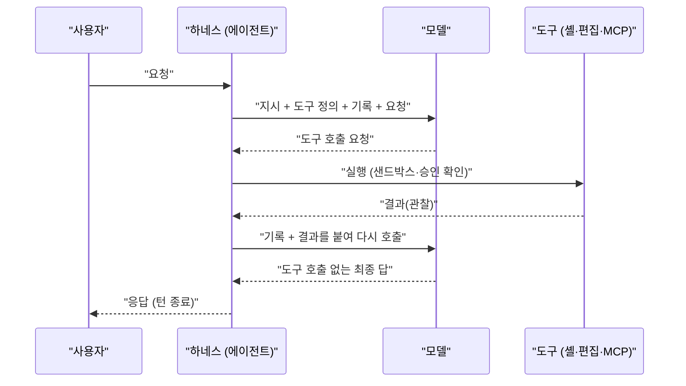

> Michael Bolin(OpenAI)의 「[Unrolling the Codex agent loop](https://openai.com/index/unrolling-the-codex-agent-loop/)」(2026.01)을 바탕으로, 샌드박스와 승인 정책은 [Codex 공식 문서](https://learn.chatgpt.com/codex/sandboxing)로 확인해 재구성한 노트다.

## 에이전트 루프란

**모델은 하나의 부품이고, 에이전트는 그 모델을 감싼 시스템이다.** 그 시스템의 심장이 **에이전트 루프(agent loop)** 다. 사용자 입력으로 프롬프트를 만들어 모델을 부르고, 모델이 도구 호출을 요청하면 도구를 실행해 결과를 프롬프트 뒤에 붙인 뒤 다시 모델을 부른다. 모델이 도구 호출 없이 답 메시지만 내면 한 **턴(turn)** 이 끝난다. 여러 턴이 모인 대화를 Codex는 스레드(thread)라 부른다.

Codex CLI, 클라우드, IDE 확장은 같은 루프(하네스)를 공유한다. Claude Code나 Cursor의 에이전트도 구조는 같다. 모델을 상자에 가두지 않고 도구를 쥐여 주는 설계 원칙은 [[claude-code-design-philosophy|Claude Code의 설계 원칙]]에 있다.

## 프롬프트를 쌓는 방식

API 호출은 기억이 없다. 그래서 하네스는 **매 회차 프롬프트 전체를 다시 보낸다.** Codex가 Responses API에 보내는 요청은 세 덩어리다.

| 필드 | 들어가는 것 |
| --- | --- |
| `instructions` | 기본 지시문. 설정 파일로 바꿀 수 있고, 없으면 모델별 기본 지시를 쓴다 |
| `tools` | 셸·계획 도구, 웹 검색, 사용자가 붙인 MCP 서버의 도구 정의 |
| `input` | 메시지와 항목의 목록. 사용자 메시지 앞에 샌드박스 권한 설명(developer 메시지), 사용자가 정한 추가 지시, `AGENTS.md` 묶음(기본 32KiB 상한)과 스킬 메타데이터, 작업 디렉터리·셸 같은 환경 정보가 먼저 들어간다 |

메시지에는 역할이 있고 우선순위는 system > developer > user > assistant 순이다. 프로젝트 규칙 파일(`AGENTS.md`, `CLAUDE.md`)이 매 요청 맥락에 실린다는 점이 중요하다. 길게 쓸수록 모든 회차의 비용과 주의력을 갉아먹는다([[claude-code-memory|Claude Code 메모리]]).

모델 응답은 SSE 스트림으로 온다. 텍스트 조각은 화면에 바로 흘리고, 추론 항목과 도구 호출 항목은 다음 요청의 `input` 뒤에 붙인다.

## 비용: 회차마다 길어지는 프롬프트

루프가 돌수록 프롬프트는 도구 결과만큼 길어진다. 매번 처음부터 계산하면 대화 전체의 비용은 회차 수의 제곱에 가깝게 늘어난다. 이를 선형에 가깝게 만드는 것이 **프롬프트 캐시**다.

### 앞부분을 바꾸지 않는다

캐시는 **프롬프트 앞부분(prefix)이 정확히 같을 때만** 맞는다. 원리(KV 캐시, 안정된 앞부분 설계)는 [[harness-engineering|프롬프트에서 하네스로]]의 컨텍스트 엔지니어링 절에 있다. 에이전트 루프에서 캐시를 깨는 흔한 원인은 다음과 같다.

| 캐시를 깨는 것 | 대응 |
| --- | --- |
| 대화 중간에 도구 목록이 바뀜(MCP 서버 연결·해제, `tools/list_changed` 알림) | 도구 정의를 세션 동안 고정한다. 도구 순서를 결정적으로 정렬한다(Codex 초기에 MCP 도구 순서가 매번 달라 캐시가 깨지는 버그가 있었다) |
| 모델 변경 | 세션 중간 모델 전환을 줄인다 |
| 샌드박스·승인 모드·작업 디렉터리 변경 | 앞쪽 메시지를 고치지 않고, **바뀐 내용을 새 메시지로 뒤에 덧붙인다** |

마지막 원칙이 핵심이다. 설정이 바뀌어도 과거 메시지를 다시 쓰지 않고 「이제부터 이렇다」를 끝에 추가한다. 앞부분이 그대로라 캐시가 산다.

### 상태를 서버에 맡기지 않는다

Responses API에는 이전 응답 ID(`previous_response_id`)를 넘겨 서버가 대화를 기억하게 하는 방법도 있다. Codex는 이를 쓰지 않고 매번 전체 기록을 보낸다. 요청이 무상태여야 데이터를 서버에 남기지 않는 무보존(Zero Data Retention) 고객도 같은 방식으로 쓸 수 있기 때문이다. 이전 추론 내용은 암호화된 항목(`encrypted_content`)으로 돌려받아 다음 요청에 그대로 싣는다.

## 맥락 창 관리: 압축

맥락 창(context window)은 입력과 출력 토큰을 합친 한도다. 긴 작업에서는 도구 결과가 쌓여 결국 한도에 닿는다. 한도 전에 성능도 먼저 떨어진다.

| 방식 | 동작 |
| --- | --- |
| 수동 압축 | `/compact`로 지금까지를 요약하게 해 그 요약으로 대화를 이어 간다 |
| 자동 압축 | 토큰이 정한 한도(Codex의 `auto_compact_limit`)를 넘으면 하네스가 알아서 압축한다 |
| API 압축 | Codex는 Responses API의 압축 엔드포인트(`/responses/compact`)를 쓴다. 돌려받은 항목 목록에는 원래 대화를 대신하는 암호화된 압축 항목이 들어 있어 다음 요청의 `input`으로 쓴다 |

압축은 손실 요약이다. 무엇을 남길지 지시하는 수동 압축, 새 세션으로 옮기기, 서브에이전트로 탐색 결과를 격리하기 중 무엇을 고를지는 [[claude-code-tips|Claude Code 실전 팁]]의 맥락 관리 절에 있다.

## 샌드박스와 승인

도구 호출은 모델이 정하지만 **실행할지는 하네스가 정한다.** 두 장치가 이를 맡는다.

| 장치 | 역할 | Codex 예 |
| --- | --- | --- |
| **샌드박스** | 명령이 닿을 수 있는 파일·네트워크 범위를 운영체제 수준에서 제한한다 | 모드: `read-only`(읽기만), `workspace-write`(작업 폴더 안 편집과 일상 명령), `danger-full-access`(제한 없음). macOS는 Seatbelt, Linux는 bubblewrap으로 격리한다 |
| **승인 정책** | 샌드박스 경계를 넘는 행동 앞에서 멈추고 묻는다 | `on-request`(경계를 넘을 때 묻는다), `never`(묻지 않는다). 승인 요청을 사람 대신 검토 에이전트에 보내는 설정도 있다 |

샌드박스 권한은 developer 메시지로 모델에게도 알려 준다. 모델이 할 수 없는 일을 미리 알아야 헛된 시도를 줄인다. 다만 이 샌드박스는 **하네스의 내장 셸 도구에만** 적용된다. MCP 서버의 도구는 각 서버가 자기 안전장치를 갖춰야 한다. Claude Code의 권한 모드와 샌드박스 설정은 [[claude-code-settings|Claude Code 설정과 권한 규칙]]에 있다.

## 정리

- 에이전트 루프는 모델 호출 → 도구 호출 → 관찰을 모델이 도구 없이 답할 때까지 반복한다. 모델은 부품이고 에이전트는 시스템이다.
- 매 회차 지시·도구 정의·규칙 파일·기록 전체를 다시 보낸다. 그래서 규칙 파일과 도구 수가 곧 매 회차의 비용이다.
- 캐시는 앞부분이 정확히 같을 때만 맞는다. 도구 목록을 고정하고, 바뀐 설정은 앞을 고치지 않고 뒤에 덧붙인다.
- 맥락이 차면 압축하되 손실 요약임을 기억한다.
- 실행 여부는 샌드박스(어디까지 닿나)와 승인 정책(언제 묻나)이 정한다. 외부 도구는 자기 안전장치가 따로 필요하다.

에이전트를 잘 쓰는 요령 대부분은 이 루프의 비용 구조와 경계를 이해하는 데서 나온다.

관련 노트: [[agentic-engineering|바이브 코딩에서 에이전틱 엔지니어링으로]], [[how-llm-works|LLM은 무엇을 하고 왜 작동하나]], [[claude-code-design-philosophy|Claude Code의 설계 원칙]], [[harness-engineering|프롬프트에서 하네스로]], [[claude-code-tips|Claude Code 실전 팁]], [[model-context-protocol|MCP의 구조와 CLI와의 선택 기준]], [[llm-serving-at-scale|LLM 서빙의 병목]]
