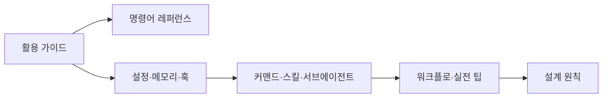

Claude Code는 Anthropic이 만든 **에이전틱 코딩 도구**다. 터미널·IDE·데스크톱 앱에서 코드베이스를 직접 읽고, 파일을 고치고, 명령을 실행하며 일을 끝까지 진행한다. 채팅으로 코드 조각을 주고받는 것과 달리 도구를 스스로 골라 쓰므로, 무엇을 맡기고 어디까지 허용하며 어떤 맥락을 남길지 정하는 일이 사용법의 대부분이다. 이 주제의 노트는 그 결정을 단위별로 나눠 정리한다.

## 하위 노트

- [Claude Code 활용 가이드](AI-Data/Claude-Code/claude-code-guide.md): 설치, 익숙해지는 순서(질문 → 편집 → 도구 → 맥락), 슬래시 명령·단축키, MCP, Skills·CLAUDE.md, 팀 설정 공유, `claude -p` 자동화, Claude Code에 맞는 프롬프트 습관, 개발 팀장처럼 위임하기
- [Claude Code 명령어·플래그 레퍼런스](AI-Data/Claude-Code/claude-code-commands.md): 내장 슬래시 명령·번들 스킬·시작 플래그·하위 명령, /powerup, 기능 지도
- [Claude Code 설정과 권한 규칙](AI-Data/Claude-Code/claude-code-settings.md): settings.json 계층과 병합, 저장소가 권한을 올리지 못하게 하는 예외, allow·ask·deny 문법, 모드별 세부, 주요 키·환경변수, 샌드박스·상태줄
- [Claude Code 메모리: CLAUDE.md·rules·자동 메모리](AI-Data/Claude-Code/claude-code-memory.md): 네 가지 기억 장치 비교, 모노레포 CLAUDE.md 로딩 규칙, paths 규칙, 에이전트 메모리 범위, CLAUDE.md 운영법
- [Claude Code 훅: 도구 호출 앞뒤에 규칙 걸기](AI-Data/Claude-Code/claude-code-hooks.md): 이벤트 종류, 설정 위치와 matcher, stdin JSON과 종료 코드 2, .env 차단 예제, 타입 검사·쿼리 중복 방지·Stop 루프·권한 위임·온디맨드 훅, 보안 주의점
- [커맨드·스킬·서브에이전트 고르기](AI-Data/Claude-Code/claude-code-extensions.md): 세 확장 단위 비교와 선택 기준, 서브에이전트 필드·내장 에이전트, 상관없는 맥락 창, 커맨드 → 에이전트 → 스킬 패턴
- [Claude 스킬 만들기 가이드](AI-Data/Claude-Code/claude-skill-building-guide.md): 프로그레시브 디스클로저, description 작성, 테스트·배포, 팀 공용 스킬 패키지화, 실전 패턴 5가지
- [Claude Code 개발 워크플로: RPI에서 CRISPY·교차 모델·에이전트 팀까지](AI-Data/Claude-Code/claude-code-workflows.md): 지시 예산과 dumb zone, RPI·CRISPY, grill-me → PRD → 수직 슬라이스 → AFK 루프, 교차 모델, 에이전트 팀, /goal·/loop, 공개 워크플로 12종
- [Claude Code 실전 팁: 만든 사람들의 사용법](AI-Data/Claude-Code/claude-code-tips.md): 계획·검증·병렬, 맥락 관리 수치와 compact·clear·rewind 선택, 훅·권한, 프롬프트 습관, 원격, 루프, PR 운영
- [Claude Code의 설계 원칙: 모델을 상자에 가두지 않는다](AI-Data/Claude-Code/claude-code-design-philosophy.md): 6개월 뒤 모델, bitter lesson, 최소 도구, 에이전틱 검색, 잠재 수요·걷어 내기, 팀과 역할의 변화

## 읽는 순서

처음이면 활용 가이드로 전체 그림을 잡고, 필요한 명령은 레퍼런스에서 찾는다. 팀에서 같이 쓰기 시작하면 설정·메모리·훅으로 규칙을 고정하고, 반복 작업이 생기면 스킬과 서브에이전트로 묶는다. 워크플로와 팁은 큰 작업을 나눠 맡기는 방법이고, 설계 원칙은 도구가 왜 이렇게 생겼는지 설명한다.

Claude API에서 도구를 다루는 방식(Programmatic Tool Calling, Tool Search)은 [[claude-advanced-tool-use|Claude API 고급 도구 사용]]에 있다. 에이전트가 스스로 도는 구조는 [[loop-engineering|루프 엔지니어링]]과 [[harness-engineering|프롬프트에서 하네스로]], 실무에서 지킬 선은 [[ai-coding-guardrails|AI 코딩 실무 가드레일]]을 함께 본다.
