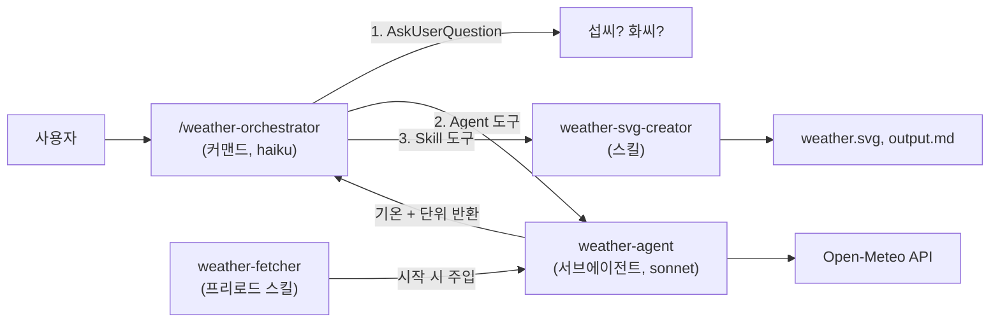

> shanraisshan의 「[claude-code-best-practice](https://github.com/shanraisshan/claude-code-best-practice)」(MIT) 중 에이전트·커맨드·스킬 비교 리포트, 서브에이전트·커맨드 문서(2026-11, v2.1.325 기준), 오케스트레이션 워크플로 예제를 바탕으로, Claude Code 제작자들의 인터뷰(Every 2025.10, Pragmatic Engineer 2026.03)와 Thariq의 세션 관리 글(2026.04)을 더해 재구성한 노트다.

## 세 가지 확장 단위

| 항목 | 서브에이전트 | 커맨드 | 스킬 |
| --- | --- | --- | --- |
| 위치 | `.claude/agents/<이름>.md` | `.claude/commands/<이름>.md` | `.claude/skills/<이름>/SKILL.md` |
| 실행 맥락 | **별도 맥락 창**(항상 분리) | 메인 대화에 인라인 | 메인 대화에 인라인(`context: fork`면 분리) |
| 부르는 법 | Claude가 Agent 도구로, 또는 `--agent` | 사용자가 `/이름` | 사용자가 `/이름`, 또는 Claude가 description을 보고 스스로 |
| 인자 | Agent 도구의 `prompt` | `$ARGUMENTS`, `$0`, `$1` | `$ARGUMENTS`, `$0`, `$1` |
| 셸 출력 주입 `` !`명령` `` | 없음 | 있음 | 있음 |
| 도구 제한 | `tools`, `disallowedTools` | `allowed-tools` | `allowed-tools`, `disallowed-tools` |
| 고유 기능 | `memory`, `skills` 프리로드, `mcpServers`, `isolation`, `permissionMode` | - | `paths`로 조건부 활성, 폴더 단위 자료 |

커맨드와 스킬은 이제 거의 같은 프론트매터(`description`, `model`, `allowed-tools`, `disable-model-invocation`, `user-invocable`, `hooks`)를 받는다. 커스텀 커맨드는 스킬로 합쳐지는 흐름이고, 폴더에 자료를 둘 수 있는 스킬이 상위 호환이다. 「커맨드는 자동 호출이 안 되고 훅도 없다」는 오래된 설명은 2026-11 기준으로 맞지 않는다.

## 언제 무엇을

| 쓸 것 | 어울리는 상황 |
| --- | --- |
| **서브에이전트** | 여러 단계를 자율로 하는 일, 메인 대화를 탐색 잡음으로 오염시키면 안 될 때, 세션을 넘는 기억이 필요할 때, 도구 제한이나 다른 권한 모드(`plan`, `acceptEdits`)가 필요할 때, 백그라운드·worktree에서 돌릴 때 |
| **커맨드** | 사용자가 명시적으로 시작하는 진입점, 다른 에이전트·스킬을 묶는 바깥 틀, 하루에 여러 번 하는 inner loop 작업(`/commit-push-pr`) |
| **스킬** | Claude가 의도에 맞춰 스스로 부르게 하고 싶을 때, 커맨드·에이전트·Claude가 함께 재사용하는 절차, 특정 에이전트에 지식을 굽는 프리로드 |

경험칙:

- **하루에 한 번 이상 하는 일**은 스킬이나 커맨드로 만든다. 한두 단어로 되는 지시(「simplify it」)는 굳이 만들 필요가 없고, 두세 줄을 매번 써야 하는 지시가 대상이다.
- 범용 `qa`·`backend` 에이전트보다 **기능 특화 서브에이전트 + 스킬**이 낫다. 워크플로는 서브에이전트보다 커맨드로 짠다.
- 같은 코드 리뷰라도 CI에서는 커맨드로, 작업 중에는 서브에이전트로 돌린다. 작업 중 리뷰 내용은 다음 할 일과 무관하므로 맥락을 갈라 두는 게 낫다.

### 셋 다 있으면 무엇이 뜨나

같은 일을 하는 커맨드·에이전트·스킬을 모두 두고 「지금 몇 시야?」라고 물으면:

1. **스킬**이 가장 먼저 뜬다. 인라인이라 오버헤드가 없다.
2. 스킬이 없거나 `disable-model-invocation: true`면 **에이전트**가 뜬다. 별도 맥락이라 무겁다.
3. **커맨드**는 사용자가 `/`로 부를 때만 돈다.

둘 다 막으면 Claude가 직접 `TZ='Asia/Karachi' date` 같은 명령을 실행한다.

## 서브에이전트

### 판단 기준: 도구 출력이 다시 필요한가

서브에이전트는 무엇보다 **맥락 관리 수단**이다. 「이 도구 출력이 나중에 다시 필요한가, 결론만 필요한가?」를 묻는다. 결론만 필요하면 맡긴다. 파일 읽기 20번, grep 12번, 막다른 길 3개는 자식 맥락에 남고 보고서만 돌아온다.

- 스펙 파일을 기준으로 결과를 검증하기, 다른 코드베이스의 인증 흐름을 요약해 오기, git 변경으로 문서 쓰기가 전형적인 예다.
- 더 많은 계산을 쓰고 싶은 요청 끝에 「use subagents」를 붙인다. 어려운 조사는 「서브에이전트 3개(5개, 10개)로 병렬 조사」처럼 난이도에 맞춰 개수를 프롬프트로 정한다. 매번 다르므로 CLAUDE.md에 넣지 않는다.

### 진짜 가치는 상관없는 맥락 창

프론트엔드 개발자·백엔드 개발자·PM 같은 역할극 에이전트는 의인화가 지나치다. 가치는 역할이 아니라 **서로를 모르는 맥락 창(uncorrelated context windows)** 에서 나온다.

- 스킬·커맨드는 부모 맥락을 보지만(상관), 서브에이전트는 프롬프트만 받는다(비상관).
- 서로 오염되지 않은 맥락 창 여럿에 토큰을 더 쓰는 것은 일종의 **테스트 타임 컴퓨트**다. 같은 모델이라도 한 에이전트가 만든 버그를 다른 에이전트가 찾는다.
- 코드 리뷰 예: 서브에이전트 여럿이 병렬로 이슈를 찾고(CLAUDE.md 준수, git 기록, 명백한 버그), 서브에이전트 5개를 더 띄워 **오탐만 검증**하고 중복을 거른다.
- 대립 처리(opponent processor): 나를 대변하는 에이전트와 감사 쪽 에이전트가 다투게 해 결론을 낸다.
- 대규모 마이그레이션: 메인 에이전트가 큰 할 일 목록을 만들고 서브에이전트들에게 **맵리듀스**로 뿌린다. 자동 수정기가 없는 린트 규칙 도입, 테스트 프레임워크 교체처럼 결과 검증이 쉬운 일에 맞는다.

### 프론트매터 필드

| 필드 | 하는 일 |
| --- | --- |
| `name`, `description` | 필수. 소문자·하이픈 이름, 언제 부를지. description에 `PROACTIVELY`를 넣으면 자동 호출을 유도한다 |
| `tools`, `disallowedTools` | 허용 목록(생략하면 전부 상속)과 제외 목록. `Agent(agent_type)`로 띄울 수 있는 하위 에이전트를 제한한다 |
| `model` | `sonnet`, `opus`, `haiku`, 전체 모델 ID, `inherit`(기본) |
| `permissionMode` | `default`, `acceptEdits`, `auto`, `dontAsk`, `bypassPermissions`, `plan` |
| `maxTurns` | 최대 턴 수 |
| `skills` | 시작할 때 **본문 전체를 주입**할 스킬 |
| `mcpServers` | 서버 이름 또는 인라인 설정. 서브에이전트 범위가 프로젝트·사용자보다 우선 |
| `hooks` | 주로 `PreToolUse`, `PostToolUse`, `Stop` |
| `memory` | `user`, `project`, `local`. 자세한 것은 [[claude-code-memory\|Claude Code 메모리]] |
| `background` | `true`면 항상 백그라운드 |
| `effort` | 추론 강도 |
| `isolation` | `"worktree"`면 임시 git worktree에서 돌고, 변경이 없으면 자동 정리 |
| `initialPrompt` | `--agent`로 메인 세션 에이전트가 될 때 첫 사용자 턴으로 자동 제출 |
| `color` | `red`, `blue`, `green`, `yellow`, `purple`, `orange`, `pink`, `cyan` |

`claude --agent=<이름>`이나 설정의 `"agent"`로 커스텀 에이전트를 메인 세션으로 띄우면, 시스템 프롬프트와 도구 세트가 다른 읽기 전용 에이전트·리뷰 전용 에이전트를 만들 수 있다.

### 내장 에이전트

| 에이전트 | 모델 | 도구 | 용도 |
| --- | --- | --- | --- |
| `general-purpose` | inherit | 전부 | 기본. 복잡한 다단계 작업 |
| `Explore` | haiku | 읽기 전용 | 빠른 코드베이스 탐색 |
| `Plan` | inherit | 읽기 전용 | 계획 모드의 사전 조사·설계 |
| `statusline-setup` | sonnet | Read, Edit | 상태줄 설정 |
| `claude-code-guide` | haiku | Glob, Grep, Read, WebFetch, WebSearch | Claude Code·Agent SDK·API 질문 |

자주 쓰는 커스텀 예로는 작업 뒤 코드를 단순화하는 `code-simplifier`, E2E 검증 절차를 담은 `verify-app`이 있다.

## 커맨드 → 에이전트 → 스킬 오케스트레이션

세 단위를 한 흐름으로 엮는 패턴이다. **커맨드는 진입점과 조율, 에이전트는 데이터 가져오기, 스킬은 결과물 만들기**를 맡고, 컴포넌트마다 책임은 하나다.

| 구분 | 프리로드 스킬(agent skill) | 직접 호출 스킬 |
| --- | --- | --- |
| 선언 | 에이전트 프론트매터 `skills: [weather-fetcher]` | 스킬 자체의 `name`, `description` |
| 로드 시점 | 에이전트가 시작할 때 본문 전체 주입 | `Skill(skill: "weather-svg-creator")`로 부를 때 |
| 실행 위치 | 에이전트 맥락 안 | 커맨드(메인 대화) 맥락 |
| 성격 | 참고 지식. 보통 `user-invocable: false` | 독립 실행. 대화에 이미 있는 데이터를 쓴다 |

이 구조에서 웹 조회의 잡음은 에이전트 맥락에만 남고 메인 대화에는 「26°C」 같은 결과만 돌아온다. 같은 패턴을 에이전트 팀으로 병렬 구축하는 예는 [[claude-code-workflows|Claude Code 개발 워크플로]]에 있다.

## 정리

- 서브에이전트는 맥락 격리, 커맨드는 사용자 진입점, 스킬은 자동 발견되는 재사용 절차다. 커맨드는 점점 스킬로 합쳐진다.
- 서브에이전트를 쓸지는 「도구 출력이 다시 필요한가」로 판단한다. 가치는 역할극이 아니라 상관없는 맥락 창에 있다.
- 에이전트에는 `skills:`로 정적 지식을, `memory:`로 쌓이는 지식을 준다.
- 커맨드 → 에이전트 → 스킬로 나누면 가져오기와 그리기가 분리되고 메인 맥락이 깨끗하게 유지된다.

관련 노트: [[claude-skill-building-guide|Claude 스킬 만들기 가이드]], [[claude-code-memory|Claude Code 메모리]], [[multi-agent|멀티 에이전트]], [[personal-agent-harness|내 일을 줄이는 하네스 만들기]], [[claude-code-workflows|Claude Code 개발 워크플로]]
