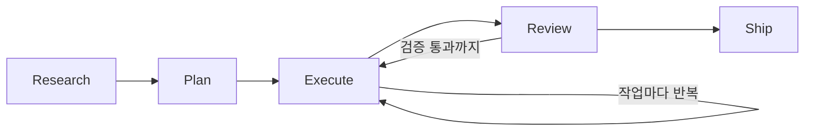
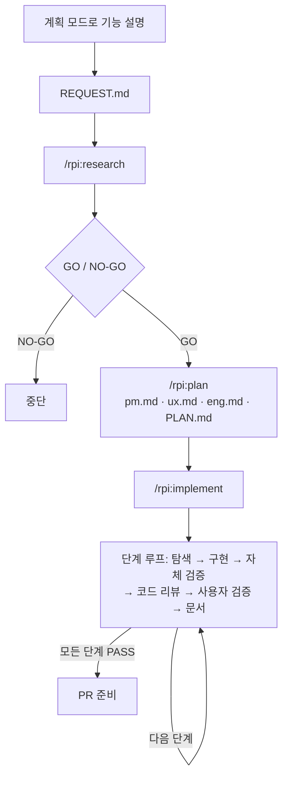
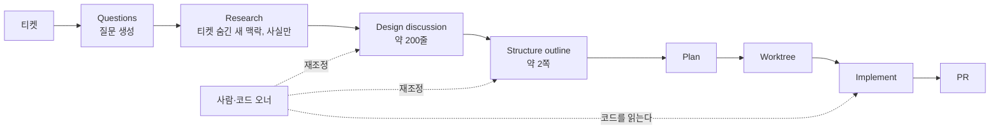
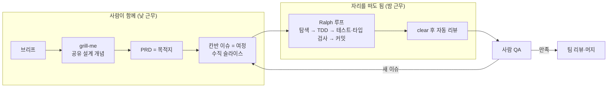
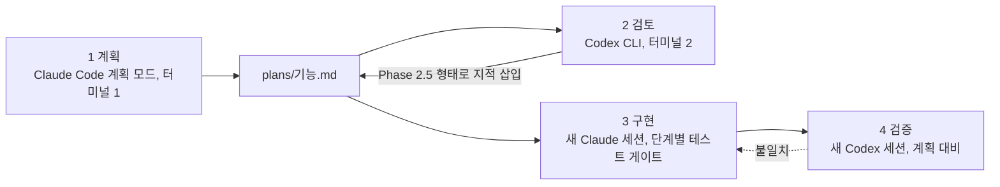

> shanraisshan의 「[claude-code-best-practice](https://github.com/shanraisshan/claude-code-best-practice)」(MIT)의 RPI·교차 모델·에이전트 팀 문서와 README 워크플로 비교표, 그리고 거기 실린 Dex Horthy의 「Everything We Got Wrong About Research-Plan-Implement」(MLOps Community, 2026.03)와 Matt Pocock의 「Full Walkthrough: Workflow for AI Coding」(2026.04) 강연 녹취를 바탕으로 재구성한 노트다. 모델 이름은 각 문서 시점(2026.03) 기준이다.

## 워크플로가 필요한 이유

공개된 워크플로는 이름이 달라도 거의 모두 **Research → Plan → Execute → Review → Ship** 골격으로 수렴하고, 구현과 검증을 작업마다 반복하는 하위 루프로 둔다. 차이는 「맨 앞에서 사람과 얼마나 정렬하느냐」와 「어떤 문서를 누가 읽느냐」에 있다.



두 가지 제약이 모든 설계를 끌고 간다.

| 제약 | 내용 | 귀결 |
| --- | --- | --- |
| **지시 예산(instruction budget)** | 프런티어 모델이 일관되게 따르는 지시는 약 150~200개다. 85개짜리 계획 프롬프트에 CLAUDE.md·시스템 프롬프트·도구·MCP가 더해지면 워크플로 준수를 기대할 수 없다 | 큰 프롬프트 하나 대신 지시가 적은 작은 프롬프트 여럿으로 쪼갠다. **if 문으로 할 수 있으면 프롬프트로 제어 흐름을 짜지 않는다** |
| **dumb zone** | 맥락이 약 40%를 넘으면 결과가 나빠진다(1M 창이든 200k든 대략 100k 토큰 부근). 입문자는 40% 아래, 60%면 마무리를 고려하고, 숙련자는 복잡한 일을 30% 아래로 유지한다 | 단계마다 새 맥락에서 시작하고, 상태는 문서로 남긴다. 압축은 퇴적물을 쌓으므로 clear를 선호한다 |

맥락이 나빠지는 원리와 KV 캐시 관점은 [[harness-engineering|하네스 엔지니어링]]에 있다.

## RPI: 단계마다 게이트

RPI(Research → Plan → Implement)는 가망 없는 기능에 힘을 쓰지 않도록 단계마다 검증 게이트를 두는 워크플로다.



| 단계 | 명령 | 산출물 | 게이트 |
| --- | --- | --- | --- |
| 설명 | 계획 모드 | `rpi/{feature}/REQUEST.md` | - |
| 조사 | `/rpi:research` | `research/RESEARCH.md` | **GO / NO-GO** |
| 계획 | `/rpi:plan` | `plan/pm.md`(사용자 스토리·인수 조건), `ux.md`(UI 흐름), `eng.md`(기술 설계), `PLAN.md`(로드맵) | 계획 승인 |
| 구현 | `/rpi:implement` | `implement/IMPLEMENT.md` | **단계별 검증** |

준비물은 프로젝트 루트의 `constitution.md`와 `.claude/settings.json`의 `"plansDirectory": "./rpi/plans"`다. 조사·계획·구현 단계마다 product-manager, ux-designer, senior-software-engineer, code-reviewer 같은 서브에이전트가 나눠 맡는다. 진행 상태는 `[ ]` 시작 전, `[~]` 진행 중, `[x]` 통과, `[!]` 조건부, `[-]` 실패로 표시한다.

## CRISPY: RPI를 쪼갠 이유

RPI 프롬프트를 많은 팀에 나눠 줘 보니 전문가는 잘 쓰는데 팀 결과는 나빴다. 원인과 고친 방식은 이렇다.

| 문제 | 원인 | 고친 방식 |
| --- | --- | --- |
| 조사가 나쁘다 | 「이걸 만들 거야, 조사해」라고 하면 모델이 **의견**을 섞는다 | 질문을 만드는 맥락과 조사하는 맥락을 분리하고, 조사 창에서는 티켓(무엇을 만드는지)을 숨긴다. 조사는 사실만 담는다 |
| 계획이 나쁘다 | 85개 넘는 지시를 담은 단일 계획 프롬프트. 절반 넘는 사용자에게서 설계 질문 단계를 건너뛰었다 | 단계를 쪼개 프롬프트당 지시를 40개 미만으로. 도구가 사용자 훈련을 요구하면 도구를 고친다 |
| 긴 계획 읽기 | 1,000줄 계획은 코드 1,000줄과 비슷하고, 구현이 계획과 달라져 코드를 또 읽어야 한다 | **계획은 훑고 코드를 읽는다** |
| 코드를 안 읽기 | 계획만 보고 넘겼더니 몇 달 뒤 시스템 큰 부분을 다시 짜야 했다 | 사용자가 의존하는 코드는 반드시 읽는다. 10배보다 **2~3배 속도**로 사람 수준 품질을 지킨다 |



- **Design discussion**(약 200줄): 현재 상태, 원하는 최종 상태, 따를 패턴, 확정된 결정, 열린 질문. 잘못 고른 코드 패턴을 여기서 바로잡는다(「그건 옛 방식이야, 저쪽을 따라」).
- **Structure outline**(약 2쪽, 계획은 약 8쪽): 단계 개요, 변경 순서, 단계별 테스트 방법. 계획이 구현이라면 outline은 시그니처와 새 타입만 담은 **C 헤더 파일**이다.
- **수직 계획**: 모델은 DB 전부 → 서비스 전부 → API 전부 → 프런트 전부로 짜려 해서 1,200줄 뒤에야 무엇이 깨졌는지 안다. outline에서 목(mock) API → 프런트 연결 → 서비스 → 마이그레이션처럼 체크포인트를 둔 수직 순서로 고친다.
- design discussion과 outline은 코드 오너에게 먼저 보낸다. 2일짜리 기능에서 코딩만 20분으로 줄면 여전히 2일이다. 정렬·리뷰 단계도 줄여야 한다.

## grill-me → PRD → 칸반 → AFK 루프

사람과 일할 때 통하던 소프트웨어 공학 기본기가 에이전트에도 그대로 통한다는 관점의 흐름이다. 작업은 **사람이 앉아 있어야 하는 일(HITL: 정렬·계획)** 과 **자리를 떠도 되는 일(AFK: 구현)** 로 나눈다. 낮 근무는 사람이 계획하고, 밤 근무는 AI가 구현한다.



| 단계 | 핵심 |
| --- | --- |
| **grill-me** | 아주 짧은 스킬. 공유된 이해에 이를 때까지 설계 트리를 한 가지씩 내려가며 한 번에 하나씩 묻고, 질문마다 추천 답을 낸다. 40~100개 질문까지 간다. 목표는 문서가 아니라 공유된 **설계 개념(design concept)** 이다 |
| **PRD(목적지 문서)** | 문제, 해결책, 사용자 스토리, 구현·테스트 결정, **범위 밖** 섹션. 쓰기 전에 고칠 모듈 목록을 받는다. 이미 공유 개념이 있으니 사람은 PRD를 다시 읽지 않는다 |
| **이슈 칸반(여정 문서)** | 독립적으로 집을 수 있는 이슈, 차단 관계, AFK·HITL 표시. 순차 계획은 에이전트 하나만 집지만 칸반은 DAG라 병렬이 된다 |
| **수직 슬라이스(tracer bullet)** | AI는 층별(수평)로 쪼갠다. 첫 조각은 스키마 변경 + 서비스 + 프런트 최소 표현을 모두 관통해야 한다. 「게이미피케이션 서비스 단독」은 반려, 「레슨을 끝내면 포인트가 대시보드에 보인다」가 좋은 조각이다 |
| **AFK 루프** | 이슈 본문 + 최근 커밋 5개 + 프롬프트를 `claude --permission-mode acceptEdits`에 넣는 스크립트를 반복한다. AFK판은 Docker 샌드박스에서 돌린다. 우선순위: 치명 버그 → 개발 인프라 → tracer bullet → 다듬기 → 리팩터. 다 끝나면 「no more tasks」를 출력하게 한다 |
| **리뷰와 QA** | 리뷰는 맥락을 비운 뒤(smart zone에서) 한다. 구현 맥락에서 리뷰하면 dumb zone 리뷰어가 된다. 구현은 Sonnet, 리뷰는 Opus. QA는 사람이 **취향을 코드베이스에 다시 새기는** 단계이고, 결과는 칸반의 새 이슈가 된다 |

보조 개념:

- **TDD**: 실패 테스트 하나 → 통과를 반복한다. 층별로 구현하고 테스트를 몰아 쓰면 테스트를 속인다. 피드백 루프의 질이 AI 코딩 품질의 천장이다.
- **깊은 모듈**: 작은 파일이 얽힌 얕은 모듈은 에이전트가 탐색하기 어렵고 테스트 경계가 모호하다. 작은 인터페이스 뒤에 기능이 많은 깊은 모듈을 큰 테스트 경계로 감싸고, **인터페이스는 사람이, 구현은 에이전트가** 맡는다.
- **push와 pull**: CLAUDE.md처럼 늘 보내는 지시가 push, 스킬처럼 필요할 때 당겨 쓰는 것이 pull이다. 구현자에게는 코딩 표준을 pull로, 리뷰어에게는 push로 준다.
- **문서 부패**: 끝난 PRD를 저장소에 두면 낡은 내용이 에이전트를 오도한다. 이슈를 닫아 둔다.
- 프런트엔드는 AI의 눈이 약하다. 버리는 라우트에 시안 3개를 만들게 하고 고른 것을 grill 세션에 다시 넣는다.

### 두 흐름의 공통점과 차이

| | CRISPY | grill-me 흐름 |
| --- | --- | --- |
| 공통 | 수평 계획 대신 수직 슬라이스, 긴 계획 리뷰 대신 짧은 정렬 + 코드 리뷰, 압축 대신 clear와 파일 상태, dumb zone 40% 경험칙 | |
| 사람이 읽는 문서 | design discussion과 outline을 팀이 읽는다 | PRD도 읽지 않는다. grill 대화 자체가 자산이다 |
| 끝난 문서 | 재개 지점으로 남긴다 | 지운다(문서 부패 방지) |

## 교차 모델 워크플로

같은 모델은 같은 맹점을 공유하므로 **다른 계열 모델에게 검토·검증을 맡긴다**. 터미널 두 개를 쓴다.



검토 모델은 원래 단계를 고쳐 쓰지 않고 「Codex Finding」 같은 중간 단계를 **끼워 넣기만** 한다. 그래야 누가 무엇을 바꿨는지 남는다. 다른 모델을 붙이는 방법은 셋이다.

| 방식 | 예 | 하는 일 |
| --- | --- | --- |
| 플러그인 | openai/codex-plugin-cc | Claude Code 안에서 `/codex:review`, `/codex:adversarial-review` |
| MCP | pal-mcp-server | 다른 모델을 도구로 호출 |
| 라우터 | claude-code-router, CLIProxyAPI | Claude Code의 API 엔드포인트를 다른 공급자로 바꿔 작업별로 모델을 고른다 |

모델을 역할로 나누는 원칙은 [[ai-delegation-toolkit|AI에게 일 맡기기]]에도 있다.

## 에이전트 팀

에이전트 팀(베타)은 **독립된 Claude Code 세션 여럿이 공유 작업 목록(shared task list)으로 조율**하는 구조다. 한 세션 안에서 맥락만 포크하는 서브에이전트와 달리, 팀원마다 CLAUDE.md·MCP·스킬이 로드된 온전한 세션이다.

```bash
tmux new -s dev
CLAUDE_CODE_EXPERIMENTAL_AGENT_TEAMS=1 claude
```

팀 프롬프트는 네 부분으로 짠다.

| 부분 | 예 |
| --- | --- |
| 목표 | 「두바이 현재 시각을 SVG 카드로 보여 주는 워크플로를 커맨드 → 에이전트 → 스킬 패턴으로 만든다」 |
| 제약 | 모든 파일은 `agent-teams/.claude/` 안에. 기존 예제를 복사하지 않는다 |
| 역할 | Command Architect(커맨드), Agent Engineer(에이전트 + 프리로드 스킬), Skill Designer(출력 스킬 + 템플릿·예시) |
| 조율 | **데이터 계약** `{time, timezone, formatted}`만 합의하고 셋을 동시에 시작한다 |

구현이 서로 독립이고 인터페이스만 맞으면 되기 때문에 병렬로 돈다. 공유 작업 목록에는 「계약 합의」, 「커맨드는 bash가 아니라 Agent 도구를 쓴다」, 「스킬은 받은 값을 다시 조회하지 않는다」 같은 확인 항목을 둔다. 실제로 Claude Code의 플러그인 기능은 스펙 → 티켓 약 100개 → 수백 개 에이전트가 집어 구현하는 방식으로 주말 동안 만들어졌다. 사람용 협업 도구(이슈 보드)가 모델용 협업 도구도 된다. 커맨드 → 에이전트 → 스킬 패턴 자체는 [[claude-code-extensions|커맨드·스킬·서브에이전트 고르기]]에 있다.

## 끝날 때까지 돌리기: /goal, /loop, /schedule

| 장치 | 기준 | 동작 |
| --- | --- | --- |
| `/goal <조건>` | **조건** | 조건이 충족될 때까지 턴을 넘어 계속 일한다. 충족 여부는 별도의 작은 모델(Haiku)이 매 턴 판정한다. `/goal clear`로 해제 |
| `/loop <간격> <프롬프트>` | **시간**(세션 안) | `/loop 5m /simplify`처럼 주기 실행. 최소 단위 1분, 반복 작업은 며칠 뒤 자동 만료, Claude를 끄면 멈춘다. 간격을 생략하면 모델이 스스로 속도를 정한다 |
| `/schedule` | **시간**(클라우드) | 기기가 꺼져도 도는 예약 작업(routines) |
| Stop 훅 | **결정적 검사** | 턴이 끝날 때 「테스트가 통과하지 않으면 계속하라」를 돌려준다([[claude-code-hooks\|Claude Code 훅]]) |
| 자동 모드 | 도구 호출 단위 권한 | 끊김 없이 돌게 할 뿐 목표를 정하지는 않는다 |

`/goal` 프롬프트는 직접 쓰기보다 「지금까지를 바탕으로 오래 돌릴 /goal 후보 셋을 제안해」나 「이 세션과 저장소를 분석해 정확한 의도로 /goal 프롬프트를 써 줘, 모호하면 질문해」로 초안을 받는 편이 낫다. 실제 루프 예는 [[claude-code-tips|Claude Code 실전 팁]]에 있다. cron + `claude -p`로 직접 파이프라인을 짜는 방식은 [[personal-agent-harness|내 일을 줄이는 하네스 만들기]]에 있다.

## 공개 워크플로 비교

README 표(2026-11)의 단계명이다. 별표(\*)는 작업마다 반복하는 하위 루프다.

| 워크플로 | 단계 |
| --- | --- |
| Matt Pocock Skills | grill-me → to-spec → to-tickets → implement → tdd\* → code-review\* → pr |
| Superpowers | brainstorming → using-git-worktrees → writing-plans → subagent-driven-development → test-driven-development\* → requesting-code-review\* → finishing-a-development-branch |
| Everything Claude Code | plan → tdd-workflow\* → implement → code-review → security-scan\* → build-fix\* → save-session |
| Spec Kit | constitution → specify → plan → tasks → implement\* → converge\* |
| gstack | office-hours → autoplan → plan-ceo/eng/design/devex-review\* → review → qa → ship → land-and-deploy → retro |
| agent-skills (Addy Osmani) | spec → plan → build → test → review → ship |
| OpenSpec | explore → propose → apply-change\* → verify-change\* → archive-change |
| Get Shit Done | new-project → new-milestone → spec-phase → plan-phase → execute-phase\* → verify-work\* → complete-milestone → ship |
| BMAD-METHOD | forge-idea → prd → spec → architecture → build → code-review\* → review |
| oh-my-claudecode | deep-interview → plan → team → team-plan\* → team-prd\* → team-exec\* → team-verify\* → team-fix\* → release |
| Compound Engineering (Every) | brainstorm → plan → work\* → simplify-code\* → code-review\* → compound |
| HumanLayer | research → design-discussion → codebase-design → subagent-orchestrator\* → test-it-locally\* → bump-version |

거의 모두 **맨 앞에 정렬 단계**(grill-me, brainstorming, office-hours, deep-interview, forge-idea, explore)를 두고 구현·검증을 하위 루프로 돌린다. 정답이 정해지지 않은 시기에는 프레임워크를 그대로 들이기보다 **계획 스택을 직접 소유**하는 편이 낫다.

## 정리

- 지시 예산(약 150~200개)과 dumb zone(약 40%) 때문에 큰 프롬프트 하나보다 지시가 적은 단계 여럿, 압축보다 clear와 문서 상태가 낫다.
- 조사는 사실만, 계획은 수직 슬라이스로. 긴 계획 문서를 리뷰하기보다 짧은 정렬 문서와 **코드**를 읽는다.
- 사람은 정렬·QA(HITL)에 앉아 있고, 구현(AFK)은 루프와 샌드박스에 맡긴다. 리뷰는 맥락을 비운 뒤, 가능하면 다른 모델로 한다.
- 병렬은 서브에이전트(한 세션 안)와 에이전트 팀(독립 세션 + 공유 작업 목록)으로 나뉘고, 팀은 데이터 계약만 먼저 합의한다.

관련 노트: [[harness-engineering|프롬프트에서 하네스로]], [[loop-engineering|루프 엔지니어링]], [[personal-agent-harness|내 일을 줄이는 하네스 만들기]], [[multi-agent|멀티 에이전트]], [[claude-code-extensions|커맨드·스킬·서브에이전트 고르기]], [[ai-delegation-toolkit|AI에게 일 맡기기]]
