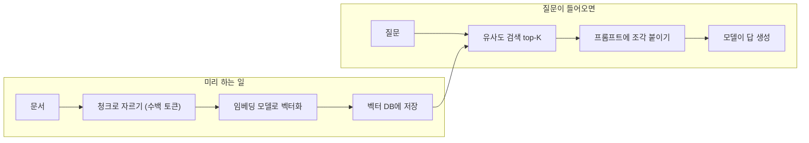

> Anthropic의 「[Introducing Contextual Retrieval](https://www.anthropic.com/news/contextual-retrieval)」(2024.09)과 실무에서 RAG 답변 품질을 진단하는 방법을 종합해 재구성한 노트다.

## RAG란

검색 증강 생성(Retrieval-Augmented Generation, RAG)은 질문이 들어오면 **지식 베이스에서 관련 있는 조각을 찾아 프롬프트에 붙이고**, 모델이 그 조각을 근거로 답하게 하는 방법이다. 모델의 학습 데이터에 없는 사내 문서, 서비스 DB의 기록, 최신 자료를 다룰 때 쓴다.

**모델은 받은 컨텍스트 밖을 모른다.** RAG 답변의 품질은 모델 성능만큼이나 검색이 무엇을 골라 넣었느냐에 달려 있다.

## 먼저 물을 것: RAG가 필요한가

| 지식 베이스 크기 | 방법 |
| --- | --- |
| 컨텍스트 창에 다 들어간다 (약 20만 토큰, 500쪽 안팎 이하) | 문서를 **통째로 프롬프트에 넣는다**(롱 컨텍스트). 프롬프트 캐싱을 쓰면 반복 호출의 지연과 비용이 크게 준다 |
| 창을 넘는다, 계속 불어난다 | RAG로 필요한 조각만 골라 넣는다 |

검색 단계가 없으면 「검색이 놓쳐서 틀린 답」이 생기지 않는다. 작은 자료에 RAG부터 붙이면 실패 지점만 늘어난다.

## 기본 파이프라인

임베딩은 의미가 비슷한 문장을 잘 찾지만 **정확히 같은 단어**(오류 코드, 제품 번호, 고유 용어)는 놓치기 쉽다.

## 검색 품질을 올리는 방법

| 방법 | 하는 일 | 효과 |
| --- | --- | --- |
| 하이브리드 검색 | 임베딩 검색에 BM25 같은 어휘 검색을 함께 돌려 결과를 합친다 | 고유 식별자·전문 용어가 든 질문에 강해진다. 임베딩만 쓸 때보다 낫다 |
| 맥락 붙인 청크(Contextual Retrieval) | 청크를 저장하기 전에 「이 조각이 문서 어디의 무슨 내용인지」를 짧게 덧붙여 임베딩과 BM25 색인을 만든다 | 잘린 조각이 원래 맥락을 잃어 검색에서 빠지는 문제를 줄인다. 검색 실패가 49% 줄었다는 실험 결과가 있다 |
| 리랭킹 | 넓게 뽑은 후보를 별도 모델로 다시 채점해 상위만 남긴다 | 위 둘과 합치면 검색 실패가 67%까지 줄었다 |
| 넉넉한 top-K | 상위 5~10개보다 20개를 넣는다 | 같은 실험에서 top-20이 top-10, top-5보다 나았다 |

BM25는 TF-IDF를 다듬은 순위 함수다. 문서 길이를 보정하고 단어 빈도에 포화를 걸어 흔한 단어가 점수를 독차지하지 못하게 한다. 검색 엔진 쪽 설명은 [[elasticsearch-search|Elasticsearch 검색]]에 있다.

## 질문을 나눠 보내기: 라우터

모든 질문이 검색을 거칠 필요는 없다. 앞단에 라우터를 두어 질문 종류에 따라 길을 나눈다.

| 질문 | 경로 |
| --- | --- |
| 인사, 잡담, 사용법 | 검색 없이 바로 답한다 |
| 최신 정보, 바깥 자료 | 웹·사내 검색 도구를 부른다 |
| 쌓아 둔 기록·문서에 대한 질문 | RAG 검색 후 답한다 |

답의 품질을 더 올려야 하면 검색, 분석, 검증을 맡는 에이전트를 나누는 구성도 있다([[multi-agent|멀티 에이전트]]).

## 답이 엉뚱할 때 진단 순서

모델을 바꾸기 전에 **모델이 실제로 받은 프롬프트**를 찍어 본다. 상용 최신 모델은 관련 문서만 제대로 받으면 대부분 찾아서 답한다. 받은 컨텍스트에 답이 없으면 검색 문제고, 있는데도 틀리면 프롬프트나 모델 문제다.

| 증상 | 의심할 곳 | 고칠 것 |
| --- | --- | --- |
| 프롬프트에 붙은 조각에 답이 없다 | 검색 | 하이브리드 검색, 맥락 붙인 청크, top-K, 리랭킹 |
| 조각에 답이 반쯤 걸쳐 잘려 있다 | 청크 크기·경계 | 청크 크기와 겹침(overlap), 문서 구조(제목·표) 단위로 자르기 |
| 조각은 맞는데 추론이 엉뚱하다 | 프롬프트 | 「주어진 자료만 근거로, 없으면 모른다고 답하라」 같은 지시, 몇 개의 예시(few-shot) |
| 자료 전체가 작은데도 틀린다 | 구조 과잉 | RAG를 빼고 롱 컨텍스트로 통째로 넣어 비교한다 |
| 외부 API 한도에 걸려 답이 안 나온다 | 호출량 | 결과 캐싱, 프롬프트 캐싱, 이벤트마다 부르지 말고 모아서 한 번에 처리 |

평가는 질문과 기대 답을 묶은 시험 세트를 만들어 검색 단계(정답 조각이 top-K에 들었나)와 생성 단계(답이 맞았나)를 따로 잰다([[evaluation-driven-development|평가 주도 개발]]).

## 한계

- 검색은 **조각 단위**라 문서 여러 곳을 엮어야 하는 관계형 질문에 약하다. 원문을 미리 종합해 두는 [[llm-wiki|LLM 위키]] 같은 대안이 있다.
- 맥락 붙인 청크는 색인할 때 청크마다 모델을 한 번씩 부르므로 색인 비용이 든다.
- 롱 컨텍스트도 창 크기와 호출 비용의 한계가 있어 자료가 계속 커지면 결국 검색이 필요하다.

## 정리

- 자료가 컨텍스트 창에 들어가면 RAG 대신 통째로 넣는다.
- 크면 청크 → 임베딩 → 벡터 검색에 BM25 하이브리드, 맥락 붙인 청크, 리랭킹, 넉넉한 top-K를 쌓는다. 효과는 겹쳐서 커진다.
- 질문 종류가 섞이면 라우터로 잡담·검색·RAG를 나눈다.
- 답이 틀리면 모델이 받은 컨텍스트부터 본다. **틀린 답의 대부분은 틀린 컨텍스트다.**

관련 노트: [[llm-wiki|LLM 위키: LLM이 쓰고 관리하는 지식 창고]], [[harness-engineering|프롬프트에서 하네스로: 에이전틱 패턴의 진화]], [[how-llm-works|LLM은 무엇을 하고 왜 작동하나]], [[evaluation-driven-development|평가 주도 개발]]
