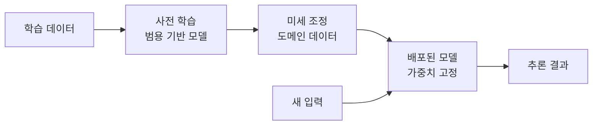
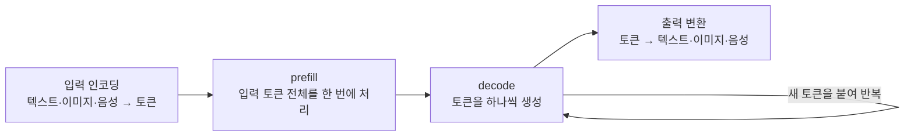

> NVIDIA 블로그의 「[What's the Difference Between Deep Learning Training and Inference?](https://blogs.nvidia.com/blog/difference-deep-learning-training-inference-ai/)」(2016.07, 2025.10 갱신)을 바탕으로 재구성한 노트다.

## 학습과 추론이란

딥러닝 모델의 일생은 두 단계로 나뉜다. **학습(training)**은 데이터를 보여 주며 가중치를 고쳐 모델을 만드는 단계다. **추론(inference)**은 학습이 끝난 모델을 서비스에 올려, 처음 보는 입력에 대해 답을 내는(무언가를 「추론하는」) 단계다. 학교에서 배우는 학생과 졸업 후 배운 것을 일에 쓰는 사람의 관계와 같다. **추론은 학습 없이 있을 수 없고, 학습의 가치는 추론에서 나온다.**

| | 학습 | 추론 |
| --- | --- | --- |
| 목적 | 가중치를 찾는다 | 찾은 가중치로 답을 낸다 |
| 가중치 | 매 반복마다 바뀐다 | 고정 |
| 계산 | 순전파 + 오차 역전파, 수많은 반복 | 순전파만 |
| 빈도 | 모델당 한 번(또는 가끔) 크게 | 요청마다 계속, 서비스가 클수록 총량이 커진다 |
| 핵심 지표 | 총 연산량, 처리량, 학습 시간 | 지연 시간, 처리량, 요청(토큰)당 비용 |

각 단계에 맞는 칩(GPU·ASIC·NPU)과 메모리 요구는 [[ai-accelerators|AI 반도체]]의 「학습과 추론은 요구가 다르다」에 있다.

## 학습: 틀린 만큼 가중치를 고친다

신경망은 뇌에서 느슨하게 영감을 받았지만, 뇌와 달리 층(layer)과 연결, 데이터가 흐르는 방향이 정해져 있다.

1. **순전파**: 학습 데이터가 첫 층에 들어가고, 각 뉴런은 입력에 가중치를 곱해 다음 층으로 넘긴다.
2. **오차 계산**: 마지막 출력을 원하는 답과 비교한다. 모델에게 정답 자체를 알려 주지 않고, **얼마나 틀렸는지**만 계산한다.
3. **오차 역전파**: 오차를 층을 거꾸로 거슬러 보내며 각 가중치가 오차에 얼마나 기여했는지 구하고, 그만큼 가중치를 고친다. 수식은 [[perceptron-mlp|퍼셉트론과 다층 퍼셉트론]]의 「오류 역전파 알고리즘」에 있다.
4. **반복**: 같은 과정을 수없이 되풀이하면 가중치가 정답에 가까운 출력을 내는 값으로 **수렴**한다.

층이 쌓이면 앞 층의 결과 위에서 더 추상적인 것을 배운다. 코드 생성 모델이라면 대략 다음과 같다.

| 층 | 배우는 것 |
| --- | --- |
| 앞쪽 | 자연어 지시의 의도를 코드로 대응시키기 |
| 중간 | 프로그래밍 패턴, 문법, 구조 |
| 뒤쪽 | 함수 자동 완성, 코드 조각 제안, 언어 간 변환 |
| 마지막 | 정확성 점검과 수정 제안 |

코드라면 「실행되는가, 언어 규칙을 지키는가, 요청한 일을 하는가」가 맞았는지를 판정하는 기준이 된다.

### 학습은 연산을 많이 먹는다

학습의 가장 큰 제약은 연산량이다. 예를 들어 Llama 3.1 405B(파라미터 4,050억 개)의 사전 학습에는 약 **3.8 × 10²⁵ FLOPs**(부동소수점 연산)가 들었다. 모델 크기와 데이터 양이 늘면 연산량도 함께 커지는 관계는 [[how-llm-works|LLM은 무엇을 하고 왜 작동하나]]의 「스케일링 법칙」에 있다.

## 미세 조정: 기반 모델을 도메인에 맞춘다

**미세 조정(fine-tuning)**은 넓은 데이터로 학습한 **기반 모델(foundation model)**을 법률 문서, 의료 영상, 사내 데이터 분석 같은 특정 도메인에 맞추는 추가 학습이다.

- 처음부터 학습하지 않고 기반 모델을 재사용하므로, 전문 모델을 훨씬 빨리 만든다.
- 모든 가중치를 고치는 대신 **일부 층만** 학습하거나, 원래 가중치는 얼린 채 작은 **어댑터(adapter)**만 붙여 학습하기도 한다. LoRA가 대표적인 어댑터 방식이다.
- 결과 모델은 기반 모델의 넓은 지식과 도메인 지식을 함께 갖는다.

앞 층을 재사용한다는 생각은 [[deep-learning-intuition|딥러닝 직관으로 이해하기]]의 「전이 학습」과 같다. LLM에서 지시 따르기·선호 학습으로 이어지는 사후 학습 단계는 [[how-llm-works|LLM은 무엇을 하고 왜 작동하나]]의 「학습 단계」에 있다.

## 추론: 토큰을 지능으로 바꾼다

학습을 마친 모델은 추론으로 실제 일을 한다. 코드·이미지 생성, 상담 챗봇, 실시간 번역, AI 검색, 추천처럼 사용자가 만나는 AI 기능은 모두 추론이다. LLM 서비스에서는 **토큰**이 입력과 출력의 기본 단위라, 사용량과 비용도 토큰으로 센다. 대규모로 토큰을 만들어 내도록 설계한 데이터센터를 **AI 팩토리(AI factory)**라고 부르기도 한다.

### LLM 추론의 네 단계

| 단계 | 하는 일 | 빠르게 하는 방법 |
| --- | --- | --- |
| 입력 인코딩 | 단어·이미지·소리를 숫자 토큰으로 바꾼다. 「hello」도 숫자 몇 개의 열이 된다 | - |
| **prefill** | 입력 토큰 전체를 모든 층에 한꺼번에 통과시켜 문맥을 파악한다. 연산이 무겁다 | **분리 서빙(disaggregated serving)**: prefill과 decode를 서로 다른 GPU 묶음에서 돌린다 |
| **decode** | 앞의 모든 토큰을 바탕으로 다음 토큰을 하나씩 만든다. 앞 토큰에 의존하므로 순서대로만 진행된다 | **추측 디코딩(speculative decoding)**: 작은 모델이 몇 토큰을 미리 추측하고, 큰 모델이 한 번에 검증해 맞은 만큼 건너뛴다 |
| 출력 변환 | 생성한 토큰을 읽을 수 있는 텍스트·이미지·음성으로 되돌린다 | - |

prefill이 연산에, decode가 메모리 대역폭에 묶이는 이유와 KV 캐시·연속 배치 같은 서빙 기법은 [[llm-serving-at-scale|LLM 서빙의 병목: KV 캐시, 배치, GPU]]에 있다.

### 처리량과 지연의 균형

추론 서비스는 두 목표를 동시에 맞춰야 한다.

- **지연(latency)**: 사용자 한 명이 체감하는 응답 속도. 첫 토큰까지 시간(TTFT), 토큰 사이 간격(TPOT)으로 잰다.
- **처리량(throughput)**: 같은 하드웨어로 동시에 처리하는 사용자·토큰 수. 토큰당 비용을 정한다.

배치를 키우면 처리량이 오르지만 사용자마다 지연이 늘어난다. 서비스 제공자는 정확도·지연·비용 사이에서 균형점을 골라 **SLA(서비스 수준 약정)**를 지킨다. 추론 모델은 답 하나에 예전보다 훨씬 많은 토큰을 만들기 때문에, 추론에 드는 연산 비중은 계속 커진다.

## 성능 평가: 벤치마크

| 벤치마크 | 성격 |
| --- | --- |
| **MLPerf** (MLCommons) | 학습(Training)과 추론(Inference) 성능을 하드웨어·소프트웨어 조합별로 비교하는 업계 표준 벤치마크 모음 |
| **InferenceX** (SemiAnalysis, 옛 이름 InferenceMAX) | 인기 모델을 여러 하드웨어에서 계속 돌려 추론 처리량·비용을 공개하는 오픈 소스 벤치마크 |

추론 서비스에서는 같은 하드웨어로 더 많은 토큰을 내는 것이 곧 수익성이므로, 벤치마크 점수가 투자 대비 효과(ROI)의 근거로 쓰인다.

## 테스트 타임 스케일링: 추론에 연산을 더 쓴다

**테스트 타임 스케일링(test-time scaling)**은 더 큰 모델을 학습하는 대신, **추론할 때 더 많은 단계와 토큰을 써서** 어려운 문제를 푸는 방식이다. 학습된 가중치를 바꾸지 않고도 추론 품질을 높일 수 있다.

| 기법 | 하는 일 |
| --- | --- |
| 사고 연쇄(chain-of-thought) | 답 전에 중간 추론 과정을 토큰으로 써 내려간다 |
| 다단계 분해 | 문제를 작은 단계로 나눠 차례로 푼다 |
| 외부 메모리 | 중간 결과나 참고 자료를 모델 밖에 두고 불러 쓴다 |

이 때문에 「학습은 비싸고 추론은 싸다」는 구도가 바뀐다. 추론 모델 시대에는 토큰을 많이 쓰는 추론 자체가 연산 수요의 큰 몫이 된다. 사고 연쇄가 왜 통하는지(시스템 1·2)는 [[how-llm-works|LLM은 무엇을 하고 왜 작동하나]]의 「한계를 넘는 방법」에 있다.

## 정리

- 학습은 가중치를 찾는 단계, 추론은 고정된 가중치로 답을 내는 단계다.
- 학습은 순전파 → 오차 계산 → 역전파를 반복해 가중치를 수렴시키며, 대형 모델에서는 10²⁵ FLOPs 단위의 연산이 든다.
- 미세 조정은 기반 모델을 재사용해 일부 층이나 어댑터만 학습하는 지름길이다.
- LLM 추론은 인코딩 → prefill → decode → 출력 변환이고, 분리 서빙과 추측 디코딩이 각각 prefill·decode를 빠르게 한다.
- 추론 서비스는 지연과 처리량의 균형으로 SLA를 맞추고, 테스트 타임 스케일링으로 추론 연산의 비중은 더 커진다.

관련 노트: [[ai-accelerators|AI 반도체]], [[llm-serving-at-scale|LLM 서빙의 병목: KV 캐시, 배치, GPU]], [[how-llm-works|LLM은 무엇을 하고 왜 작동하나]], [[perceptron-mlp|퍼셉트론과 다층 퍼셉트론]], [[deep-learning-intuition|딥러닝 직관으로 이해하기]], [[ml-model-serving|머신러닝 모델 서빙]]
