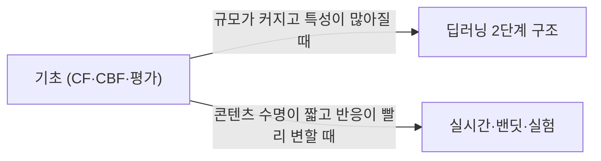

> 국내 기업 기술 블로그의 추천 시스템 글 20편 목록(GeekNews, 2020)을 출발점으로, 찾을 수 있는 원문과 각 사 공식 발표를 모아 재구성한 주제다. 각 노트에 실제로 참고한 원문을 밝혔다.
> Team-Neighborhood의 「[I want to study Data Science](https://github.com/Team-Neighborhood/I-want-to-study-Data-Science/wiki/%EC%B6%94%EC%B2%9C-%EC%8B%9C%EC%8A%A4%ED%85%9C)」 위키 「추천 시스템」 문서가 모은 자료(베이스라인·이웃 기반 CF, Item2Vec, 밴딧과 타기팅, SQL 기반 베스트·연관 추천)는 각 하위 노트에 나눠 넣었다.

## 추천 시스템이란

추천 시스템(Recommender System)은 **사용자가 아이템을 얼마나 좋아할지 예측해, 관심 가질 만한 것을 골라 보여 주는 시스템**이다. 아이템이 너무 많아 사람이 다 훑어볼 수 없을 때 필요하다. 음악 서비스의 곡은 수천만 개이고 뉴스 포털에는 하루 수만~수십만 건의 기사가 들어온다. 추천은 이 탐색 범위를 줄여 주는 일이다.

추천이 화면에 나오는 자리는 크게 셋이다.

| 자리 | 예 | 주로 쓰는 신호 |
| --- | --- | --- |
| 연관 추천 (item-to-item) | 글 하단 「함께 봤어요」, 다음 곡 이어 듣기, 유사글 | 아이템 간 유사도 |
| 개인화 추천 | 앱 첫 화면 피드, 「○○님이 좋아할 음악」 | 사용자의 최근 소비 이력 |
| 타기팅 | 관심 있을 사용자에게만 보내는 푸시 | 사용자별 예측 반응률 |

## 접근 방식 한눈에 보기

| 방식 | 핵심 질문 | 강점 | 약점 | 노트 |
| --- | --- | --- | --- | --- |
| 협업 필터링 (CF) | 이걸 좋아한 사람들은 또 뭘 좋아했나 | 행동 데이터만으로 잘 맞는다 | 이력이 없는 아이템·사용자(콜드 스타트), 인기 편향 | [[recsys-basics\|추천 시스템 기초]] |
| 콘텐츠 기반 필터링 (CBF) | 내용이 비슷한 건 뭔가 | 새 아이템도 바로 추천 | 행동을 모르니 엉뚱하게 느껴질 수 있다 | [[recsys-basics\|추천 시스템 기초]] |
| 딥러닝 2단계 (후보 → 랭킹) | 수억 개 중 수백 개를 빨리 추리고, 그 안에서 정밀하게 고른다 | 다양한 특성, 실시간 서빙 | 파이프라인·인프라가 무겁다 | [[deep-learning-recsys\|딥러닝 추천 시스템]] |
| 밴딧·실시간 피드백 | 지금 반응이 좋은 걸 바로 더 보여 줄까, 새 걸 시험할까 | 생명주기가 짧은 콘텐츠(뉴스)에 강하다 | 피드백 지연, 위치 편향 | [[realtime-recsys\|실시간 추천과 실험]] |

실서비스는 하나만 쓰지 않는다. 사내 추천 플랫폼은 대개 CF·CBF·통계 모델을 여러 개 앙상블하고 그 위에 밴딧과 A/B 실험 플랫폼을 얹는다. 추천은 모델 하나가 아니라 **플랫폼**이다.

## 실서비스에서 반복되는 원칙

- **자리와 비용을 먼저 정하고 알고리즘을 고른다.** 연관 상품 자리에는 얕은 CF로 충분하고, 수억 개 아이템의 개인화 피드에는 2단계 딥러닝이 필요하다.
- **CF와 CBF는 거의 항상 같이 쓴다.** 신규 아이템은 CBF 특징, 다른 서비스의 이용 이력(크로스오버), 기존 로직 폴백으로 푼다.
- **수명이 짧은 콘텐츠는 실시간 피드백과 밴딧이 핵심이다.** 피드백 속도가 곧 성능이다.
- **클릭만 최적화하지 않는다.** 열독률·체류·대화 시작 같은 깊은 반응과 장기 가치를 목표에 넣는다.
- **단순한 모델을 먼저 내보내고 A/B 테스트로 매일 고친다.** 다른 서비스에서 통한 모델이 여기서도 통한다는 보장은 없다. 데이터와 목표 지표가 다르기 때문이다.
- **구독·친구 관계 밖의 좋은 콘텐츠를 꺼내는 자리를 따로 둔다.** 공개된 콘텐츠라도 「읽을 수 있다」와 「전달된다」는 다르다.
- **여론에 닿는 추천(뉴스·검색어)에는 투명성과 사용자 조절권이 함께 필요하다.**

## 하위 노트

- [추천 시스템 기초: 협업 필터링과 콘텐츠 기반 필터링](AI-Data/Recommender-System/recsys-basics.md): 명시적·암묵적 피드백, 베이스라인 모형과 이웃 기반 CF, 행렬 분해(ALS)와 오토인코더, 오디오·텍스트·이미지 임베딩, 앙상블과 폴백, 콜드 스타트·희소성·인기 편향, 평가 지표
- [딥러닝 추천 시스템: 후보 생성과 랭킹](AI-Data/Recommender-System/deep-learning-recsys.md): 유튜브식 2단계 구조, 다음 아이템 예측 학습, Item2Vec, 유사 벡터 검색, 학습·서빙 파이프라인, 순차 추천, 크로스오버·멀티모달·맥락 인식 추천, 장기 가치와 파운데이션 추천 모델
- [실시간 추천과 실험: 밴딧, 피드백 지연, A/B 테스트](AI-Data/Recommender-System/realtime-recsys.md): ε-greedy·톰슨 샘플링·UCB 밴딧, 사용자 군집과 타기팅, 뉴스 추천의 시간 감쇠·위치 편향, CTR을 넘어 열독률, 실시간 파이프라인 구조, 버킷 실험, 투명성과 사용자 조절권

## 읽는 순서

텍스트 벡터로 비슷한 영화를 찾는 가장 단순한 콘텐츠 기반 추천은 [[text-similarity|문자열·문서 유사도]]에 있다. 학습의 기본 개념은 [[machine-learning-basics|머신 러닝 기초]], 임베딩은 [[how-llm-works|LLM은 무엇을 하고 왜 작동하나]]를 함께 본다.
