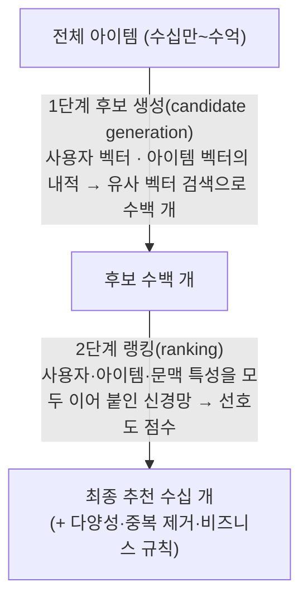
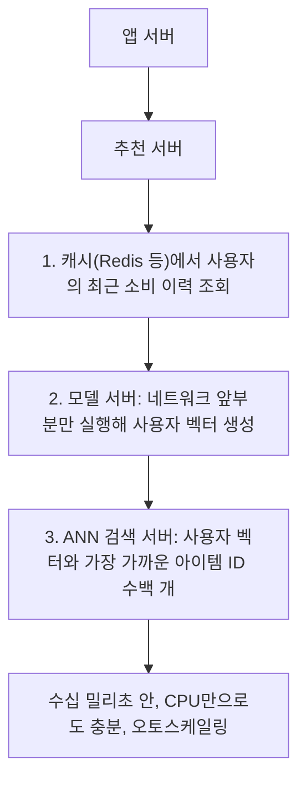
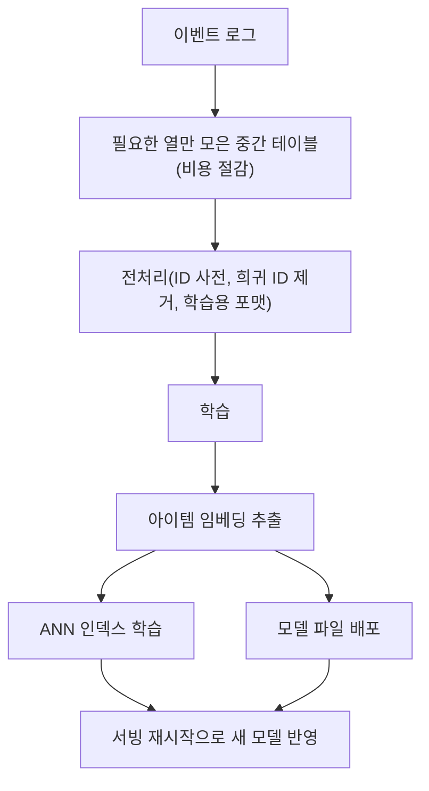

> 당근마켓의 「[딥러닝 개인화 추천](https://medium.com/daangn/%EB%94%A5%EB%9F%AC%EB%8B%9D-%EA%B0%9C%EC%9D%B8%ED%99%94-%EC%B6%94%EC%B2%9C-1eda682c2e8c)」·「[딥러닝 추천 시스템 in production](https://medium.com/daangn/%EB%94%A5%EB%9F%AC%EB%8B%9D-%EC%B6%94%EC%B2%9C-%EC%8B%9C%EC%8A%A4%ED%85%9C-in-production-fa623877e56a)」(2019), 네이버 AiRS·AiTEMS 발표 자료(2017), LINE 「[Timeline의 새로운 도전 1편](https://engineering.linecorp.com/ko/blog/a-new-challenge-for-line-timeline-1/)」(2020)을 바탕으로, 이후의 흐름은 2026년 공개 내용으로 보강해 재구성한 노트다. 피드의 다단계 파이프라인은 ByteByteGo의 System Design 101 가이드 「[How does Twitter recommend "For You" Timeline](https://bytebytego.com/guides/how-does-twitter-recommend-tweets)」를 바탕으로 덧붙였다.

## 왜 딥러닝으로 가나

행렬 분해 라이브러리만으로 실시간 개인화 피드를 만들면 세 가지가 막힌다.

- 학습 데이터가 늘면 메모리 사용량이 급격히 커지고 학습이 느려진다.
- 사용자를 ID 하나로만 표현해서 지역·시간 같은 다른 정보를 넣기 어렵다.
- 요청마다 빠르게 추천을 계산하는 구조가 고려돼 있지 않다.

이 문제를 푼 대표 설계가 유튜브의 「[Deep Neural Networks for YouTube Recommendations](https://research.google/pubs/pub45530/)」(2016)다. 이후 대부분의 대형 피드 추천이 같은 뼈대를 쓴다.

## 2단계 구조

아이템이 많으면 사용자 한 명에 대해 모든 아이템의 점수를 계산할 시간이 없다. 그래서 **빠르고 거칠게 추린 뒤, 좁혀진 후보만 정밀하게 정렬한다.**

| 단계 | 입력 | 출력 | 특징 |
| --- | --- | --- | --- |
| 후보 생성 | 최근 소비 이력, 지역 등 일부 특성 | 사용자 벡터 → 가까운 아이템 수백 개 | 원리는 행렬 분해와 같다. 사용자 벡터를 신경망으로 만든다는 점만 다르다 |
| 랭킹 | 사용자·아이템·문맥 특성 전부 | 아이템별 점수 | 내적이 아니라 신경망 출력으로 점수를 내는 회귀 모델이다 |

### 피드 추천의 다단계 파이프라인

소셜 피드처럼 후보 풀이 거대하고 응답 시간이 짧아야 하는 서비스는 2단계를 더 잘게 나눈다. 공개된 X(옛 Twitter)의 「For You」 타임라인 알고리즘이 대표 예다.

| 단계 | 하는 일 | 후보 수 감각 |
| --- | --- | --- |
| 후보 수집(candidate sourcing) | 팔로우 관계 그래프, 임베딩 유사도 등 여러 소스에서 후보를 모은다 | 수억 → 수천 |
| 전역 필터링 | 차단·뮤트, 안전 정책, 이미 본 글을 거른다 | 수천 → 1~2천 |
| 점수 매기기·랭킹 | 신경망이 참여(좋아요·답글·재게시) 확률을 예측해 점수를 낸다 | |
| 다양성 필터 | 한 작성자·한 주제가 몰리지 않게 섞는다 | |
| 혼합(mixing) | 광고, 팔로우 추천 같은 다른 모듈과 섞어 최종 피드를 만든다 | 수십 |

**단계마다 계산 비용이 커지는 만큼 후보 수를 줄여서**, 전체를 짧은 응답 시간 안에 끝낸다.

### 후보 모델 학습: 다음 아이템 맞히기

후보 모델은 **사용자가 본 아이템 목록을 문장처럼 보고, 다음에 볼 아이템을 예측하는** 언어 모델식으로 학습한다.

| 항목 | 내용 |
| --- | --- |
| 입력 | 최근 본 아이템 ID 수십 개, 지역 같은 맥락, 시간 |
| 정답 | 다음에 본 아이템 ID |
| 학습 | 네거티브 샘플링 + 이진 교차 엔트로피 (word2vec과 같은 요령) |
| 평가 | MAP, Top-K 적중. 며칠 치 로그로 학습하고 다음 날로 시험한다 |

- **맥락은 모델을 나누지 말고 조건으로 넣는다.** 지역별로 모델을 따로 두면 겹치는 범위와 여러 지역을 오가는 사용자를 다루지 못한다. 조건으로 넣으면 처음 가 본 지역에서도 각자 취향대로 추천을 받는다.
- **학습 데이터의 소비 패턴이 그대로 추천에 배어든다.** 중고 거래처럼 최신 아이템 소비가 압도적인 서비스에서는 모델도 최신 아이템을 추천하는 경향을 띤다.
- **복잡한 시스템은 단계로 쪼개 빨리 내보낸다.** 후보 모델만 먼저 붙여 배포하고 A/B 테스트로 개선한 뒤 랭킹 모델을 더한다.

### 서빙: 네트워크의 뒷부분을 벡터 검색으로 바꾼다

학습 때는 네거티브 샘플링 덕에 계산이 가볍지만, 예측 때는 사용자 벡터와 **모든 아이템 벡터의 내적**을 구해야 한다. 내적은 결국 가까운 벡터 찾기이므로 **근사 최근접 이웃(ANN) 검색**으로 바꿀 수 있다.

ANN 인덱스(faiss 등)는 데이터가 많아지면 느려지고 메모리를 많이 쓰므로 배포 전에 인덱스를 학습(양자화·클러스터링)해 둔다. faiss 외에 ScaNN, HNSW 기반 라이브러리, 벡터 DB가 같은 역할을 한다.

### 학습·배포 파이프라인

새 아이템이 계속 들어오므로 **주기적으로 다시 학습하고 배포**해야 한다.

- 워크플로는 Kubeflow Pipelines, Airflow, Vertex AI Pipelines 같은 오케스트레이터로 자동화한다.
- **전처리를 모델 그래프 안에 넣으면** 서빙 때 같은 전처리를 다시 짤 필요가 없다. 학습과 서빙의 전처리 불일치(training-serving skew)를 막는 방법이다.

## 순서를 보는 모델: 세션 추천

협업 필터링은 과거 클릭을 근거로 하므로 **방금 나온 뉴스**를 추천하기 어렵고, 한 이슈를 깊게 파고드는 소비도 잘 못 잡는다. 그래서 순서를 보는 모델을 붙인다.

- 문서마다 벡터(Doc2Vec 등)를 만든다.
- 사용자가 읽은 순서대로 벡터를 이어 시퀀스를 만든다. 몇 분 안에 이어 읽은 문서는 같은 맥락(세션)으로 본다.
- 순환 신경망(RNN)이 다음에 읽을 문서를 예측한다. 같은 맥락의 새 문서가 들어오면 바로 추천할 수 있다.
- **CF가 다양성을, 순서 모델이 깊이와 최신성을** 맡는 하이브리드가 된다.

지금은 RNN 자리를 트랜스포머 기반 순차 추천(SASRec, BERT4Rec 계열)이 주로 차지한다. 「다음 아이템 예측」이라는 문제 설정은 같다.

## 여러 신호를 합치는 추천

| 방식 | 무엇을 합치나 | 효과 |
| --- | --- | --- |
| 크로스오버 추천 | 같은 회사의 다른 서비스 이용 이력(검색, 뉴스, 영상, 스포츠)과 상품명·카테고리·가격·판매자·이미지 벡터 | **해당 서비스 이력이 없어도** 추천한다(야구 영상을 본 사용자에게 야구 용품). 인기 대신 취향과 속성을 맞추므로 신규 판매자·비인기 상품도 노출되고, 써 봐야 아는 경험재에서 효과가 크다 |
| 멀티모달 유사도 | 아이템마다 텍스트·이미지·비디오·소비 이력 벡터 | 각 벡터의 코사인 유사도로 비슷한 아이템을 찾고 하나로 정렬한다. 구독 관계 밖의 좋은 콘텐츠를 꺼내는 탐색 공간에 쓴다 |
| 맥락 인식 추천 | 현재 위치·시간대·인구 통계·관심사 + 사용자 생성 콘텐츠로 만든 아이템 프로필 | 맥락과 프로필이 맞는 것을 고른다. 같은 장소·시간이라도 사용자 집단마다 다른 장소를 권한다 |

## 지금의 흐름

후보 생성 → 랭킹 뼈대는 유지되고, 그 위에서 다음 방향으로 옮겨 간다.

| 방향 | 내용 |
| --- | --- |
| 다단계 구조 | 후보를 여러 단계로 좁히고, 사용자·아이템을 대조 학습(contrastive learning)으로 임베딩하는 투 타워 후보 모델을 쓴다. 랭킹 파이프라인은 서비스별로 설정만 바꿔 공유한다 |
| 장기 가치 목표 | 클릭만 보지 않고 최신성, 관심도, 대화·거래 시작, 체류 시간을 함께 보고 부정 피드백은 내린다 |
| 파운데이션 추천 모델 | 여러 서비스가 하나의 큰 추천 모델을 공유하고, 의외의 발견(serendipity)을 목표에 넣는다. LLM은 아이템·사용자 표현과 학습 데이터 생성에 쓴다. 모델이 커지면서 서빙은 실시간에서 준실시간으로 옮겨 간다 |

추천 대상이 반경 몇 km 안으로 제한되는 지역 서비스는 후보 풀이 작아 정교한 개인화가 더 어렵다.

## 정리

- 아이템이 많으면 후보 생성(빠르게 수백 개) → 랭킹(정밀하게) 2단계로 나눈다.
- 후보 모델은 「최근 본 것으로 다음 것 맞히기」로 학습하고, 맥락은 조건으로 넣고, 서빙은 사용자 벡터 + ANN 검색으로 바꾼다.
- 추천은 한 번 만들고 끝나지 않는다. 수집 → 전처리 → 학습 → 인덱스 → 배포를 자동으로 반복하는 파이프라인이 본체다.
- 순서 모델은 최신 콘텐츠와 세션 맥락을, 크로스오버·멀티모달 신호는 콜드 스타트를 푼다.
- 복잡한 시스템은 후보 모델만 먼저 내보내고 A/B 테스트로 키운다.

관련 노트: [[Recommender-System|추천 시스템]], [[recsys-basics|추천 시스템 기초]], [[realtime-recsys|실시간 추천과 실험]], [[deep-learning-intuition|딥러닝 직관으로 이해하기]], [[how-llm-works|LLM은 무엇을 하고 왜 작동하나]]
