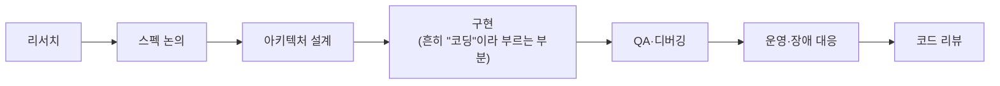

> 하용호의 강의 자료 「[AI로 개발을 어떻게 가속화하는가: 드디어 열린 입코딩 시대](https://drive.google.com/file/d/1SJ7-1YXo4r4pkHDuMdKLR9NtgbUsSRoZ/view)」(2025.07)와 Addy Osmani의 「[The AI-Native Software Engineer](https://addyo.substack.com/p/the-ai-native-software-engineer)」(2025.07)를 바탕으로 재구성한 노트다.

## 핵심: 코딩은 일의 일부다

AI 네이티브 엔지니어(AI-native software engineer)는 AI를 **일상 업무 전체에 깔린 협업자**로 다룬다. 작업마다 「AI가 이걸 더 빠르게, 더 잘, 또는 다르게 할 수 있나」를 먼저 묻는다. 개발자의 시간은 코딩보다 그 바깥에서 더 많이 쓰이므로, 빨라지려면 모든 단계에 AI가 들어가야 한다.



이 방식에서 일의 산출물은 **코드 + AI에게 먹일 자료**(요구 사항, 규칙, 도메인 지식)다. 둘을 함께 버전 관리하고 함께 키운다. **경험이 많을수록 AI에게 맥락을 잘 주므로 결과도 좋다.** AI는 실력을 대체하지 않고 증폭한다.

AI 소식은 몇 달이면 절반이 바뀐다. 매번 따라잡기보다 **어느 정도 대중화되어 정리된 도구와 방법을 받아 쓰는 편이 투자 대비 효과가 크다.** 바뀌는 것은 모델 이름이고, 아래 원칙은 오래 간다.

## 원칙

| 원칙 | 뜻 |
| --- | --- |
| AI부터 시도한다 | 조사·설계 비교·프로토타입을 일단 AI에 시켜 보고 얼마나 해내는지 본다 |
| 신뢰하되 검증한다 | 결과물의 정확성·보안·가독성 책임은 끝까지 사람에게 있다 |
| 모두가 관리자다 | 직접 다 짜기보다 작업을 정의해 에이전트에게 맡기고, 감독·검토·통합한다 |
| AI가 읽기 쉬운 코드베이스 | 규칙 파일(CLAUDE.md, AGENTS.md 등), 좋은 README, 일관된 구조가 결과 품질을 올린다 |
| 증폭이지 자동 조종이 아니다 | 작게 나눠 맡기고 단계마다 검토한다. 이해 못 한 코드가 쌓이면 AI 기술 부채가 된다 |

### 도입 단계

1. **도구를 미리 깔아 둔다.** 에디터 어시스턴트 하나, 코딩 에이전트 하나, 범용 채팅 하나. 손 닿는 곳에 있어야 습관이 된다.
2. **구체적으로 요청한다.** 「테스트 써 줘」가 아니라 대상의 동작, 다룰 케이스, 출력 형식을 적는다. 방법은 [[prompt-cheat-sheet|프롬프트 작성법 치트시트]].
3. **보조 코드부터 맡긴다.** 이해는 하지만 쓰기 귀찮은 코드(파서, 변환, 설정)에서 신뢰를 쌓은 뒤 핵심 로직으로 넓힌다.
4. **코딩 밖으로 넓힌다.** 커밋 메시지, PR 설명, 문서, 설계 개요, 비개발 직군에게 보낼 설명까지.
5. **고쳐 가며 쓴다.** 처음부터 다시 시키지 말고 어디가 틀렸는지 짚어 수정을 요청한다. 잘 먹힌 프롬프트는 모아 둔다.
6. **자율성을 천천히 높인다.** 질문에 답하는 단계에서 여러 파일을 고치고 테스트를 돌리는 에이전트로 넘어간다. 자율성이 커질수록 확인 지점도 늘린다. 위임 단계를 올리고 내리는 원리는 [[ai-delegation-toolkit|AI에게 일 맡기기]]에 있다.

## 도구의 네 범주

| 범주 | 하는 일 | 예 | 쓸 때 |
| --- | --- | --- | --- |
| 에디터 어시스턴트 | 자동 완성, 파일 단위 편집, 코드 설명 | GitHub Copilot, Cursor | 기존 코드를 고치는 편집·테스트 주기 안에서 |
| 터미널·IDE 코딩 에이전트 | 계획을 세우고 여러 파일 수정, 명령 실행, 테스트까지 | Claude Code, Codex CLI, Gemini CLI, Cline | 기능 하나를 통째로 맡길 때. 계획 단계를 검토한다 |
| 비동기 백그라운드 에이전트 | 이슈를 받아 격리된 환경에서 작업하고 PR로 돌려준다 | Copilot coding agent, Codex(클라우드), Jules | 잘 정의된 작업을 여러 개 병렬로 맡길 때 |
| 프로토타이핑 도구 | 프롬프트 한 번으로 실행되는 앱 골격 생성 | v0, Bolt, Lovable, Replit | 새 아이디어·PoC를 빠르게 보여 줄 때 |

에디터 도구는 **좋은 도구를 쥐여 주는** 쪽이라 일하는 사람은 여전히 나다. 에이전트형 도구는 **좋은 주니어를 붙여 주는** 쪽이라 나는 그들을 부린다. 자율성과 작업 완수율이 높아 「시켜 놓고 지켜보기」가 된다.

- 프로토타이핑 도구의 결과물은 **첫 초안**이다. 70% 정도는 빠르게 나오지만 나머지 30%(엣지 케이스, 성능, 실제 비즈니스 규칙)는 사람이 채운다(「70% 문제」). 흔한 조합은 프로토타이핑 도구로 골격을 만들고 저장소로 옮겨 코딩 에이전트로 다듬는 방식이다.
- 도구 지형은 빠르게 바뀐다. 한 도구에 매달리지 말고 범주별로 하나씩 갖추고 주기적으로 갈아 본다.

## 개발 생명 주기별 활용

| 단계 | AI에게 시킬 일 | 사람이 지킬 것 |
| --- | --- | --- |
| 리서치 | 문제 정의의 빈틈 지적, 결정 변수·제약·목적 함수로 정형화, 딥 리서치 | 출처와 근거 확인 |
| 요구 사항 | 기능 목록 브레인스토밍, 사용자 스토리 초안, 「이 요구 사항을 분명히 하려면 무엇을 물어야 하나」, PRD 초안 | 실제 사용자·고객에게 확인 |
| 설계 | 대안별 장단점, 선택 근거, Mermaid 다이어그램, API 엔드포인트 초안, 「이 설계에서 무엇이 깨질 수 있나」 | 최종 결정과 근거. 명세를 먼저 쓰는 스펙 주도 개발 |
| 구현 | 스캐폴딩·설정 파일, 기존 파일을 예시로 준 일관된 모듈 생성, 리팩터링 | diff를 주니어의 PR처럼 리뷰 |
| 테스트 | 단위 테스트, 속성 기반 테스트(Hypothesis, fast-check)의 속성 찾기, E2E 시나리오 목록, 더미 데이터, 빠진 케이스 찾기 | 기대값이 의도와 맞는지. 실데이터는 익명화 |
| 디버깅·유지보수 | 스택 트레이스 해석, 원인 가설, 레거시 코드 설명, 라이브러리 버전 마이그레이션 | 패치 후 테스트 실행 |
| 배포·운영 | Terraform·Kubernetes YAML 초안, CI 워크플로, 알림 쿼리, 장애 로그 요약, 런북 | 자격 증명·보안 그룹·비용. 안전한 환경에서 먼저 적용 |

### 리서치: 고민을 아웃소싱한다

| 요령 | 방법 |
| --- | --- |
| 거대한 한 방 질문 | 고급 추론 모델은 짧은 핑퐁보다 **상세한 스펙을 담은 긴 질문 하나**에 더 잘 답한다 |
| 질문도 AI와 만든다 | 빠른 대화형 모델과 주고받으며 질문을 다듬고 완성본을 추론 모델에 넣는다 |
| 도메인 지식 문서 | 도메인 지식을 정리한 한 페이지 문서를 두고 첨부하거나, 사내 위키를 MCP로 연결해 참조하게 한다. 문서가 최신으로 관리되는지가 관건이다 |

### 기획: PRD → 태스크 리스트 → 구현

코딩 에이전트에게 맡길 지시를 쓰는 일도 AI에게 맡긴다.

```text
1. "이런 걸 만들 거야. 제품 요구 사항(PRD)을 써 줘"     → prd.md
2. "이 PRD로 세부 작업 목록을 만들어 줘"                → tasklist.md
3. 두 파일을 프로젝트에 두고, 규칙 파일에서 항상 참조하게 한다
4. "Day 1 작업 시작" 식으로 잘라서 맡긴다
```

- 기간을 주면 날짜별 할 일로 나눠 주어 잘라서 지시하기 편하다. "주니어 개발자에게 줄 수준으로" 요청하면 더 잘게 쪼개진다.
- 원하는 라이브러리가 따로 없으면 **대중적인 라이브러리**를 쓰게 한다. 학습 데이터에 많이 나온 것일수록 코드 품질이 좋다.

## 바이브 코딩의 현실적인 패턴

바이브 코딩은 **작성자가 뒤바뀐 방식**이다. AI가 짜고 사람이 돕는다. 취지는 AI의 빠른 작성 속도로 전체를 여러 번 반복해 결과에 빨리 닿는 것이다. 기존 코드베이스에서 쓸 만한 패턴은 이렇다.

| 역할 | 내용 |
| --- | --- |
| AI | 코드의 대부분을 짜고, 오류도 다시 고쳐 쓴다. 사람이 손으로 고치는 것보다 AI가 다시 쓰는 편이 빠르다 |
| 사람 | 구조를 검토하고, **바뀐 코드는 모두 읽고**, 문제를 찾아 자세히 보고하고 수정 방향을 권한다 |
| 리팩터링 | 수백 줄 쌓일 때마다 작은 리팩터링을 시킨다. 큰 리팩터링을 한 번에 맡기면 자주 망가진다 |
| 파일 크기 | 컨텍스트 창을 생각하면 큰 파일 하나보다 작은 파일 여럿이 유리하다 |

AI 개발이 지속 가능한지는 지시의 크기와 규칙의 양에서 갈린다.

| 지시 방식 | 결과 |
| --- | --- |
| 포괄적 요구 + 규칙 없음 | 한 번에 바뀌는 양이 커서 검토할 수 없다 → AI를 포기하고 손코딩으로 돌아간다 |
| 세세한 단일 요구 + 풍부한 규칙 | 변경량이 사람이 검토할 수 있는 크기다 → AI 개발이 계속된다 |

## Rule-Growing Development

TDD에서 테스트와 코드가 함께 자라듯, AI와 일할 때는 **규칙과 코드가 함께 자란다.**

TDD:


RGD:


- 규칙에는 코딩 스타일뿐 아니라 그 프로젝트에 필요한 지식도 담는다.
- 규칙 파일(`CLAUDE.md`, `AGENTS.md`, `.cursor/rules/` 등)은 팀 저장소에서 버전 관리한다. 파일 위치와 범위는 [[claude-code-guide|Claude Code 활용 가이드]]에 있다.
- **"하지 마"보다 "이렇게 해"를 잘 따른다.** 금지와 바른 방향을 함께 쓴다. 예: "LLM 모델 버전을 바꾸지 마라. 바꿔야 하면 작업을 멈추고 사용자에게 확인하라."
- 영어로 쓰면 지시를 미묘하게 더 잘 따르는 경향이 있다. 적용 경로(glob)를 지정하면 더 잘 적용된다.

### 규칙에 자주 넣는 것

| 범주 | 예 |
| --- | --- |
| 변경 범위 | "가능한 한 간단한 해법을 쓴다", "시킨 것만 고친다", "구조 자체는 바꾸지 않는다". 간단하게 하라는 말은 표현을 바꿔 여러 번 강조해야 지킨다 |
| 실행 환경 | dev·test·prod 구분, 환경별 실행 방법 |
| 패키지·도구 | 패키지 관리자(pip인지 uv인지), 가상 환경 활성화, 테스트 프레임워크. 빠지면 엉뚱한 곳에 패키지를 설치한다 |
| 라이브러리·버전 | 자주 쓰는 라이브러리와 기준 버전. 명시하지 않으면 학습 때 많이 본 구버전 문법으로 간다 |
| DB | 스키마, 샘플 데이터, 샘플 쿼리를 별도 파일로 둔다. SQL 작성이 크게 나아진다 |
| 금지 영역 | 테스트 코드, API 이름과 파라미터, 데이터 마이그레이션. 자세한 원칙은 [[ai-coding-guardrails\|AI 코딩 실무 가드레일]] |
| 황금률 | 구현 세부가 확실하지 않으면 항상 개발자에게 묻는다 |

규칙 파일을 따로 고칠 짬은 잘 나지 않는다. **커밋할 때 필요하면 규칙 파일도 함께 갱신하는 커밋 명령**을 만들어 두면 저절로 최신이 된다. 교정을 규칙보다 더 강한 층(코드베이스·정적 분석)에 넣는 기준은 [[agent-trust-environment|에이전트를 믿을 수 있는 환경 만들기]]에 있다.

## AI가 코드를 찾는 방식을 고려한다

코딩 도구는 코드베이스 전체를 읽지 못하고 관련 조각을 골라 읽는다. 임베딩 검색이든 검색 명령이든 **적중률은 100%가 아니다.**

| 문제 | 대처 |
| --- | --- |
| 이름이 실제 의미와 다르면 관련 코드를 못 찾는다(예: `transaction` 테이블이 실은 실명 인증 기록) | 의미를 밝히는 주석·docstring을 코드 곁에 둔다 |
| 파일 이름이 `A.py`, `page.py` | `user_identity_check.py`처럼 길고 구체적으로 짓는다 |
| 이미 있는 함수를 못 찾고 새로 만든다(가장 흔한 실수) | "철저히 찾아보고 정말 없을 때만 새로 만들라"고 지시하거나, 아는 함수는 이름을 짚어 준다 |
| 거대한 데이터 파일이 인덱싱돼 문제를 일으킨다 | `.cursorignore` 같은 무시 목록에 넣는다 |

## 검증과 되돌리기

- **증상이 아니라 원인을 고치게 한다.** AI는 메모리 할당 늘리기, 재시도 횟수 늘리기, 경고 지우기, 실패한 테스트 지우기, 기준 낮추기처럼 증상만 없애는 해결책을 고를 때가 있다. 이런 우회가 보이면 금지하는 규칙을 더한다.
- **존재하지 않는 함수·설정 키를 의심한다.** 공식 문서로 확인한다. 린터·타입 검사·테스트는 AI 코드에도 똑같이 돌린다.
- **보안 코드는 천천히 본다.** 인증·암호화·비밀 정보 코드는 특히 꼼꼼히 보고, 비밀 값을 AI로 만들지 않는다. AI에게 버그·보안 문제를 다시 묻는 것은 빠른 1차 점검일 뿐 보장이 아니다.
- **테스트가 가드레일이다.** A를 고치면 B가 망가지는 일을 코드베이스의 테스트가 막는다. 다만 테스트 변경은 사람이 모두 눈으로 확인한다.
- **세션은 중간중간 새로 연다.** 맥락이 길어질수록 성능이 떨어진다. 긴 맥락에서 글자 그대로 일치하지 않는 정보를 찾는 능력이 크게 떨어진다는 측정도 있다([NoLiMa](https://arxiv.org/abs/2502.05167)).
- **커밋을 평소보다 자주 한다.** 커밋하지 않았다면 도구의 체크포인트·되돌리기 기능을 쓴다.
- **에이전트에는 경계를 둔다.** 의존성 추가 전 확인, 네트워크 호출 제한, 계획 모드·드라이런으로 단계별 승인.

## 에이전트형 도구로 맡기기

- **개발 밖의 일도 맡긴다.** 로컬 머신과 상호작용하므로 파일 정리, 보고서 묶음 요약, 지난주 Git 이력 정리, 남의 코드 변경 의도 추론 같은 일을 시킨다.
- **반복 작업은 명령으로 등록한다.** 이슈 번호만 주면 문제를 파악해 고치고 PR까지 보내는 식이다.
- **병렬화한다.** 작업마다 git worktree로 폴더를 나누면 저장소를 다시 받지 않고도 동시에 작업한다. 원격 서버라면 tmux로 세션을 유지한다.
- **프론트엔드도 맡긴다.** Playwright MCP로 브라우저를 조작하게 하고, 서버에서 돌릴 때는 headless 모드를 명시한다.
- **자주 쓰는 MCP는 사용자 단위로 허용한다.** `~/.claude/settings.json`의 허용 목록에 `mcp__context7`처럼 서버 이름을 넣으면 그 서버의 도구를 모두 허용한다.
- **데이터 분석과 학습에도 쓴다.** 비즈니스 정의까지 말로 주면("잔존은 가입 2주 뒤에도 로그인하는 것") 쿼리·추출·시각화까지 이어진다. 외국어 문서는 원문·번역 병기 번역으로 읽고, 읽기 전에 AI 요약으로 읽을 가치를 거른다. 긴 프롬프트는 음성 받아쓰기로 말하면 쉽다.

## 팀과 윤리

| 주제 | 규칙 |
| --- | --- |
| 리뷰 | AI가 만든 코드도 사람 리뷰와 테스트를 거쳐 커밋한다. PR에 AI가 만든 부분과 쓴 프롬프트를 밝히면 리뷰어가 어디를 볼지 안다 |
| 지식 공유 | 팀 스택에 맞는 프롬프트·규칙 파일을 함께 쌓는다. 실패 사례도 공유한다 |
| 회의적인 동료 | 홍보보다 실제 결과(찾은 버그, 아낀 시간)로 보여 준다 |
| 데이터·보안 | 「이 코드와 맥락이 외부 서버에 기록돼도 되나」를 먼저 묻는다. 회사 정책, 엔터프라이즈 플랜·자체 호스팅 모델을 확인한다 |
| 저작권 | 라이선스 있는 코드를 그대로 베끼게 하지 않는다. 결과물의 책임은 쓴 사람에게 있다 |
| 리더의 역할 | 직접 써 보이고, 도구 비용과 실험 시간을 대고, 실패해도 괜찮은 분위기를 만든다. 업무의 중심이 작성에서 명세·검증·통합으로 옮겨 간 것을 일정과 리뷰 기준에 반영한다 |

## 사람의 역할

### 깐깐한 시니어가 된다

AI는 얼개는 잘 잡지만 논리 오류는 잘 못 잡는다. **코드를 면밀히 읽고 무엇이 왜 틀렸는지 말하는 능력**은 여전히 필요하다. 이 검토도 AI가 돕는다.

| 요청 | 효과 |
| --- | --- |
| 혹평 요청 | 가장 효과가 좋다 |
| 다른 관점 요청 | 놓친 설계 대안 |
| 잠재 오류 추정 | 리뷰 전 위험 지점 |
| 근거와 출처 요청 | 그럴듯한 오답 거르기 |
| 놓친 이슈 요청 | 빠진 요구 사항 |

### AI가 맡을 수 있는 일의 길이

| 연구 | 결과 |
| --- | --- |
| [SWE-Lancer](https://arxiv.org/abs/2502.12115)(OpenAI, 2025) | 실제 프리랜서 과제에서, 직접 구현하는 과제보다 여러 제안 중 나은 것을 고르는 관리자 과제의 성공률이 높았다 |
| [METR 작업 길이](https://arxiv.org/abs/2503.14499)(2025) | AI가 50% 확률로 완수하는 작업의 길이(사람 기준 소요 시간)가 약 7개월마다 두 배로 늘었다 |

**한 번에 맡기는 작업을 AI가 감당할 크기 안으로 쪼개야** 성공률이 오른다. AI가 더 긴 일을 맡을수록 사람이 맡는 일의 단위도 커진다. AI 도구가 오히려 개발을 느리게 했다는 연구도 있는데, 도구만 얹고 일하는 방식은 그대로였던 경우다. **일하는 방식 자체를 AI 친화적으로 재편해야** 효과가 난다.

### 트레이드오프 사이의 선택자

AI는 여러 선택지를 만들어 줄 수 있지만, **옳고 그름이 아니라 옳음과 옳음 사이에서 고르는 일**은 사람의 몫이다. 기초(CS, 설계, 문제 해결)가 탄탄할수록 질문이 좋아지고 답을 잘 가려낸다.

## 정리

- 작업마다 **AI부터 시도**하고, 결과는 **사람이 검증**한다. 산출물은 코드 + AI에게 먹일 자료다.
- 도구는 에디터 어시스턴트·코딩 에이전트·비동기 에이전트·프로토타이핑 네 범주로 갖추고, 요구 사항부터 운영까지 모든 단계에 쓴다.
- 고급 모델에는 상세한 긴 질문을 한 번에 준다. 질문과 PRD·태스크 리스트도 AI와 함께 만든다.
- AI가 짜고 사람은 구조 검토, 변경 읽기, 문제 보고를 맡는다. 지시는 작게, 리팩터링도 작게 한다.
- 이상한 행동을 볼 때마다 규칙을 더해 규칙과 코드를 함께 키운다. 금지와 바른 방향을 같이 쓴다.
- 의미 있는 주석과 이름으로 AI가 코드를 찾게 하고, 증상만 고치는 해결책을 경계한다.
- 사람은 깐깐한 리뷰어이자 트레이드오프 사이의 선택자가 된다. 결정과 책임은 넘기지 않는다.

관련 노트: [[agent-trust-environment|에이전트를 믿을 수 있는 환경 만들기]], [[claude-code-guide|Claude Code 활용 가이드]], [[ai-coding-guardrails|AI 코딩 실무 가드레일]], [[harness-engineering|프롬프트에서 하네스로: 에이전틱 패턴의 진화]], [[ai-era-developer|AI 시대 개발자의 역할]], [[ai-delegation-toolkit|AI에게 일 맡기기: 권한·정보·도구]], [[loop-engineering|루프 엔지니어링]], [[organizational-ax|조직 AX: 개발 자동화에서 전사 AI 전환까지]]
