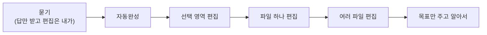

> 배휘동의 발표 자료 「나날이 발전하고픈 개발자를 위한 AI 활용법」(2025.08) 1부를 바탕으로 재구성한 노트다.

## 핵심: 꿀팁보다 위임의 원리

도구별 꿀팁(유용한 MCP 모음, 서브에이전트 모음, 프롬프트 기법)은 몇 달이면 낡는다. 몇 년 전 유행한 프롬프트 기법 상당수는 지금 모델에서 효과가 없다. 오래 가는 것은 그 팁들이 노리는 목적이다. **AI와 함께 내 문제를 더 잘 풀고 싶다.**

코딩 에이전트를 여럿 부리는 일은 사람에게 일을 맡기는 일과 닮았다. 그래서 매니지먼트의 질문을 그대로 쓸 수 있다.

| 질문 | 다루는 것 |
| --- | --- |
| 어떤 **권한**을 줄까 | 위임 단계, 자율성, 모니터링 |
| 어떤 **정보**를 줄까 | 컨텍스트 엔지니어링: What·Why, 필요할 때 How, 문서와 템플릿 |
| 어떤 **도구**를 쥐여 줄까 | MCP, 다른 에이전트, 검증 장치 |

## 권한: 잘할수록 넓히고 못하면 좁힌다

Management 3.0의 위임 7단계는 결정권을 누가 얼마나 갖는지를 나눈다.

| 단계 | 뜻 |
| --- | --- |
| 1. 통보(tell) | 내가 결정하고 알려 준다 |
| 2. 설득(sell) | 내가 결정하고 납득시킨다 |
| 3. 상의(consult) | 의견을 들은 뒤 내가 결정한다 |
| 4. 합의(agree) | 함께 토론해 결정한다 |
| 5. 조언(advise) | 의견만 주고 결정은 맡긴다 |
| 6. 질의(inquire) | 맡기고 가끔 물어본다 |
| 7. 위임(delegate) | 전적으로 맡긴다 |

AI에게도 같다. **일을 잘하면 단계를 올려 보고, 못하면 더 자주 검사하며 단계를 내리고, 다시 잘하면 보폭을 넓힌다.** 코딩 도구의 모드가 이 단계와 겹친다.



오른쪽으로 갈수록 토큰·에이전트 작업 시간 ↑, 내 코딩 시간 ↓, 리뷰할 양 ↑

### 맡긴 뒤 지켜보는 법

LLM은 블랙박스다. 세 가지로 관리한다.

| 방법 | 실천 |
| --- | --- |
| 기대 출력을 정해 둔다 | 사용자 스토리, 자동화 테스트, TDD. 입력에 무엇이 나와야 하는지 명확하면 결과를 기계가 판정한다 |
| 블랙박스에 창을 낸다 | 사고 과정(thinking) 로그, 도구 호출 로그를 읽고 도구가 어떻게 동작하는지 이해한다 |
| 되돌릴 지점을 둔다 | 작업 단위로 git 커밋, 진행 상황을 적는 파일 기반 메모리. 잘못되면 언제든 돌아간다 |

## 정보: What과 Why, 필요할 때 How

모델이 좋아질수록 How는 알아서 하는 경우가 많다. 특히 내가 모르는 것을 모르는 영역에서는 How를 맡기는 편이 낫다. 점점 중요해지는 것은 **무엇을(What) 왜(Why)** 원하는지다.

### STICC: What과 Why를 전하는 틀

인지심리학자 게리 클라인(Gary Klein)이 제안한 지시 틀이다. 사람에게 일을 맡길 때 쓰던 것을 프롬프트에 그대로 쓴다.

| 항목 | 담을 내용 |
| --- | --- |
| 상황(Situation) | 지금 나는 어떤 상황이다 |
| 작업(Task) | 그래서 이 일을 해 달라 |
| 의도(Intent) | 이 일은 이런 이유로 한다 |
| 우려(Concern) | 이 부분이 불안하다. 여기에 집중하고, 이렇게 테스트하라 |
| 조정(Calibrate) | 이럴 땐 이렇게 하고, 모르겠으면 나에게 물어라 |

### How가 필요할 때: 인지 작업 분석(CTA)

위임 단계를 올렸는데 AI가 잘 못하는 일은 대개 사람의 **암묵지**가 필요한 일이다. 이때는 내가 그 일을 어떻게 하는지를 꺼내야 한다. 전문가의 머릿속 판단 과정을 인터뷰로 뽑아내는 인지 작업 분석(CTA, Cognitive Task Analysis)을 나 자신에게 한다.

1. 이 작업을 끝내려고 나는 어떤 순서로 무엇을 하나? 각 행동을 **입력 → 처리 → 출력 → 다음 행동**으로 적는다.
2. 그중 프로그램(AI)이 대신하면 가장 편해지는 행동은? 그러려면 어떤 정보·권한·도구가 필요한가?
3. 잘 끝났다고 판단할 때 나는 무엇을 확인하나? 그것을 자동화된 테스트로 바꿀 수 있나? 결과를 검토하기 쉽게 하려면 무엇을 보여 줘야 하나?

이렇게 쪼갠 과정과 그 과정에서 나온 대화가 AI에게 가장 값진 컨텍스트가 된다. 혼자서는 잘 안 떠오르니 **다른 사람과 대화하며** 하거나, AI가 메타인지를 깨우는 질문을 던지게 한다. 디버깅 고수들을 인터뷰해 사고방식을 뽑아낸 「디버깅 마인드셋」도 CTA의 예다.

### 컨텍스트가 모자란 걸 아는 법

LLM은 보통 말한 대로 「해 준다」. 정보가 부족해도 그럴듯하게 채운다. 부족함을 드러내게 하는 기법이 있다.

| 기법 | 방법 | 효과 |
| --- | --- | --- |
| 되묻게 하기 | 「답하기 전에 더 나은 답에 필요한 정보를 먼저 물어봐」 | 빠진 컨텍스트를 모델이 요청한다. 딥 리서치 기능들이 시작 전에 이렇게 한다 |
| 모르면 모른다고 하기 | 「정보가 불충분하면 모르겠다고 말해」 | 단순하지만, 노력하면 답할 수 있는 것도 일찍 포기하게 만든다 |
| 불확실성 지도 | 「응답 끝에 불확실성 지도를 붙여. 가장 덜 자신 있는 부분, 지나치게 단순화했을 수 있는 부분, 어떤 질문이나 정보가 네 의견을 바꿀 수 있는지」 | 환각을 확인하기 쉽고, 무엇을 더 줘야 할지 보인다 |
| 메타 프롬프트 | 「이 프롬프트를 개선하고, 왜 그렇게 고쳤는지 알려 줘」 | 내가 습관적으로 빠뜨리는 정보를 깨닫는다. 개선안은 정답이 아니니 실제로 나아지는지 실험한다 |

이 넷을 합쳐 「AI와 함께 CTA를 하는 프롬프트」를 AI와 대화하며 만들고, 완성된 프롬프트를 새 세션에 넣어 실제 CTA를 돌릴 수도 있다.

### 그 밖의 컨텍스트: 사람이 일을 잘하게 할 정보라면 무엇이든

- 요구 문서(PRD), 기술 요구 문서(TRD), 정보 구조(IA), 사용자 스토리와 플로우
- 보고 따라 할 참고 코드, 템플릿, 코딩 컨벤션, 디자인 시스템
- 일을 제대로 했는지 점검할 체크리스트(테스트 코드)
- 이 모든 것을 언제 어떻게 쓰는지 알려 주는 안내(`CLAUDE.md`, Cursor Rules 같은 규칙 파일)

**어떤 템플릿에서 시작하느냐가 바이브 코딩 결과를 크게 좌우한다.** 좋은 템플릿이 있으면 뼈대를 만드는 데 토큰을 낭비하지 않고, 참고할 코드가 있으면 훨씬 잘 짠다. 0에서 시작할 때는 공개된 좋은 템플릿부터 찾고, 없으면 만든다. 이것이 시니어 개발자가 팀에 줄 수 있는 큰 기여다.

## 도구: 꼭 필요한 것만 붙인다

### MCP는 선별해서

MCP 서버는 많이 붙일수록 좋지 않다. 보안 위협, 의존성, 디버깅 난이도, 비용이 늘고, 도구 정의가 매 요청의 컨텍스트를 차지하며, 원하는 도구가 정확히 호출되기 어려워진다.

| 흔히 붙이는 MCP | 대안 |
| --- | --- |
| 최신 문서 가져오기 | 문서를 미리 로컬에 받아 둔다 |
| UI 코드 조각 가져오기 | 라이브러리 CLI나 템플릿으로 충분하다 |
| GitHub·데이터베이스 서비스 API | 공식 CLI가 더 정확하다 |
| 다른 LLM 호출 | 그 LLM의 CLI를 직접 부른다 |
| 파일 시스템, 웹 검색, 단계적 사고 | 에이전트에 이미 비슷한 내장 도구가 있다 |

남길 가치가 있는 것은 **에이전트가 원래 할 수 없는 일을 하게 하는 것**(실제 브라우저를 조작하는 Playwright로 UI 디버깅·디자인 확인)과 **다른 차원으로 똑똑하게 일하게 하는 것**(심볼 단위로 코드를 찾아 토큰을 아끼는 Serena 같은 코드 이해 도구)이다. 작업마다 필요한 MCP만 켜고 끈다.

Claude Code는 MCP 도구 응답이 일정 토큰을 넘으면 자른다. 큰 페이지를 읽는 브라우저 도구가 잘리면 `MAX_MCP_OUTPUT_TOKENS` 환경 변수로 한도를 올린다.

```json
// ~/.claude/settings.json
{ "env": { "MAX_MCP_OUTPUT_TOKENS": "100000" } }
```

### 다른 에이전트

| 종류 | 쓰임과 한계 |
| --- | --- |
| 서브에이전트 | 권한을 읽기 전용으로 묶을 수 있어 「이 저장소에 대해 답하는 에이전트」, 「코딩 대화 상대」처럼 쓰기 좋다. 특정 라이브러리 전문가 에이전트의 효과는 실험으로 확인한다 |
| 다른 LLM CLI | 「코드베이스가 크면 Gemini와 상의하며 진행해」처럼 비대화형 모드(`gemini -p`, `claude -p`, `codex exec`)로 부르게 한다. 무료 사용량이 넉넉한 CLI는 개인용으로 좋다 |
| 백그라운드 에이전트 | 병렬로 맡기는 대신 과정을 보며 개입하는 쪽을 택하면 덜 쓰게 된다. 결정을 제대로 해 두고 리뷰까지 AI에게 시키면 병렬화할 여지가 커진다 |
| 코드 리뷰 에이전트 | Diff에 보이는 **잘못 구현한 것**은 잘 잡지만, **구현했어야 하는데 빠진 것**은 잘 못 잡는다 |

### 검증 장치: 품질은 여전히 중요하다

- AI는 보고 따라 할 코드가 좋을수록 잘 짠다. 코드베이스 품질이 높을수록 속도와 비용도 유리하다. 보안·감사처럼 사람이 코드를 읽을 일도 결국 생긴다.
- 정적 검사(타입, 린트)와 테스트로 에이전트를 **옭아매면** 좋은 코드가 나올 확률이 높아진다([[harness-engineering|프롬프트에서 하네스로]]).
- 디버깅은 사용자 리포트와 스크린샷만 던지면 대개 실패한다. 디버깅의 핵심 컨텍스트는 **근본 원인을 찾고 재현하는 과정**이다. 그 과정을 사람이 먼저 하거나, 그 사고방식을 에이전트에 담는다.

## 하루 작업 흐름

사용자 규칙과 프로젝트 규칙이 이미 설정돼 있다는 전제다.

```text
1. 새 세션을 연다 (/clear)
2. 작업에 맞게 MCP를 켜고 끈다
3. STICC로 작업을 주고, 컨텍스트를 더하고, 구현 계획을 함께 짠다
4. 계획대로 구현을 맡긴다
5. 대화·구현 계획·테스트 방법을 문서로 남겨 코드와 함께 커밋한다
6. 자동·수동 테스트, 필요하면 코드·규칙·문서를 고친다
7. 안 되면 5의 커밋(또는 그 전)으로 돌아가 반복한다. 끝나면 커밋
8. 몇 작업마다 코드베이스 전체를 한 문서로 묶어(Repomix) 컨텍스트가 큰 모델에게 리팩터링 계획을 받고 실행한다
```

5번에서 계획과 프롬프트까지 커밋하는 이유는 **AI 시대에 무엇을 버전 관리할지**의 문제다. 결정적으로 생성되는 산출물은 관리하지 않고, 코드와 그 코드를 만든 계획, 계획을 만든 프롬프트·컨텍스트까지는 남긴다. 그래야 결과가 이상할 때 어느 층에서 틀어졌는지 추적하고, 같은 일을 다시 맡길 수 있다.

### 잘 쓰고 있는지 확인한다

「A일 때는 B가 좋다」는 팁을 들으면 **「좋다」의 기준이 뭐지? 좋아진 걸 어떻게 관찰하지?**를 묻는다. 측정하겠다고 마음먹는 것만으로 변화가 시작된다. 내가 이 도메인에서 AI를 점점 더 잘 쓰고 있다는 걸 어떻게 확인할지도 AI와 대화하며 정할 수 있다.

## 정리

- 꿀팁은 낡는다. AI에게 줄 **권한·정보·도구**를 정하고 결과를 관리하는 원리가 남는다.
- 권한은 위임 단계처럼 잘하면 넓히고 못하면 좁힌다. 기대 출력·로그·커밋으로 지켜본다.
- 정보는 What·Why가 먼저(STICC). 암묵지가 필요한 일은 CTA로 How를 꺼낸다.
- 되묻게 하기, 불확실성 지도, 메타 프롬프트로 빠진 컨텍스트를 드러낸다.
- 템플릿이 결과를 크게 좌우한다. MCP는 에이전트가 원래 못하는 일을 하게 하는 것만 붙인다.
- 계획과 프롬프트까지 코드와 함께 커밋하고, 몇 작업마다 전체를 보고 리팩터링한다.

관련 노트: [[ai-accelerated-development|AI로 개발 가속하기: 규칙을 키우는 개발]], [[claude-code-guide|Claude Code 활용 가이드]], [[ai-era-developer|AI 시대 개발자의 역할]], [[harness-engineering|프롬프트에서 하네스로]], [[ai-coding-guardrails|AI 코딩 실무 가드레일]], [[system-prompt-patterns|시스템 프롬프트 설계 패턴]]
