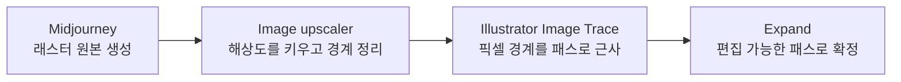

## 왜 세 단계인가

미드저니 같은 이미지 생성 AI는 **래스터(픽셀) 이미지**를 만든다. 로고·아이콘·스티커·인쇄물에 쓰려면 크기를 마음대로 바꾸고 색과 모양을 고칠 수 있는 **벡터**가 필요하다. 생성 이미지를 바로 벡터화하면 해상도가 낮고 경계에 노이즈가 많아 패스가 울퉁불퉁하고 조각이 잔뜩 생긴다. 중간에 업스케일을 끼우면 이 문제가 대부분 사라진다.

| 단계 | 하는 일 | 결과에 주는 영향 |
| --- | --- | --- |
| 1. 생성 (Midjourney) | 형태와 화풍을 정한다 | 처음부터 단순한 형태·적은 색·깨끗한 배경으로 그릴수록 추적이 쉽다 |
| 2. 업스케일 | 픽셀 수를 늘리고 계단 현상·압축 노이즈·잔얼룩을 매끈하게 다듬는다 | 경계가 또렷해져 추적 패스가 매끄럽고 기준점이 적어진다 |
| 3. 이미지 추적 (Image Trace) | 픽셀 경계를 따라 벡터 패스를 만든다 | 노이즈 설정으로 작은 점을 버리고, 색 수로 면을 단순화한다 |
| 4. 확장 (Expand) | 추적 결과를 일반 패스로 바꾼다 | 이후 패스·색을 직접 편집할 수 있다. 확장 뒤에는 추적 옵션을 다시 조정할 수 없다 |

업스케일러는 미드저니 자체의 Upscale 기능이나 별도 도구(Topaz Gigapixel, 무료 오픈소스 Upscayl 등)를 쓴다. AI 업스케일러는 단순 확대가 아니라 디테일을 다시 그리므로, 생성 이미지의 어색한 부분이 함께 정리되는 효과도 있다.

## 1. 생성 단계에서 추적하기 좋게 만들기

- 프롬프트에 `flat vector illustration`, `simple shapes`, `limited color palette`, `white background`처럼 평면적인 화풍을 지정한다.
- 그라데이션·질감·사진 같은 묘사는 추적하면 수백 개의 조각이 된다. 필요하면 벡터로 만든 뒤 일러스트레이터에서 다시 입힌다.
- 파라미터는 [[midjourney-prompt-parameters|미드저니 프롬프트 파라미터]]를 참고한다. `--s`를 낮추면 장식이 줄어 형태가 단순해진다.

## 2. 이미지 추적 설정

일러스트레이터에서 이미지를 선택하고 **창 > 이미지 추적(Window > Image Trace)** 패널을 연다. 프리셋으로 시작하고 고급 설정을 조정한다.

| 설정 | 뜻 | 조정 요령 |
| --- | --- | --- |
| 모드(Mode) | 컬러·회색 음영·흑백 | 로고·아이콘은 흑백이나 적은 색 컬러 |
| 색상(Colors) / 임계값(Threshold) | 쓸 색 수, 흑백 경계 | 색이 적을수록 면이 단순해진다 |
| 패스(Paths) | 패스가 픽셀 경계에 얼마나 붙을지 | 높이면 원본에 딱 맞고, 낮추면 느슨하고 매끄럽다 |
| 모서리(Corners) | 급한 굽이를 모서리점으로 만들 정도 | 높이면 모서리가 많아진다 |
| 노이즈(Noise) | 무시할 픽셀 영역 크기 | 고해상도는 20~50, 저해상도는 1~10. 높이면 잔점이 사라진다 |
| 방식(Method) | 인접(Abutting) / 중첩(Overlapping) | 면끼리 맞붙는 컷아웃이면 인접, 겹쳐 쌓으면 중첩 |
| 흰색 무시(Ignore White) | 흰 배경을 패스로 만들지 않는다 | 흰 배경 이미지라면 켠다 |

업스케일로 해상도가 높아졌으므로 노이즈를 높게 잡아도 형태가 무너지지 않는다. 이것이 업스케일을 먼저 하는 실질적인 이유다.

## 3. 마무리

1. **확장(Expand)** 으로 추적 결과를 패스로 확정한다.
2. 남은 잔조각은 직접 선택 도구로 지우거나 패스파인더로 합친다.
3. 기준점이 많으면 **객체 > 패스 > 단순화(Simplify)** 로 줄인다.
4. 웹에 쓸 아이콘이면 SVG로 내보낸다. 내보낸 SVG를 넣는 법은 [[svg-icons|SVG 아이콘]]에 있다.

## 한계

- 사진처럼 계조가 풍부한 이미지는 어떤 설정으로도 깔끔한 벡터가 되지 않는다. 평면적인 일러스트에 맞는 방법이다.
- 자동 추적은 곡선을 근사할 뿐이라, 정밀한 로고는 결국 손으로 다듬거나 다시 그려야 한다.
- 생성 이미지의 상업적 사용 조건은 서비스 약관과 요금제에 따라 다르므로 확인한다.

## 정리

- 생성 AI는 래스터를 만들고, 쓸모 있는 결과물은 대개 벡터여야 한다.
- **업스케일을 먼저 하면** 경계가 정리돼 추적 패스가 매끄럽고 조각이 적어진다.
- 추적은 색 수·노이즈·패스 설정으로 단순화 정도를 정하고, 확장으로 편집 가능한 패스로 확정한다.
- 처음부터 단순한 형태와 적은 색으로 생성하면 전 과정이 쉬워진다.

관련 노트: [[midjourney-prompt-parameters|미드저니 프롬프트 파라미터]], [[svg-icons|SVG 아이콘]], [[bezier-curve|베지어 곡선]]
