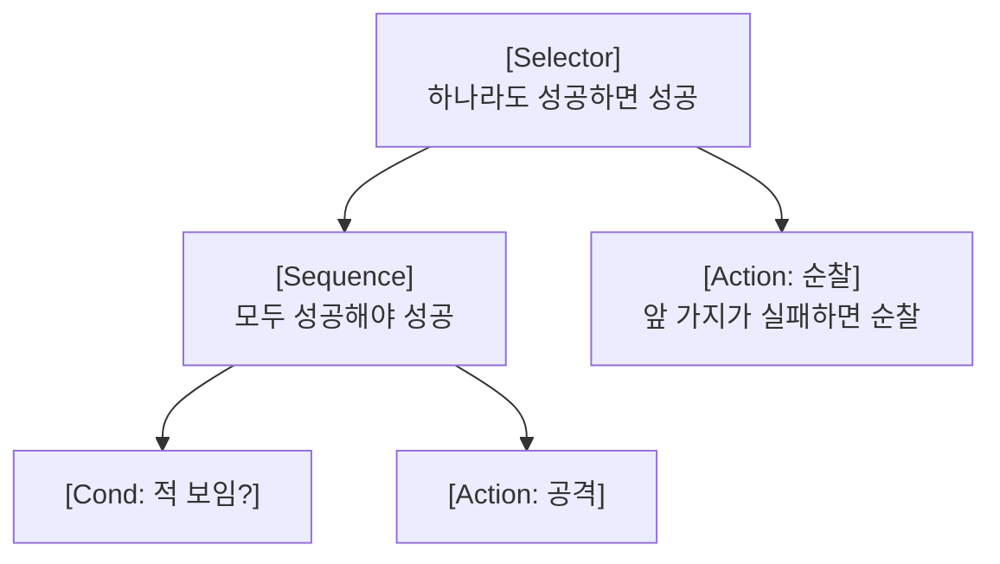

> LINE Engineering 블로그의 「[Behavior Tree를 알아봅시다](https://engineering.linecorp.com/ko/blog/behavior-tree/)」를 바탕으로 재구성한 노트다.

## 비헤이비어 트리란

비헤이비어 트리(Behavior Tree, BT)는 **에이전트가 지금 무엇을 할지 고르는 결정 구조를 트리로 표현한 것**이다. 게임 NPC의 AI에서 시작해 로봇 제어, 대화 시스템으로 퍼졌다.

트리는 주기적으로 **틱(tick)** 을 받는다. 틱이 오면 루트부터 **깊이 우선**으로 자식을 평가하고, 각 노드는 결과를 부모에게 돌려준다. 게임에서는 프레임 업데이트마다, 대화 시스템에서는 발화 한 번마다 틱을 주는 것이 보통이다.

## 반환 상태

| 상태 | 의미 |
| --- | --- |
| Success | 맡은 일을 끝냈다 |
| Failure | 할 수 없거나 실패했다 |
| Running | 아직 진행 중이다. 다음 틱에 이 노드를 다시 평가해 이어 간다 |

**Running이 있어서 여러 틱에 걸친 행동**(문까지 걸어가기, 애니메이션 재생)을 한 노드로 표현할 수 있다. 오래 Running인 노드를 끊을 장치(타임아웃, 인터럽트)가 없으면 트리가 한 행동에 붙잡힌다.

## 노드의 종류

| 분류 | 노드 | 동작 |
| --- | --- | --- |
| 복합(Composite) | **Sequence** | 자식을 왼쪽부터 평가한다. Failure나 Running이 나오면 즉시 그 값을 돌려주고, 모두 Success일 때만 Success. 논리 AND |
| | **Selector(Fallback)** | 자식을 우선순위 순으로 평가한다. Success나 Running이 나오면 즉시 돌려주고, 모두 Failure일 때만 Failure. 논리 OR |
| | **Parallel** | 여러 자식을 함께 평가하고, 성공한 자식 수 같은 정책으로 결과를 정한다 |
| 데코레이터(Decorator) | If·조건 가드 | 조건이 참일 때만 자식을 실행하고, 아니면 Failure |
| | Repeat·While | 정한 횟수만큼, 또는 조건이 참인 동안 자식을 반복한다. 다 채우기 전에는 Running |
| | Inverter·Retry·Timeout | 결과 뒤집기, 실패 시 재시도, 시간 초과 시 Failure |
| 리프(Leaf) | Action | 트리 밖의 실제 함수를 호출한다(이동, 공격, 응답 생성) |
| | Condition | 상태를 검사해 Success·Failure만 돌려준다 |

Selector와 Sequence의 자식 순서에 **무작위·확률**을 섞으면 같은 상황에서도 행동이 단조롭지 않게 된다.

### 블랙보드

노드끼리 값을 주고받을 공용 메모리를 **블랙보드(blackboard)** 라고 한다. 조건 노드는 블랙보드의 "적 위치"를 읽고, 액션 노드는 "마지막으로 본 시각"을 쓴다. 노드가 서로를 직접 알지 않아도 되므로 서브트리를 떼어 재사용하기 쉽다.

## FSM과 비교

| 관점 | 유한 상태 기계(FSM) | 비헤이비어 트리 |
| --- | --- | --- |
| 구조 | 상태와 상태 사이의 전이 | 행동을 고르는 우선순위 트리 |
| 확장 | 상태가 늘면 전이가 상태 수의 제곱에 가깝게 늘어난다 | 서브트리를 붙이거나 빼면 된다 |
| 재사용 | 전이가 상태 안에 박혀 떼어 내기 어렵다 | 서브트리(블록)를 다른 트리에서 그대로 쓴다 |
| 반응성 | 전이 조건을 상태마다 따로 적는다 | 매 틱 루트부터 다시 평가해 우선순위 높은 가지가 자연히 끼어든다 |

## 한계

- 트리가 커지면 **매 틱 평가하는 노드 수**가 늘어 비용이 커진다. Running 노드부터 이어서 평가하는 최적화를 쓴다.
- 자원이 떨어진 상황 같은 예외 가지를 빠뜨리면 같은 대기 행동만 반복한다. 실패 경로를 설계에 넣어야 한다.
- 장기 계획에는 약하다. 목표를 세우고 행동 순서를 찾는 문제는 GOAP·HTN 같은 플래너나 학습 기반 방법([[reinforcement-learning|강화 학습]])과 함께 쓴다.

## 어디서 쓰나

| 분야 | 예 |
| --- | --- |
| 게임 엔진 | Unreal Engine의 Behavior Tree 에디터처럼 그래픽 도구로 트리를 편집한다 |
| 로봇 | ROS 2의 내비게이션 스택(Nav2)이 BehaviorTree.CPP로 주행 행동을 조립한다 |
| 대화 시스템 | 발화마다 틱을 주어 의도 확인 → 슬롯 채우기 → 응답 같은 흐름을 고른다 |

## 정리

- BT는 틱마다 루트부터 깊이 우선으로 평가하고, 노드는 Success·Failure·Running을 돌려준다.
- Sequence는 AND, Selector는 OR, 데코레이터는 자식 하나를 감싼 제어문이다.
- 노드 간 데이터는 블랙보드로 주고받아 서브트리를 재사용한다.
- FSM의 전이 폭증 없이 행동을 조립하는 것이 BT의 핵심 가치다.

관련 노트: [[tree|트리와 이진 탐색 트리]], [[dfs|깊이 우선 탐색 (DFS)]], [[reinforcement-learning|강화 학습: 에이전트·MDP·가치 함수와 알고리즘 분류]], [[feedback-control-pid|피드백 제어와 PID 제어기]]
