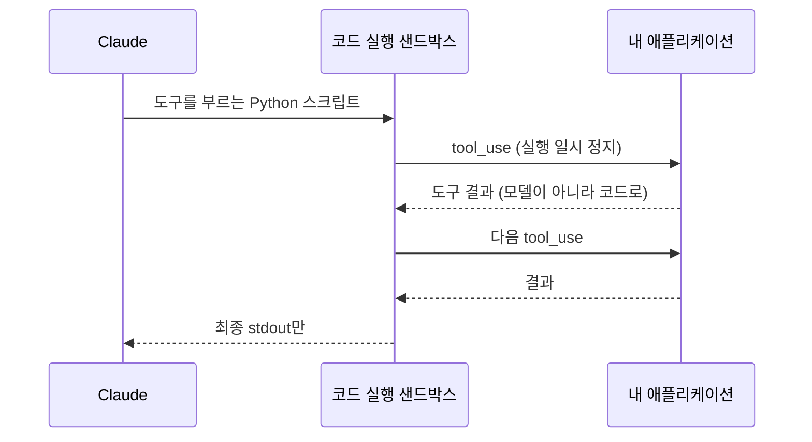

> shanraisshan의 「[claude-code-best-practice](https://github.com/shanraisshan/claude-code-best-practice)」(MIT)의 고급 도구 사용 리포트를 바탕으로 재구성한 노트다. 네 기능은 2026-02-18에 정식 출시됐고 Claude API·Microsoft Foundry에서 쓴다. 효과 수치는 Anthropic이 발표한 벤치마크다.

## 무엇이 문제인가

에이전트가 도구를 쓰는 기본 루프는 **도구 호출 하나마다 모델 추론 한 번**이다. 도구가 많아지면 두 가지가 맥락을 채운다.

| 맥락을 채우는 것 | 예 |
| --- | --- |
| 도구 정의 | MCP 도구 50개 × 약 1.5K 토큰 = 질문하기 전에 75K 토큰 |
| 중간 결과 | 로그 전체, 원본 HTML, 큰 조회 결과가 다음 추론까지 그대로 남는다 |

네 기능은 각각 다른 병목을 친다. **가장 큰 병목부터** 도입한다.

| 기능 | 푸는 병목 | 효과 |
| --- | --- | --- |
| Tool Search | 도구 정의가 맥락을 채움 | 도구 정의 토큰 약 85% 감소(77K → 8.7K) |
| Programmatic Tool Calling | 큰 중간 결과, 다단계 왕복 | 토큰 약 37% 감소 |
| Dynamic Filtering | 웹 검색·가져오기의 잡음 | 입력 토큰 평균 24% 감소 |
| Tool Use Examples | 파라미터를 잘못 채움 | 복잡한 파라미터 정확도 72% → 90% |

## Programmatic Tool Calling(PTC)

모델이 Python 스크립트를 쓰고, **스크립트가 도구를 async 함수로 호출**한다. 중간 결과는 코드 안에서만 오가고 **최종 stdout만** 모델 맥락에 들어간다. 도구 3개면 추론 3번이던 것이 추론 1번이 된다.

- 코드 실행 도구 `code_execution_20260120` 이상(`{"type": "code_execution_20260120", "name": "code_execution"}`)을 함께 넣고, 부를 도구에 `allowed_callers: ["code_execution_20260120"]`을 지정한다(`code_execution_20260521`도 같은 뜻으로 받는다). 이 필드는 모델 유도용이지 보안 경계가 아니다. 기본값은 `["direct"]`이고 둘 다 넣을 수도 있지만 **도구마다 한 방식만** 쓰는 편이 낫다. 응답의 `caller` 필드로 어느 쪽에서 불렸는지 구분한다.
- 어울리는 패턴: N개 항목을 한 번의 추론으로 배치 처리, 조건을 만족하면 조기 종료, 파일 크기에 따라 전체·요약 도구 고르기, 로그에서 ERROR만 마지막 10개 거르기.
- 어울리는 일: 집계가 필요한 큰 데이터, 서로 의존하는 순차 호출 3개 이상, 모델에 넘기기 전에 걸러야 하는 결과. 안 맞는 일: 단일 호출, 즉시 사용자 피드백이 필요한 도구, 오버헤드가 이득보다 큰 아주 빠른 작업.
- 제약: Bedrock·Vertex 불가, MCP 커넥터 도구·computer use·browser use 도구 불가(웹 검색은 코드에서 부를 수 있다), `strict: true` 구조화 출력·`tool_choice` 강제 불가. 컨테이너는 만든 뒤 30일까지 다시 쓸 수 있고 약 5분 쉬면 체크포인트되며, 코드가 기다리는 도구 결과는 약 4분 뒤 타임아웃된다. 도구 결과가 문자열로 코드에 들어가므로 **코드 주입을 검증**해야 한다.

## Dynamic Filtering

웹 검색·가져오기 결과를 그대로 넣지 않고, 모델이 결과를 거르는 코드를 직접 써서 실행한 뒤 걸러진 내용만 맥락에 넣는다. 도구 타입 `web_search_20260209`, `web_fetch_20260209`를 쓰면 지원 모델에서 기본으로 켜진다.

- 검색형 벤치마크(BrowseComp)에서 정답률이 Sonnet 4.6은 33.3% → 46.6%, Opus 4.6은 45.3% → 61.6%로 올랐다.
- 큰 모델은 필터 코드를 복잡하게 짜서 비용이 오히려 조금 늘 수 있다.

## Tool Search

드물게 쓰는 도구에 `defer_loading: true`를 걸어 정의를 맥락에서 빼 두고, 필요할 때 모델이 검색해 불러오게 한다. MCP 서버 전체를 `mcp_toolset`의 `default_config`로 미루고 자주 쓰는 도구만 `configs`에서 예외로 둘 수도 있다.

| 도입 기준 | 운영 원칙 |
| --- | --- |
| 도구 정의 10K 토큰 초과, 도구 10개 이상, MCP 서버 여러 개, 도구 선택 정확도 문제 | 자주 쓰는 3~5개만 상시 로드한다. 이름·설명을 검색되게 구체적으로 쓴다. 시스템 프롬프트에 어떤 능력이 있는지 적어 둔다 |

## Tool Use Examples

도구 정의에 `input_examples` 배열을 넣는다. JSON 스키마는 타입은 말해도 **사용 패턴**은 못 전한다: 선택 파라미터를 언제 넣는지, 어떤 조합이 말이 되는지, 날짜·ID 형식 관례, 중첩 구조.

- placeholder가 아닌 현실 데이터로, 최소·부분·전체 예시를 섞어 도구당 1~5개를 둔다.
- 파라미터 상관관계를 보여 준다. 예: `priority: "critical"`이면 `assignee`가 있다.

## Claude Code와의 관계

| 기능 | Claude Code에서 |
| --- | --- |
| Tool Search | 내장돼 있다. MCP 도구 설명이 맥락의 일정 비율(기본 10%)을 넘으면 미뤄 두고 검색한다. 임계값은 `ENABLE_TOOL_SEARCH=auto:N`(N은 맥락 %), 늘 올릴 서버는 `.mcp.json` 항목에 `"alwaysLoad": true` |
| Dynamic Filtering, PTC | CLI에는 없다. Agent SDK로 웹 조사·커스텀 에이전트를 만들 때 쓴다 |
| Tool Use Examples | CLI에서 설정할 수 없다. MCP 서버 작성자가 스키마에 넣는다 |

MCP 서버를 만든다면 반환 형식을 설명에 명확히 적고 구조화된 JSON을 돌려준다. PTC가 코드에서 그 결과를 파싱하기 때문이다. 어떤 MCP를 붙일지 고르는 원칙은 [[ai-delegation-toolkit|AI에게 일 맡기기]]에 있다.

## 정리

- 도구가 많을수록 맥락은 도구 정의와 중간 결과로 찬다. 맥락은 비용이자 품질이다.
- 정의가 비대하면 Tool Search, 중간 결과가 크면 PTC, 웹 잡음은 Dynamic Filtering, 파라미터 오류는 Examples로 친다.
- PTC의 핵심은 「중간 결과를 모델 밖, 코드 안에 둔다」이고, 이는 서브에이전트로 탐색 잡음을 격리하는 것과 같은 발상이다.

관련 노트: [[harness-engineering|프롬프트에서 하네스로]], [[ai-delegation-toolkit|AI에게 일 맡기기]], [[claude-code-guide|Claude Code 활용 가이드]], [[llm-behavior-variability|LLM 동작은 왜 날마다 다른가]]
