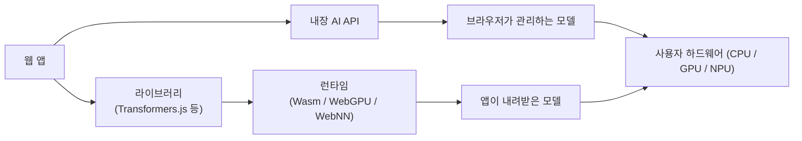

> web.dev의 「[Learn AI](https://web.dev/learn/ai)」 강좌 중 「Choose a client-side library」 모듈을 바탕으로, API 상태는 Chrome for Developers의 [Built-in AI](https://developer.chrome.com/docs/ai/built-in-apis) 문서로 확인해 재구성한 노트다.

## 두 가지 방식

클라이언트 사이드 AI는 서버 없이 사용자 기기에서 추론한다. 방법은 둘이다. 어느 쪽을 클라이언트에 둘지, 서버와 어떻게 나눌지는 [[web-ai-platform-choice|웹 AI 플랫폼 고르기]]에서 다룬다.



| | 내장 AI | 라이브러리 + 커스텀 모델 |
| --- | --- | --- |
| 모델 | 브라우저가 내려받아 여러 사이트가 공유 | 사이트마다 사용자가 내려받음 |
| 설정 | API 호출만 | 모델 로딩, 런타임 설정, 추론 파이프라인 |
| 맞춤성 | 프롬프트·옵션만 | 모델 선택, 일부는 파인튜닝·학습 |
| 비용 | 호출당 비용 없음 | 호출당 비용 없음, 개발·유지 비용 큼 |
| 잘 맞는 곳 | 빠른 프로토타입, 좁고 잘 정의된 기능 | 내장 AI로 안 되는 모델·파이프라인 |

## 내장 AI (Built-in AI)

브라우저가 작은 기반 모델을 들고 있고, 과제별 고수준 API로 노출한다. Chrome은 Gemini Nano와 과제별 전문 모델을, Microsoft Edge는 자체 모델을 쓴다. 개발자 입장에서는 다른 브라우저 기능처럼 부르고 결과를 받으면 끝이다.

### Chrome 내장 AI API 상태 (2026년 10월 기준)

| API | 하는 일 | 웹 | 확장 프로그램 |
| --- | --- | --- | --- |
| Translator API (`Translator`) | 번역 | Chrome 138부터 정식 | Chrome 138부터 정식 |
| Language Detector API (`LanguageDetector`) | 언어 감지 | Chrome 138부터 정식 | Chrome 138부터 정식 |
| Summarizer API (`Summarizer`) | 요약 (`key-points`, `tldr`, `teaser`, `headline`) | Chrome 138부터 정식 | Chrome 138부터 정식 |
| Prompt API (`LanguageModel`) | 자연어 요청, 텍스트·이미지·오디오 입력 | Chrome 148 전후로 정식 전환 중(상태 표에서 확인) | Chrome 138부터 정식 |
| Prompt API 샘플링 파라미터 (`samplingMode`) | 출력의 예측성·창의성 조절 | 오리진 트라이얼 (Chrome 148~) | `temperature`·`topK` 지원 |
| Writer / Rewriter API (`Writer`, `Rewriter`) | 새 글 쓰기 / 고쳐 쓰기 | 개발자 트라이얼 (플래그) | 개발자 트라이얼 |
| Proofreader API (`Proofreader`) | 교정 | 개발자 트라이얼 (플래그) | 개발자 트라이얼 |

- Writer·Rewriter는 Chrome 137~148, Proofreader는 Chrome 141~145에 오리진 트라이얼을 거쳤고, 지금은 `chrome://flags`(`#writer-api`, `#rewriter-api`, `#proofreader-api`)로 시험한다.
- MDN 기준으로 이 API들은 실험적(Experimental)이고 **Baseline이 아니다.** 사실상 Chromium 계열 전용이므로 대체 경로가 필수다.
- 상태는 자주 바뀐다. 쓰기 전에 [Built-in AI API 상태표](https://developer.chrome.com/docs/ai/built-in-apis)를 다시 확인한다.

### 하드웨어 요건 (Chrome)

- **데스크톱 전용.** Windows 10·11, macOS 13 이상, Linux, Chromebook Plus의 ChromeOS. Android·iOS의 Chrome은 지원하지 않는다.
- 모델을 받을 볼륨에 **22GB 이상** 여유 공간. 내려받은 뒤 여유 공간이 10GB 아래로 떨어지면 모델이 지워지고, 조건이 회복되면 다시 받는다.
- GPU는 VRAM 4GB 초과, 또는 CPU는 RAM 16GB 이상·4코어 이상.
- 첫 다운로드에만 비종량제 네트워크가 필요하다. 이후 추론은 오프라인으로 되고, 데이터는 Google이나 제3자에게 가지 않는다.
- 모델 현재 크기와 상태는 `chrome://on-device-internals`에서 본다.

### 쓰는 순서: 확인 → 사용자 활성화 → 생성 → 실행

```js
// 1. 기능 감지와 가용성 확인
if (!('Summarizer' in self)) return showFallback();
const availability = await Summarizer.availability();
// "unavailable" | "downloadable" | "downloading" | "available"
if (availability === 'unavailable') return showFallback();

// 2. 모델을 받아야 하면 사용자 활성화(클릭·키 입력) 뒤에만 create() 가능
if (availability !== 'available' && !navigator.userActivation.isActive) return;

// 3. 생성: 다운로드 진행률을 사용자에게 알린다
const summarizer = await Summarizer.create({
  type: 'key-points', format: 'markdown', length: 'short',
  monitor(m) {
    m.addEventListener('downloadprogress', (e) => updateProgress(e.loaded));
  },
});

// 4. 실행
const summary = await summarizer.summarize(reviewsText);
```

- `availability()`에는 `prompt()`에 쓸 옵션(언어, 모달리티)을 **똑같이** 넘긴다. 모델마다 지원 언어·모달리티가 다르기 때문이다.
- `create()`에 `AbortSignal`을 넘기면 세션을 정리할 수 있다. 옵션은 생성 후 못 바꾸니, 바꾸려면 새로 만든다.
- 기본적으로 최상위 창과 같은 출처 iframe에서만 쓸 수 있다. 다른 출처 iframe은 Permissions Policy로 허용한다(`<iframe allow="summarizer">`).
- TypeScript 타입은 `@types/dom-chromium-ai` 패키지에 있다.

### Prompt API: 세션과 구조화 출력

```js
const session = await LanguageModel.create({
  initialPrompts: [{ role: 'system', content: '블로그 제목 도우미다. 제목 3개를 JSON으로 낸다.' }],
});

const schema = { type: 'object', properties: { titles: { type: 'array', items: { type: 'string' } } } };
const result = await session.prompt(blogContent, { responseConstraint: schema });
const { titles } = JSON.parse(result);
```

- `responseConstraint`에 JSON 스키마나 정규식을 넘기면 출력 모양을 강제한다. 스키마도 컨텍스트 창을 쓰며, `session.measureContextUsage()`로 잴 수 있다.
- 웹에서는 `temperature`·`topK`를 기본으로 노출하지 않는다. 숫자 파라미터가 모델마다 같은 뜻을 갖지 않기 때문이다. 오리진 트라이얼의 `samplingMode`(`most-predictable` ~ `most-creative`)가 그 대안이다.
- 시스템·사용자 프롬프트 나누는 법은 [[system-prompt-patterns|시스템 프롬프트 설계 패턴]]에 있다.

### 내장 AI의 한계

| 한계 | 대응 |
| --- | --- |
| 작은 모델: 복잡한 추론·긴 컨텍스트·열린 대화에 약하다 | 좁은 과제에만 쓰고 어려운 요청은 서버로 승격 |
| 첫 실행에 큰 다운로드·저장 공간 | 가치를 먼저 보여 주고, 다운로드 시점을 사용자 여정 뒤쪽으로 |
| 브라우저마다 지원이 다르다 | 서버 대체 경로를 반드시 둔다 |
| 기기의 모델은 OS·브라우저가 언제든 지울 수 있다 | 일시적으로 모델이 없는 상태를 정상 경로로 처리 |
| 같은 API라도 브라우저마다 모델이 달라 응답이 다르다 | 브라우저별로 평가한다. 공통 인터페이스 표준화는 W3C 커뮤니티 그룹에서 진행 중이다 |

RAG, 에이전트, 복잡한 워크플로가 필요하면 라이브러리 런타임이나 서버 추론으로 간다.

## 라이브러리로 커스텀 모델 돌리기

| 라이브러리 | 돌리는 것 | 학습 | 잘 맞는 곳 |
| --- | --- | --- | --- |
| Transformers.js | Hugging Face Hub의 모델 (여러 모달리티) | 전체 학습 없음 | NLP 파이프라인, 임베딩, 작은 멀티모달 |
| TensorFlow.js | TensorFlow·Keras 모델 | 브라우저에서 학습 가능 | 비전·오디오, 커스텀 분류기 |
| WebLLM | 작은 언어 모델 (Gemma, Mistral, Phi, Qwen 등), MLC 컴파일 모델 | 없음 | 클라이언트 챗봇·에이전트, 오프라인 AI |
| MediaPipe | 과제별 비전 모델, 일부 텍스트 모델 | 없음 | 얼굴·손·포즈, AR, 제스처 UI |
| ONNX Runtime Web | 모든 ONNX 모델 | 없음 | 임베딩, 안전 필터, 커스텀 ML |

- **Transformers.js**: 감성 분석·개체명 인식·요약·임베딩 같은 익숙한 `pipeline`으로 Hub의 모델을 바꿔 끼우며 실험한다.
- **TensorFlow.js**: 이미지 분류·객체 탐지·포즈 추정의 사전 학습 모델이 많고 API가 안정적이다. Node.js에서도 돈다.
- **WebLLM**: OpenAI 호환 형태의 API라 서버 모델과 하이브리드로 바꾸기 쉽다. 클라이언트에서 대화형·에이전트 기능을 원할 때 고른다.
- **MediaPipe**: 전처리 → 추론 → 후처리를 다 맡고 중급 기기에서도 실시간으로 돈다. 자체 C++ 런타임을 쓴다.
- **ONNX Runtime Web**: PyTorch·TensorFlow·scikit-learn에서 ONNX로 내보낸 모델을 그대로 올린다.

이 분야의 추천 라이브러리는 빨리 바뀐다. 고를 때마다 유지 상태를 확인한다.

## 런타임

라이브러리는 브라우저의 저수준 실행 백엔드로 연산을 하드웨어에 매핑한다. 런타임은 성능, 메모리, 수치 안정성, 기기 호환성을 좌우한다.

| 런타임 | 쓰는 하드웨어 | 특징 |
| --- | --- | --- |
| **WebAssembly (Wasm)** | CPU (SIMD, 멀티스레드) | 모든 브라우저에서 돈다. 임베딩·분류기·랭킹 같은 작은 작업에 충분하고, 큰 행렬 곱은 느리다. **가장 안전한 대체 경로** |
| **WebGPU** | GPU | Wasm보다 훨씬 빨라 브라우저 LLM 추론을 가능하게 한다. MDN 기준 아직 Baseline이 아니어서 Wasm 대체가 필요하다 |
| **WebNN** | GPU, NPU 등 기기의 가속기 | 행렬 곱·합성곱·활성화를 가장 효율적인 경로로 돌린다. 아직 실험 단계 |

| 라이브러리 | Wasm | WebGPU | WebNN |
| --- | --- | --- | --- |
| Transformers.js | 지원 | 지원 | 실험 |
| TensorFlow.js | 지원 | 실험 | 미지원 |
| WebLLM | 실험 | 지원 | 미지원 |
| MediaPipe | 지원 | 실험 | 미지원 |
| ONNX Runtime Web | 지원 | 실험 | 실험 |

## 정리

- 내장 AI는 **설정 없이 공짜로** 좁은 기능을 붙이는 길이고, 라이브러리는 **모델을 고르는 대신 운영을 떠안는** 길이다.
- Chrome에서 번역·언어 감지·요약은 138부터, Prompt API는 148 전후로 웹 정식 전환이 진행 중이다. 쓰기·고쳐 쓰기·교정은 아직 플래그 단계다.
- 내장 AI는 데스크톱 전용이고 Baseline이 아니다. **기능 감지 → `availability()` → 사용자 활성화 → `create()`** 순서와 서버·비AI 대체 경로를 항상 갖춘다.
- 런타임은 WebGPU를 우선하되 Wasm으로 떨어질 수 있게 만든다.

관련 노트: [[web-ai-platform-choice|웹 AI 플랫폼 고르기]], [[ai-ux-patterns|AI 기능의 UX 패턴]], [[system-prompt-patterns|시스템 프롬프트 설계 패턴]], [[webgl-shaders|WebGL과 셰이더: 브라우저가 GPU로 그리는 방식]]
