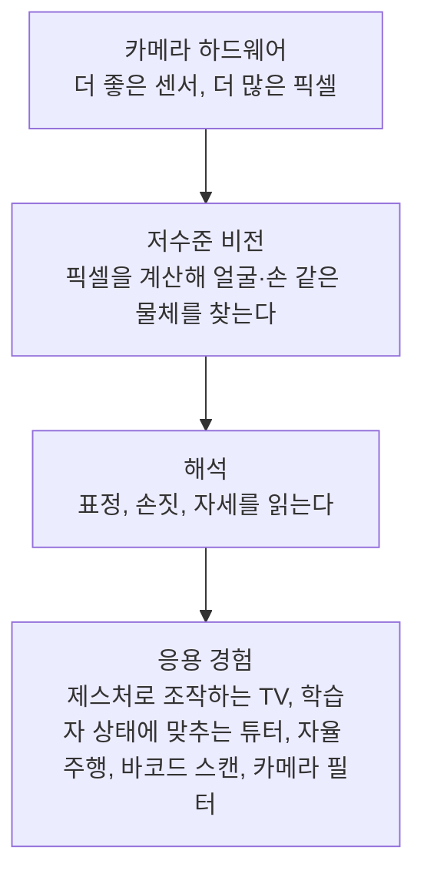

> CrashCourse의 「Crash Course Computer Science」 #35 「Computer Vision」(2017)을 바탕으로, 그 뒤 바뀐 사실은 2026년 기준으로 고쳐 재구성한 노트다.
> 「영상 처리와 컴퓨터 비전」, 「선수 지식」, 「세부 과제」는 Team-Neighborhood의 「[I want to study Data Science](https://github.com/Team-Neighborhood/I-want-to-study-Data-Science/wiki)」 위키 「컴퓨터 비전」 문서로, 「대표 데이터셋」은 같은 위키의 「[데이터](https://github.com/Team-Neighborhood/I-want-to-study-Data-Science/wiki/%EB%8D%B0%EC%9D%B4%ED%84%B0)」 문서와 각 데이터셋 공식 페이지로 보강했다.

## 컴퓨터 비전이란

컴퓨터 비전(computer vision)은 **디지털 이미지와 영상에서 높은 수준의 이해를 뽑아내는** 분야다. 카메라는 사람 눈보다 정밀하게 찍지만, 찍는 것과 보는 것은 다르다. 이미지는 컴퓨터에게 RGB 값을 가진 픽셀의 격자일 뿐이고([[deep-learning-intuition|딥러닝 직관으로 이해하기]]의 「숫자」 절), 비전 알고리즘은 이 숫자에서 「공이 어디 있나」, 「이건 얼굴인가」, 「웃고 있나」를 끌어낸다.

| 단위 | 보는 것 | 대표 기법 |
| --- | --- | --- |
| 픽셀 하나 | 색 | 색 추적 |
| 패치(주변 픽셀 묶음) | 에지, 선, 점 같은 국소 특징 | 커널과 합성곱 |
| 특징의 조합 | 얼굴, 손, 물체 | Viola-Jones, CNN |
| 물체 안의 좌표 | 눈꼬리, 입꼬리, 관절 | 랜드마크 추적 |

### 영상 처리와 컴퓨터 비전

두 말은 전공자도 섞어 쓰지만 목적이 다르다.

| | 영상 처리(image processing) | 컴퓨터 비전(computer vision) |
| --- | --- | --- |
| 목적 | 이미지를 **바꾼다** | 이미지를 **이해한다** |
| 입력 → 출력 | 이미지 → 이미지 | 이미지 → 의미(라벨, 좌표, 설명) |
| 예 | 모자이크, 블러, 에지 강조, 노이즈 제거 | 얼굴 검출, 물체 분류, 특징 추출·매칭 |

얼굴을 찾으려고 필터로 기울기(gradient)를 또렷하게 만드는 단계는 영상 처리이고, 그 기울기를 학습된 패턴과 비교해 「얼굴이다」라고 판단하는 단계는 컴퓨터 비전이다. 비전은 거의 항상 영상 처리를 앞 단계로 깔고 가므로 경계가 칼같지는 않다.

### 선수 지식

| 분야 | 왜 필요한가 |
| --- | --- |
| 디지털 영상 처리 | 이미지를 다루는 기본 조작 |
| 선형대수 | 이미지는 행렬이고, 변환·투영은 행렬 연산이다 |
| 미적분 | 기울기 같은 특징 계산, 신경망 학습 |
| 디지털 신호 처리 | 이미지도 2차원 신호다. 샘플링, 에일리어싱, LTI 시스템, [[fourier-transform\|푸리에 변환]] |
| 확률·패턴 인식 | 추출한 특징의 분포를 보고 분류한다 |

## 픽셀 하나로 하는 일: 색 추적

가장 단순한 비전 알고리즘은 **색으로 물체를 따라가는** 것이다. 분홍 공의 가운데 픽셀 RGB 값을 저장해 두고, 새 이미지의 모든 픽셀을 돌며 목표 색과의 차이가 가장 작은 픽셀을 고른다. 영상의 프레임마다 반복하면 공의 궤적이 나온다.

이 방식은 깨지기 쉽다. 조명·그림자 때문에 공의 색이 프레임마다 달라지고, 비슷한 색의 유니폼이 있으면 헷갈린다. 그래서 조명과 배경을 통제할 수 있는 환경(공장 라인, 스튜디오의 크로마키)에서만 쓴다.

## 패치와 커널: 합성곱

에지(edge)처럼 **여러 픽셀에 걸친 특징**은 픽셀 하나로는 판단할 수 없다. 작은 픽셀 영역인 **패치(patch)** 를 봐야 한다.

세로 에지는 「왼쪽 픽셀들과 오른쪽 픽셀들의 밝기 차이가 크고, 그 차이가 세로로 이어지는 곳」이다. 이 규칙을 숫자 격자로 적은 것이 **커널(kernel)** 또는 필터다. 커널을 관심 픽셀 위에 겹치고, 겹친 칸끼리 곱해 모두 더한 값을 가운데 픽셀의 새 값으로 쓴다. 이 연산이 **합성곱(convolution)** 이다.

```text
세로 에지 커널(프리윗)        패치(회색조 밝기)             결과
  -1  0  1                    20  20  70
  -1  0  1        ×           20  20  70        →  (70-20)×3 = 150 : 에지일 가능성 높음
  -1  0  1                    20  20  70

같은 커널을 고른 벽 위에 놓으면 왼쪽·오른쪽이 상쇄돼 0에 가깝다 → 에지가 아니다
```

이미지의 모든 픽셀에 같은 커널을 밀며 적용하면, 세로 에지가 강한 곳만 밝은 새 이미지가 나온다. 가로 에지는 거의 보이지 않으므로 가로 에지를 보려면 커널을 90도 돌린 것을 쓴다. 이 두 커널이 **프리윗 연산자(Prewitt operator)** 이고, 가운데 줄에 가중치 2를 준 것이 소벨(Sobel) 연산자다.

| 커널 | 하는 일 |
| --- | --- |
| 에지 검출(프리윗, 소벨) | 한 방향의 밝기 변화가 큰 곳을 강조한다 |
| 선 검출 | 양쪽에 에지가 있는 가는 선에 반응한다 |
| 점(섬) 검출 | 주변과 대비되는 픽셀 덩어리에 반응한다. 눈동자처럼 밝은 영역에 둘러싸인 어두운 원 |
| 블러 | 주변 평균을 내 부드럽게 한다 |
| 샤프닝 | 가운데를 키우고 주변을 빼 경계를 또렷하게 한다 |

커널은 **특정 모양에만 반응하는 쿠키 틀**처럼 쓸 수 있다. 큰 커널의 합성곱은 주파수 영역에서 곱하는 편이 빠르다([[fourier-transform|푸리에 변환]]).

## 약한 특징을 모아 얼굴 찾기: Viola-Jones

커널 하나는 형편없는 얼굴 검출기다. 하지만 얼굴에는 특징이 모여 있다. 콧등은 콧방울보다 밝아 선 커널에 반응하고, 눈은 밝은 피부에 둘러싸인 어두운 영역이라 점 커널에 반응한다. 얼굴이 아닌 곳에 이런 특징이 우연히 한꺼번에 모일 가능성은 낮다.

**Viola-Jones 얼굴 검출**(2001)은 이 생각을 구현한 초기 알고리즘이다. 검색 창(search window)을 이미지 위로 밀면서 단순한 밝기 차이 특징 여러 개를 계산하고, **약한 판별기 여럿을 부스팅으로 묶어** 강한 판별기를 만든다([[decision-tree-ensemble|결정 트리와 앙상블]]의 AdaBoost). 얼굴이 아닌 창은 앞 단계에서 빨리 버리는 연쇄 구조라 실시간으로 돌아, 디지털카메라의 얼굴 인식 초점으로 널리 쓰였다.

## 커널을 학습한다: 합성곱 신경망

인공 뉴런은 입력마다 가중치를 곱해 더한다([[perceptron-mlp|퍼셉트론]]). 입력을 1차원 목록 대신 **2차원 픽셀 패치**로 주면 이것은 합성곱과 똑같다. 가중치가 곧 커널 값이다. 차이는 사람이 미리 정한 커널(프리윗) 대신 **신경망이 데이터에서 쓸모 있는 커널을 스스로 찾는다**는 점이다.

| | 손으로 설계한 커널 | 합성곱 신경망(CNN) |
| --- | --- | --- |
| 커널 값 | 사람이 정한다 | 학습으로 정해진다 |
| 층 | 보통 한 번 적용 | 합성곱 위에 합성곱을 쌓는다 |
| 찾는 것 | 정해 둔 모양(에지, 선) | 과제에 필요한 모양이면 무엇이든 |

CNN은 뉴런 묶음(커널 뱅크)으로 이미지를 처리해 커널마다 새 이미지(특징 맵)를 내고, 다음 층이 그 특징 맵 위에서 다시 합성곱을 한다. 첫 층은 에지를, 다음 층은 에지가 모인 모서리를, 그다음은 눈썹·입 같은 부분을, 마지막은 「얼굴이다」를 본다. 층이 쌓이며 보는 것이 올라가는 모습은 [[deep-learning-intuition|딥러닝 직관으로 이해하기]]의 「층이 쌓이며 보는 것」에 있다. 복잡한 장면을 알아보려면 층이 깊어야 해서 CNN은 딥러닝으로 분류된다.

CNN과 Viola-Jones는 얼굴 밖에서도 쓰인다. 손글씨 인식, CT 영상의 종양 찾기, 도로 교통량 감시가 같은 방식이다. 2020년 이후에는 이미지를 패치로 잘라 토큰처럼 다루고 어텐션으로 관계를 보는 **비전 트랜스포머(ViT)** 가 큰 모델의 주류가 됐고, 이미지와 글을 함께 다루는 멀티모달 LLM도 이 구조를 쓴다. 가볍고 빠른 모델이 필요한 기기 안 추론에서는 CNN이 여전히 널리 쓰인다. 탐지 성능은 IoU·mAP로 잰다([[classification-metrics|분류 모델 성능 평가 지표]]).

## 랜드마크에서 맥락으로

얼굴을 찾은 다음에는 더 특화된 알고리즘으로 코끝, 입꼬리, 눈꼬리 같은 **얼굴 랜드마크(facial landmark)** 좌표를 찍는다. 좌표가 있으면 많은 판단이 점 사이 거리 계산으로 바뀐다.

| 랜드마크로 하는 일 | 방법 |
| --- | --- |
| 눈을 떴나 | 위아래 눈꺼풀 점 사이 거리 |
| 놀람·기쁨 | 눈 대비 눈썹의 상대 위치 |
| 미소 | 입 랜드마크의 모양 |
| 얼굴 인식(생체 인식) | 눈 사이 거리, 이마 높이 같은 얼굴 기하. 휴대폰 잠금 해제부터 CCTV 감시까지 |
| 몸짓·손짓 | 손과 몸 전체의 관절 랜드마크 |

표정에서 감정을 추정해 컴퓨터가 **맥락을 아는(context-sensitive)** 행동을 하게 하려는 연구가 있다. 사용자가 헷갈려하면 도움말을 띄우고, 짜증 났을 때는 업데이트를 권하지 않는 식이다([[interface-psychology|인터페이스 심리학]]의 감성 컴퓨팅). 다만 표정과 내면 감정의 대응은 사람·문화마다 달라 과학적 근거가 약하다는 비판이 크고, EU AI 법은 직장과 교육 현장에서 감정 인식 AI를 금지한다. 얼굴 인식은 생체 정보라 수집·보관 자체가 프라이버시 문제다([[responsible-ai-governance|책임 있는 AI]]).

## 추상화 층

컴퓨터 비전도 다른 컴퓨터 시스템처럼 추상화로 쌓인다.



층마다 연구가 따로 진행되고, 아래층이 좋아지면 위층의 응용이 함께 넓어진다. 대규모 학습이 가능해진 것은 빠른 GPU 덕분이다.

## 세부 과제

| 과제 | 출력 | 대표 방법 |
| --- | --- | --- |
| **분류**(classification) | 이미지 전체의 클래스 하나 | CNN(ResNet 등), ViT. ImageNet 대회로 알려졌다 |
| **탐지**(detection) | 물체마다 경계 상자(bounding box) 좌표 + 클래스 | YOLO 계열, DETR |
| **분할**(segmentation) | 픽셀마다 클래스. 의미 분할·인스턴스 분할 | U-Net, Mask R-CNN, SAM. 비지도 방식(mean shift)도 있다 |
| **특징 추출**(feature detection) | 크기·위치·회전이 바뀌어도 다시 찾을 수 있는 점. 주로 코너 | Harris 코너, FAST |
| **특징 기술**(feature description) | 특징점 주변을 요약한 벡터. 분별력·불변성·작은 크기를 갖춰야 한다 | SIFT, ORB, HOG |
| **매칭·정합**(matching, registration) | 시점이 다른 영상을 한 좌표계로 맞추는 변환 | 기술자로 같은 점을 찾고 선형·비선형 변환. CT와 MRI 겹쳐 보기, 파노라마 |
| **3D 비전** | 두 장 이상의 영상에서 복원한 3차원 좌표 | 삼각 측량, 스테레오 비전, 다시점, Visual SLAM |
| **추적**(tracking) | 관심 물체의 시간축 위치 | 칼만 필터, 탐지 + 연결(SORT 계열) |
| **생성**(generative) | 새 이미지 | GAN에서 시작해 지금은 확산 모델(diffusion)이 주류 |

3D 비전은 카메라 기하·캘리브레이션, 정렬(rectification), 특징 추출과 매칭, 3차원 복원을 모두 거치므로 위 과제를 한 번에 익히는 연습 과제로 좋다. 분류는 Keras·PyTorch로 금방 만들어 볼 수 있어 입문으로 알맞다. 개·고양이 사진 2만 5천 장을 둘로 나누는 Kaggle의 Dogs vs. Cats 같은 이진 분류가 첫 과제로 흔하다.

### 대표 데이터셋

| 데이터셋 | 과제 | 규모·특징 |
| --- | --- | --- |
| [ImageNet](https://image-net.org/) | 분류 | ILSVRC 대회용 1,000개 클래스, 학습 이미지 약 120만 장. 사전 학습의 표준 |
| [CIFAR-10](https://www.cs.toronto.edu/~kriz/cifar.html) | 분류 | 32×32 컬러 이미지 6만 장, 10개 클래스. 작은 모델 실험용 |
| Stanford Dogs | 세분류(fine-grained) | 개 120종, 약 2만 장. 비슷한 클래스끼리 구별하는 문제 |
| LSUN | 장면 분류 | 침실·다리·교실 같은 장면별 대량 이미지. 생성 모델 학습에도 많이 쓴다 |
| [COCO](https://cocodataset.org/) | 탐지·분할·캡션 | 80개 물체 범주, 이미지마다 상자·마스크·설명 문장. 탐지 모델 성능 비교의 기준 |
| [DeepFashion2](https://github.com/switchablenorms/DeepFashion2) | 의류 탐지·분할·랜드마크·검색 | 13개 의류 범주, 약 49만 장 |
| [Visual Genome](https://visualgenome.org/) | 장면 그래프, 이미지와 언어 연결 | 이미지 속 물체·속성·관계를 구조화해 주석 |
| [VQA](https://visualqa.org/) | 시각 질의응답 | 이미지와 질문을 받아 답을 낸다 |
| [YouTube-8M](https://research.google.com/youtube8m/) | 영상 다중 레이블 분류 | 수백만 개 영상, 3,800개 넘는 시각 개체 레이블 |
| LabelMe | 다각형 주석 | 사용자가 웹에서 직접 물체 윤곽을 그려 만든 주석 데이터와 도구 |

여기 없는 데이터는 Kaggle Datasets, Google Dataset Search, 공공데이터포털, AI Hub에서 찾는다. 원하는 데이터가 없으면 직접 수집한다([[web-scraping-strategy|웹 크롤링 전략]]).

## 정리

- 컴퓨터 비전은 픽셀 격자의 숫자에서 물체·장면·맥락의 의미를 끌어내는 일이다.
- 색은 픽셀 하나로 보지만, 에지처럼 여러 픽셀에 걸친 특징은 패치에 커널을 곱해 더하는 합성곱으로 본다.
- Viola-Jones는 약한 특징 검출기를 부스팅으로 묶어 얼굴을 찾았다.
- CNN은 뉴런의 가중치가 곧 커널이라는 점을 이용해 커널을 학습하고, 합성곱을 층층이 쌓아 에지 → 모양 → 부분 → 물체로 올라간다. 큰 모델은 비전 트랜스포머로 옮겨 갔다.
- **찾은 물체 위에 랜드마크를 찍으면 표정·제스처·생체 인식으로 이어지고, 그만큼 프라이버시와 오용의 책임도 커진다.**

관련 노트: [[deep-learning-intuition|딥러닝 직관으로 이해하기]], [[perceptron-mlp|퍼셉트론과 다층 퍼셉트론]], [[decision-tree-ensemble|결정 트리와 앙상블]], [[classification-metrics|분류 모델 성능 평가 지표]], [[fourier-transform|푸리에 변환]], [[responsible-ai-governance|책임 있는 AI: 프라이버시·공정성·신뢰]]
