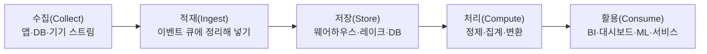

> ByteByteGo의 System Design 101 가이드 「[Data Pipelines Overview](https://bytebytego.com/guides/data-pipelines-overview)」, 「[Key Data Terms](https://bytebytego.com/guides/key-data-terms)」를 바탕으로, 분석 저장소의 성장 단계와 적재 원칙은 「[타다(TADA) 서비스의 데이터 웨어하우스: 태초부터 현재까지](https://speakerdeck.com/vcnc/tada-tada-seobiseuyi-deiteo-weeohauseu-taecobuteo-hyeonjaeggaji)」 발표로 보강해 재구성한 노트다.

## 데이터 파이프라인이란

데이터 파이프라인(data pipeline)은 **데이터를 만들어지는 곳에서 쓰이는 곳까지 옮기면서 쓸 수 있는 모양으로 바꾸는 과정**이다. 앱 DB, 이벤트 로그, 외부 API, 기기 센서에 흩어진 데이터를 모아 정리해야 분석·대시보드·머신 러닝이 같은 데이터를 믿고 쓸 수 있다.

## 다섯 단계



| 단계 | 하는 일 | 예 |
| --- | --- | --- |
| **수집** | 데이터 저장소, 데이터 스트림, 애플리케이션, 원격 기기에서 데이터를 얻는다 | 앱 DB의 변경 내역(CDC), 클릭 이벤트, IoT 센서 값 |
| **적재** | 받은 데이터를 시스템에 넣고 이벤트 큐에서 정리한다. 생산과 소비의 속도를 분리한다 | Kafka 같은 메시지 큐, 수집 커넥터 |
| **저장** | 이후 처리를 위해 보관한다 | 데이터 웨어하우스, 데이터 레이크, 레이크하우스, 운영 DB |
| **처리** | 집계·정제·변환으로 회사 기준에 맞춘다. 형식 변환, 압축, 파티셔닝도 여기서 한다 | 배치 작업, 스트림 처리 |
| **활용** | 처리된 데이터를 사람과 시스템이 쓴다 | BI·셀프서비스 분석, 대시보드, 운영 데이터 저장소, 의사 결정 엔진, 데이터 과학, ML 학습·서빙, 사용자용 기능 |

**각 단계의 품질이 다음 단계의 상한**이다. 수집에서 빠진 이벤트는 아무리 잘 처리해도 대시보드에 나오지 않는다.

### 배치와 스트림

| | 배치 처리 | 스트림 처리 |
| --- | --- | --- |
| 단위 | 일정 시간 동안 쌓인 묶음 | 이벤트 하나하나 |
| 지연 | 분~시간 | 초 이하 |
| 쓰임 | 일일 매출 집계, 모델 재학습, 정산 | 실시간 이상 탐지, 실시간 추천, 알림 |
| 어려움 | 결과가 늦다 | 순서 뒤바뀜, 중복, 상태 관리 |

### ETL과 ELT

| | ETL (Extract → Transform → Load) | ELT (Extract → Load → Transform) |
| --- | --- | --- |
| 변환 위치 | 저장소에 넣기 **전**, 별도 처리 서버 | 저장소에 넣은 **뒤**, 웨어하우스 안에서 SQL로 |
| 장점 | 정제된 데이터만 저장한다 | 원본이 남아 나중에 변환을 바꿔 다시 돌릴 수 있다 |
| 언제 | 저장소의 연산 비용이 비쌀 때, 민감 정보를 미리 걸러야 할 때 | 클라우드 웨어하우스처럼 저장·연산이 싸고 탄력적일 때. 지금 흔한 방식 |

## 저장소 용어

| 용어 | 뜻 | 특징 |
| --- | --- | --- |
| **데이터 웨어하우스** (data warehouse) | 여러 출처의 데이터를 통합해 **정해진 스키마**로 저장한 분석용 저장소 | 복잡한 질의와 과거 데이터 분석에 맞다. 쓰기 전에 구조를 정한다(schema-on-write) |
| **데이터 마트** (data mart) | 웨어하우스에서 **한 부서·주제**만 떼어 낸 부분 집합 | 마케팅·재무 같은 팀이 빠르게 조회한다 |
| **데이터 레이크** (data lake) | 정형·반정형·비정형 데이터를 **원래 형식 그대로** 쌓아 둔 저장소. 보통 객체 저장소(S3 등) 위에 있다 | 싸고 유연하다. 읽을 때 구조를 해석한다(schema-on-read). 관리하지 않으면 아무도 못 쓰는 「데이터 늪」이 된다 |
| **레이크하우스** (lakehouse) | 레이크의 저장 방식 위에 웨어하우스의 트랜잭션·스키마 관리를 얹은 구조 | 하나의 저장소로 BI와 ML을 함께 지원한다 |
| **오픈 테이블 포맷** | 객체 저장소의 파일들을 하나의 테이블처럼 다루게 하는 메타데이터 계층. **Delta Lake**, Apache Iceberg, Apache Hudi | ACID 트랜잭션, 스키마 변경, 과거 시점 조회(time travel)를 레이크에 더하고 배치와 스트리밍을 한 테이블로 합친다 |
| **데이터 파이프라인** | 데이터를 한 시스템에서 다른 시스템으로 옮기고 바꾸는 과정 | 웨어하우스·레이크를 채우는 길 |
| **데이터 메시** (data mesh) | 데이터 소유와 제공을 중앙 데이터 팀이 아니라 **도메인별 팀**에 나누는 조직·아키텍처 방식 | 각 팀이 자기 데이터를 「제품」으로 책임지고, 공통 플랫폼과 거버넌스는 함께 쓴다 |

```text
정형 정도  높음 ◀───────────────────────────────▶ 낮음
          데이터 마트 ⊂ 데이터 웨어하우스   레이크하우스   데이터 레이크
                                         (레이크 + 테이블 포맷)
```

## 분석 저장소가 커 가는 단계

서비스 초기에는 웨어하우스 없이 시작하는 경우가 많다. 보통 아래 순서로 옮겨 가고, 단계마다 막히는 지점이 다르다.

| 단계 | 방식 | 막히는 지점 |
| --- | --- | --- |
| 1. 읽기 복제본 | 운영 DB의 복제본에 BI 도구를 붙인다. 분석 쿼리가 서비스 DB를 느리게 하지 않는다 | 다른 출처(로그, 외부 API, 다른 DB)와 조인할 수 없다. 분석용 테이블을 만들려면 서비스 배포 과정을 거쳐야 한다 |
| 2. 분석용 RDB | Spark 같은 배치 작업으로 여러 출처를 한 RDB에 모은다 | 저장·연산 자원을 직접 관리하고 늘려야 한다. 분석 SQL 기능(윈도 함수, 배열·구조체 타입)이 부족할 수 있다 |
| 3. 관리형 클라우드 웨어하우스 | BigQuery·Snowflake·Redshift처럼 저장과 연산을 나눠 쓰는 만큼 낸다 | 쿼리 비용 관리. 파티션·클러스터링을 설계하지 않으면 매번 전체를 읽는다 |

어느 단계를 고를지는 저장·데이터 이동 비용과 운영 인력으로 정한다. 다음은 단계와 상관없이 지키는 적재 원칙이다.

- **분석 부하는 운영 DB에서 떼어 낸다.**
- **적재는 멱등하게.** 임시 테이블에 쓴 뒤 본 테이블에 UPSERT(`MERGE`)하고 임시 테이블을 지우면, 배치가 실패해 다시 돌려도 중복이 생기지 않는다. 기본 JDBC 쓰기처럼 덧붙이기·덮어쓰기만 되는 도구에서는 이 단계를 따로 만든다.
- **크기에 따라 갱신 방식을 나눈다.** 작은 테이블은 매번 통째로 덮어쓰고, 큰 테이블은 날짜 파티션 단위로 갈아 끼운다.
- **파티션은 분석하는 기준의 날짜로.** UTC 타임스탬프 대신 현지 기준 날짜 컬럼을 만들어 파티션하면 "어제 매출" 같은 질의가 파티션 하나만 읽는다. 상태가 바뀌는 데이터(주문 → 완료 → 환불)는 최종 상태에 이를 때까지 해당 파티션을 다시 적재한다.
- **로그는 먼저 원본 그대로 쌓는다.** 관리형 스트림 서비스로 객체 저장소에 바로 적재해 두고, 가공은 필요해질 때 붙인다(ELT).
- 구성원 누구나 SQL로 데이터를 조회할 수 있게 되는 것이 웨어하우스의 가장 큰 효과다.

## 정리

- 파이프라인은 수집 → 적재 → 저장 → 처리 → 활용이고, 앞 단계의 품질이 뒤 단계의 상한이다.
- 처리는 지연 요구에 따라 배치와 스트림으로 나눈다.
- 지금은 원본을 먼저 넣고 저장소 안에서 변환하는 ELT가 흔하다.
- 웨어하우스는 정형·분석용, 레이크는 원본 그대로, 레이크하우스는 둘을 합친 것이고, 테이블 포맷(Delta Lake·Iceberg)이 그 둘을 잇는다.
- 데이터 메시는 기술이 아니라 **소유권을 도메인 팀으로 나누는 방식**이다.

관련 노트: [[python-data-analysis|파이썬 데이터 분석 프로세스]], [[machine-learning-basics|머신 러닝 기초: 네 단계 추상화]], [[database-models|데이터베이스 모델]], [[elasticsearch|Elasticsearch와 ELK 스택]]
