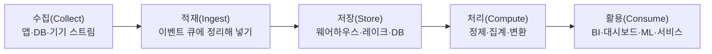

> ByteByteGo의 System Design 101 가이드 「[Data Pipelines Overview](https://bytebytego.com/guides/data-pipelines-overview)」, 「[Key Data Terms](https://bytebytego.com/guides/key-data-terms)」를 바탕으로, 분석 저장소의 성장 단계와 적재 원칙은 「[타다(TADA) 서비스의 데이터 웨어하우스: 태초부터 현재까지](https://speakerdeck.com/vcnc/tada-tada-seobiseuyi-deiteo-weeohauseu-taecobuteo-hyeonjaeggaji)」 발표로 보강해 재구성한 노트다. 단계별 도구 지도와 도구 선택 원칙은 「[I want to study Data Science](https://github.com/Team-Neighborhood/I-want-to-study-Data-Science/wiki/%EB%8D%B0%EC%9D%B4%ED%84%B0-%EC%97%94%EC%A7%80%EB%8B%88%EC%96%B4)」 위키의 데이터 엔지니어 문서를 뼈대로 2026년 기준으로 고쳐 썼고, 「[그들이 AWS 위에서 데이터 파이프 라인을 운영하는 법](https://docs.google.com/presentation/d/11C_BKio0DZIop_ZjJk7ogxQtWV5qHIr-hHjw277z64k/edit)」·「[스타트업에서 데이터를 더하는 법](https://docs.google.com/presentation/d/1AqiRVm32zCg59TKDgbs14FaVgNf8kqfXFkCYxAPw8ac/edit)」(2019), 「[Data pipeline and data lake](https://www.slideshare.net/charsyam2/data-pipeline-and-data-lake)」, 토스 SLASH 21 「[토스 데이터의 흐름과 활용](https://toss.im/slash-21/sessions/2-1)」, DEVIEW 2016 「[카카오의 데이터 파이프라인](https://www.slideshare.net/deview/236-67609108)」, 「[The Data Engineering Cookbook](https://github.com/andkret/Cookbook)」, 「[Data Engineer Roadmap](https://github.com/datastacktv/data-engineer-roadmap)」, 「[데이터 엔지니어 관련 영상 메모](https://zzsza.github.io/data/2018/07/28/data-engineer-video/)」로 보강했다.

## 데이터 파이프라인이란

데이터 파이프라인(data pipeline)은 **데이터를 만들어지는 곳에서 쓰이는 곳까지 옮기면서 쓸 수 있는 모양으로 바꾸는 과정**이다. 앱 DB, 이벤트 로그, 외부 API, 기기 센서에 흩어진 데이터를 모아 정리해야 분석·대시보드·머신 러닝이 같은 데이터를 믿고 쓸 수 있다.

페이지뷰·방문자 수 몇 개만 뽑거나 원본에서 바로 숫자를 읽으면 되는 단계라면 파이프라인은 필요 없다. **여러 데이터를 서로 엮거나 중간에 변환한 결과를 다시 재료로 쓸 때** 필요해진다. 추천을 예로 들면 「사용자 행동 집계 → 사용자 성향 점수」, 「추천 결과에 대한 반응 분석」, 「새 글의 성향 평가」, 「사용자별 점수 계산 → 상위 N개 추천」이 각각 하나의 파이프이고, 각 파이프는 자기 결과물을 남기며 다음 파이프의 입력이 된다. 이런 파이프가 수십 개로 늘면 실행 순서·재시도·실패 알림을 맡는 오케스트레이터가 필요하다. 머신 러닝을 위한 것이면 머신 러닝 파이프라인이라고도 부른다([[mlops|MLOps]]).

## 다섯 단계



| 단계 | 하는 일 | 예 |
| --- | --- | --- |
| **수집** | 데이터 저장소, 데이터 스트림, 애플리케이션, 원격 기기에서 데이터를 얻는다 | 앱 DB의 변경 내역(CDC), 클릭 이벤트, IoT 센서 값 |
| **적재** | 받은 데이터를 시스템에 넣고 이벤트 큐에서 정리한다. 생산과 소비의 속도를 분리한다 | Kafka 같은 메시지 큐, 수집 커넥터 |
| **저장** | 이후 처리를 위해 보관한다 | 데이터 웨어하우스, 데이터 레이크, 레이크하우스, 운영 DB |
| **처리** | 집계·정제·변환으로 회사 기준에 맞춘다. 형식 변환, 압축, 파티셔닝도 여기서 한다 | 배치 작업, 스트림 처리 |
| **활용** | 처리된 데이터를 사람과 시스템이 쓴다 | BI·셀프서비스 분석, 대시보드, 운영 데이터 저장소, 의사 결정 엔진, 데이터 과학, ML 학습·서빙, 사용자용 기능 |

**각 단계의 품질이 다음 단계의 상한**이다. 수집에서 빠진 이벤트는 아무리 잘 처리해도 대시보드에 나오지 않는다. 그래서 무엇을 어떤 모양으로 남길지부터 정한다([[event-log-design|이벤트 로그 설계와 수집]]).

활용 쪽 결과물은 크게 둘로 갈린다. 「IT 기사를 본 사용자의 연령 비율」처럼 많이 모아 훑는 **분석용(OLAP)** 결과와, 「이 사용자가 방금 본 기사와 비슷한 기사」처럼 한 사용자를 즉시 조회하는 **서비스용(개인화)** 결과다. 서비스용은 실시간 이벤트에 분석으로 만든 메타데이터를 조인해 수 초 안에 내놓아야 하므로 저장소와 처리 방식이 따로 필요하다.

## 단계별 도구 지도 (2026)

**도구는 블록처럼 조합하는 것이다.** 아래 도구를 다 알 필요는 없고, 단계마다 몇 개를 골라 잇는다. 대신 **비슷한 도구 대비 왜 이 도구인지 설명할 수 있어야 한다.** 언어와 플랫폼도 문제를 푸는 수단을 고르는 일이다.

| 단계 | 대표 도구 | 과거에 많이 쓰던 것 |
| --- | --- | --- |
| 수집: 로그·이벤트 | 수집 에이전트 Fluent Bit·Fluentd·Logstash, 앱 SDK(Firebase·GA4, BigQuery로 원본 내보내기 지원) | Flume |
| 수집: DB·외부 서비스 | 변경 데이터 캡처(CDC) Debezium + Kafka Connect, 배치 적재 Airbyte·Fivetran·dlt | Sqoop, Embulk, 주기적 전체 덤프 |
| 적재(버퍼) | Apache Kafka(4.0부터 ZooKeeper 없이 KRaft만), Amazon Kinesis Data Streams, Google Cloud Pub/Sub, Redpanda | Redis 리스트를 버퍼로 쓰기 |
| 저장 | 객체 저장소(S3·GCS) + Parquet + 테이블 포맷(Apache Iceberg·Delta Lake), 웨어하우스(BigQuery·Snowflake·Redshift·ClickHouse). RDB·NoSQL은 운영·서빙용 | HDFS, 원본 JSON 그대로 쌓기 |
| 처리: 배치 | Spark(DataFrame·SQL), 웨어하우스 안 SQL 변환은 dbt | Hadoop MapReduce, Hive(SQL → MapReduce) |
| 처리: 스트림 | Apache Flink, Spark Structured Streaming, Kafka Streams | Storm, Spark Streaming(DStream) |
| 처리: 대화형 SQL | Trino(옛 PrestoSQL), 웨어하우스 자체 엔진, Athena, DuckDB | Presto, Impala |
| 오케스트레이션 | Apache Airflow, Dagster, Prefect, 관리형 Cloud Composer·MWAA | Luigi, Oozie, Digdag, cron |
| 활용: 대시보드·탐색 | Metabase, Superset, Redash, Tableau, Looker, Jupyter | Zeppelin |
| 품질·관측 | dbt 테스트, Great Expectations, Soda, Monte Carlo | 수동 행 수 확인 |

도구를 나누는 축 몇 가지는 알아 둔다.

| 비교 | 차이 |
| --- | --- |
| Airflow vs Dagster vs Prefect | Airflow는 작업(task)을 잇는 DAG를 일정에 맞춰 돌리는 가장 널리 쓰이는 표준이고, 3.0(2025)부터 데이터 에셋 기반 스케줄과 DAG 버전 관리가 들어갔다. Dagster는 처음부터 **만들어지는 데이터(에셋)** 를 중심으로 계보·신선도를 관리한다. Prefect는 파이썬 함수에 데코레이터를 붙이는 방식이라 동적인 흐름을 짜기 쉽다 |
| dbt | ELT의 T를 맡는다. `SELECT` 문 하나가 테이블 하나(모델)가 되고, `ref()`로 모델끼리 의존을 걸면 DAG가 된다. 테스트·문서를 같은 코드로 관리한다. 변환을 웨어하우스 안에서 SQL로 하므로 별도 처리 서버가 없다 |
| Spark vs Flink | Spark는 배치가 본업이고 스트림은 작은 배치를 이어 붙이는 방식이 기본이다. Flink는 이벤트 하나씩 처리하는 스트림이 본업이며 이벤트 시간·상태·정확히 한 번 처리를 깊게 지원한다 |
| 웨어하우스 vs 레이크 + 테이블 포맷 | 웨어하우스는 저장과 엔진이 한 제품이다. Iceberg 같은 오픈 테이블 포맷은 데이터를 객체 저장소에 두고 Spark·Trino·Flink·Snowflake·BigQuery 등 여러 엔진이 같은 테이블을 읽고 쓰게 한다 |
| Kafka vs 관리형 스트림 | Kafka는 커넥터 생태계가 가장 넓지만 브로커 여러 대의 업그레이드·모니터링을 직접 해야 한다. Kinesis·Pub/Sub은 운영 부담이 없고 클라이언트 SDK가 있지만 메시지 크기 제한(Kinesis 레코드 1MB)과 커넥터 지원이 더 좁다. 관리형 Kafka(MSK, Confluent Cloud)도 있다 |

### 도구를 고르는 원칙

- **사람이 머신보다 비싸다.** HDFS와 Hadoop을 직접 설치해 운영하면 그것을 이해하고 업그레이드할 사람을 뽑아야 한다. 객체 저장소 + 관리형 클러스터(EMR, Dataproc)처럼 버튼으로 늘리는 쪽을 먼저 본다. 고민의 결과가 「머신 대신 사람이 더 들어가는」 선택이면 다시 생각한다.
- **빅데이터 도구는 한 서버로 안 될 때 쓴다.** 메모리가 모자라거나 디스크가 차서 서버 한 대로 감당할 수 없을 때가 빅데이터다. 그 전에는 분산 시스템의 운영비가 이득보다 크다([[distributed-data-processing|분산 데이터 처리]]).
- **하나의 저장소, 하나의 언어.** 데이터를 한곳에 모으고 SQL로 조회하게 하면 엔지니어·분석가·마케터가 같은 언어로 일한다. 저장소마다 전용 질의어(Elasticsearch 쿼리 등)를 배우게 하지 말고, 표현력이 모자라면 함수가 풍부한 SQL 엔진(Trino, BigQuery)으로 메운다. 대시보드·노트북 같은 조회 도구는 그 위에 용도별로 얹는다.
- **배치로 시작하고 필요할 때 스트림을 더한다.** 배치는 구조가 단순해 빨리 만들고 싸게 돌린다. 실시간 요구가 확인되면 그때 스트림 파이프라인을 붙인다.
- **요구 사항을 질문으로 확인한다.** 기술이 결정을 이끌게 두지 않는다.

| 질문 | 결정되는 것 |
| --- | --- |
| 결과가 얼마나 신선해야 하나, 얼마나 빨리 나와야 하나 | 배치·스트림, 서빙 저장소 |
| 집계는 언제 하나 (조회할 때, 일정대로, 흐르는 동안) | 사전 집계 테이블, 스트림 처리 |
| 콜드 데이터는 얼마나 되고 얼마나 자주 조회하나 | 핫·콜드 분리, 보존 기간 |
| 누가 어떤 도구로 조회하나, 민감 정보는 어떻게 막나 | 조회 도구, 권한·행 단위 보안 |
| 전송 지연·실패·누락을 어떻게 알아채나 | 파이프라인 모니터링 지표 |

## 배치와 스트림

| | 배치 처리 | 스트림 처리 |
| --- | --- | --- |
| 단위 | 일정 시간 동안 쌓인 묶음 | 이벤트 하나하나 |
| 지연 | 분~시간 | 초 이하 |
| 쓰임 | 일일 매출 집계, 모델 재학습, 정산 | 실시간 이상 탐지, 실시간 추천, 알림 |
| 어려움 | 결과가 늦다 | 순서 뒤바뀜, 중복, 상태 관리 |

배치는 이미 저장된 데이터를 통째로 읽으니 전체 그림을 본다. 스트림은 저장되기 전 흘러가는 조각만 보므로 볼 수 있는 범위가 좁은 대신 바로 반응한다.

### 스트림의 시간과 상태

- **이벤트 시간과 수집 시간은 다르다.** 15시 30분에 생긴 로그가 기기의 네트워크 사정으로 16시에 들어오는 일이 흔하다. 시간 단위 파티션을 이벤트 시간으로 나누면 늦게 온 로그를 어디까지 기다릴지 정해야 한다.
- **늦게 오는 데이터는 두 층으로 받는다.** 최근 데이터는 1분 안에 보이는 「핫」 영역에 바로 쌓고, 몇 시간 늦게 온 로그까지 반영한 「콜드」 영역을 배치가 뒤따라가며 보정한다. 실시간 결과는 늘 정확하지 않으며, 배치가 최종 정답을 만든다.
- **윈도로 끊어 집계한다.** 겹치지 않게 일정 간격으로 자르는 텀블링(tumbling) 윈도, 일정 간격으로 미끄러지며 겹치는 슬라이딩(sliding) 윈도, 활동 사이 공백으로 나누는 세션(session) 윈도가 있다. 늦게 온 데이터를 언제까지 받아 줄지는 워터마크(watermark)로 정한다.
- **상태는 메모리에 있으니 무한히 키울 수 없다.** 사용자 ID처럼 키가 계속 늘면 윈도 기간으로 자르거나 TTL로 오래된 키를 지운다. 장애에 대비해 상태를 객체 저장소에 체크포인트로 남긴다.
- **상태를 진실의 원천으로 삼지 않는다.** 앱 안의 상태가 깨지거나 모델이 바뀌면 복구할 길이 없다. 원본 로그에서 특정 시점부터 다시 소비해 결과를 다시 만들 수 있게 설계한다.

메시지가 유실되거나 중복되는 수준(at-most / at-least / exactly once)과 단계별 대책은 [[message-queue-kafka|메시지 큐와 Kafka]]에 있다. 차량 GPS처럼 타임스탬프가 있어 같은 값을 다시 써도 덮어쓰기로 끝나는 데이터는 at-least once로 충분하고, 결제처럼 빠져도 겹쳐도 안 되는 데이터만 exactly once가 필요하다. 도구마다 지원하는 수준이 달라 설계 단계에서 정한다.

### 람다와 카파 아키텍처

배치와 스트림을 함께 쓰는 대표 구조다.

| | 람다(Lambda) | 카파(Kappa) |
| --- | --- | --- |
| 구성 | 배치 층(정확한 과거) + 스트림 층(빠른 최근) + 둘을 합치는 서빙 층 | 스트림 층 하나. 재처리는 로그를 처음부터 다시 흘려서 한다 |
| 예 | 「어제까지 광고 클릭 수(배치) + 오늘 0시부터 클릭 수(스트림) = 지금까지 클릭 수」. 오늘 데이터는 갱신이 빠른 저장소(Kudu 등)에, 어제까지는 Parquet 파티션에 두고 뷰 하나로 합쳐 조회한다 | 보존 기간이 긴 Kafka 토픽을 원본으로 두고, 로직이 바뀌면 새 스트림 작업이 처음부터 다시 계산한다 |
| 비용 | 집계 세 번, 저장소 세 개, 같은 로직을 두 번 구현 | 로그 보존 비용, 대량 재처리 시간 |

서빙 층은 비싸므로 **실시간 합산이 꼭 필요한 곳(CPC 광고 과금 등)에만** 쓰고, 일반 통계는 배치로 끝낸다. 배치·스트림을 같은 API로 짜는 엔진(Flink, Spark Structured Streaming)과 스트림 쓰기를 받는 테이블 포맷이 자리 잡으면서 두 층을 하나의 코드와 테이블로 합치는 쪽이 흔해졌다.

### ETL과 ELT

| | ETL (Extract → Transform → Load) | ELT (Extract → Load → Transform) |
| --- | --- | --- |
| 변환 위치 | 저장소에 넣기 **전**, 별도 처리 서버 | 저장소에 넣은 **뒤**, 웨어하우스 안에서 SQL로 |
| 장점 | 정제된 데이터만 저장한다 | 원본이 남아 나중에 변환을 바꿔 다시 돌릴 수 있다 |
| 언제 | 저장소의 연산 비용이 비쌀 때, 민감 정보를 미리 걸러야 할 때 | 클라우드 웨어하우스처럼 저장·연산이 싸고 탄력적일 때. 지금 흔한 방식이고 dbt가 이 T를 맡는다 |

## 저장소 용어

| 용어 | 뜻 | 특징 |
| --- | --- | --- |
| **데이터 웨어하우스** (data warehouse) | 여러 출처의 데이터를 통합해 **정해진 스키마**로 저장한 분석용 저장소 | 복잡한 질의와 과거 데이터 분석에 맞다. 쓰기 전에 구조를 정한다(schema-on-write). 사실(fact)·차원(dimension) 테이블의 스타·스노플레이크 스키마로 설계한다 |
| **데이터 마트** (data mart) | 웨어하우스에서 **한 부서·주제**만 떼어 낸 부분 집합 | 마케팅·재무 같은 팀이 빠르게 조회한다 |
| **데이터 레이크** (data lake) | 정형·반정형·비정형 데이터를 **원래 형식 그대로** 쌓아 둔 저장소. 보통 객체 저장소(S3 등) 위에 있다 | 싸고 유연하다. 읽을 때 구조를 해석한다(schema-on-read). 관리하지 않으면 아무도 못 쓰는 「데이터 늪」이 된다 |
| **레이크하우스** (lakehouse) | 레이크의 저장 방식 위에 웨어하우스의 트랜잭션·스키마 관리를 얹은 구조 | 하나의 저장소로 BI와 ML을 함께 지원한다 |
| **오픈 테이블 포맷** | 객체 저장소의 파일들을 하나의 테이블처럼 다루게 하는 메타데이터 계층. **Delta Lake**, Apache Iceberg, Apache Hudi | ACID 트랜잭션, 스키마 변경, 과거 시점 조회(time travel)를 레이크에 더하고 배치와 스트리밍을 한 테이블로 합친다 |
| **카탈로그·메타스토어** | 테이블 이름, 스키마, 파티션, 실제 파일 위치(S3 경로)를 담은 저장소. Hive Metastore, AWS Glue Data Catalog, Iceberg REST 카탈로그 | 데이터는 객체 저장소에 두고 카탈로그에 테이블만 등록하면 SQL 엔진이 바로 질의한다 |
| **데이터 파이프라인** | 데이터를 한 시스템에서 다른 시스템으로 옮기고 바꾸는 과정 | 웨어하우스·레이크를 채우는 길 |
| **데이터 메시** (data mesh) | 데이터 소유와 제공을 중앙 데이터 팀이 아니라 **도메인별 팀**에 나누는 조직·아키텍처 방식 | 각 팀이 자기 데이터를 「제품」으로 책임지고, 공통 플랫폼과 거버넌스는 함께 쓴다 |

```text
정형 정도  높음 ◀───────────────────────────────▶ 낮음
          데이터 마트 ⊂ 데이터 웨어하우스   레이크하우스   데이터 레이크
                                         (레이크 + 테이블 포맷)
```

레이크를 둘 때 같이 풀어야 하는 문제가 있다. 파일·RDB·객체 저장소에 데이터가 흩어지면 **어디에 원하는 데이터가 있는지, RDB와 레이크 중 어느 쪽이 원본인지**가 흐려진다. 새 테이블과 컬럼 변경을 카탈로그가 자동으로 찾게 하고(Glue 크롤러 등), 쓰레기 데이터가 쌓이지 않게 수명 주기를 정한다.

### 데이터 계층과 테이블 이름

가공 단계에 따라 테이블을 계층으로 나누면 쓰는 사람도 관리하는 사람도 편하다. 레이크하우스에서는 같은 생각을 메달리온(medallion) 구조의 브론즈·실버·골드라 부른다.

| 계층 | 내용 | 예 |
| --- | --- | --- |
| 1층 원천 (브론즈) | 수집한 그대로. 로그성 이벤트, DB 스냅샷, 검색엔진·캐시 스냅샷 | `t1_log`, `t1_db`, `t1_meta` |
| 2층 공용 가공 (실버) | 잘게 쪼개진 서비스 테이블을 고객·판매자 같은 주제로 모은 공용 테이블. 레거시·인수 합병으로 조인할 테이블이 많을 때 특히 쓸모 있다 | `t2_customer`, `t2_seller` |
| 3층 서비스용 (골드) | 서비스 DB·API로 내보낼 결과, 특수 목적 집계 | `t3_seller_exported_jdbc` |

테이블 이름에 **도메인·대상·데이터 성격·기간·주기**를 넣으면 이름만 보고 무엇인지 안다. 성격은 시계열 원천(`timeseries`), 덤프 원천(`snapshot`), 집계(`aggr`)로 나눈다.

```text
place_summary_aggr_30d_daily        업체 요약, 최근 30일 집계, 매일 적재
leisure_impression_timeseries_hourly 레저 노출 로그, 시간별 가공
place_order_snapshot_daily          업체 주문 스냅샷, 일별
```

집계 테이블은 **평균을 담지 않는다.** 평균의 평균은 실제 평균이 아니므로 합계와 개수를 담아 어떤 기간으로든 다시 나눌 수 있게 한다. 기간 내 고유 사용자 수처럼 하루치를 더해 구할 수 없는 값은 `1d`, `7d`, `28d` 테이블을 따로 만든다.

## 분석 저장소가 커 가는 단계

서비스 초기에는 웨어하우스 없이 시작하는 경우가 많다. 보통 아래 순서로 옮겨 가고, 단계마다 막히는 지점이 다르다.

| 단계 | 방식 | 막히는 지점 |
| --- | --- | --- |
| 1. 읽기 복제본 | 운영 DB의 복제본에 BI 도구를 붙인다. 분석 쿼리가 서비스 DB를 느리게 하지 않는다 | 다른 출처(로그, 외부 API, 검색엔진, 다른 DB)와 조인할 수 없다. 로그인 같은 이벤트까지 운영 DB에 쌓게 된다. 분석용 테이블을 만들려면 서비스 배포 과정을 거쳐야 한다 |
| 2. 분석용 RDB | Spark 같은 배치 작업으로 여러 출처를 한 RDB에 모은다 | 저장·연산 자원을 직접 관리하고 늘려야 한다. 분석 SQL 기능(윈도 함수, 배열·구조체 타입)이 부족할 수 있다 |
| 3. 관리형 클라우드 웨어하우스·레이크 | BigQuery·Snowflake·Redshift처럼 저장과 연산을 나눠 쓰는 만큼 내거나, 객체 저장소 + Parquet + SQL 엔진으로 레이크를 꾸린다 | 쿼리 비용 관리. 파티션·클러스터링을 설계하지 않으면 매번 전체를 읽는다 |

사용자 행동 분석이 필요해지면 외부 분석 SDK(Firebase 등)로 결제·노출·클릭을 심는 경우가 많다. 설치는 쉽지만 원본 데이터를 그대로 주지 않거나 요약만 주고, 사내 도구와 붙지 않는 경우가 있다. 결국 클라이언트·서버 로그를 직접 정의·검증·수집하는 체계가 필요해진다([[event-log-design|이벤트 로그 설계와 수집]]).

운영 DB를 자주 통째로 덤프하면 DB에 부하가 걸린다. 변경분만 DB 로그에서 읽는 CDC로 바꾸면 부하를 줄이면서 더 자주 반영할 수 있다(CDC의 동작은 [[distributed-data-patterns|데이터 관리 패턴]]). 어느 단계를 고를지는 저장·데이터 이동 비용과 운영 인력으로 정하고, 구성원 누구나 SQL로 데이터를 조회할 수 있게 되는 것이 웨어하우스의 가장 큰 효과다.

## 적재와 운영 원칙

단계와 상관없이 지키는 원칙이다.

| 원칙 | 방법 |
| --- | --- |
| **분석 부하를 운영 DB에서 떼어 낸다** | 복제본, CDC, 별도 분석 저장소 |
| **적재는 멱등하게** | 임시 테이블에 쓴 뒤 본 테이블에 UPSERT(`MERGE`)하고 임시 테이블을 지우면, 배치가 실패해 다시 돌려도 중복이 생기지 않는다. 기본 JDBC 쓰기처럼 덧붙이기·덮어쓰기만 되는 도구에서는 이 단계를 따로 만든다 |
| **크기에 따라 갱신 방식을 나눈다** | 작은 테이블은 매번 통째로 덮어쓰고, 큰 테이블은 날짜 파티션 단위로 갈아 끼운다 |
| **파티션은 분석하는 기준의 날짜로** | UTC 타임스탬프 대신 현지 기준 날짜 컬럼을 만들어 파티션하면 "어제 매출" 같은 질의가 파티션 하나만 읽는다. 상태가 바뀌는 데이터(주문 → 완료 → 환불)는 최종 상태에 이를 때까지 해당 파티션을 다시 적재한다 |
| **원본을 먼저 그대로 쌓는다** | 로그는 관리형 스트림 서비스로 객체 저장소에 바로 적재해 두고, 가공은 필요해질 때 붙인다(ELT) |
| **핫·콜드를 나눈다** | 분석가가 자주 질의하는 핫 데이터만 정제해 웨어하우스에 두고, 1년에 한 번 볼까 한 콜드 데이터는 싼 객체 저장소에 두고 Athena·Trino·외부 테이블로 읽는다. 웨어하우스에 원본을 다 넣으면 끌 수 없는 노드 비용이 계속 나간다 |
| **재작업은 반드시 온다** | 장애 복구, 운영성 작업, 「2015년부터 다시」 같은 새 집계가 생긴다. 배치 앱은 기준 날짜와 반복 횟수를 인자로 받아, 급하지 않으면 한 번 길게 돌리고 급하면 별도 클러스터에서 날짜별로 병렬 실행한다 |
| **여러 곳에 쓸 때는 원본부터** | 가공 결과를 객체 저장소(원본)와 서비스 DB 두 곳에 쓰다 DB 쪽만 실패하면, 다시 계산하지 말고 객체 저장소에서 읽어 DB만 다시 채운다 |
| **용도별로 클러스터·큐를 나눈다** | 기계가 쓰는 배치(새벽에 몰림)와 사람이 쓰는 탐색 질의(업무 시간에 몰림), 스트림을 다른 클러스터나 큐로 나눈다. 바쁜 시간에만 스팟 인스턴스를 더 붙인다 |
| **원천 스키마 변화를 감지한다** | 입수 대상 DB의 컬럼 변경을 매일 자동으로 찾아 데이터 관련자에게 알린다 |

오케스트레이터(Airflow 등)는 정해진 시각 실행, 작업 간 의존성, 실패 시 재시도, 특정 파일이 생길 때까지 기다리는 센서, 정한 시간 안에 안 끝나면 알리는 SLA를 맡는다. 하지만 **재시작이 코드의 버그를 고쳐 주지는 않는다.** 「10개 이상이어야 하는데 9개」인 결과가 정상인지 실패인지는 작업 결과를 검증하는 테스트(행 수 기대치, NULL 비율, 신선도)로 잡는다.

## 정리

- 파이프라인은 수집 → 적재 → 저장 → 처리 → 활용이고, 앞 단계의 품질이 뒤 단계의 상한이다.
- 도구는 단계별로 블록처럼 몇 개만 고르되, 왜 그 도구인지 설명할 수 있어야 한다. 사람이 머신보다 비싸니 관리형을 먼저 본다.
- 배치로 시작하고 실시간이 필요할 때 스트림을 더한다. 스트림은 늦게 오는 데이터와 상태 관리가 핵심이고, 배치가 최종 보정을 맡는다.
- 지금은 원본을 먼저 넣고 저장소 안에서 변환하는 ELT가 흔하다. 웨어하우스는 정형·분석용, 레이크는 원본 그대로, 레이크하우스는 둘을 합친 것이고, 테이블 포맷(Iceberg·Delta Lake)이 그 둘을 잇는다.
- 테이블은 계층과 이름 규칙으로 정리하고, 배치는 재작업을 전제로 만든다.

관련 노트: [[event-log-design|이벤트 로그 설계와 수집]], [[distributed-data-processing|분산 데이터 처리: MapReduce, Spark, SQL 엔진]], [[mlops|MLOps]], [[python-data-analysis|파이썬 데이터 분석 프로세스]], [[machine-learning-basics|머신 러닝 기초: 네 단계 추상화]], [[database-models|데이터베이스 모델]], [[database-selection|데이터베이스 고르기]], [[message-queue-kafka|메시지 큐와 Kafka]], [[elasticsearch|Elasticsearch와 ELK 스택]]
