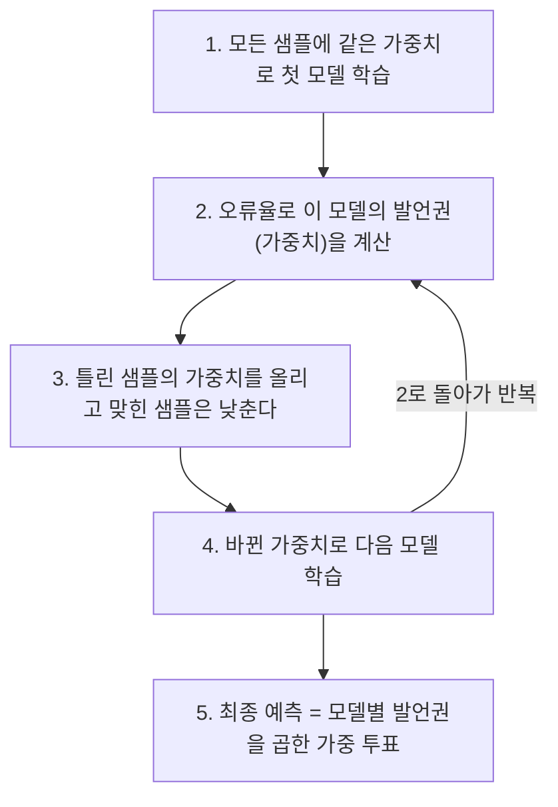

> 팔만코딩경(42Seoul 커뮤니티 위키)의 「비전공자도 쉽게 배우는 인공지능 - extra : Model」을 바탕으로 재구성한 노트다.
> 배깅과 부스팅의 트리 차이, 정형 데이터에서 부스팅이 강한 이유, 작은 트리 여러 개와 큰 트리 하나의 비교는 zzsza의 「[Datascience Interview Questions](https://github.com/zzsza/Datascience-Interview-Questions)」 머신러닝 질문 목록을 따라 보강했다.

## 딥러닝만이 답은 아니다

딥러닝은 머신 러닝 방법 중 하나일 뿐이다. 이미지·음성·텍스트처럼 구조가 복잡한 비정형 데이터에서는 신경망이 강하지만, 집값 예측처럼 **행과 열로 정리된 정형 데이터**에서는 트리 기반 앙상블이 더 정확하고 빠른 경우가 많다. Kaggle의 정형 데이터 대회 상위권을 오래 차지한 것도 이 계열이다.

## 결정 트리

결정 트리(decision tree)는 "면적 > 30평?", "역세권?" 같은 **질문을 이어 붙여 데이터를 나누는** 모델이다. 끝 노드(잎)에 도달한 데이터의 다수 부류(분류) 또는 평균값(회귀)이 예측이 된다.

```text
               [면적 > 30평?]
               /            \
            예              아니오
       [역세권?]          [준공 10년 이내?]
        /     \             /        \
     고가    중가         중가       저가
```

### 어떤 질문으로 나눌까: 불순도

각 노드에서 **나눈 뒤 양쪽이 가장 "순수"해지는 질문**을 고른다. 순수하다는 것은 한쪽에 같은 부류만 모였다는 뜻이다. 이를 재는 값이 불순도(impurity)이고, 대표 척도가 지니 불순도다.

```text
Gini(노드) = 1 − Σₖ pₖ²          (pₖ: 노드 안에서 부류 k의 비율)
분할 후 Gini = Σ (자식 노드 샘플 수 / 부모 샘플 수) × Gini(자식)    ← 가중합
```

- 한 부류만 있으면 0(가장 순수), 두 부류가 반반이면 0.5다.
- 분할 후 Gini가 가장 많이 줄어드는 특징과 기준값을 고른다. 엔트로피(정보 이득)를 쓰기도 한다.
- 더 나눠도 불순도가 줄지 않거나, 최대 깊이·최소 샘플 수에 닿으면 멈춘다.

트리는 해석이 쉽고 전처리가 거의 필요 없지만, 끝까지 키우면 학습 데이터에 **과적합**한다. 이 약점을 여러 트리로 메우는 것이 앙상블이다.

## 앙상블: 배깅과 부스팅

| | 배깅(bagging) | 부스팅(boosting) |
| --- | --- | --- |
| 트리 만드는 순서 | 독립적으로, **병렬** | 앞 모델 결과를 보고 **순차** |
| 데이터 | 복원 추출(bootstrap)한 서로 다른 표본 | 앞에서 틀린 샘플에 가중치를 더 준다 |
| 결과 합치기 | 다수결 투표·평균 | 모델별 가중치를 둔 가중합 |
| 줄이는 것 | 분산(과적합) | 편향(과소적합) |
| 장점 | 과적합에 강하고 병렬이라 빠르다 | 대체로 정확도가 더 높다 |
| 단점 | 정확도 상한이 부스팅보다 낮은 편 | 과적합 위험, 순차라 학습이 느리다 |
| 대표 | 랜덤 포레스트 | AdaBoost, Gradient Boosting, XGBoost, LightGBM, CatBoost |

### 랜덤 포레스트

랜덤 포레스트(random forest)는 배깅에 **특징 무작위 선택**을 더한다. 트리마다 데이터를 일부만 뽑고, 각 분할에서도 특징을 일부만 후보로 써서 트리끼리 서로 다르게 만든다. 서로 다른 실수를 하는 트리들이 투표하면 개별 실수가 상쇄된다.

### AdaBoost의 흐름



그레이디언트 부스팅(gradient boosting)은 가중치 대신 **앞 모델의 잔차(오차)를 다음 트리가 예측**하게 한다. 정확히는 손실 함수의 기울기(음의 그레이디언트)를 다음 트리의 목표로 삼으므로, 제곱 오차면 잔차가 되고 로그 손실이면 분류에도 그대로 쓴다. XGBoost·LightGBM·CatBoost는 이를 빠르고 정규화가 잘 되게 구현한 라이브러리로, 정형 데이터의 사실상 표준이다. 모두 `pip`으로 바로 설치해 scikit-learn과 비슷한 API로 쓴다.

### 배깅과 부스팅은 쓰는 트리부터 다르다

| | 배깅·랜덤 포레스트 | 그레이디언트 부스팅 |
| --- | --- | --- |
| 개별 트리 | **깊게** 키운다. 편향은 낮고 분산이 큰 트리 | **얕게** 둔다(깊이 3~8, 극단적으로 그루터기). 편향이 큰 약한 학습기 |
| 트리를 늘리면 | 성능이 수렴할 뿐 과적합이 늘지 않는다. 계산만 는다 | 계속 늘리면 학습 데이터에 과적합한다. 검증 손실이 멈추면 끊는다(조기 종료) |
| 핵심 하이퍼파라미터 | 트리 수, 분할마다 볼 특징 수(`max_features`) | 학습률(shrinkage)과 트리 수의 짝, 트리 깊이·잎 수, 행·열 서브샘플링 |
| 검증 | 복원 추출에서 빠진 약 37%의 샘플(OOB)로 따로 검증 세트 없이 성능을 추정한다 | 별도 검증 세트나 교차 검증으로 조기 종료 지점을 찾는다 |

학습률을 낮추면 트리 하나가 고치는 양이 줄어 더 많은 트리가 필요하지만, 대체로 일반화가 좋아진다. 부스팅도 트리마다 행·열을 일부만 뽑는 서브샘플링(stochastic gradient boosting)을 더해 분산을 줄인다. 배깅의 아이디어를 빌려 오는 것이다.

### 왜 정형 데이터에서 부스팅이 이기나

Kaggle의 정형 데이터 대회 상위 해법은 오랫동안 XGBoost·LightGBM·CatBoost와 그 앙상블이 차지했다. 이유는 정형 데이터의 모양과 트리의 성질이 맞기 때문이다.

| 정형 데이터의 성질 | 트리 부스팅이 유리한 점 |
| --- | --- |
| 단위·분포가 제각각인 열(나이, 금액, 범주) | 분할은 값의 순서만 보므로 스케일링·로그 변환이 필요 없다 |
| 쓸모없는 열이 섞여 있다 | 불순도를 줄이지 못하는 특징은 분할에 거의 안 쓰인다. 신경망은 이런 열에 흔들린다 |
| 경계가 매끄럽지 않다(「35세부터 요율이 뛴다」) | 계단 모양 함수를 바로 표현한다. 신경망은 매끄러운 함수 쪽으로 치우친다 |
| 결측값이 많다 | XGBoost·LightGBM은 결측을 보낼 기본 방향을 학습한다 |
| 특징 사이 상호작용 | 깊이 d인 트리가 최대 d개 특징의 상호작용을 자동으로 만든다 |

라이브러리마다 강점이 조금씩 다르다.

| 라이브러리 | 특징 |
| --- | --- |
| XGBoost | 손실의 2차 미분까지 써서 분할을 고르고, 잎 가중치에 L1·L2 정규화를 건다. 결측값 기본 방향 학습 |
| LightGBM | 값을 히스토그램 구간으로 묶어 분할 탐색을 줄이고, 손실을 가장 많이 줄이는 잎부터 키운다(leaf-wise). 큰 데이터에서 빠르지만 작은 데이터에서는 과적합하기 쉬워 `num_leaves`를 제한한다 |
| CatBoost | 범주형 특징을 타깃 통계로 바꿀 때 순서를 섞어 미래 정보가 새지 않게 한다(ordered target statistics). 범주가 많으면 전처리 없이 강하다 |

다만 이미지·텍스트·음성처럼 원자료에서 특징을 배워야 하는 데이터, 또는 데이터가 아주 많고 그 구조를 신경망에 맞게 줄 수 있을 때는 딥러닝이 앞선다. 정형 데이터에서 트리가 신경망을 앞서는 경향은 벤치마크 연구(Grinsztajn 외, 「Why do tree-based models still outperform deep learning on tabular data?」, NeurIPS 2022)로도 확인되었다.

### 큰 트리 하나 vs 작은 트리 50개

같은 데이터에 큰 결정 트리 하나보다 작은 트리 50개의 앙상블이 대체로 낫다.

- **큰 트리 하나**는 잎마다 몇 개의 샘플만 남을 때까지 나눠 학습 데이터를 외운다. 데이터가 조금만 바뀌어도 트리 모양이 크게 바뀐다(분산이 크다).
- **작은 트리 여러 개**를 평균하면 개별 트리의 우연한 실수가 상쇄된다. 분산 σ², 서로의 상관 ρ인 트리 n개를 평균한 분산은 `ρσ² + (1 − ρ)σ² / n`이다. n을 늘리면 둘째 항이 0으로 가고, **첫째 항을 줄이려면 트리끼리 달라야 한다.** 랜덤 포레스트가 데이터와 특징을 무작위로 뽑는 이유다. 50개가 다 똑같은 트리라면 앙상블의 이득은 없다.
- 부스팅에서는 작은 트리 하나하나가 앞선 트리들이 남긴 오차의 다른 부분을 고치므로, 깊이 3인 트리 50개가 깊이 10인 트리 하나보다 복잡한 함수를 덜 과적합하게 표현한다.
- 대가는 **해석성**이다. 트리 하나는 if 문으로 읽히지만 50개는 그렇지 않다. 앙상블에서는 특징 중요도나 SHAP 값으로 무엇이 예측을 움직였는지 본다.

## 학습한 모델 배포하기

모델은 학습보다 **데이터 전처리, 검증, 배포, 모니터링**에 드는 품이 더 크다. 이 전 과정을 관리하는 것을 MLOps라 한다. 배포 위치는 크게 둘이다.

| 방식 | 실행 위치 | 장점 | 단점 | 예 |
| --- | --- | --- | --- | --- |
| 서버 배포 | 클라우드·백엔드 서버 | 큰 모델, 쉬운 업데이트, 중앙 관리 | 네트워크 지연, 서버 비용, 데이터가 기기 밖으로 나간다 | 번역, 추천, LLM API |
| 엣지(온디바이스) 배포 | 스마트폰·차량 등 사용자 기기 | 낮은 지연, 오프라인 동작, 개인정보 보호 | 기기 성능·전력 제약, 모델 경량화 필요 | 자율 주행, 사진 분류, Core ML·TensorFlow Lite(LiteRT) 앱 |

서버 배포의 가장 단순한 형태는 학습한 모델을 불러와 HTTP 요청을 받아 예측값을 돌려주는 REST API다. 파이썬에서는 FastAPI나 Flask로 엔드포인트를 만들고, 규모가 커지면 전용 모델 서빙 도구나 관리형 서비스를 쓴다.

## 정리

- 정형 데이터에서는 딥러닝보다 트리 앙상블을 먼저 시도한다.
- 결정 트리는 불순도(지니·엔트로피)를 가장 많이 줄이는 질문으로 데이터를 나눈다.
- 배깅·랜덤 포레스트는 병렬 투표로 분산을, 부스팅은 순차 보정으로 편향을 줄인다.
- 배깅은 깊은 트리를 서로 다르게 만들어 평균하고, 부스팅은 얕은 트리를 학습률을 낮춰 쌓은 뒤 조기 종료로 끊는다.
- 앙상블의 이득은 트리끼리의 상관이 낮을수록 크다. 같은 트리 50개는 트리 하나와 같다.
- 모델 배포는 서버(관리 용이)와 엣지(지연·개인정보 유리) 중 제약에 맞춰 고른다.
- **좋은 모델은 데이터 모양에 맞는 모델이다.**

관련 노트: [[machine-learning-basics|머신 러닝 기초: 네 단계 추상화]], [[python-data-analysis|파이썬 데이터 분석 프로세스]], [[perceptron-mlp|퍼셉트론과 다층 퍼셉트론]]
