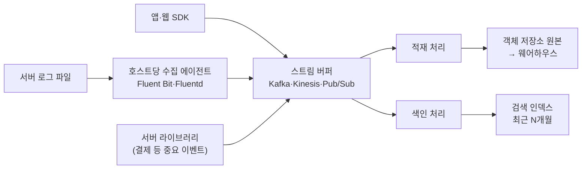

> 「[로그 기깔나게 잘 디자인하는 법](https://www.slideshare.net/jeongsangbaek/ss-80795259)」(2017)을 뼈대로, NDC18 「[야생의 땅 듀랑고의 데이터 엔지니어링 이야기: 로그 시스템 구축 경험 공유](https://www.slideshare.net/ssuser380e9c/ndc18-95524337)」, WATCHA 「[멀티클라우드를 이용한 로그 분석 플랫폼 개발하기](https://medium.com/watcha/%EB%A9%80%ED%8B%B0%ED%81%B4%EB%9D%BC%EC%9A%B0%EB%93%9C%EB%A5%BC-%EC%9D%B4%EC%9A%A9%ED%95%9C-%EB%A1%9C%EA%B7%B8-%EB%B6%84%EC%84%9D-%ED%94%8C%EB%9E%AB%ED%8F%BC-%EA%B0%9C%EB%B0%9C%ED%95%98%EA%B8%B0-8c5f671df559)」(2019), DEVIEW 2016 「[카카오의 데이터 파이프라인](https://www.slideshare.net/deview/236-67609108)」, AWSKRUG 「[Spark + S3 + R3를 이용한 데이터 분석 시스템 만들기](https://www.slideshare.net/awskr/spark-s3-r3)」의 로그 형식, 「[그들이 AWS 위에서 데이터 파이프 라인을 운영하는 법](https://docs.google.com/presentation/d/11C_BKio0DZIop_ZjJk7ogxQtWV5qHIr-hHjw277z64k/edit)」·「[스타트업에서 데이터를 더하는 법](https://docs.google.com/presentation/d/1AqiRVm32zCg59TKDgbs14FaVgNf8kqfXFkCYxAPw8ac/edit)」(2019)으로 보강해 재구성한 노트다. 관리형 서비스의 한도는 2026년 기준 공식 문서로 고쳐 썼다.
> 「설계 순서」와 「품질 문제의 원인」은 「[로그 데이터로 유저 이해하기](http://woowabros.github.io/woowabros/2017/07/30/logdata.html)」, 「[모바일 게임 데이터 분석 및 실전 활용](https://www.slideshare.net/5rocks_io/ndc-20140529)」, NCSOFT 분석팀 「[인턴 생활기 #3](https://danbi-ncsoft.github.io/etc/2018/07/20/etc-summer-intern-3.html)」으로 보강했다.

## 이벤트 로그란

이벤트 로그는 **사용자 행동과 비즈니스 사건(로그인, 클리어, 결제, 노출, 클릭)을 시각과 함께 남긴 기록**이다. 장애를 추적하는 시스템 로그와는 쓰임이 다르다. 시스템 로그(에러, 스택 트레이스, 요청 로그)의 수집과 형식은 [[observability|관측 가능성]]에서 다루고, 이 노트는 분석·운영용 이벤트 로그를 다룬다. 다만 수집 경로는 둘이 같이 쓰는 경우가 많다.

| 쓰임 | 예 |
| --- | --- |
| 서비스 운영 | 「아이템이 없어졌어요」 문의에 실제 획득·소비 이력을 확인하고 복구한다 |
| 주요 지표 | 일·월 활성 사용자(DAU·MAU), 재방문율, 플레이 시간 |
| 데이터 기반 의사 결정 | 이탈 구간 분석으로 초반 안내 개선, 인구수별 재방문율로 적정 인원 산정, 행동 유형 군집으로 업데이트 방향 결정 |
| 데이터 서비스 | 추천·랭킹·개인화의 학습 데이터와 실시간 입력 |

로그를 대충 쌓으면 지표가 부정확하거나 아예 만들 수 없고, 그 지표로 잘못된 결정을 내린다.

## 설계 원칙

### 1. 보고 싶은 지표부터 정한다

「뭘 볼지 몰라 일단 다 쌓기」는 쓸모없는 로그를 만든다. **지표를 먼저 정하고 그 지표에 필요한 필드를 거꾸로 정한다.**

| 지표 | 이벤트 | 필드 |
| --- | --- | --- |
| DAU | 로그인 | 사용자 식별자(광고 ID, 계정 ID), 기기 정보(모델, OS, 언어, 스토어), 연령·성별, 사용자 레벨, 타임스탬프 |
| 일자·레벨별 스테이지 클리어 | 스테이지 클리어 | 사용자 식별자, 스테이지 번호, 클리어 여부, 플레이한 캐릭터, 사용자 레벨, 타임스탬프 |
| 일자별 재화 획득·소비와 사유 | 재화 변동 | 사용자 식별자, 유료·무료 재화 변동량, 변동 후 잔액, 획득 사유, 사용자 레벨, 타임스탬프 |

이렇게 설계하면 「시간대별 로그인 수」, 「로그인 횟수와 클리어의 상관」, 「스테이지별 재화 획득량」처럼 처음에 생각하지 못한 지표도 같은 로그로 뽑힌다. 설계 시점은 **출시 전 기능이 확정될 때**, 그리고 **출시 후 업데이트를 기획할 때**마다다. 기능과 지표를 확정하고 그 지표에 필요한 로그를 함께 정한다.

### 2. 기록 시점의 기준을 정확히 한다

「로그인해야 로비에 들어가니 로비 입장 때 로그인 로그를 찍자」고 하면, 튜토리얼이나 광고 시청 중에 떠난 사용자는 로그인 기록조차 없다. 앱 실행 → 로그인까지 온 사용자는 **활성 사용자**, 튜토리얼을 지나 로비까지 온 사용자는 더 깊이 플레이한 **참여 사용자**로 서로 다른 사건이다. 기준을 잘못 잡으면 로그를 다시 심어야 하고, 그 전 기간의 활성 사용자는 영영 알 수 없다. 이벤트마다 「무엇이 일어난 순간에 찍는가」를 문서로 정한다.

### 3. 매번 검증한다

출시 전, 기능을 바꿀 때마다 QA 단계에서 실제로 쌓인 로그를 확인한다. **한번 오염된 로그는 무엇이 오염됐는지 가려내기 매우 어렵고, 전체 로그의 가치를 무너뜨린다.** 정확하게 기록된 로그가 귀한 자원이 된다.

### 4. 테이블 모양으로 남긴다

API 응답을 그대로 저장하거나, 용량을 줄이겠다고 값을 2차원 배열에 밀어 넣으면 질의할 수 없다.

```json
{"user_id": "u1", "stage_id": 1, "is_clear": 1, "rewards": [[0, 15, 300], [1, 20802, 1500]]}
```

보상의 위치와 개수가 매번 달라 SQL로 꺼내기 어렵고, 결국 파서를 짜야 한다. 로그 종류가 200가지이고 하루 10억 행이 쌓이면 파서 개발·검증 시간과 처리 워커 비용이 감당하기 어려워진다. **키가 붙은 객체로 남긴다.**

```json
{"user_id": "u1", "stage_id": 1, "is_clear": 1,
 "rewards": [{"type": 0, "id": 15, "value": 300}, {"type": 1, "id": 20802, "value": 1500}]}
```

대부분의 빅데이터 도구는 스키마만 정의하면 SQL로 질의한다. 행·열로 펼칠 수 있는 형태(CSV, 키-값 JSON)가 가장 좋다. 용량은 모양을 망가뜨려 줄이지 말고 **압축과 열 지향 포맷**(gzip, zstd, Parquet)으로 줄인다. 객체 저장소는 1TB에 월 20달러대로 싸다.

### 5. 원본은 모두, 웨어하우스에는 정제한 것만

원본은 버리지 않고 싼 객체 저장소에 모두 쌓되, 분석가가 상시 질의하는 핫 데이터만 사실·차원 테이블로 정제해 웨어하우스에 둔다. 정제는 워크플로 도구로 관리한다. 노드 비용이 줄고 질의도 빨라진다([[data-pipeline-basics|데이터 파이프라인과 저장소 용어]]).

### 설계 순서

1. **서비스를 사용자처럼 전부 써 본다.** 모든 화면과 이벤트(클릭, 배너 노출)를 파악하며 로깅 항목을 정리한다. 게임 분석가에게 게임을 직접 플레이하게 하는 것도 같은 이유다. 이 과정에서 분석의 방향도 잡힌다.
2. 신규 기능이 생기면 이벤트 로그를 설계한다. 예: 새 A 화면에서 가입하는 경우를 따로 남긴다.
3. 수집이 시작되면 **본격 분석 전에 품질부터 확인한다.** 필드·파라미터에 정의대로 값이 쌓이는지, 누락·이상값이 없는지 보고 유관자와 원인을 고친다.

## 품질 문제의 원인

| 원인 | 성격 | 대응 |
| --- | --- | --- |
| 설계 단계의 항목 누락, 잘못된 필드·값 정의 | 사람 | 실무자와 협의해 수정 |
| 서비스 업데이트가 로그 설계에 반영되지 않음 | 사람 | 기능 변경 때 로그 명세도 함께 갱신 |
| 품질 확인 부족 | 사람 | 수집 직후 점검을 절차로 둔다 |
| 수집 과정의 중복(같은 화면이 3초 동안 5번 기록) | 기계 | 분석 단계에서 정제한다. 사람의 행동으로 말이 되는 단위(예: 분 단위 1회)로 묶고, 무엇을 기준으로 중복을 제거하는지 기록한다 |

모바일 앱은 로그 포맷, 해상도(얼마나 자세히 남길지), 유실(비정상 종료, 앱 버그, 비동기 통신) 문제가 특히 크다. 출시 후 잘못된 지표로 운영하면 되돌릴 기회가 없으므로 **설치 수, 신규 사용자, 활성 사용자, 세션 수와 세션 시간, 매출, 결제 사용자, 구매 횟수** 같은 기본 측정값의 정합성을 출시 전 테스트 기간에 맞춰 둔다.

## 로그 한 줄의 구조

이벤트를 **누가(who) · 무엇을(what) · 어떻게(how) · 언제(when)** 로 나누면 이벤트 종류가 늘어도 같은 틀로 질의한다.

```json
{
  "who":  {"userId": "123456", "address": "10.0.0.1", "userAgent": "App 1.3.21 (Android 14; ko_KR)"},
  "what": {"objectType": "USER_THREAD_MESSAGE", "objectId": "12345_xxxx", "parentId": "12345"},
  "how":  {"action": "ADD"},
  "when": {"timeMillis": 1761836401010},
  "version": 1
}
```

| 공통 필드 | 이유 |
| --- | --- |
| 이벤트 이름·종류 | 테이블·파티션을 나누는 기준 |
| 사용자·기기·세션 식별자 | 사용자 단위 지표, 세션 분석 |
| 이벤트 발생 시각 | 수집 시각과 다르다. 늦게 들어온 로그를 바른 날짜에 넣는다 |
| 앱·로그 버전 | 스키마가 바뀐 시점을 구분한다 |
| 고유 로그 ID | 재전송으로 생긴 중복을 걸러 낸다 |

## 스키마로 공유한다

로그를 추가할 때마다 팀 사이에 스펙을 맞추는 비용이 크고, 서비스마다 언어·라이브러리·실행 환경이 다르다. **로그 구조를 Protocol Buffers나 Avro 스키마로 정의하고 각 언어용 라이브러리를 만들어 배포하면** 문서 없이 같은 구조를 쓰고 언어에 묶이지 않는다. Kafka 쪽에서는 스키마 레지스트리로 버전과 호환성을 관리한다.

데이터 플랫폼을 여러 서비스가 쓰게 하려면 **데이터 형식, 수집 엔드포인트, 저장 방식, 결과 API의 스펙이 명확해야** 한다. 어떤 데이터가 나오고 어디에 어떻게 쓸 수 있는지 모두가 알아야 서비스 팀이 원본 대신 가공된 결과를 받아 가고, 서비스마다 수집 인프라를 따로 세우는 낭비도 막는다.

클라이언트 로그는 품질 관리 도구가 따로 필요하다. **스키마 정의 도구, QA 단계의 로그 검증 도구, 입수량 확인 도구**가 있어야 빠짐과 오염을 일찍 잡는다.

## 클라이언트 로그와 서버 로그

| | 클라이언트 로그 (앱·웹) | 서버 로그 |
| --- | --- | --- |
| 내용 | 노출·클릭·화면 이동 같은 사용자 동작. 서버가 모르는 정보가 있다 | 웹 서버 접근 로그, 애플리케이션 이벤트, 결제·로그인 같은 중요 사건 |
| 수집 | 분석 SDK(Firebase·GA4)나 스트림 서비스의 클라이언트 SDK. GA4·Firebase는 원본 이벤트를 BigQuery로 내보낼 수 있다 | **에이전트**: 로그 파일·stdout을 읽어 보낸다. **라이브러리**: 앱 안에서 직접 보낸다 |
| 주의 | 결제 로그는 마케팅 성과 측정을 위해 외부 도구로도 보내지므로 특히 꼼꼼히 관리한다. 외부 SDK는 원본을 주지 않거나 원하는 기능이 없을 수 있다 | 결제처럼 빠지면 안 되는 사건은 라이브러리로 직접 보내고, 스키마가 거의 안 바뀌고 신뢰도가 중요한 로그는 RDB에 따로 남기기도 한다 |

## 수집 파이프라인



| 구성 요소 | 설계 포인트 |
| --- | --- |
| 수집 에이전트 | 호스트 하나에 하나를 두고 그 호스트의 여러 프로세스 로그를 모은다. Fluent Bit은 C로 짜여 의존성 없이 가볍고, Fluentd는 플러그인이 많다 |
| 스트림 버퍼 | 큐와 달리 읽어도 지우지 않고 보존 기간 동안 가지고 있다. **처리 계층에 장애가 나도 버퍼에서 다시 읽어 복구한다.** Kinesis Data Streams는 기본 24시간, 최대 365일까지 보존하고 샤드를 무중단으로 늘리고 줄인다 |
| 여러 소비자 | 같은 스트림을 원본 적재와 검색 색인이 각자 읽는다. Kinesis는 샤드당 읽기 처리량(초당 5회 호출, 2MB)을 소비자들이 나눠 쓰므로, 소비자가 많으면 소비자마다 전용 처리량을 주는 향상된 팬아웃(enhanced fan-out)을 쓴다 |
| 원본 저장소 | 모든 로그를 객체 저장소에 쌓는다. 분석은 여기서 웨어하우스로 이어진다 |
| 검색 인덱스 | 「이 사용자의 최근 행동」, 「이 오류 코드의 서버 로그」처럼 바로 찾아야 하는 조회용이다. 클러스터 비용이 데이터에 비례해 늘므로 최근 몇 달만 두고, 오래된 데이터는 덜 비싼 노드로 옮기는 핫-웜 구조를 쓴다 |
| 실시간 처리기 | 새 로그 형식이 들어오면 테이블에 자동 반영하고, 해시로 중복을 걸러 저장한다 |

사용자에게 보이는 오류 메시지에 **오류 코드**를 넣으면, 문의가 들어왔을 때 그 코드로 검색해 어느 호스트에서 어떤 메시지와 트레이스백이 남았는지 바로 찾는다. 여러 서버에 SSH로 들어가 로그 파일을 뒤지지 않아도 된다.

운영 DB의 서비스 데이터도 주기적으로 같은 분석 저장소에 동기화하면, 로그만으로는 알 수 없는 정보(회원 속성, 주문 상태)를 로그와 함께 분석할 수 있다.

## 수집 자체를 감시한다

로그 유실은 **알아채는 데 오래 걸린다.** 유실을 늦게 발견하면 그 기간의 지표는 되살릴 수 없다.

- 에이전트가 시작할 때 서비스 디스커버리(Consul 등)에 등록하게 하고, 서비스 중인 서버 목록과 비교해 빠진 에이전트를 알린다.
- 에이전트가 살아 있어도 전송이 멈출 수 있다. **들어온 양과 내보낸 양**을 지표로 모아(Prometheus 등) 차이가 나면 알린다.
- 이벤트 종류별 시간당 입수량을 평소와 비교해, 배포 뒤 특정 이벤트가 사라지면 바로 잡는다.

## 정리

- 로그는 보고 싶은 지표에서 거꾸로 설계하고, 기록 시점의 기준을 문서로 정한다.
- QA마다 로그를 검증한다. 오염된 로그는 전체를 못 쓰게 만든다.
- 행·열로 펼칠 수 있는 키-값 구조로 남기고, 용량은 압축과 Parquet으로 줄인다.
- 스키마(Protobuf·Avro)로 공유하고, 버퍼에 보존 기간을 두어 처리 장애를 복구할 수 있게 한다.
- 원본은 객체 저장소에 모두, 조회용은 검색 인덱스에 최근 것만 두고, 수집 파이프라인 자체를 감시한다.

관련 노트: [[data-pipeline-basics|데이터 파이프라인과 저장소 용어]], [[observability|관측 가능성: 로그, 트레이스, 메트릭]], [[message-queue-kafka|메시지 큐와 Kafka]], [[elasticsearch|Elasticsearch와 ELK 스택]], [[distributed-data-processing|분산 데이터 처리: MapReduce, Spark, SQL 엔진]]
