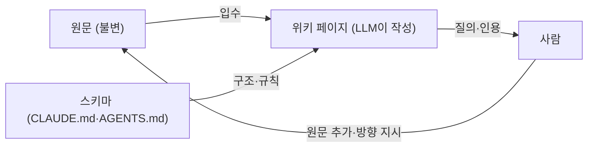

> Andrej Karpathy의 「[LLM Wiki](https://gist.github.com/karpathy/442a6bf555914893e9891c11519de94f)」(2026.04)를 바탕으로 재구성한 노트다.

## LLM 위키란

**LLM 위키(LLM Wiki)** 는 사람이 모은 원문을 LLM 에이전트가 읽고, 주제·개체별 마크다운 페이지로 요약·연결해 **계속 갱신하는 지식 창고**다. 사람은 원문을 고르고 질문한다. 쓰기와 정리는 LLM이 맡는다.

핵심 차이는 **지식이 쌓이느냐**다. 일반적인 RAG(검색 증강 생성)는 질문할 때마다 원문에서 조각(chunk)을 찾아 답을 새로 조립한다. 어제 같은 질문으로 알아낸 것이 어디에도 남지 않는다. LLM 위키는 원문이 들어올 때 미리 종합해 두므로, 위키 자체가 복리로 불어나는 결과물이 된다.

| 구분 | 청크 검색 RAG | LLM 위키 |
| --- | --- | --- |
| 종합하는 시점 | 질문할 때마다 | 원문이 들어올 때 |
| 결과물 | 그때그때의 답 | 링크된 페이지 묶음(영속) |
| 모순 처리 | 서로 다른 조각이 그대로 섞인다 | 입수할 때 표시하고 고친다 |
| 사람이 하는 일 | 질문 | 원문 고르기, 질문, 방향 잡기 |

사람이 운영하는 위키가 실패하는 이유는 **관리 비용이 가치보다 빨리 커지기** 때문이다. 링크 걸기, 낡은 문장 고치기, 중복 합치기를 LLM이 거의 공짜로 해 주면 위키가 최신 상태로 유지된다. 1945년 Vannevar Bush가 구상한 메멕스(Memex)를 현실화하는 방식으로 볼 수 있다.

## 세 개의 층

| 층 | 내용 | 누가 바꾸나 |
| --- | --- | --- |
| **원문(raw sources)** | 기사, 논문, 메모, 이미지. 사실의 기준이다 | 사람이 추가만 한다. 고치지 않는다 |
| **위키(wiki)** | 요약, 개체·주제 페이지, 비교, 종합 | LLM |
| **스키마(schema)** | 페이지 구조, 이름 규칙, 작업 절차를 적은 설정 문서 | 사람과 LLM이 함께 다듬는다 |

## 세 가지 작업

| 작업 | 하는 일 |
| --- | --- |
| **입수(ingest)** | 원문 하나를 넣으면 요약 페이지를 쓰고, 관련 개체·주제 페이지(보통 10~15개)를 고치고, 모순을 표시하고, 색인과 로그를 갱신한다 |
| **질의(query)** | 색인을 읽고 관련 페이지를 찾아 인용과 함께 답한다. 쓸 만한 답은 다시 위키 페이지로 저장한다 |
| **점검(lint)** | 주기적으로 모순, 낡은 주장, 고아 페이지, 빠진 교차 링크, 비어 있는 주제를 찾는다 |

## 탐색을 돕는 두 파일

- **`index.md`**: 전체 페이지 목록과 한 줄 설명. 입수할 때마다 갱신한다. LLM이 질의할 때 가장 먼저 읽는 지도다.
- **`log.md`**: 무엇을 언제 바꿨는지 덧붙이기만 하는 시간순 기록. 줄 머리를 일정한 접두어로 맞추면 `grep` 같은 유닉스 도구로 쉽게 훑는다.

위키가 색인 한 장으로 감당하기 어려울 만큼 커지면 로컬 검색 도구를 붙인다. 보기 도구로는 그래프 뷰·백링크가 있는 Obsidian, 원문 수집에는 웹 클리퍼, 이력 관리에는 git을 쓰는 조합이 흔하다. 원문의 이미지는 내려받아 두어야 LLM이 나중에 볼 수 있다.

## 유사도 검색의 한계와 관계 표현

벡터 유사도 검색은 **여러 조건을 조합한 관계형 질문**에 약하다. 「A는 사과를 먹고 배는 먹지 않았다. B는 사과와 배를 모두 먹었다」라는 글에서 「사과와 배를 둘 다 먹은 사람은?」을 물으면, 두 문장 모두 질문과 비슷하게 보여 정확히 골라내기 어렵다. 유사도는 **주제가 비슷한지**를 재지, 부정·교집합 같은 논리를 재지 않는다.

| 방식 | 강점 | 약점 |
| --- | --- | --- |
| 청크 유사도 검색 | 구축이 쉽고 자연어 질문을 바로 받는다 | 관계·부정·집계 질문에 약하다 |
| 온톨로지·지식 그래프 | 개체와 관계(누가 무엇을 먹었나)를 명시해 조합 질문에 정확하다 | 자연어 질문을 그래프 질의로 바꾸는 일이 어렵고, 스키마를 설계·유지해야 한다 |
| LLM 위키 | 입수할 때 관계를 문장·표·링크로 미리 정리해 둔다 | 위키 품질이 LLM의 요약과 점검에 달려 있다 |

LLM 위키는 그래프 DB 없이도 개체 페이지와 링크로 관계를 드러내는 중간 지점이다. 정밀한 집계가 필요한 데이터는 위키 문장보다 구조화된 저장소(표, DB)에 두는 편이 맞다.

## 한계

- 요약 과정에서 LLM이 틀린 종합을 만들면 그 오류가 다른 페이지로 번진다. 원문을 불변으로 두고 페이지마다 출처를 남겨야 되짚을 수 있다.
- 스키마가 없으면 페이지 모양과 이름이 제각각이 되어 링크와 점검이 무너진다.
- 입수 한 번에 여러 페이지를 고치므로 토큰 비용이 든다. 대신 질의는 싸진다.

## 정리

- RAG는 질문할 때 종합하고, LLM 위키는 원문이 들어올 때 종합해 **쌓는다**.
- 원문(불변) · 위키(LLM 작성) · 스키마(규칙)의 세 층으로 나눈다.
- 입수·질의·점검을 반복하고, `index.md`와 `log.md`로 탐색과 이력을 잡는다.
- 유사도 검색은 관계형 질문에 약하므로, 관계는 개체 페이지·링크·표로 미리 드러낸다.

결국 사람은 무엇을 읽을지와 무엇을 물을지를 정하고, 위키를 돌보는 반복 노동은 LLM에 넘기는 구조다.

관련 노트: [[harness-engineering|프롬프트에서 하네스로: 에이전틱 패턴의 진화]], [[personal-agent-harness|내 일을 줄이는 하네스 만들기]], [[how-llm-works|LLM은 무엇을 하고 왜 작동하나]], [[markdown|Markdown 문법]]
