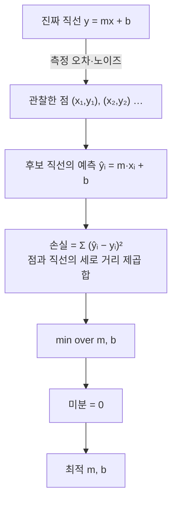

> Alvin Wan의 「머신 러닝 시작하기」(웹액츄얼리 번역, 2021.01)를 바탕으로 재구성한 노트다.
> 소프트웨어 엔지니어가 머신 러닝 실무자가 되는 법은 그렉 브록만의 「[How I became a machine learning practitioner](https://blog.gregbrockman.com/how-i-became-a-machine-learning-practitioner)」(2019.07)를 바탕으로 더했다.
> 「분류기: 특징과 결정 경계」 절과 좁은 AI·범용 AI 구분은 CrashCourse의 「Crash Course Computer Science」 강의를 바탕으로 보강했다.
> 최소제곱법의 행렬 풀이(정규 방정식)는 임성빈의 「[Matrix calculus](https://www.slideshare.net/ssuser7e10e4/matrix-calculus)」(Team-Neighborhood 「[I want to study Data Science](https://github.com/Team-Neighborhood/I-want-to-study-Data-Science/wiki/%EA%B3%B5%EB%B6%80%ED%95%98%EB%A9%B4-%EC%A2%8B%EC%9D%80-List)」 위키 「공부하면 좋은 List」가 안내하는 자료)로 보강했다.
> 교차 검증, 확률과 우도, L1·L2 규제, 차원의 저주와 PCA는 zzsza의 「[Datascience Interview Questions](https://github.com/zzsza/Datascience-Interview-Questions)」 통계·머신러닝 질문 목록을 따라 보강했다.

## 머신 러닝이란

머신 러닝(machine learning)은 **데이터에서 패턴을 찾아 예측에 쓰는 기법**의 묶음이다. 대부분은 데이터에 숨은 **분포**, 즉 어떤 일이 얼마의 확률로 일어나는지를 배우는 일로 요약된다.

구매 금액 분포가 "5달러 이하 50%, 5~10달러 25%, 10~100달러 24%, 100달러 초과 1%"라는 것을 알면 세 가지를 할 수 있다.

| 과제 | 분포로 하는 일 |
| --- | --- |
| 이상 탐지 | 100달러 결제가 들어오면 이상 거래로 표시한다 |
| 추천 | 3달러를 쓴 사람에게 5달러 이하 상품을 보여 준다 |
| 예측 | 정보가 없으면 다음 구매는 5달러 이하라고 예측한다 |

흔히 섞어 쓰지만 머신 러닝은 인공지능(AI)이라는 더 큰 목표 안의 기법 묶음이다. 스팸 판별, 부정맥 진단, 다음 영상 추천처럼 한 가지 일만 잘하는 AI를 **좁은 AI(narrow AI, weak AI)**, 사람처럼 무엇이든 하는 AI를 **범용 AI(AGI, strong AI)** 라 한다. LLM은 한 모델이 번역·요약·코딩을 모두 해 이 경계를 흐렸지만, 사람 수준의 범용 AI가 이뤄졌는지는 합의가 없다.

실제로는 입력 x를 출력으로 바꾸는 함수, 즉 **모델** `f(x)`를 배운다. `f(x) = ax`에서 `a`가 매개변수(parameter)다. 예측 `f(x)`와 정답(label) `y`의 차이를 재는 **손실 함수**를 정하고, 손실이 가장 작은 매개변수를 찾는다. 매개변수 후보가 무한하면 그 "찾는 방법"이 핵심 문제가 된다.

## 네 단계 추상화

어떤 머신 러닝 문제든 네 층으로 나눠 생각한다(UC 버클리 CS189의 분류).

| 단계 | 정할 것 | 예: 손글씨 숫자 분류 / 직선 맞추기 |
| --- | --- | --- |
| 1. 애플리케이션과 데이터 | 입력·출력이 무엇인가, 정답이 있는가 | 숫자 이미지 → 숫자 |
| 2. 모델 | 어떤 함수 꼴을 쓸까: 선형, 다항식, 로지스틱 회귀, 신경망 | 선형 회귀 `y = mx + b` |
| 3. 최적화 목표 | 손실을 어떻게 정의하나, 가중치·불균형은 | `Σ(m·xᵢ + b − yᵢ)²` 최소화 |
| 4. 최적화 알고리즘 | 목표를 어떻게 푸나 | 미분해서 0으로 놓고 푼다(닫힌 해), 또는 경사 하강법 |

### 1. 데이터

데이터를 모으고 다듬는 일이 전체의 대부분이다. 데이터는 세 몫으로 나눈다.

| 세트 | 용도 |
| --- | --- |
| 학습(training) | 모델이 반복해서 보며 매개변수를 맞춘다 |
| 검증(validation) | 학습 중 성능을 재고 모델·하이퍼파라미터를 고른다 |
| 테스트(test) | 마지막에 **한 번만** 쓴다. 여러 번 보면 테스트 세트에 과적합된다 |

데이터가 적으면 검증 세트를 떼어 내기 아깝고, 어느 몫이 검증에 걸렸느냐에 따라 점수가 흔들린다. 그래서 **교차 검증(cross-validation)** 을 쓴다. K-겹(K-fold) 교차 검증은 학습 데이터를 K개(보통 5나 10)로 나눠, 한 겹을 검증에 두고 나머지로 학습하기를 K번 돌린 뒤 점수를 평균한다. 모든 샘플이 한 번씩 검증에 쓰이고, 점수의 평균과 함께 흩어짐(표준편차)도 얻는다.

| 변형 | 쓰는 때 |
| --- | --- |
| 층화(stratified) K-겹 | 분류에서 겹마다 클래스 비율을 원래대로 맞춘다. 불균형 데이터의 기본값 |
| 그룹(group) K-겹 | 같은 사용자·환자의 샘플이 학습과 검증에 나뉘어 들어가면 점수가 부풀므로, 그룹 단위로 겹을 나눈다 |
| 시간 순서 분할 | 시계열은 미래로 과거를 맞히면 안 되므로 앞부분으로 학습하고 뒷부분으로 검증하며 창을 앞으로 민다([[time-series-analysis\|시계열 분석]]) |
| 중첩(nested) 교차 검증 | 하이퍼파라미터 탐색과 성능 추정을 같은 겹으로 하면 낙관적으로 나오므로, 바깥 루프는 평가, 안쪽 루프는 탐색에 쓴다 |

스케일링·결측 대체·특징 선택 같은 전처리도 **겹 안에서 학습 몫으로만 맞춘다.** 전체 데이터로 평균을 구한 뒤 나누면 검증 몫의 정보가 새어(data leakage) 점수가 실제보다 좋게 나온다. scikit-learn의 `Pipeline`을 `cross_val_score`에 넘기면 이 순서가 지켜진다.

### 2. 모델: 지도와 비지도

| 구분 | 데이터 | 문제 | 예 |
| --- | --- | --- | --- |
| 지도 학습 | 정답이 있다 | 분류: k개 클래스 중 어디인가 | 이 개의 품종은? |
| | | 회귀: 연속값·확률을 낸다 | 이 환자의 발병 확률은? |
| 비지도 학습 | 정답이 없다 | 군집화: 비슷한 것끼리 묶는다 | 비슷한 DNA 서열 |
| | | 차원 축소: 핵심 특징만 남긴다 | 얼굴의 공통 특징 |

### 분류기: 특징과 결정 경계

분류(classification)를 하는 알고리즘을 **분류기(classifier)** 라 한다. 나방 두 종을 가려내는 분류기를 예로 들면 흐름은 이렇다.

| 개념 | 뜻 | 나방 예 |
| --- | --- | --- |
| 특징(feature) | 대상을 쓸모 있게 요약한 값. 사진·소리 같은 원자료 대신 몇 개의 숫자로 줄인다 | 날개 길이, 무게 |
| 레이블 데이터(labeled data) | 특징값에 정답을 붙인 학습 데이터 | 곤충학자가 잰 값 + 종 이름 |
| 결정 경계(decision boundary) | 특징 공간을 클래스별 영역으로 자르는 선·면 | 「날개 45mm 미만이고 무게 0.75g 미만이면 A종」 |
| 레이블 없는 데이터(unlabeled data) | 정답을 모르는 새 데이터. 특징을 재서 경계의 어느 쪽에 떨어지는지로 예측한다 | 숲에서 새로 잡은 나방 |

- 두 종의 분포가 가운데서 겹치면 어떤 경계도 100%가 될 수 없다. 경계를 한쪽으로 옮기면 A를 B로 잘못 보는 수가 줄고 B를 A로 보는 수가 는다. 알고리즘의 일은 정답을 최대로, 오류를 최소로 하는 경계를 찾는 것이다. 어디서 맞고 틀렸는지는 혼동 행렬로 센다([[classification-metrics|분류 모델 성능 평가 지표]]).
- 특징 공간을 축에 평행한 상자로 자르는 것이 **결정 트리**다. 코드로는 중첩된 if 문이 된다([[decision-tree-ensemble|결정 트리와 앙상블]]).
- **서포트 벡터 머신(SVM)** 은 클래스 사이 여백(margin)이 가장 넓은 경계를 찾는다. 커널 함수를 쓰면 곡선·곡면 경계도 만든다.
- 특징이 3개면 경계는 평면, 수백·수천 개면 **초평면(hyperplane)** 이 된다. 사람은 그릴 수도 상상할 수도 없지만 알고리즘은 같은 방식으로 찾는다.
- 결정 트리와 SVM은 데이터로 확신 있는 결정을 내리는 **통계학**에 뿌리를 두고, 인공 신경망은 뇌의 뉴런에서 착안했다([[perceptron-mlp|퍼셉트론과 다층 퍼셉트론]]).

### 3·4. 최소제곱법으로 본 목표와 알고리즘



특징이 여러 개면 같은 문제를 행렬로 쓴다. 데이터 n개, 특징 k개일 때 X는 n×k, 계수 β는 k×1, 정답 y는 n×1이다.

```text
손실:   ‖Xβ − y‖² = βᵀXᵀXβ − 2yᵀXβ + yᵀy
기울기: ∇ = 2XᵀXβ − 2Xᵀy = 0
정규 방정식(normal equation): XᵀXβ = Xᵀy   →   β̂ = (XᵀX)⁻¹Xᵀy
```

`XᵀX`의 역행렬이 있으려면 특징끼리 완전히 겹치지 않아야 한다(다중공선성이 없어야 한다). 머신 러닝의 문제는 거의 늘 이런 고차원 벡터·행렬 계산이라 선형대수가 기초가 되고, 미분 결과의 차원(shape)을 맞춰 보는 습관이 계산 실수를 막는다.

최소제곱법은 이처럼 **닫힌 해(closed-form solution)** 가 있어 공식으로 바로 답이 나온다. 대부분의 모델, 특히 신경망은 닫힌 해가 없어서 경사 하강법처럼 조금씩 손실을 줄여 가는 반복 알고리즘을 쓴다.

## 모든 기법에 깔린 주제

### 과적합과 과소적합

| 현상 | 뜻 | 비유 |
| --- | --- | --- |
| 과적합(overfitting) | 학습 데이터에 지나치게 맞춰 새 데이터에 약하다 | 지난 시험 날 한 행동까지 그대로 반복하면 다음 시험도 잘 볼 거라 믿는 것 |
| 과소적합(underfitting) | 중요한 패턴을 놓친다 | 숙제 점수만 보고 시험 성적을 예측하는 것 |

둘 사이의 균형을 **편향-분산 트레이드오프(bias-variance tradeoff)** 로 다룬다. 손실에 모델 복잡도 벌점을 더하거나, 학습률 같은 하이퍼파라미터를 조정한다.

### MLE와 MAP

먼저 확률(probability)과 우도(likelihood)를 가른다. 같은 식 `P(x | θ)`를 두 방향으로 읽는 것이다.

| | 확률 | 우도 |
| --- | --- | --- |
| 고정된 것 | 모수 θ (예: 동전 앞면 확률 0.5) | 관찰한 데이터 x (예: 10번 중 앞면 7번) |
| 변하는 것 | 데이터 x | 모수 θ |
| 묻는 것 | 이 동전이면 앞면 7번이 나올 확률은? | 앞면 7번이 나왔다면 θ = 0.5와 0.7 중 어느 쪽이 더 그럴듯한가? |
| 합 | 가능한 x에 대해 합하면 1 | θ에 대해 합(적분)해도 1이 아니다. 확률 분포가 아니다 |

앞면 7번이면 `L(θ) = θ⁷(1 − θ)³`이고, 이것을 가장 크게 하는 θ = 0.7이 최대우도추정값이다. 곱셈이 길어지면 수치가 0으로 뭉개지므로 실제로는 로그를 씌운 로그 우도를 최대화한다(음의 로그 우도를 최소화하는 것이 분류의 교차 엔트로피 손실이다).

레시피로 아이스크림 맛을 맞히고 싶다. 원하는 것은 `P(맛 | 레시피)`인데, 데이터로 셀 수 있는 것은 `P(레시피 | 맛)`이다.

- **최대우도추정(MLE)**: `P(레시피 | 맛)`이 가장 큰 맛을 고른다. 데이터가 가장 그럴듯해지는 쪽을 택한다.
- **최대사후확률(MAP)**: 여기에 맛 자체의 사전 확률 `P(맛)`까지 곱해 고른다. 사전 지식을 반영한다.

### 특징화와 정규화

데이터가 원 모양이면 직선으로 맞지 않는다. 하지만 입력을 `x² `, `y²`로 바꾸면 `x² + y² = r²`은 새 변수에 대해 선형이 되어 최소제곱법을 그대로 쓸 수 있다. 이렇게 입력을 변환하는 것이 **특징화(featurization)** 다. 특징을 늘릴수록 모델이 복잡해지므로, **정규화(regularization)** 로 복잡도에 벌점을 줘 과적합을 막는다.

한국어 「정규화」는 두 가지를 가리키므로 구분한다. **규제(regularization)** 는 손실에 벌점을 더해 모델을 단순하게 만드는 것이고, **특징 스케일링(normalization, standardization)** 은 열마다 단위를 맞추는 전처리다(최소-최대로 0~1, 또는 평균 0·표준편차 1). 스케일링은 거리를 쓰는 k-NN·k-means·SVM과 경사 하강법의 수렴에 중요하고, 값의 순서만 보는 트리 모델에는 거의 영향이 없다. 규제의 벌점도 계수 크기에 걸리므로 스케일링을 먼저 해야 공정하게 걸린다.

| 규제 | 손실에 더하는 항 | 효과 | 이름 |
| --- | --- | --- | --- |
| L1 | `λ Σ \|wᵢ\|` | 덜 중요한 계수를 **정확히 0**으로 만든다. 특징 선택 효과가 있어 결과가 희소하다 | Lasso |
| L2 | `λ Σ wᵢ²` | 모든 계수를 0 쪽으로 고르게 줄이되 0으로 만들지는 않는다. 서로 상관된 특징의 계수를 나눠 갖게 해 다중공선성에 강하다 | Ridge, 신경망의 가중치 감쇠(weight decay) |
| L1 + L2 | 두 항을 섞는다 | 희소성과 안정성을 함께 얻는다 | Elastic Net |

L1이 0을 만드는 이유는 기하로 보인다. 계수 2개일 때 L1 제약 `|w₁| + |w₂| ≤ t`는 꼭짓점이 축 위에 있는 마름모이고, 손실의 등고선은 대개 그 꼭짓점에서 처음 닿는다. L2 제약은 원이라 축 위가 특별하지 않다. 확률로 보면 L2는 계수에 가우시안 사전 분포, L1은 라플라스 사전 분포를 둔 MAP 추정과 같다.

### 차원의 저주와 차원 축소

특징(차원)이 늘면 공간의 부피가 기하급수로 커져 데이터가 상대적으로 텅 빈다. 이것이 **차원의 저주(curse of dimensionality)** 다.

- 각 축을 10칸으로 나눌 때 1차원은 10칸, 10차원은 10¹⁰칸이다. 칸마다 샘플이 하나씩만 있으려 해도 데이터가 터무니없이 많이 필요하다.
- 고차원에서는 **모든 점 사이의 거리가 비슷해진다.** 가장 가까운 이웃과 가장 먼 이웃의 거리 비가 1에 가까워져, 거리로 판단하는 k-NN·k-means·유사도 검색이 무뎌진다.
- 쓸모없는 특징이 늘면 모델이 우연한 패턴에 맞춰 과적합하기 쉽다.

대응은 특징을 고르거나(특징 선택: L1 규제, 트리의 특징 중요도) 줄이는 것(차원 축소)이다. 대표가 **주성분 분석(PCA, principal component analysis)** 이다.

```text
1. 각 특징에서 평균을 빼 중심을 맞춘다 (단위가 다르면 표준화도)
2. 공분산 행렬을 구해 고유벡터·고유값을 얻는다 (또는 데이터 행렬을 SVD)
3. 고유값이 큰 순서, 즉 분산을 가장 많이 담는 방향부터 k개를 고른다 → 주성분
4. 데이터를 그 k개 축에 사영한다
```

| PCA가 하는 일 | 이유 |
| --- | --- |
| 차원 축소 | 분산이 큰 상위 k개 축만 남긴다. 누적 설명 분산(예: 95%)으로 k를 정한다 |
| 데이터 압축 | n×d 데이터를 n×k 좌표와 k×d 축으로 저장하고, 필요하면 근사 복원한다 |
| 노이즈 제거 | 잡음은 여러 방향에 고르게 흩어져 분산이 작은 성분에 몰린다. 그 성분을 버리고 복원하면 잡음이 줄어든다 |

PCA는 선형 변환이라 꼬인 구조는 펴지 못하고, 주성분이 무엇을 뜻하는지 해석하기 어렵다. 시각화용 비선형 축소로는 t-SNE·UMAP을 쓰고, 텍스트의 LSA는 단어-문서 행렬에 SVD를 적용한 같은 계열이다. 딥러닝 임베딩도 고차원 원자료를 저차원 의미 공간으로 줄이는 차원 축소의 한 형태다.

## 소프트웨어 엔지니어에서 머신 러닝 실무자로

선형대수와 확률의 기초가 있는 소프트웨어 엔지니어는 몇 달의 독학으로 머신 러닝 엔지니어가 될 수 있다. 공개 강좌와 자료는 충분하다. 가장 큰 장벽은 기술이 아니라 다시 초보자가 되는 것을 받아들이는 마음이다. 소프트웨어 실력을 계속 찾는 환경에 있으면 익숙한 일로 돌아가며 전환을 미루기 쉽다.

소프트웨어 관점만으로 문제를 보면 반쪽만 보인다. 모델링을 조금 바꾸면 피할 수 있는 어려운 문제를 인프라로 풀려 들게 된다. 대규모 분산 학습처럼 소프트웨어와 머신 러닝을 엮어야 풀리는 문제가 많아, 두 기술을 함께 가진 사람이 결정적인 기여를 한다.

| 방법 | 내용 |
| --- | --- |
| 만들 것을 정하고 배운다 | 챗봇처럼 구체적인 목표를 두고, 강좌에서 필요한 모듈만 고른다. LSTM 언어 모델, 다음에 Transformer 모델을 직접 짜고 학습시킨다. 논문은 한 줄씩 완전히 이해할 때까지 읽는다 |
| 남의 모델 코드를 크게 고쳐 본다 | 공개된 사전 학습 모델을 미세 조정하고, 생성 속도를 높이는 캐싱처럼 모델 전체를 건드리는 변경을 구현해 보면, 모델이 어떻게 짜여 있는지 세부까지 이해하게 된다. 머리에 담을 수 있는 복잡도를 넘으면 버리고 다시 한다 |
| 실험 기록부터 챙긴다 | 초보 때 가장 괴로운 것은 알고리즘이 아니라 작업 흐름이다. 어떤 실험이 어떤 코드로 돌았는지, 지난주 결과를 비교할 수 있게 보관했는지, 결과를 오염시키는 작은 버그가 없는지. 진전하고 있는지 확신하려면 이것부터 갖춘다 |
| 독학 뒤에 전문가를 찾는다 | 기초를 혼자 쌓은 뒤에야 전문가의 조언을 제대로 흡수할 수 있다. 실제 프로젝트를 시작할 때 조언자를 구한다 |
| 느린 것을 예상한다 | 처음 프로그래밍을 배울 때처럼 몰입이 오지 않는다. 그걸 알고 시작하면 버틴다. 실패해도 괜찮다고 느끼게 해 주는 주변 사람도 큰 힘이 된다 |

몇 달 지나면 끝없이 새 개념을 배워야 할 것 같던 느낌이 사라진다. 완전히 새로운 기본 요소를 계속 배우지 않아도 진전할 수 있고, 남은 것(가중치 초기화, 학습률 스케줄 같은 경험)은 점진적으로 쌓인다. 실패할 시간과 공간을 스스로에게 주면, 대개 예상보다 빨리 된다.

## 실습 도구

| 도구 | 용도 |
| --- | --- |
| NumPy | 효율적인 선형대수 연산 |
| scikit-learn | 회귀·분류·군집 등 고전 기법을 바로 쓰는 라이브러리 |
| PyTorch | 신경망과 딥러닝 |
| Jupyter | 실험과 시각화를 한 문서에서([[jupyter-notebook\|Jupyter Notebook]]) |

## 더 읽을거리

- [Google 머신러닝 단기집중과정](https://developers.google.com/machine-learning/crash-course?hl=ko): 선형·로지스틱 회귀와 분류, 수치·범주형 데이터 다루기, 일반화와 과적합, 신경망·임베딩·LLM 입문, 프로덕션 ML 시스템과 공정성까지 영상·인터랙티브 시각화·실습으로 다루는 무료 강좌.
- [Google 머신러닝 용어집](https://developers.google.com/machine-learning/glossary/?hl=ko): ML·AI 용어를 알파벳순으로 정의한 한국어 용어집.
- [김성범 교수(고려대 산업경영공학부) 유튜브 채널](https://www.youtube.com/channel/UCueLU1pCvFlM8Y8sth7a6RQ/videos): 「핵심 머신러닝」 강의 시리즈.

## 정리

- 머신 러닝은 데이터의 분포를 배워 이상 탐지·추천·예측을 하는 일이다.
- 데이터 → 모델 → 목표 → 알고리즘의 네 층으로 나눠 보면 어떤 기법이든 자리가 보인다.
- 데이터는 학습·검증·테스트로 나누고, 테스트 세트는 마지막에 한 번만 본다. 데이터가 적으면 K-겹 교차 검증을 쓰고 전처리도 겹 안에서 맞춘다.
- 과적합과 과소적합 사이의 균형이 모든 기법의 공통 과제다.
- L1 규제는 계수를 0으로 만들어 특징을 고르고, L2는 고르게 줄인다. 특징이 너무 많으면 차원의 저주가 오므로 고르거나 PCA로 줄인다.
- 모델을 고르기 전에 무엇을 예측하고 무엇으로 성공을 잴지부터 정한다.
- 엔지니어가 머신 러닝으로 넘어갈 때 가장 큰 장벽은 다시 초보자가 되는 것이다. 만들 것을 정해 배우고, 남의 모델 코드를 고쳐 보고, 실험 기록부터 챙긴다.

관련 노트: [[python-data-analysis|파이썬 데이터 분석 프로세스]], [[jupyter-notebook|Jupyter Notebook]], [[text-similarity|문자열·문서 유사도: 편집 거리와 코사인 유사도]], [[perceptron-mlp|퍼셉트론과 다층 퍼셉트론]], [[classification-metrics|분류 모델 성능 평가 지표]], [[decision-tree-ensemble|결정 트리와 앙상블]], [[sustainable-learning-loop|개발자의 지속 가능한 학습 루프]], [[deep-learning-intuition|딥러닝 직관으로 이해하기]], [[Recommender-System|추천 시스템]], [[time-series-analysis|시계열 분석]]
