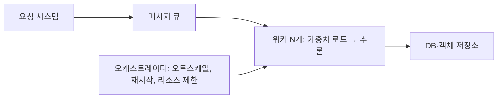

> 쏘카 기술 블로그의 「[딥러닝 모델 Serving 간단 구축기](https://tech.socar.kr/data/2020/03/10/ml-model-serving)」, 줌인터넷 기술 블로그의 「[BentoML을 활용하여 딥러닝 모델 API 서빙하기](https://zuminternet.github.io/BentoML/)」를 바탕으로, BentoML 사용법은 [공식 문서](https://docs.bentoml.com/)로 확인해 재구성한 노트다. 배포 형태와 CPU·GPU 선택, 모바일 배포는 「[A Guide to Production Level Deep Learning](https://github.com/alirezadir/Production-Level-Deep-Learning)」과 「[Full Stack Deep Learning Bootcamp 정리](https://zzsza.github.io/mlops/2019/10/06/fullstack-deeplearning-bootcamp/)」로 보강하고, 서버리스 한도는 [AWS Lambda 문서](https://docs.aws.amazon.com/lambda/latest/dg/gettingstarted-limits.html)로 확인했다.

## 모델 서빙이란

모델 서빙(model serving)은 **학습이 끝난 모델을 다른 시스템이 호출해 예측(추론)을 받을 수 있는 형태로 운영하는 일**이다. 학습은 한 번 잘 돌면 끝이지만, 서빙은 지연 시간, 처리량, 장애, 배포를 계속 책임진다.

선택지는 크게 둘이다.

| 방식 | 내용 | 맞는 경우 |
| --- | --- | --- |
| 관리형·엔드투엔드 플랫폼 | 학습부터 배포까지 묶은 플랫폼(SageMaker, Vertex AI, Kubeflow 등) | 팀이 크고 모델이 많을 때. 기능은 넓지만 익히는 비용과 플랫폼 의존이 생긴다 |
| 직접 구성하는 가벼운 서빙 | 기존 인프라(컨테이너, 큐, 오케스트레이터) 위에 추론 서버만 얹는다 | 모델이 몇 개이고 기존 시스템과 붙이는 일이 중요할 때 |

LLM처럼 토큰을 하나씩 생성하는 모델은 KV 캐시·연속 배치 같은 별도 문제가 있다. 그 내용은 [[llm-serving-at-scale|LLM 서빙의 병목]]에 정리했다. 서빙은 모델 운영의 한 부분이고, 버전 관리·모니터링·재학습까지 이어지는 전체 흐름은 [[mlops|MLOps]]에 있다.

## 배포 형태와 CPU·GPU 선택

웹 배포는 입력을 받아 예측하는 **예측 시스템**과, 요청을 받아 규모에 맞게 예측 시스템을 부르는 **서빙 시스템**(REST·gRPC 서버)으로 나뉜다. 서빙 시스템을 올리는 방식은 넷이다.

| 형태 | 장점 | 단점 |
| --- | --- | --- |
| VM에 배포 | 단순하다. 인스턴스를 더해 늘린다 | 프로비저닝이 번거롭고, 안 쓸 때도 비용을 낸다 |
| 컨테이너 + 오케스트레이터 | 환경이 재현되고 Kubernetes로 늘리고 줄인다. 지금 가장 흔하다 | 계산 시간이 아니라 서버 가동 시간만큼 낸다 |
| 서버리스 함수 | 요청만큼 내고 운영할 서버가 없다 | AWS Lambda 기준 실행 15분, 메모리 10GB, 컨테이너 이미지 10GB 한도가 있고 GPU를 쓸 수 없다. 큰 모델은 콜드 스타트가 길다 |
| 모델 서버 | 모델 전용 웹 서버. 요청을 묶어 GPU로 추론한다 | 설정할 것이 늘어난다 |

| 추론 | 고르는 기준 |
| --- | --- |
| CPU | **요구 지연·처리량을 맞춘다면 CPU가 먼저다.** 서버를 늘리거나 서버리스로 확장한다. 추천의 사용자 벡터 계산처럼 가벼운 모델은 CPU로 수 밀리초에 끝난다 |
| GPU | 큰 모델이나 높은 처리량이 필요할 때. 요청을 모아 한 번에 돌리는 적응형 배치가 있는 모델 서버(아래 BentoML, Triton 등)를 쓴다 |

### 모바일·엣지 배포

기기는 메모리와 연산이 작다. 가중치를 8비트 등으로 줄이는 **양자화**, MobileNet처럼 작게 설계한 구조, 큰 모델의 출력을 작은 모델이 배우는 **지식 증류**(DistilBERT 등)로 줄인다. 기기용 런타임으로 LiteRT(옛 TensorFlow Lite), PyTorch의 ExecuTorch, Core ML, ONNX Runtime을 쓰고, 프레임워크 사이 변환에는 ONNX 형식을 쓴다. 웹 브라우저 안에서 돌리는 방법은 [[client-side-web-ai|클라이언트 사이드 웹 AI]]에 있다.

## 동기 API와 큐 기반 워커

| 구조 | 흐름 | 장점 | 단점 |
| --- | --- | --- | --- |
| 동기 API | 클라이언트 → 추론 서버(HTTP·gRPC) → 응답 | 단순하다. 사용자가 결과를 바로 기다리는 기능에 맞다 | 추론이 느리면 요청이 쌓이고 타임아웃이 난다 |
| 큐 기반 워커 | 요청 시스템 → 메시지 큐 → 워커가 가져가 추론 → 결과를 저장소·DB에 기록 | 요청 쪽과 모델 쪽을 따로 바꾸고 늘릴 수 있다. 큐가 몰리는 부하를 흡수한다 | 결과를 나중에 받는 구조여야 한다. 큐 보관 기간 안에 소비하지 못하면 메시지를 잃는다 |

요청끼리 순서가 상관없고 서로 독립이면 상태 없는 워커를 늘리는 만큼 처리량이 거의 선형으로 오른다. 워커가 자기 속도로 가져가는 pull 방식이라 확장이 쉽다([[message-queue-kafka|메시지 큐와 Kafka]]).

## 설계 원칙

| 원칙 | 이유 |
| --- | --- |
| **가중치를 컨테이너 이미지와 분리** | 가중치를 이미지에 넣으면 이미지가 커지고, 재학습할 때마다 이미지를 다시 빌드해야 한다. 객체 저장소나 모델 저장소에서 시작 시 받아 온다 |
| **살아 있음과 일하고 있음을 구분** | 프로세스는 살아 있는데 아무 일도 안 하는 좀비 워커가 생긴다. 예외 처리만으로는 못 잡으니 하트비트 파일이나 liveness probe로 오케스트레이터가 교체하게 한다 |
| **배치로 묶어 추론** | GPU는 한 건씩보다 여러 건을 묶을 때 효율이 높다. 최대 배치 크기와 최대 대기 시간을 정해 지연과 처리량을 맞바꾼다 |
| **메시지 형식** | JSON은 단순하고, 메시지가 아주 많으면 Protocol Buffers 같은 이진 형식이 처리량에 유리하다 |
| **배포 게이트** | 병합하면 스테이징, 명시적 버전 태그를 달아야 운영에 나가게 한다. 이미지 태그가 바뀌지 않으면 배포 도구가 재배포를 건너뛸 수 있으니 태그는 매번 고유하게 붙인다 |
| **비용 통제** | 수요에 따라 워커를 늘리고 줄이며, 중단돼도 되는 작업은 스팟(선점형) 노드를 쓴다. 노드 수가 들쭉날쭉하므로 모니터링이 그 변화를 따라가야 한다 |
| **외부 SDK 오류 처리** | 클라우드 클라이언트 호출은 빈 응답·형식이 틀린 응답까지 처리해야 워커가 죽지 않는다 |

로그·노드 상태·알림은 일반 서비스와 같은 방식으로 수집한다([[observability|관측 가능성]]).

## 서빙 프레임워크: BentoML의 예

Flask나 FastAPI로 직접 감싸면 API 문서, 배치 처리, 워커 수, 컨테이너 빌드를 모두 손으로 붙여야 한다. 서빙 프레임워크는 이 반복 작업을 맡는다. BentoML은 그중 파이썬 중심의 오픈소스 프레임워크다.

| 요소 | 역할 |
| --- | --- |
| 서비스 정의 | 클래스에 `@bentoml.service`를 붙이고, 추론 메서드에 `@bentoml.api`를 붙이면 HTTP 엔드포인트가 된다. OpenAPI(Swagger) 문서가 자동으로 생긴다 |
| 적응형 배치(adaptive batching) | `@bentoml.api(batchable=True)`로 켜면 들어오는 요청을 최대 배치 크기·최대 지연 안에서 자동으로 묶어 추론한다 |
| 모델 저장소 | 학습한 모델을 이름과 버전으로 저장해 두고 서비스가 불러 쓴다 |
| Bento | 코드·모델·의존성을 묶은 배포 단위. `bentoml build`로 만들고 `bentoml containerize`로 Docker 이미지를 만든다 |

예전 버전(0.x)은 `BentoService` 클래스와 아티팩트 클래스로 모델을 묶었지만, 1.x에서 지금의 서비스 데코레이터 방식으로 바뀌었다. 같은 자리에 NVIDIA Triton Inference Server, KServe, Ray Serve 같은 도구도 있고, LLM은 vLLM·SGLang처럼 생성 모델 전용 엔진을 쓴다.

## 정리

- 사용자가 결과를 기다리면 동기 API, 그렇지 않으면 큐 기반 워커가 확장과 장애 격리에 유리하다.
- 가중치는 이미지 밖에 두고, 워커는 상태 없이 만들어 수평으로 늘린다.
- 프로세스 생존이 아니라 실제로 일하는지를 헬스 체크한다.
- 배치는 GPU 효율을 올리는 가장 쉬운 수단이다. 서빙 프레임워크가 적응형 배치를 대신 해 준다.

관련 노트: [[mlops|MLOps]], [[llm-serving-at-scale|LLM 서빙의 병목: KV 캐시, 배치, GPU]], [[message-queue-kafka|메시지 큐와 Kafka]], [[kubernetes-architecture|쿠버네티스 구조와 핵심 개념]], [[observability|관측 가능성: 로그, 트레이스, 메트릭]], [[text-classification-in-production|서비스용 텍스트 분류 모델 만들기]]
