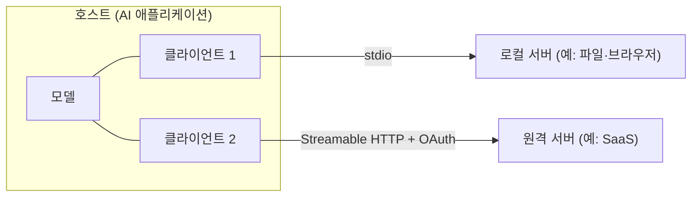
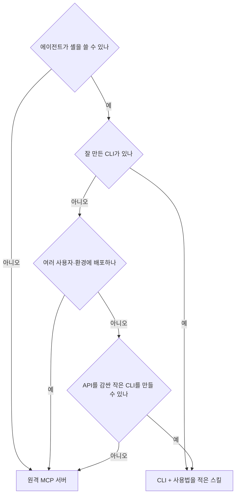

> Eric Holmes의 「[MCP is dead. Long live the CLI](https://ejholmes.github.io/2026/02/28/mcp-is-dead-long-live-the-cli.html)」(2026.02, [한국어 번역](https://velog.io/@surim014/mcp-is-dead-long-live-the-cli))과 GeekNews Weekly 「AI 에이전트가 불러낸 CLI의 귀환」(2026.03)·「스킬이 쏟아지는 시대, 내 하네스는 내가 만든다」(2026.04), Master.dev 뉴스레터의 「MCP Goes Stateless」(2026.08) 소식을 바탕으로, 프로토콜 내용은 MCP 공식 명세 [2026-07-28 변경 내역](https://modelcontextprotocol.io/specification/2026-07-28/changelog)으로 확인해 재구성한 노트다.

## MCP란

**MCP(Model Context Protocol)** 는 LLM 애플리케이션이 외부 도구·데이터에 붙는 방법을 표준화한 개방형 프로토콜이다. 「AI용 USB-C」라는 비유처럼, 서비스가 MCP 서버를 한 번 만들면 Claude Code, Cursor, ChatGPT 같은 어떤 MCP 클라이언트에서도 같은 도구를 쓴다. 통합 수가 「앱 수 × 서비스 수」에서 「앱 수 + 서비스 수」로 준다. 메시지 형식은 JSON-RPC 2.0이다.

Claude Code에서 MCP 서버를 추가·허용하는 방법은 [[claude-code-guide#MCP로 도구 연결하기|Claude Code 활용 가이드]]에, 스킬·서브에이전트와 함께 고르는 기준은 [[claude-code-extensions|커맨드·스킬·서브에이전트 고르기]]에 있다. 이 노트는 프로토콜 자체와 「MCP냐 CLI냐」의 판단을 다룬다.

## 구조: 호스트, 클라이언트, 서버

| 참여자 | 역할 | 예 |
| --- | --- | --- |
| **호스트(host)** | 사용자가 쓰는 AI 애플리케이션. 모델을 부르고, 어떤 서버에 붙을지와 권한을 관리한다 | Claude Code, Claude 데스크톱, IDE |
| **클라이언트(client)** | 호스트 안에서 서버 하나와 연결을 맡는 구성 요소. 서버마다 하나씩 생긴다 | 호스트가 서버별로 만드는 연결 객체 |
| **서버(server)** | 도구·데이터를 MCP로 노출하는 프로그램. 로컬 프로세스일 수도, 원격 서비스일 수도 있다 | GitHub, Sentry, Playwright MCP 서버 |

### 서버가 내놓는 세 가지

| 기본 요소(primitive) | 누가 쓰기로 정하나 | 쓰임 |
| --- | --- | --- |
| **도구(tools)** | 모델 | 모델이 판단해 호출하는 함수. 이름, 설명, JSON Schema 입력(`inputSchema`)·출력(`outputSchema`)을 가진다 |
| **리소스(resources)** | 애플리케이션 | URI로 읽는 데이터(파일, 레코드, 문서). 호스트가 맥락에 넣을지 정한다 |
| **프롬프트(prompts)** | 사용자 | 미리 만든 지시 템플릿. 슬래시 명령처럼 사용자가 골라 쓴다 |

반대 방향으로 서버가 클라이언트에 요청하는 기능도 있다. 사용자에게 추가 입력을 받는 **엘리시테이션(elicitation)** 이 대표적이다. 서버가 클라이언트의 모델을 빌려 쓰는 샘플링(sampling)과 작업 디렉터리를 알려 주는 루트(roots)는 2026-07-28 개정에서 지원 중단(deprecated)으로 바뀌었다. 대신 디렉터리는 도구 인자나 서버 설정으로 넘기고, 모델은 서버가 LLM API를 직접 부르라는 것이 권장 이전 경로다.

## 전송과 인증

| 전송 | 동작 | 인증 |
| --- | --- | --- |
| **stdio** | 호스트가 서버를 자식 프로세스로 띄우고 표준 입출력으로 메시지를 주고받는다. 로컬 도구에 쓴다 | 환경 변수 등으로 받은 자격 증명. 명세의 OAuth 흐름을 쓰지 않는다 |
| **Streamable HTTP** | 클라이언트가 HTTP POST로 요청하고, 응답은 일반 JSON 또는 SSE 스트림으로 받는다. 원격 서버에 쓴다 | OAuth 2.1 기반 인가. 서버는 리소스 서버, 별도 인가 서버가 토큰을 발급한다 |

예전의 HTTP+SSE 전송(엔드포인트 두 개)은 2025-03-26 개정부터 Streamable HTTP로 대체됐고, 2026-07-28 개정에서 정식으로 지원 중단 상태가 됐다. 지원 중단된 기능은 최소 12개월 유지된 뒤 제거된다.

원격 서버 인증에서 2026-07-28 개정이 바꾼 점은 다음과 같다.

- 클라이언트 등록은 동적 클라이언트 등록(DCR, RFC 7591) 대신 **클라이언트 ID 메타데이터 문서(Client ID Metadata Documents)** 를 권장한다. DCR은 하위 호환용으로 남는다.
- 인가 서버는 응답에 `iss`(RFC 9207)를 넣고, 클라이언트는 코드를 교환하기 전에 발급자를 검증한다.
- 자격 증명은 발급한 인가 서버에 묶인다. 다른 인가 서버에 재사용하지 않는다.

## 무상태 프로토콜로의 전환

2026-07-28 명세는 출시 이후 가장 큰 개정으로, MCP를 **양방향·상태 유지 프로토콜에서 요청·응답 중심의 무상태(stateless) 프로토콜**로 바꿨다.

| 바뀐 점 | 이전 | 2026-07-28 |
| --- | --- | --- |
| 연결 시작 | `initialize` → `notifications/initialized` 핸드셰이크로 버전·기능 협상 | 핸드셰이크 없음. 요청마다 `_meta`에 프로토콜 버전·클라이언트 기능을 싣는다. 서버 정보가 미리 필요하면 `server/discover`를 부른다 |
| 세션 | Streamable HTTP의 `Mcp-Session-Id` 헤더 | 프로토콜 수준 세션 제거. 상태가 필요하면 서버가 만든 핸들을 도구 인자로 주고받는다 |
| 서버 → 클라이언트 요청 | 서버가 열린 스트림으로 샘플링·엘리시테이션 요청 | **다중 왕복 요청(MRTR)**: 서버가 `resultType: "input_required"`로 필요한 입력을 돌려주면 클라이언트가 답을 담아 원 요청을 다시 보낸다 |
| 변경 알림 | HTTP GET 스트림, `resources/subscribe` | `subscriptions/listen` 하나로 원하는 알림만 구독 |
| 스트림 재개 | `Last-Event-ID`로 끊긴 SSE 이어받기 | 제거. 끊기면 새 요청으로 다시 보낸다 |
| 확장 | Tasks가 실험 기능으로 코어에 있음 | 확장 프레임워크를 정식화. Tasks(`io.modelcontextprotocol/tasks`), MCP Apps 등이 확장으로 분리 |

무상태가 되면서 **아무 서버 인스턴스나 아무 요청을 처리할 수 있다.** 일반 로드 밸런서 뒤에 서버를 여러 대 두거나 서버리스·엣지에서 돌리기 쉬워졌다. Streamable HTTP 요청에는 `Mcp-Method`, `Mcp-Name` 헤더가 붙어 게이트웨이가 본문을 파싱하지 않고 라우팅·계량한다. 목록 응답(`tools/list` 등)에는 캐시 힌트(`ttlMs`, `cacheScope`)가 붙고, 도구 목록은 결정적 순서로 돌려주도록 권장한다. 도구 정의 순서가 매번 같아야 LLM 프롬프트 캐시가 깨지지 않기 때문이다.

## 도구 정의는 공짜가 아니다

MCP 도구는 이름·설명·스키마가 **매 요청의 맥락에 실린다.** 도구 50개가 각각 1.5K 토큰이면 질문을 하기도 전에 75K 토큰을 쓴다. 도구가 많을수록 모델이 맞는 도구를 고르기도 어려워진다. 대응은 세 갈래다.

| 대응 | 방법 |
| --- | --- |
| 덜 붙인다 | 작업에 필요한 서버만 켠다. 에이전트가 원래 못 하는 일을 하게 하는 서버만 남긴다([[ai-delegation-toolkit\|AI에게 일 맡기기]]의 「MCP는 선별해서」) |
| 미뤄 싣는다 | 드물게 쓰는 도구 정의를 빼 두고 필요할 때 검색해 불러온다(도구 검색). 원리와 Claude Code 설정은 [[claude-advanced-tool-use\|Claude API 고급 도구 사용]]에 있다 |
| 결과를 거른다 | 큰 응답을 그대로 맥락에 넣지 않고 코드에서 걸러 최종 결과만 넣는다(Programmatic Tool Calling) |

## MCP냐 CLI냐

코딩 에이전트는 셸을 쓸 수 있다. 그래서 `gh`, `aws`, `kubectl`처럼 잘 만든 CLI가 있으면 MCP 서버 없이 바로 쓴다. 이 흐름을 타고 Google Workspace(`gws`), Microsoft 365, Obsidian 같은 서비스가 에이전트용 CLI를 내놓았다.

### CLI가 나은 이유

| 기준 | CLI | MCP 서버 |
| --- | --- | --- |
| 모델의 사전 지식 | man 페이지·스크립트로 이미 학습돼 있다. `gh pr view 123`은 설명 없이 쓴다 | 도구마다 설명·파라미터 문서를 새로 써서 맥락에 실어야 한다 |
| 디버깅 | 에이전트가 실행한 명령을 사람이 그대로 쳐서 같은 결과를 본다 | 호출이 대화 안에만 있어 JSON 전송 로그를 뒤져야 한다 |
| 조합 | 파이프·`jq`·리다이렉트로 걸러 필요한 것만 맥락에 넣는다. 예: `terraform show -json plan.out \| jq`로 변경 리소스만 센다 | 결과를 통째로 맥락에 넣거나, 서버에 필터 기능을 따로 만들어야 한다 |
| 인증 | SSO·프로필·`gh auth login`처럼 이미 성숙한 방식을 사람과 에이전트가 같이 쓴다 | 서버마다 로그인을 따로 하고 자주 다시 한다 |
| 운영 | 디스크의 바이너리일 뿐이다. 상주 프로세스·초기화가 없다 | 로컬 서버는 띄우고 살려 두어야 하는 프로세스다. 시작 실패가 잦다 |
| 권한 범위 | 명령·인자 단위로 허용한다. `gh pr view`는 허용, `gh pr merge`는 승인 | 도구 이름 단위로만 허용할 수 있고 인자별 제한은 어렵다 |

CLI 사용법은 **스킬**에 적어 두면 필요할 때만 맥락에 올라온다. 「CLI + 스킬」 조합은 도구 정의를 상시 싣지 않아 토큰 면에서도 가볍다.

### MCP가 나은 경우

반대쪽 관점은 **스킬은 지식 계층, MCP는 연결 계층**이라는 구분이다. 스킬은 절차를 가르치지만 CLI 설치·인증·플랫폼 호환이라는 마찰을 그대로 진다. MCP는 설치 없이 붙는 원격 서버, 표준 OAuth, 샌드박싱으로 어느 환경에서나 같게 동작한다.

| 상황 | 이유 |
| --- | --- |
| 셸이 없는 환경(웹·모바일 챗 앱, 데스크톱 앱) | CLI를 실행할 수 없다. 원격 MCP 서버는 URL만 등록하면 된다 |
| 쓸 만한 CLI가 없는 서비스 | API를 직접 감싸는 것보다 MCP 서버 하나가 낫다 |
| 여러 사용자에게 배포하는 SaaS 연동 | 사용자별 OAuth 위임, 조직 단위 관리, 감사 로그를 표준으로 얻는다 |
| 에이전트가 원래 못 하는 상호작용 | 실제 브라우저 조작(Playwright, Chrome DevTools)처럼 상태를 가진 도구 |
| 자주 바뀌는 지식을 여러 환경에 공유 | 로컬 스킬 파일을 기기마다 복사하지 않는다([[claude-skill-building-guide#지식을 원격 MCP로 제공하기\|Claude 스킬 만들기 가이드]]) |

### 에이전트용 CLI를 만든다면

서비스를 만드는 쪽이라면 **API를 먼저, 그다음 CLI를** 제대로 만든다. 에이전트용 CLI는 사람용 CLI와 설계 우선순위가 다르다.

- 출력은 `--output json`처럼 구조화된 형식을 지원한다. 사람용 표 출력부터 바꿀 필요는 없고 JSON 옵션부터 더한다.
- 긴 인자 나열 대신 API 페이로드 전체를 JSON으로 받는다.
- CLI가 스스로 스키마를 알려 주게 한다(스키마 인트로스펙션). 문서가 곧 명령이 된다.
- 에이전트는 믿을 수 없는 호출자로 본다. 입력 검증, `--dry-run`, 파괴적 명령의 확인 절차를 CLI 수준에서 둔다.

## 한계와 위험

- **도구 설명도 입력이다.** 서버가 내려보내는 도구 설명과 응답은 프롬프트 인젝션 경로가 된다. 믿을 수 있는 서버만 붙이고 권한을 좁힌다([[llm-security-attacks|LLM 보안 공격]]).
- **무상태 전환의 이전 비용**: 세션·핸드셰이크·서버 발신 요청에 기대던 서버와 클라이언트는 MRTR과 명시적 핸들로 다시 짜야 한다. 지원 중단 기능은 12개월 이상 동작하므로 그동안 옮긴다.
- **CLI도 공짜가 아니다.** 출력이 큰 CLI는 맥락을 똑같이 채운다. `jq`·`head`로 거르는 습관이나 출력 필터가 있어야 CLI의 이점이 산다.

## 정리

- MCP는 호스트·클라이언트·서버로 나뉘고, 서버는 도구(모델)·리소스(앱)·프롬프트(사용자)를 내놓는다.
- 전송은 로컬 stdio와 원격 Streamable HTTP, 원격 인증은 OAuth다. 2026-07-28 개정으로 핸드셰이크와 세션이 사라져 수평 확장이 쉬워졌다.
- 도구 정의는 매 요청의 맥락을 차지한다. 덜 붙이고, 미뤄 싣고, 결과를 거른다.
- 셸이 있고 좋은 CLI가 있으면 CLI + 스킬이 단순하다. 셸이 없거나, CLI가 없거나, 여러 사용자에게 인증을 위임해야 하면 MCP가 맞다.

MCP와 CLI는 경쟁이 아니라 에이전트가 처한 환경에 따라 고르는 두 인터페이스다.

관련 노트: [[claude-code-extensions|커맨드·스킬·서브에이전트 고르기]], [[claude-advanced-tool-use|Claude API 고급 도구 사용]], [[claude-code-guide|Claude Code 활용 가이드]], [[ai-delegation-toolkit|AI에게 일 맡기기]], [[claude-skill-building-guide|Claude 스킬 만들기 가이드]], [[devtools-ai-agents|DevTools의 AI 지원과 에이전트용 DevTools(MCP)]], [[llm-security-attacks|LLM 보안 공격]]
