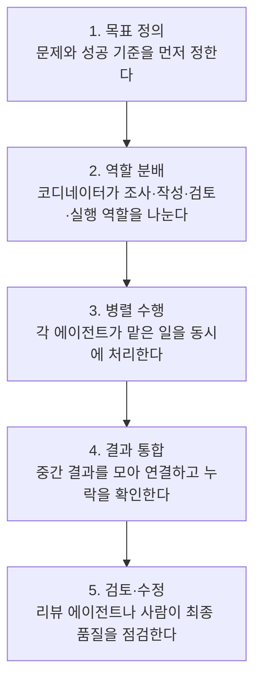

> riverkim.kr에 쓴 카드뉴스(2026.07)를 다시 정리한 노트다.
> 에이전트 하나의 정의와 특성은 ByteByteGo의 System Design 101 가이드 「[What is an AI Agent?](https://bytebytego.com/guides/what-is-an-ai-agent)」를 바탕으로 보강했다.

## AI 에이전트란

AI 에이전트(AI agent)는 **환경을 인식하고, 정보를 모으고, 그 정보로 정해진 목표를 이루기 위한 행동을 스스로 고르는 소프트웨어**다. LLM 에이전트에서는 LLM이 정보 처리와 의사 결정을 맡는다.

| 특성 | 의미 |
| --- | --- |
| 자율성 | 사람이 매번 지시하지 않아도 행동한다. 중요한 지점에는 사람 확인(human in the loop)을 둘 수 있다 |
| 기억 | 사용자 선호와 지식을 저장해 개인화하고, 대화 밖에서도 진행 상황을 이어 간다 |
| 인식 | 환경에서 들어오는 정보(파일, 화면, API 응답)를 받아 해석한다 |
| 도구 사용 | 웹 검색, 코드 실행, API 호출 같은 도구로 실제 일을 한다 |
| 협업 | 다른 에이전트나 사람과 함께 일한다 |

고전 AI의 분류로는 규칙에만 반응하는 **단순 반사형**, 내부 상태를 두는 **모델 기반 반사형**, 목표를 기준으로 행동을 고르는 **목표 기반**, 결과의 효용을 비교하는 **효용 기반**, 경험으로 나아지는 **학습형** 에이전트로 나눈다([[reinforcement-learning|강화 학습]]의 에이전트도 같은 뜻이다).

시스템 구성은 에이전트 하나가 개인 비서처럼 일하는 **단일 에이전트**, 여러 에이전트가 협력하거나 경쟁하는 **멀티 에이전트**, 에이전트와 사람이 함께 일하는 **사람-기계 협업**으로 나뉜다. 아래는 멀티 에이전트를 다룬다.

## 멀티 에이전트란

멀티 에이전트(Multi Agent)는 **여러 AI 에이전트가 역할을 나눠 하나의 일을 처리하는 방식**이다. 한 에이전트가 모든 것을 하는 대신, 조율 담당이 큰 목표를 쪼개고 전문 에이전트들이 조사·작성·검토·실행을 맡는다. 사람 팀이 PM과 실무자로 나뉘어 일하는 구조와 비슷하다.

## 왜 필요한가

| 이유 | 내용 |
| --- | --- |
| 복잡한 업무 분해 | 큰 일을 작은 역할로 나누면 처리와 관리가 쉬워진다 |
| 전문성 분리 | 역할마다 지시·도구를 따로 최적화할 수 있다 |
| 병렬 처리 | 서로 의존하지 않는 작업을 동시에 돌려 속도를 높인다 |
| 품질 향상 | 생성한 결과를 다른 에이전트가 검토하면 오류가 줄어든다 |

## 작동 흐름

## 구성 요소

| 요소 | 역할 |
| --- | --- |
| 코디네이터(오케스트레이터) | 전체 목표를 이해하고 어떤 에이전트가 무엇을 할지 조율 |
| 전문 에이전트 | 조사·작성·분석·검토처럼 한 역할에 집중 |
| 도구 연결 | 검색, 코드 실행, 데이터 조회, 문서 작성 도구와 연결 |
| 공유 컨텍스트 | 중간 결과와 규칙을 공유해 흐름이 끊기지 않게 함 |
| 가드레일·검수 | 오류·중복·보안 문제를 줄이고 최종 판단을 보완 |

멀티 에이전트의 품질은 모델 개수보다 설계와 연결 방식이 좌우한다.

## 활용 예

| 분야 | 나누는 방식 |
| --- | --- |
| 리서치 | 자료 조사 → 비교 → 요약 |
| 문서 작성 | 초안 작성 후 다른 에이전트가 자동 검토 |
| 코딩 | 설계, 구현, 리뷰 역할 분리 |
| 고객 응대 | 문의 분류 → 답변 작성 → 품질 확인 |
| 프로젝트 관리 | 회의 요약, 일정 정리, 액션 아이템 정리 |
| 데이터 분석 | 수집 → 분석 → 리포트 생성 |

복합 업무, 반복 업무, 여러 단계가 맞물린 협업 업무일수록 장점이 커진다.

## 장점과 주의점

| 장점 | 주의점 |
| --- | --- |
| 속도: 여러 작업을 동시에 처리 | 역할 설계: 역할이 겹치거나 모호하면 효율이 떨어진다 |
| 품질: 생성과 검토를 분리해 오류 감소 | 컨텍스트 관리: 에이전트 사이 정보 전달이 약하면 결과가 흔들린다 |
| 전문화: 역할별로 더 정교한 지시·도구 | 비용·지연: 에이전트가 늘수록 호출 비용과 시간도 는다 |
| 확장성: 업무가 커져도 구조적으로 늘리기 쉽다 | 최종 책임: 중요한 결정은 사람의 검수와 판단이 필요하다 |

역할 설계와 컨텍스트 관리가 어렵다면 에이전트를 여럿 두는 대신 **하네스 하나 + 외부 위임**으로 푸는 길도 있다. [[design-system-agent-harness#멀티 에이전트 대신 "하네스 + 외부 위임"|디자인 시스템을 아는 화면 생성 에이전트 설계하기]]의 「멀티 에이전트 대신 하네스 + 외부 위임」이 그 예다.

## 주요 프레임워크

2026년 기준으로 많이 쓰는 도구들이다. 이 분야는 빠르게 바뀌므로 도입 전에 각 프로젝트의 유지 상태를 확인한다.

| 프레임워크 | 특징 |
| --- | --- |
| LangGraph | 상태를 가진 오케스트레이션, 그래프 기반 워크플로, 서브그래프 |
| Microsoft Agent Framework | AutoGen과 Semantic Kernel의 직접 후속작. AutoGen의 멀티 에이전트 추상화에 Semantic Kernel의 상태 관리·텔레메트리를 합치고 그래프 워크플로를 더했다. 새 프로젝트는 AutoGen 대신 이것으로 시작한다 |
| CrewAI | crews + flows, 가드레일, 메모리, 관찰성(observability) |
| OpenAI Agents SDK | 에이전트 간 인계(handoff), 가드레일, 추적 |
| Claude Agent SDK·서브에이전트 | Claude Code의 에이전트 루프를 라이브러리로 쓰고, 한 가지 일에 집중하는 서브에이전트에 도구 권한을 제한해 맡긴다 |

에이전트끼리, 에이전트와 도구 사이를 잇는 표준도 자리 잡았다. 도구 연결은 **MCP**, 서로 다른 프레임워크의 에이전트 간 통신은 **A2A(Agent2Agent)** 프로토콜이 맡는다.

설계할 때 함께 기억할 원칙은 세 가지다.

- 멀티 에이전트가 항상 정답은 아니다. 단순한 일은 에이전트 하나가 낫다.
- 관찰성·평가·가드레일이 실전 품질을 좌우한다.
- 도구 사용과 역할 분리가 핵심 패턴이다.

키워드: orchestration, observability, guardrails, evaluation.

## 정리

- 멀티 에이전트는 여러 AI가 역할을 나눠 일하는 구조다.
- 흐름은 목표 설정 → 역할 분배 → 병렬 수행 → 결과 통합 → 검토·수정.
- 역할이 겹치지 않게 나누고, 컨텍스트를 잘 넘기고, 검수 단계를 두는 것이 설계의 핵심이다.
- 에이전트가 늘면 비용과 지연도 는다. 필요한 만큼만 나눈다.

관련 노트: [[claude-code-guide|Claude Code 활용 가이드]], [[loop-engineering|루프 엔지니어링]], [[design-system-agent-harness|디자인 시스템을 아는 화면 생성 에이전트 설계하기]], [[harness-engineering|프롬프트에서 하네스로]]
