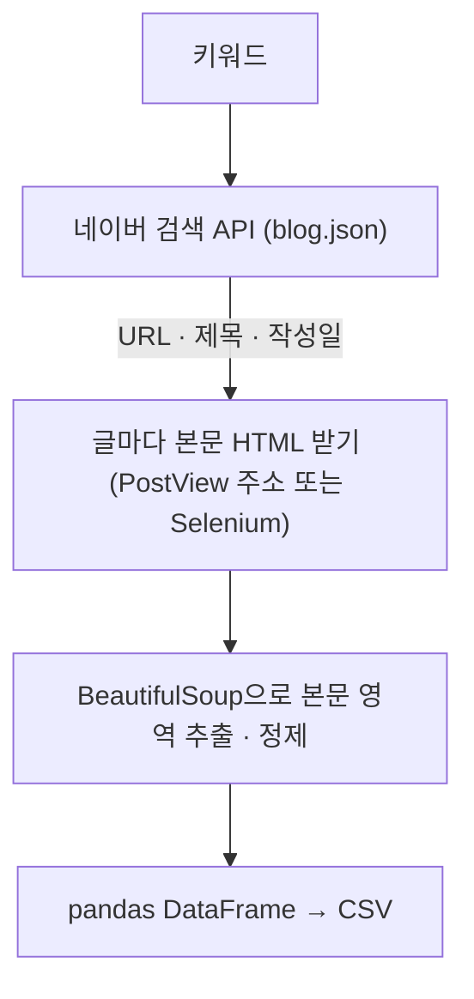

> dev-woo의 「[python으로 naver 블로그 크롤링 crawler](https://developer-woo.tistory.com/60)」(2024.02)를 바탕으로, 네이버 검색 API 공식 문서로 보강해 재구성한 노트다.

## 구조

네이버 블로그 수집은 목록은 공식 API로, 본문은 페이지에서 가져오는 두 단계로 나눈다. 검색 API는 본문 대신 몇 줄짜리 요약(`description`)만 주기 때문이다.



## 1. 검색 API로 글 목록 모으기

[네이버 개발자센터](https://developers.naver.com/)에서 애플리케이션을 등록하고 사용 API로 「검색」을 고르면 Client ID와 Secret이 나온다. 로컬 테스트라면 웹 서비스 URL은 `http://127.0.0.1`로 둔다.

| 항목 | 값 |
| --- | --- |
| 요청 | `GET https://openapi.naver.com/v1/search/blog.json` |
| 헤더 | `X-Naver-Client-Id`, `X-Naver-Client-Secret` |
| `query` | 검색어(UTF-8) |
| `display` | 한 번에 받을 개수, 1~100 |
| `start` | 시작 위치, 1~1000. 그래서 한 검색어로는 **최대 약 1,100건**까지만 받는다 |
| `sort` | `sim`(정확도순, 기본) 또는 `date`(최신순) |
| 응답 `items` | `title`, `link`, `description`, `bloggername`, `postdate`(`YYYYMMDD`) |
| 한도 | 검색 API 전체 하루 25,000회 |

```python
import os, re, requests

HEADERS = {
    "X-Naver-Client-Id": os.environ["NAVER_CLIENT_ID"],
    "X-Naver-Client-Secret": os.environ["NAVER_CLIENT_SECRET"],
}

def search_blog(query, pages=2, display=100):
    items = []
    for page in range(pages):
        res = requests.get(
            "https://openapi.naver.com/v1/search/blog.json",
            headers=HEADERS,
            params={"query": query, "display": display, "start": page * display + 1, "sort": "date"},
            timeout=10,
        )
        res.raise_for_status()
        items += res.json()["items"]
    return [
        {"url": it["link"], "title": re.sub(r"<[^>]+>", "", it["title"]), "date": it["postdate"]}
        for it in items
    ]
```

- `title`에는 검색어 강조용 `<b>` 태그가 섞여 오므로 지운다.
- 키는 코드에 박지 말고 환경 변수로 넘긴다.
- `params`에 dict를 넘기면 `requests`가 인코딩한다. `urllib.parse.quote`로 미리 인코딩해 넣으면 이중 인코딩이 된다.

## 2. 본문 받기: iframe 문제

`blog.naver.com/<아이디>/<글번호>` 페이지는 겉 틀이고, 실제 글은 `mainFrame` iframe 안에 있다. 이 주소를 `requests`로 받으면 본문이 없다.

| 방법 | 방식 | 특징 |
| --- | --- | --- |
| PostView 주소 | iframe의 실제 주소 `blog.naver.com/PostView.naver?blogId=<아이디>&logNo=<글번호>`를 바로 요청 | 브라우저가 필요 없어 빠르다. 대량 수집에 맞다 |
| 모바일 주소 | `m.blog.naver.com/<아이디>/<글번호>` | iframe이 없다 |
| Selenium | 브라우저로 열고 `driver.switch_to.frame("mainFrame")` 후 `page_source` | 느리지만 JavaScript 실행이 필요한 경우에도 된다 |

```python
from bs4 import BeautifulSoup

def post_view_url(url):
    blog_id, log_no = url.rstrip("/").split("/")[-2:]
    return f"https://blog.naver.com/PostView.naver?blogId={blog_id}&logNo={log_no}"

def fetch_body(url):
    html = requests.get(post_view_url(url), headers={"User-Agent": "Mozilla/5.0"}, timeout=10).text
    soup = BeautifulSoup(html, "html.parser")
    node = soup.select_one("div.se-main-container") or soup.select_one("#postViewArea")
    if node is None:
        return None
    text = node.get_text(" ", strip=True)
    return re.sub(r"\s+", " ", text.replace("​", "")).strip()
```

- `div.se-main-container`는 스마트에디터 ONE으로 쓴 글의 본문 영역이다. 옛 에디터 글은 `#postViewArea`처럼 다른 구조라서 선택자를 둘 이상 둔다.
- 본문에 섞인 제로폭 공백(`​`)과 연속 줄바꿈을 지운다.
- 네이버는 마크업을 수시로 바꾼다. 추출이 갑자기 빈 값을 내면 선택자부터 확인한다.
- Selenium 4.6 이상은 Selenium Manager가 드라이버를 자동으로 받는다. `webdriver-manager`의 `ChromeDriverManager().install()`은 더 필요 없다. 고정 `sleep` 대신 `WebDriverWait`로 요소가 뜰 때까지 기다린다.

## 3. 저장하기

```python
import time
import pandas as pd

rows = []
for post in search_blog("파이썬 크롤링"):
    try:
        post["body"] = fetch_body(post["url"])
    except requests.RequestException as e:
        post["body"] = None
        post["error"] = str(e)
    rows.append(post)
    time.sleep(0.5)                     # 요청 간격을 둔다

pd.DataFrame(rows).to_csv("blog.csv", index=False, encoding="utf-8-sig")
```

- **예외는 글 단위로 잡는다.** 반복문 전체를 `try`로 감싸면 한 글에서 실패할 때 남은 글을 모두 건너뛰고, 제목·본문 리스트 길이가 어긋나 DataFrame 생성이 깨진다. 글마다 dict 한 개를 만들면 길이가 어긋날 일이 없다.
- `utf-8-sig`로 저장해야 엑셀에서 한글이 깨지지 않는다.
- 네이버 블로그가 아닌 링크(외부 블로그 연동 등)도 섞여 온다. 주소가 `blog.naver.com`인지 먼저 거른다.

## 주의점

| 증상 | 원인 | 해결 |
| --- | --- | --- |
| 본문이 비어 있다 | 겉 주소를 받아 iframe 밖만 봤다 | PostView·모바일 주소, 또는 Selenium `switch_to.frame` |
| 일부 글만 빈 값 | 옛 에디터 글, 선택자 변경 | 선택자를 여러 개 두고 차례로 시도 |
| `Error Code:` 출력에서 `TypeError` | 정수 상태 코드를 문자열과 `+`로 이었다 | f-string이나 `res.raise_for_status()` |
| 1,100건 이후로 안 나온다 | `start` 상한 1000 | 검색어를 쪼개거나 기간·정렬을 바꿔 여러 번 검색 |
| 차단·느려짐 | 요청이 너무 잦다 | 요청 간격, 재시도 백오프, 동시 요청 수 제한 |

수집한 글은 저작물이다. 분석·연구 목적이라도 이용 약관과 robots.txt를 확인하고, 원문을 그대로 재배포하지 않는다.

## 정리

- 목록은 검색 API, 본문은 페이지에서 가져온다.
- 블로그 본문은 `mainFrame` iframe 안에 있다. PostView 주소를 요청하면 브라우저 없이 받는다.
- 선택자는 바뀐다. 여러 개를 두고, 빈 값이 나오면 선택자부터 의심한다.
- 예외는 글 단위로 잡고, 한 글 = dict 한 개로 모아 CSV로 저장한다.

관련 노트: [[newspaper-article-scraping|newspaper로 기사 본문 추출하기]], [[python-data-analysis|파이썬 데이터 분석 프로세스]], [[rest-api|REST API]], [[web-scraping-strategy|웹 크롤링 전략]]
