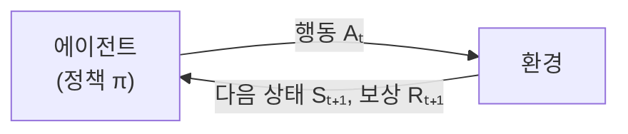

> 팔만코딩경(42Seoul 커뮤니티 위키)의 「강화학습이란」, 「강화학습 내맘대로 분류」를 바탕으로 재구성한 노트다.
> 응용 분야와 공부·구현 요령은 RLKorea의 「[How to study Reinforcement Learning](https://github.com/reinforcement-learning-kr/how_to_study_rl/wiki)」 위키(Team-Neighborhood 「[I want to study Data Science](https://github.com/Team-Neighborhood/I-want-to-study-Data-Science/wiki/%EA%B0%95%ED%99%94-%ED%95%99%EC%8A%B5)」 위키가 안내하는 자료)로 보강했다.

## 강화 학습이란

강화 학습(Reinforcement Learning)은 **정답 레이블 없이, 시행착오로 받은 보상을 신호 삼아 행동 규칙을 배우는** 머신 러닝 분야다. 지도 학습이 "이 입력의 정답은 이것"을 배운다면, 강화 학습은 "이 상황에서 이렇게 하면 길게 봐서 얼마나 좋은가"를 배운다. 게임 AI, 로봇 제어, 추천, 그리고 LLM을 사람 선호에 맞추는 RLHF(Reinforcement Learning from Human Feedback)가 대표적인 응용이다.



## 기본 용어

| 용어 | 뜻 |
| --- | --- |
| 에이전트(agent) | 의사결정을 하는 주체. 여럿이면 멀티 에이전트 강화 학습 |
| 환경(environment) | 행동을 받아 다음 상태와 보상을 돌려주는 시스템. 게임이라면 게임 자체 |
| 상태 Sₜ / 관측 Oₜ | 상태는 환경의 전체 정보, 관측은 에이전트가 실제로 보는 일부. 전부 보이면 fully observed, 일부만 보이면 partially observed |
| 행동 Aₜ / 행동 공간 | 고를 수 있는 행동과 그 집합. 이산(discrete)이거나 연속(continuous)이다 |
| 스텝 / 에피소드 | 스텝은 행동 한 번, 에피소드(trajectory, rollout)는 시작부터 끝까지의 상태·행동 나열(게임 한 판) |
| 시작 상태 분포 | 에피소드가 시작될 수 있는 상태 s₀들의 분포 |
| 상태 전이 확률 | `P(s' \| s, a)`: s에서 a를 했을 때 s'로 갈 확률 |
| 보상 Rₜ | 행동 직후 환경이 주는 스칼라 신호 `R(s, a, s')` |
| 정책 π | 상태를 보고 행동을 고르는 규칙. 결정적이면 `a = π(s)`, 확률적이면 `π(a \| s)` |

**마르코프 성질**: 다음 상태는 바로 전 상태와 직전 행동에만 달려 있고, 그 이전 이력과는 무관하다고 가정한다.

## 마르코프 결정 과정(MDP)

강화 학습 문제는 MDP라는 틀로 정식화한 뒤 푼다. MDP는 다섯 요소의 튜플이다.

```text
MDP = (S, A, P, R, γ)
       │  │  │  │  └ 감가율(discount factor), 0 ≤ γ ≤ 1
       │  │  │  └ 보상 함수
       │  │  └ 상태 전이 확률
       │  └ 행동 집합
       └ 상태 집합
```

γ 대신 시작 상태 분포 ρ₀를 넣어 정의하는 문헌도 있다. 무엇을 튜플에 넣느냐는 표기 차이이고, 문제를 이루는 재료는 같다.

## 리턴, 가치 함수, 벨만 방정식

### 리턴과 감가율

당장의 보상만 보면 근시안이 된다. 그래서 앞으로 받을 보상을 모두 더하되, 먼 미래일수록 γ를 거듭 곱해 깎는다. 지금 먹는 밥이 내일 먹을 밥보다 값지다는 직관과 같다.

```text
Gₜ = Rₜ₊₁ + γ·Rₜ₊₂ + γ²·Rₜ₊₃ + …
```

### 가치 함수

| 함수 | 정의 | 의미 |
| --- | --- | --- |
| 상태 가치 `V^π(s)` | `E_π[Gₜ \| Sₜ = s]` | 정책 π를 따를 때 상태 s에서 기대되는 리턴 |
| 행동 가치 `Q^π(s, a)` | `E_π[Gₜ \| Sₜ = s, Aₜ = a]` | s에서 a를 한 뒤 π를 따를 때의 기대 리턴. **Q 함수** |
| 최적 가치 `V*(s)`, `Q*(s, a)` | 모든 정책 중 최댓값 | 가장 좋은 정책을 썼을 때의 가치 |

`Q*`를 알면 최적 행동은 `a* = argmaxₐ Q*(s, a)`로 바로 나온다. 그래서 많은 알고리즘이 Q를 추정하는 데 집중한다.

### 벨만 방정식

벨만 방정식(Bellman equation)은 **지금 상태의 가치를 "즉시 보상 + 감가된 다음 상태의 가치"로 쪼개는** 재귀식이다.

```text
V^π(s)   = E_π[ Rₜ₊₁ + γ·V^π(Sₜ₊₁) | Sₜ = s ]
Q^π(s,a) = E_π[ Rₜ₊₁ + γ·Q^π(Sₜ₊₁, Aₜ₊₁) | Sₜ = s, Aₜ = a ]
Q*(s,a)  = E[ Rₜ₊₁ + γ·maxₐ' Q*(Sₜ₊₁, a') ]      ← 벨만 최적 방정식
```

긴 에피소드 전체를 볼 필요 없이 한 스텝씩 값을 맞춰 가며 가치를 갱신할 수 있는 근거가 이 식이다.

## 알고리즘 분류

경계가 겹치는 분류지만, 세 축으로 보면 대부분의 알고리즘이 자리를 찾는다.

### 1. 모델 기반 vs 모델 프리

여기서 "모델"은 MDP의 **전이 확률 P와 보상 함수 R**이다.

| 구분 | 전제 | 대표 방법 |
| --- | --- | --- |
| 모델 기반(model-based) | P와 R을 알거나 학습해서 쓴다 | 동적 계획법(정책 반복·가치 반복), 계획(planning), AlphaZero·MuZero |
| 모델 프리(model-free) | P와 R을 모른 채 경험에서 바로 배운다 | Q-learning, SARSA, DQN, 정책 경사 계열 |

### 2. 가치 기반 vs 정책 기반

| 구분 | 학습 대상 | 대표 |
| --- | --- | --- |
| 가치 기반(value-based) | Q 함수를 추정하고 정책은 Q에서 유도 | Q-learning, DQN |
| 정책 기반(policy-based) | 정책 π를 매개변수화해 직접 최적화 | REINFORCE, 정책 경사 |
| 액터-크리틱(actor-critic) | 정책(액터)과 가치(크리틱)를 함께 학습 | A2C, PPO, SAC |

가치를 추정하는 방식은 업데이트 시점으로도 나뉜다. **몬테카를로(MC)** 는 에피소드가 끝나야 실제 리턴으로 갱신하고, **시간차(TD) 학습**은 매 스텝 벨만 방정식으로 추정한 값으로 갱신한다.

### 3. 온 정책 vs 오프 정책

| 구분 | 데이터 | 예 |
| --- | --- | --- |
| 온 정책(on-policy) | 지금 학습 중인 정책이 직접 모은 경험만 쓴다 | SARSA, PPO |
| 오프 정책(off-policy) | 다른 정책(과거 정책, 탐색용 정책)이 모은 경험도 쓴다 | Q-learning, DQN(리플레이 버퍼), SAC |

## 어디에 쓰나

지도·비지도 학습과 달리 **에이전트가 스스로 행동해 학습 데이터를 모은다.** 새 정보가 필요하면 탐색(exploration)하고, 충분히 알면 활용(exploitation)한다. 대신 직접 시행착오를 겪어야 하므로 데이터 효율이 낮다.

| 분야 | 예 |
| --- | --- |
| 게임 | 대전 상대 에이전트, 게임 난이도 조절 |
| 제어·로봇 | 차선 변경 같은 차량 거동 결정, 공장 자동화, 보조 로봇·의수, 전력 시스템 |
| 자연어 처리 | 더 자연스러운 대화 생성, LLM의 사람 선호 정렬(RLHF) |
| 비전 | 물체 추적, 분할을 돕는 에이전트 |
| 추천 | 사용자 상황에 따라 실시간으로 바뀌는 피드·광고 추천([[realtime-recsys\|밴딧]]) |
| 최적화 | 데이터센터 냉각 에너지, 작업 스케줄링, 신경망 구조 탐색(NAS), 최적 설계 |

## 공부와 구현 요령

### 공부 순서

- 딥러닝 기초를 먼저 익힌 뒤 심층 강화 학습(Deep RL)으로 간다.
- 알고리즘 지도는 OpenAI Spinning Up의 「A Taxonomy of RL Algorithms」, 분야별 핵심 논문 흐름은 같은 사이트의 「Key Papers in Deep RL」로 잡는다.
- 기초가 끝나면 도메인이나 과제 하나를 정해 프로젝트로 진행한다.
- 논문은 2차 블로그보다 원저자 자료를 본다. 어떤 문제 때문에 나왔는지, 강점과 빈틈, 「꼭 이 방법이어야 했나」를 따지며 읽는다. 공개 리뷰가 있는 학회(ICLR 등)는 리뷰를 같이 읽으면 비판적으로 보는 눈이 생긴다.

### 환경부터 확인한다

강화 학습에서 환경은 지도 학습의 데이터 전처리만큼 중요하다.

- **무작위 에이전트로 먼저 돌려 본다.** state, action, reward, next state, done을 출력해 각 행동이 무엇이고 값이 어떤 범위인지 확인한다.
- 렌더링해서 에이전트가 실제로 어떻게 움직이는지 본다. 사람이 쉬운 환경과 에이전트가 쉬운 환경은 다르다(무작위로 움직이면 Flappy Bird는 날아가 버리고 Mountain Car는 제자리다).
- **환경을 직접 만들면** 직접 플레이해 의도대로 동작하는지, 모든 상황에서 보상이 설정대로 나오는지 출력해 확인한다. 보상이 연달아 쏟아지거나 패널티가 너무 많으면 학습이 망가진다.
- 직접 만든 환경에서 학습이 안 되면 **검증된 구현**(Stable-Baselines3 등)을 먼저 돌려 본다. 그래도 안 되면 환경 쪽 문제일 가능성이 크다.
- 에이전트가 결정을 내리기에 충분한 상태 정보를 주고 있는지 확인한다.
- 논문 결과를 볼 때는 보상 곡선만 보지 말고, 그 환경에 유리하게 짜인 것은 아닌지, 랜덤 시드 한두 개만 골라 보여 준 것은 아닌지 따진다.

### 구현 공통 요령

| 요령 | 이유 |
| --- | --- |
| 논문이 다룬 환경이면 **논문의 하이퍼파라미터부터** 쓴다 | 예: DQN의 리플레이 버퍼 기본 크기는 100만이다 |
| 카트폴처럼 너무 쉬운 과제로만 검증하지 않는다 | 구현이 틀려도 풀리는 경우가 있다 |
| 텐서의 shape과 자료형(list, NumPy 배열, 프레임워크 텐서)을 늘 확인한다 | 손실 함수의 입력과 타깃 shape이 다르면 브로드캐스팅으로 조용히 틀린다 |
| 감가율로 내다보는 길이를 가늠한다 | 실효 시야는 대략 1/(1 − γ)다. γ = 0.99면 약 100스텝이고, 0.99를 460번 곱하면 0.01 아래로 떨어진다 |
| 리턴·어드밴티지를 표준화하고 보상 규모를 맞춘다 | DQN은 보상을 −1~1로 자른다(clipping) |
| 보상이 드물면 내재 보상(intrinsic reward), 모방 학습, 계층적 강화 학습을 쓴다 | 무작위 행동으로는 보상을 거의 못 받는다 |

### 알고리즘별 요령

| 계열 | 요령 |
| --- | --- |
| DQN | ε을 1에서 시작해 일정 스텝 뒤부터 줄인다(고정 0.1보다 낫다). 타깃 네트워크는 주기적으로 갱신하고, 타깃 쪽으로는 기울기가 흐르지 않게 한다(PyTorch `detach()`). Q값 과대평가를 막으려 Double DQN 타깃을 쓴다. 리플레이 버퍼는 오프 정책 학습에서만 쓸 수 있다 |
| 정책 경사 | 에피소드 끝에 반드시 보상이 나오면 REINFORCE부터 해 본다. 확률적 정책은 처음에 행동 확률이 고르게(행동 3개면 0.33씩) 나오도록 초기화하고, 정책 엔트로피가 0으로 줄어드는지로 수렴을 본다. 단일 A2C는 잘 안 되는 경우가 많아 여러 환경을 병렬로 돌린다. 엔트로피 보너스는 너무 이른 수렴을 막는다 |
| TRPO·PPO | 리턴과 GAE는 뒤에서부터 거꾸로 계산한다. GAE는 γ·λ에 민감하다. PPO는 클리핑만으로 신뢰 영역을 흉내 내 계산이 가볍고 미니배치 학습이 된다 |
| 연속 행동 | 결정적 정책이면 DDPG, 확률적 정책(가우시안 평균·표준편차 출력)이면 TRPO·PPO·SAC를 쓰거나, 행동을 잘게 나눠 이산 문제로 바꾼다. 결정적 정책의 출력은 행동 공간 범위로 잘라 준다 |
| DDPG·SAC | DDPG는 하이퍼파라미터에 민감하고 후반에 성능이 급락하기 쉬워 기울기 클리핑을 쓴다. 소프트 타깃 갱신 τ는 0.005 정도. SAC는 온도 α를 자동 조정하는 두 번째 버전을 쓰고(log α를 학습), 두 Q 함수 중 작은 값을 써서 과대평가를 줄인다 |
| 탐색 기법 | 보상이 드문 환경(Montezuma's Revenge)에서 NoisyNet, 의사 횟수(pseudo-count), ICM·RND 같은 내재 보상을 쓴다. ICM·RND는 신경망 예측 오차를 보상으로 줘 구현이 쉽다. 외재 보상을 0으로 두고 내재 보상만으로 학습되는지 보면 구현을 검증할 수 있고, 정규화가 틀리면 아예 학습되지 않는다 |
| 모델 기반 | 알파고 계열의 출발점은 몬테카를로 트리 탐색(MCTS)이다. 틱택토 같은 작은 환경에서 MCTS부터 구현해 본다 |
| 분산 학습(IMPALA, Ape-X) | 데이터를 모으는 액터는 CPU에, 학습기는 GPU에 둔다. 서버·네트워크 지식이 함께 필요하다 |
| 모방 학습(GAIL) | 판별기가 주는 보상 `−log D(s, a)`로 정책을 학습한다. GAN처럼 하이퍼파라미터에 민감하므로 판별기와 정책의 갱신 비율을 조절하고, 판별기 정확도를 출력해 너무 강해지면 학습을 멈춘다 |

## 실습 환경

| 도구 | 용도 |
| --- | --- |
| Gymnasium | 강화 학습 환경 표준 API. 유지가 끊긴 OpenAI Gym을 Farama 재단이 이어받았다 |
| Stable-Baselines3 | PPO·DQN·SAC 등 검증된 구현을 바로 쓰는 PyTorch 라이브러리 |
| Unity ML-Agents | Unity 게임 장면을 강화 학습 환경으로 쓰는 툴킷 |
| Pygame | 간단한 2D 환경을 직접 만들 때 |

## 정리

- 강화 학습은 상태·행동·보상의 상호작용으로 누적 보상을 최대화하는 정책을 배운다.
- 문제는 MDP `(S, A, P, R, γ)`로 정식화하고, 리턴은 감가율로 미래 보상을 깎아 더한 값이다.
- 가치 함수 V·Q는 기대 리턴이고, 벨만 방정식이 한 스텝 단위 갱신을 가능하게 한다.
- 알고리즘은 모델 기반/프리, 가치/정책 기반(+액터-크리틱), 온/오프 정책의 세 축으로 본다.
- 학습이 안 되면 알고리즘보다 환경과 보상부터 의심한다. 무작위 에이전트와 검증된 구현으로 먼저 확인한다.
- 보상 설계가 곧 문제 정의다. 보상이 엉뚱하면 에이전트는 엉뚱한 목표를 정확히 최적화한다.

관련 노트: [[machine-learning-basics|머신 러닝 기초: 네 단계 추상화]], [[multi-agent|멀티 에이전트]], [[perceptron-mlp|퍼셉트론과 다층 퍼셉트론]], [[realtime-recsys|실시간 추천과 실험: 밴딧]]
