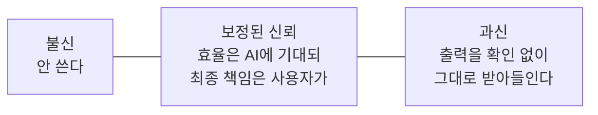

> web.dev의 「[Learn AI](https://web.dev/learn/ai)」 강좌 중 「Build responsibly with AI」 모듈을 바탕으로 재구성한 노트다.
> 같은 기술의 두 얼굴, 데이터 편향, 도덕적 딜레마 절은 고려사이버대학교 「알고리즘과 문제해결」(2023-2학기) 강의 내용으로 보강했다.

## 책임 있는 AI란

**AI의 판단은 중립적인 계산 결과가 아니라 데이터를 고른 사람과 규칙을 정한 사람의 선택이 담긴 산출물이다.** 그래서 "AI가 그렇게 판단했다"는 말은 책임을 덜어 주지 못한다. 같은 기술도 누가, 어떤 데이터로, 어떤 제약 아래 쓰느냐에 따라 결과가 갈린다. 생각을 읽어 문자로 바꾸는 헤드셋은 말을 못 하는 환자에게 목소리를 주지만, 같은 장치로 국가가 시민의 생각을 들여다보거나 제조사가 뇌파 데이터를 팔 수도 있다. 그래서 설계 단계에서 다음을 함께 묻는다.

| 질문 | 헤드셋 예 |
| --- | --- |
| 누가 쓰고, 누가 영향을 받는가 | 사용자(특히 장애가 있는 사람), 개발사, 서비스 업체, 규제 기관 |
| 무엇이 새어 나갈 수 있는가 | 뇌파 데이터 유출, 오작동 시 의도하지 않은 발화 |
| 실패하면 어떻게 되돌리는가 | 즉시 취소 기능, 보안 장치, 인체 유해성 검증 |

데이터 소스를 고르고, 모델 행동을 설정하고, 출력을 보여 주는 방식 하나하나가 시스템의 책임과 안전을 정한다. **AI 거버넌스(AI governance)**는 이 결정들을 관리하는 일이고, 세 축으로 나뉜다.

| 축 | 목표 |
| --- | --- |
| 프라이버시(Privacy) | 데이터를 책임 있게 다루고, 무엇을 모으는지 설명하고, 브라우저 밖으로 나가는 것을 최소화한다 |
| 공정성(Fairness) | 차별적 행동(편향)을 점검하고, 사용자가 문제를 신고하는 루프를 만든다 |
| 신뢰와 투명성(Trust & transparency) | 불확실성과 실수가 있어도 계속 쓸 수 있도록 보정된 신뢰를 설계한다 |

보안도 거버넌스의 중요한 축이다. 탈옥·프롬프트 인젝션·데이터 중독은 [[llm-security-attacks|LLM 보안 공격]]에, 시스템 프롬프트 유출은 [[system-prompt-patterns|시스템 프롬프트 설계 패턴]]에, 더 넓은 틀은 Google의 [Secure AI Framework(SAIF)](https://saif.google/)에 있다.

세 축은 모두 AI 솔루션의 세 층(데이터 · 지능 · UX)에서 각각 다룬다.

## 한눈에 보기

| | 데이터 | 지능 | UX |
| --- | --- | --- | --- |
| **프라이버시** | 덜 모으고 더 지킨다 | 외부 모델의 민감 정보 기억을 막는다 | 투명하고 제어 가능하게 |
| **공정성** | 출처를 밝히고 균형을 맞춘다 | 출력의 편향을 시험·완화한다 | 사용자가 편향을 찾고 고치게 한다 |
| **신뢰** | 데이터 출처와 신선도를 밝힌다 | 추론을 모듈화하고 설명 가능하게 | 점진적 설명과 피드백 |

## 프라이버시

기대 수준은 제품마다 다르다. 소비자 제품은 이름·메시지·브라우징 기록 같은 **개인 식별 정보(PII)** 보호가, 기업용은 데이터 주권·기밀·지식 재산 보호가 중심이다. 의료·금융·교육처럼 삶에 영향을 주는 분야는 엔터테인먼트보다 훨씬 엄격해야 한다.

### 데이터: 덜 모으고 더 지킨다

입력·출력·피드백·오류 로그는 평가, 파인튜닝, 퓨샷 예시, UX 개선에 다시 쓰인다. 그래서 모으되 원칙을 지킨다.

- **학습에 필요한 것만 모은다.** 상품 검색 개선에는 전체 프로필이 아니라 질의·클릭 패턴·익명 세션이면 충분하다.
- **민감 정보를 지운다.** 외부 모델로 보내기 전에 익명화·가명화·집계로 PII를 없앤다.
- **보관 기간을 줄인다.** 목적을 다한 로그와 캐시는 지운다.
- 무엇을, 얼마나, 왜 모으는지 문서로 남긴다. 비개발자에게 데이터 흐름을 설명할 수 없다면 통제하기에도 너무 복잡하다.

### 지능: 모델이 기억하지 않게

열린 채팅·글쓰기 화면에서는 사용자가 무심코 민감 정보를 입력한다. 금칙어는 막을 수 있어도 맥락상 민감한 정보는 못 막는다. 외부 제공자의 서버 모델이 입력을 학습에 재사용하면 언젠가 다른 사용자에게 개인 정보 조각이 새어 나갈 수 있다(LLM 기억 문제).

- **외부 API를 꼼꼼히 확인한다.** 입력이 기록·보관·학습에 쓰이는지 알아야 한다. 정책이 불투명한 서비스는 피한다. 모델 카드(model card)는 모델의 설계와 평가 방식을 정리한 문서다.
- **직접 학습한다면 민감한 세부를 추상화한다.** 지름길 학습(shortcut learning)을 경계한다. 신용 평가에서 우편번호는 인종·계층을 대신하는 신호가 될 수 있다.
- **민감한 분야는 클라이언트 추론을 쓴다.** 브라우저 내장 AI나 브라우저에서 도는 모델이면 데이터가 기기를 떠나지 않는다([[client-side-web-ai|클라이언트 사이드 웹 AI]]).
- 개인화가 필요하면서 데이터를 지켜야 하면 **연합 학습(federated learning)**을 검토한다. 기기에서 학습하고 익명화된 결과만 서버로 보낸다.

### UX: 보여 주고 고르게 한다

| 방법 | 예 |
| --- | --- |
| 투명하게 | "기기에서 처리됨", "분석을 위해 안전하게 전송됨" 라벨, 툴팁으로 점진적 공개 |
| 맥락에서 묻는다 | 일괄 동의 대신 "이전 검색을 추천 개선에 쓸까요?" |
| 단순한 제어 | 개인화·클라우드 기능·데이터 공유 토글 |
| 볼 수 있게 | 앱 안의 작은 프라이버시 대시보드 |
| 이유를 설명한다 | 어떻게 쓰이는지 알면 사용자는 더 기꺼이 공유한다. 보관 정책도 같다 |

## 공정성

채용·법률·금융처럼 사람에게 직접 영향을 주는 결정에서 편향은 특히 위험하다. 과거 채용 데이터로 학습한 모델은 직무 능력이 아니라 인구 통계 특징으로 소수 집단 지원자를 불리하게 평가할 수 있다. 편향은 데이터에서 태어나 모델에서 커지고 UX에서 드러난다.

### 데이터 편향

머신 러닝 모델의 성능은 대부분 학습 데이터가 정한다([[machine-learning-basics|머신 러닝 기초]]). 데이터에 사회의 편견이나 수집 과정의 쏠림이 들어 있으면 모델은 그것을 그대로, 때로는 더 크게 배운다. 이것이 **데이터 편향(data bias)** 이다. 알고리즘 편향이나 AI 편향이라고도 부르지만 출발점은 대개 데이터다.

미국 일부 법원이 참고 자료로 쓴 재범 위험 점수 프로그램 **COMPAS**가 대표 사례다. 2016년 ProPublica가 실제 재범 기록과 비교해 보니, 다시 범죄를 저지르지 않은 흑인 피고인이 백인 피고인보다 고위험으로 잘못 분류되는 비율이 훨씬 높았다. 개발사는 점수가 인종과 무관하게 같은 정확도로 맞는다고 반박했다. 이 논쟁은 **공정성의 정의가 여러 개이고 동시에 만족시킬 수 없는 경우가 있다**는 것을 보여 준다. "점수가 같으면 실제 위험도 같다"는 기준과 "집단별 오분류 비율이 같다"는 기준은 집단 간 기저율이 다르면 함께 성립하기 어렵다. 어느 쪽을 택할지는 사람이 정하고, 그 선택을 문서로 남긴다.

편향은 작은 분류기에서도 생긴다. 사자와 호랑이를 구분하는 이미지 분류기를 만들 때 사자 사진이 훨씬 많고(**양의 불균형**), 사자는 갈기 있는 수컷뿐이고 호랑이는 백호가 없으면(**다양성의 공백**), 모델은 암사자나 백호에서 틀린다. 얼굴 인식에서 같은 일이 생기면 특정 피부색이나 성별을 잘 못 알아보는 시스템이 된다. 데이터를 모을 때는 점검 축을 표로 만들어 칸마다 채웠는지 확인한다.

| 점검 축 | 예 |
| --- | --- |
| 클래스별 개수 | 사자와 호랑이를 비슷한 수로 |
| 하위 집단 | 암수, 새끼와 성체, 털 색 |
| 촬영 조건 | 자세, 각도, 배경 유무, 조명 |

평가할 때도 전체 정확도 하나만 보지 말고 **하위 집단별 정확도**를 따로 본다. 전체가 95%여도 특정 집단에서 60%라면 그 집단에게는 쓸 수 없는 모델이다([[classification-metrics|분류 모델 평가 지표]]).

### 데이터

- **출처와 범위를 밝힌다.** "주로 영어 콘텐츠로 학습했고 기술 문서는 적다"처럼 약점을 미리 알린다.
- **진단 테스트를 돌린다.** "She/He/They is a great leader"를 넣고 감성·어조 차이를 비교한다. 작은 차이가 깊은 편향의 신호다.
- **데이터셋에 메타데이터를 단다.** 도메인·지역·격식 수준을 붙여 두면 감사·필터링·재균형이 쉬워진다.
- 직접 학습한다면 **표현을 넓혀 균형을 맞춘다.** 만든 뒤 고치는 것보다 효과적이다.

### 지능

- 편향 탐지 필터로 성별 표현이나 배제적 어조를 정기적으로 시험하고 드리프트를 감시한다.
- 예측 모델에서는 우편번호·학력·소득처럼 민감한 특성을 간접적으로 담는 속성을 조심한다.
- 출력을 여러 개 만들어 중립성·다양성·어조로 순위를 매긴 뒤 보여 준다.
- 고정관념을 강화하는 출력을 막는 규칙을 둔다.

### UX

- **근거를 보여 준다.** "이전 입력을 보고 전문적인 어조를 추천했다"처럼 숨은 판단이 아니라 정해진 논리를 따른다는 것을 알린다.
- **의미 있는 제어를 준다.** 어조·복잡도·시각 스타일을 사용자가 고른다.
- **편향·오류 신고를 쉽게 한다.** 신고가 쉬울수록 개선용 실데이터가 많아진다.
- **피드백 루프를 닫는다.** 신고를 재학습·규칙에 반영하고 "추천의 문화적 편향을 줄이도록 조정했다"처럼 진행을 알린다.

## 신뢰와 투명성

사용자는 버튼이 늘 같은 일을 하는 예측 가능한 앱에 익숙하다. AI는 이 기대를 깬다. 언어 모델은 환각하고, 예측 모델은 잘못 분류하고, 에이전트는 엇나간다. 그리고 사용자가 이 오류를 막는 마지막 방어선이다.

목표는 사용자를 양 끝에서 가운데 **보정된 신뢰(calibrated trust)**로 끌어오는 것이다.

### 데이터

- 데이터의 출처와 계보를 밝힌다.
- 데이터가 얼마나 최신인지 적는다.
- 모델이 본 콘텐츠 종류와 약한 영역(예: 비영어 데이터)을 설명한다.
- 상호작용이 쌓이면 데이터 스냅숏을 버전별로 남겨 출력이 어떻게 변했는지 설명할 수 있게 한다.

### 지능

- **맥락 안에서 그때그때 설명한다.** 사용자는 설명서를 읽지 않고 바로 쓰기 시작한다(능동적 사용자의 역설). 그래서 작은 설명을 상호작용 안에 심는다.
- **한계를 먼저 알린다.** "유머나 전문 용어는 피하면 결과가 낫다" 같은 짧은 안내.
- **신뢰도 표시와 대체 경로.** 확률 점수나 과거 성공률로 신뢰도를 추정하고, 명백히 틀린 출력에는 안전한 대체 동작을 정해 둔다.
- **모듈식으로 만든다.** 문법·문체·어조를 단계별로 처리하면 "어조: 덜 격식, 복잡도: 단순화"처럼 단계마다 무엇이 바뀌었는지 보여 줄 수 있다.

### UX

- **교육 수준을 맞춘다.** 파워 유저에겐 가벼운 안내, 초보자에겐 자세한 설명.
- **점진적으로 공개한다.** "자동 생성됨" 같은 작은 표시에서 시작해 클릭하면 더 보여 준다.
- **피드백 결과를 보여 준다.** "간결한 답을 선호하셔서 어조를 조정했다"처럼 사용자의 수정이 이후 행동을 바꾼다는 것을 알린다.
- **오류를 우아하게 다룬다.** 확신이 낮으면 인정하고 검토를 사용자에게 넘긴다("의도와 다를 수 있다. 게시 전에 확인하라"). 다시 시도·수정·안전한 대체로 돌아가는 길을 준다.

## 정답 없는 설계 문제: 도덕적 딜레마

딜레마는 어느 쪽을 골라도 바람직하지 않은 결과가 나오는 상황이다. 대표가 철학자 필리파 풋(Philippa Foot)이 1967년에 제시한 **트롤리 문제**다. 브레이크가 고장 난 전차가 다섯 명에게 달려가고, 선로를 바꾸면 한 명이 있는 쪽으로 간다. 결과의 총합을 보는 **공리주의**는 한 명을 희생해 다섯을 살리라고 하고, 행위 자체의 옳고 그름을 보는 **의무론**은 사람을 수단으로 삼는 개입 자체를 문제 삼는다.

사람 운전자는 사고 순간에 반사적으로 반응하고 그 결과를 사고로 받아들인다. **자율주행차**는 피할 수 없는 충돌에서 어떻게 움직일지를 누군가 **미리 코드로 정해야 한다.** 방향을 틀지, 탑승자와 보행자 중 누구를, 다수와 소수·아이와 노인·사람과 동물 중 누구를 우선할지, 신호를 지킨 보행자와 무단횡단한 보행자를 다르게 볼지 모두 설계자의 가치관이 들어간 결정이다.

MIT의 **모럴 머신(Moral Machine)** 은 이 질문을 웹에서 대규모로 물었다. 2018년 Nature에 실린 결과에 따르면 233개 국가·지역에서 약 4천만 건의 선택이 모였다. 동물보다 사람, 적은 수보다 많은 수, 노인보다 젊은 사람을 살리는 경향은 전 세계에 공통이었지만, 나이를 얼마나 중시하는지, 법을 지킨 사람을 얼마나 우대하는지는 지역별로 차이가 컸다. 교훈은 다수결로 정답을 정하자는 것이 아니라, **보편적으로 합의된 정답이 없고** 한 나라의 기준을 다른 나라에 그대로 수출하면 그곳의 가치와 어긋날 수 있다는 것이다.

그래서 개발자가 할 일은 다음과 같다.

- **이해관계자를 먼저 그린다.** 직접 사용자뿐 아니라 판단의 대상이 되는 사람, 데이터를 제공한 사람까지 포함한다.
- **어떤 기준을 택했고 무엇을 포기했는지 명시한다.** 공정성 정의도, 딜레마의 우선순위도 문서로 남긴다.
- **만장일치를 기다리지 않는다.** 가능한 많은 사람이 참여하는 공론화를 거쳐 합리적인 수준에서 출시하고, 문제를 신고하고 고칠 경로를 열어 둔다.

## 정리

- AI의 판단은 데이터와 설계자의 선택이 담긴 결과물이다. 누가 영향을 받고, 무엇이 새고, 어떻게 되돌릴지를 설계 단계에서 묻는다.

- 거버넌스는 프라이버시 · 공정성 · 신뢰 세 축을 데이터 · 지능 · UX 세 층에서 각각 다룬다.
- 프라이버시: 덜 모으고, PII를 지우고, 민감하면 기기에서 처리하고, 사용자에게 보이고 고르게 한다.
- 공정성: 데이터 출처를 밝히고, 개수 불균형과 하위 집단 누락을 점검하고, 하위 집단별로 평가하고, 신고를 쉽게 하고 그 결과를 반영한다. 공정성의 정의는 서로 충돌할 수 있으니(COMPAS) 택한 기준을 명시한다.
- 신뢰: 과신도 불신도 아닌 보정된 신뢰로 이끈다. 한계를 먼저 말하고, 확신이 낮으면 사람에게 검토를 넘긴다.
- 처음부터 모든 것을 할 수는 없다. 가장 중요한 영역부터 정하고 출시와 피드백마다 가드레일을 다듬는다.

관련 노트: [[ai-feature-blueprint|AI 기능 기획]], [[ai-ux-patterns|AI 기능의 UX 패턴]], [[system-prompt-patterns|시스템 프롬프트 설계 패턴]], [[client-side-web-ai|클라이언트 사이드 웹 AI]], [[ai-platform-shift|AI 플랫폼 전환과 일의 재편]], [[ai-2027-scenario|AI 2027: 초지능 도래 시나리오와 정렬 문제]], [[machine-learning-basics|머신 러닝 기초]], [[classification-metrics|분류 모델 평가 지표]], [[software-testing#AI 소프트웨어 테스트|AI 소프트웨어 테스트]]
