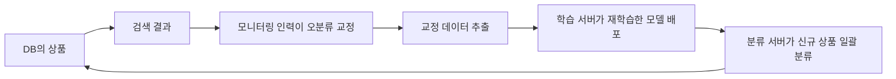

> NAVER D2의 「[클린봇 2.0: 문맥을 이해하는 악성 댓글(단문) 탐지 AI](https://d2.naver.com/helloworld/7753273)」, 「[TensorFlow를 활용한 네이버쇼핑의 상품 카테고리 자동 분류](https://d2.naver.com/helloworld/1264836)」를 바탕으로 재구성한 노트다.

## 무엇이 다른가

논문이나 대회의 분류는 고정된 데이터에서 점수를 올리는 문제다. 서비스의 분류는 기준을 정하고, 데이터를 계속 고치고, 빠르게 다시 배포하는 문제다. 규칙 기반 분류(「이 업체 카테고리는 저 카테고리로」)는 대상과 체계가 바뀔 때마다 규칙이 무너지므로, 규모가 커지면 학습 기반 분류로 넘어간다.


## 1. 기준과 라벨

- **분류 기준을 먼저 글로 정의한다.** 악성 댓글이라면 욕설, 저속한 표현, 선정적·폭력적·차별적·비하 표현처럼 유형을 나누고, 학술 자료와 심의 기준을 참고해 경계를 정한다. 기준이 흐리면 라벨러마다 판단이 갈린다.
- **"애매함" 라벨을 따로 받는다.** 라벨러에게 해당·애매·해당 안 함(2·1·0)을 고르게 하고, 애매한 데이터는 학습에서 뺀다. 경계 사례를 억지로 한쪽에 넣으면 모델이 배우는 신호가 흐려진다.
- **출력은 확률로 둔다.** 모델은 0~1 사이 점수를 내고, 조치(숨김, 검수 요청)는 운영 요구에 맞춘 **임계값**으로 정한다. 임계값은 정밀도와 재현율을 맞바꾸는 손잡이다([[classification-metrics|분류 모델 성능 평가 지표]]).

## 2. 토큰화는 도메인을 따른다

| 데이터 | 문제 | 선택 |
| --- | --- | --- |
| 댓글 | 오타, 자모만 쓴 표현, 특수문자로 비튼 욕설이 많다 | 단어·형태소 대신 **음절 단위** 토큰화. 드문 음절은 `<unk>`로 묶는다 |
| 상품명 | 띄어쓰기가 없고, 한영 혼용, 모델 코드(`SL-M2029`), 용량(`500GB`)이 핵심 단서다 | 일반 NLP라면 불용어로 버릴 **속성·모델 코드를 살리는** 쇼핑 전용 사전과 term 추출. 모델 코드의 `-`는 지우지 않는다 |

임베딩도 같은 원리다. 위키백과로 사전 학습한 단어 벡터는 상품명의 쓰임을 모르므로, 도메인 데이터로 임베딩을 직접 학습하는 편이 낫다. 토큰화 방식 일반은 [[nlp-pipeline|자연어 처리 파이프라인]]에 있다.

## 3. 무거운 모델보다 갱신하기 쉬운 모델

분류 과제가 이진 분류처럼 단순하면 가장 큰 모델이 답이 아니다.

- 이런 과제에서는 파라미터를 늘리는 것보다 데이터를 늘리는 효과가 더 큰 경우가 많다.
- 표현의 유행이 빠르게 바뀌는 문제는 자주 다시 학습해 배포하는 쪽이 이긴다. 무거운 모델은 재학습 시간과 비용이 크다.
- 사용자가 글을 쓰는 순간 판정해야 하면 응답 속도와 안정성이 정확도만큼 중요하다.

그래서 CNN·BiLSTM 같은 가벼운 구조를 쓰고, 큰 모델의 힘은 다른 방식으로 빌린다.

| 방법 | 내용 |
| --- | --- |
| 데이터 확장 | 큰 모델로 학습 데이터를 늘리거나 라벨을 붙인다 |
| 교사-학생 학습(지식 증류) | 큰 모델(교사)의 출력을 작은 모델(학생)이 따라 배우게 한다 |
| 전이 학습 | 관련 과제를 먼저 학습해 표현을 얻는다. 예: 같은 사용자가 비슷한 시기에 쓴 두 댓글은 의미가 가깝다는 가정으로 문장 유사도를 먼저 학습하거나, 언어 모델링(ELMo류)을 먼저 학습한다 |

지금은 사전 학습된 트랜스포머 인코더를 미세 조정하거나 LLM으로 라벨을 만들어 작은 모델을 학습시키는 방식이 흔하다. 원칙은 같다. 서빙 비용과 갱신 주기를 먼저 정하고 그 안에서 가장 좋은 모델을 고른다([[ml-model-serving|머신러닝 모델 서빙]]).

## 4. 학습: 불균형과 라벨 노이즈

**클래스 불균형**: 한 클래스가 훨씬 많으면 모델이 다수 쪽으로 기운다. 소수 클래스를 복제하는 **오버샘플링**, 다수 클래스를 줄이는 언더샘플링, 손실에 클래스 가중치를 주는 방법이 있다.

**라벨 노이즈는 모델로 찾는다.** 사람이 붙인 라벨에는 반드시 오류가 섞인다. 교차 검증처럼 데이터를 나눠 돌리면 모든 데이터에 "자기를 학습하지 않은 모델"의 예측을 얻을 수 있다.

```text
데이터를 N등분
for k in 1..N:
    k번째 조각을 빼고 학습 → k번째 조각을 예측
예측 점수가 높은데 "아님"으로, 낮은데 "해당"으로 라벨된 것부터 사람이 검수·교정
```

라벨을 고친 뒤 다시 학습하면 구조를 바꾸지 않아도 모든 모델의 성능이 오른다. 이런 접근을 체계화한 것이 confident learning 계열 기법이다.

## 5. 사람의 교정을 학습 데이터로

운영 중 사람이 잘못 분류된 항목을 바로잡으면, 그 결과는 가장 깨끗한 학습 데이터다. 교정 데이터를 따로 모아 정기 재학습에 넣으면, 서비스가 돌수록 모델이 좋아지는 순환이 생긴다.



## 6. 텍스트만으로 부족하면 다중 입력

상품명만으로는 "여성 티셔츠"와 "강아지 티셔츠"를 가르기 어렵지만 이미지를 보면 쉽다. 사람이 판단할 때 보는 단서를 모델 입력에도 넣는다.

| 입력 | 처리 |
| --- | --- |
| 상품명(텍스트) | 단어 임베딩 → CNN으로 위치와 무관한 핵심어 특징 추출 → LSTM으로 주변 단어 문맥 통합(CNN-LSTM) |
| 이미지 | 모바일용으로 가벼운 CNN(MobileNet 계열)으로 특징 추출 |
| 기타 메타데이터 | 업체 원래 카테고리, 가격, 브랜드, 제조사, 이미지 비율을 범주형·수치형 특징으로 |

각 갈래의 출력 벡터를 이어 붙여 마지막 분류층에 넣는 **다중 입력(multi-input) 모델**이 단일 입력보다 정확하다.

## 정리

- 기준을 글로 정의하고, 애매한 데이터는 학습에서 뺀다. 출력은 확률, 조치는 임계값으로.
- 토큰화와 임베딩은 도메인 데이터의 모양(오타, 모델 코드)에 맞춘다.
- 자주 갱신하고 빠르게 응답해야 하면 가벼운 모델 + 데이터 품질이 큰 모델보다 낫다.
- 교차 예측으로 라벨 오류를 찾고, 사람이 고친 데이터를 재학습에 되돌린다.

관련 노트: [[nlp-pipeline|자연어 처리 파이프라인: 전처리부터 언어 모델까지]], [[classification-metrics|분류 모델 성능 평가 지표]], [[text-similarity|문자열·문서 유사도: 편집 거리와 코사인 유사도]], [[ml-model-serving|머신러닝 모델 서빙]], [[deep-learning-intuition|딥러닝 직관으로 이해하기]]
