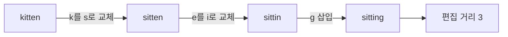
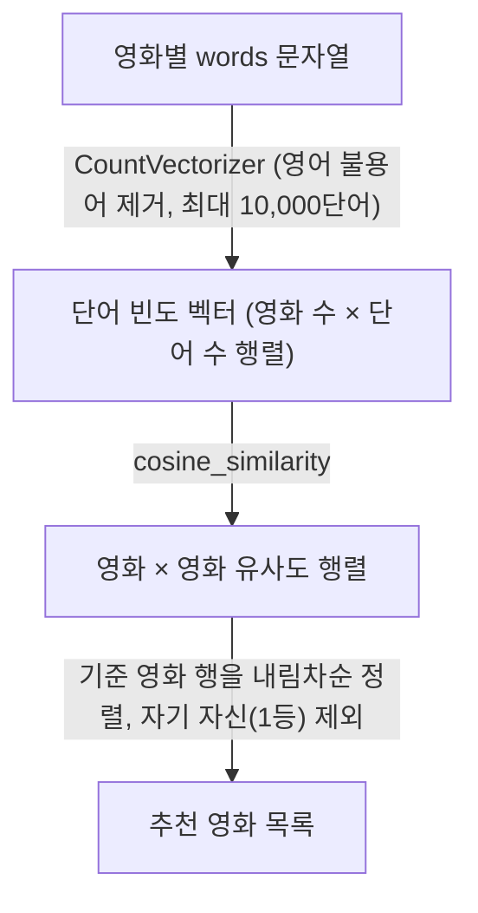

> riverkim.kr에 쓴 글을 다시 정리한 노트다. 영화 추천 웹 서비스 프로젝트(Django)에서 쓴 코드를 바탕으로 했다.
> 「다른 벡터 거리와 유사도」는 김기현의 「[특징 유사도 구하기](https://kh-kim.gitbook.io/natural-language-processing-with-pytorch/00-cover-4/07-similarity)」, 이웃 검색과 문서 군집은 「[(한국어) 텍스트 마이닝을 위한 튜토리얼](https://github.com/lovit/textmining-tutorial)」로 보강했다.

"두 텍스트가 얼마나 비슷한가"를 숫자로 바꾸면 오타가 섞인 검색어로도 원하는 결과를 찾고, 비슷한 콘텐츠를 추천할 수 있다. 비교 대상이 짧은 문자열인지 단어가 많은 문서인지에 따라 쓰는 방법이 다르다.

| 비교 대상 | 방법 | 값의 의미 | 쓰임 |
| --- | --- | --- | --- |
| 짧은 문자열 (검색어 vs 제목) | 편집 거리, Jaro-Winkler | 고치는 횟수(작을수록 비슷) / 0~1 점수(클수록 비슷) | 오타에 강한 검색, 자동완성 |
| 문서·키워드 묶음 | 벡터화 + 코사인 유사도 | -1~1 (단어 빈도 벡터면 0~1, 클수록 비슷) | 비슷한 글·상품·영화 추천 |

## 편집 거리

편집 거리(Edit Distance, 레벤슈타인 거리)는 한 문자열을 다른 문자열로 바꾸는 데 필요한 **삽입·삭제·교체의 최소 횟수**다. 값이 작을수록 두 문자열이 비슷하다.



두 문자열의 앞부분끼리 비교한 결과를 표에 채워 나가는 **동적 계획법**으로 O(m×n)에 구한다.

```python
def edit_distance(a: str, b: str) -> int:
    dp = [[0] * (len(b) + 1) for _ in range(len(a) + 1)]
    for i in range(len(a) + 1):
        dp[i][0] = i
    for j in range(len(b) + 1):
        dp[0][j] = j
    for i in range(1, len(a) + 1):
        for j in range(1, len(b) + 1):
            cost = 0 if a[i - 1] == b[j - 1] else 1
            dp[i][j] = min(dp[i - 1][j] + 1,        # 삭제
                           dp[i][j - 1] + 1,        # 삽입
                           dp[i - 1][j - 1] + cost) # 교체
    return dp[-1][-1]
```

### Jaro-Winkler 유사도

파이썬에서는 `jellyfish`나 `rapidfuzz` 라이브러리로 **Jaro-Winkler 유사도**를 바로 계산한다. 편집 횟수 대신 일치하는 문자와 순서가 뒤바뀐 문자를 따져 0~1 사이 점수를 내고, 앞부분(접두사)이 같을수록 가산점을 준다. 사람들이 검색어를 앞에서부터 입력하는 점을 생각하면 제목 검색에 잘 맞는다.

```python
from jellyfish import jaro_winkler_similarity

def search(movies, keyword, top_n=5):
    scored = [
        {**m, 'similarity': jaro_winkler_similarity(keyword, m['title'])}
        for m in movies
    ]
    scored.sort(key=lambda m: -m['similarity'])  # 유사도 높은 순
    return scored[:top_n]
```

검색어와 모든 영화 제목의 점수를 계산해 높은 순으로 상위 5개를 돌려준다. 데이터가 많아지면 매번 전체를 훑는 비용이 커지므로, 그때는 검색 엔진의 퍼지 검색(fuzzy search)을 고려한다.

## 코사인 유사도

코사인 유사도(Cosine Similarity)는 두 벡터 사이 **각도의 코사인 값**이다. 방향이 같을수록 1에 가깝다. 문서를 단어 빈도 벡터로 바꾸면 문서 길이와 상관없이 "어떤 단어를 비슷한 비율로 쓰는가"를 비교할 수 있다.

```text
similarity(A, B) = (A · B) / (|A| × |B|)
```

영화마다 줄거리·장르·키워드를 합친 `words` 문자열을 만들어 두고, 아래 순서로 비슷한 영화를 찾는다.



```python
from sklearn.feature_extraction.text import CountVectorizer
from sklearn.metrics.pairwise import cosine_similarity

def recommend(words_list, target_idx, top_n=6):
    vectors = CountVectorizer(max_features=10000, stop_words='english') \
        .fit_transform(words_list).toarray()
    similarity = cosine_similarity(vectors)
    ranked = sorted(enumerate(similarity[target_idx]), key=lambda x: x[1], reverse=True)
    return [idx for idx, _ in ranked[1:top_n + 1]]  # 0번은 자기 자신
```

- 단순 빈도 대신 TF-IDF(`TfidfVectorizer`)를 쓰면 흔한 단어의 영향이 줄어든다.
- 영화 수가 n이면 유사도 행렬은 n×n이다. 요청마다 새로 계산하지 말고 미리 계산해 저장해 두는 편이 낫다.

## 다른 벡터 거리와 유사도

| 척도 | 계산 | 특징 |
| --- | --- | --- |
| L1 거리(맨해튼) | 차원별 차이의 절댓값 합 | 격자 길을 따라 걷는 거리. 이상치에 덜 민감하다 |
| L2 거리(유클리드) | 차원별 차이 제곱합의 제곱근 | 가장 익숙한 직선거리. 벡터 길이(문서 길이)의 영향을 그대로 받는다 |
| L∞ 거리 | 차원별 차이 중 가장 큰 값 | 한 차원이라도 크게 다르면 멀다 |
| 코사인 유사도 | 내적을 두 길이의 곱으로 나눔 | 방향만 본다. 1이면 같은 방향, 0이면 직교, −1이면 반대 |
| 자카드 유사도 | 교집합 크기 / 합집합 크기 | 단어 집합끼리 비교. 빈도 벡터에는 `Σ min(wᵢ, vᵢ) / Σ max(wᵢ, vᵢ)`로 일반화한다 |

단어 빈도처럼 대부분이 0인 **희소 벡터**에서는 겹치는 단어가 하나도 없으면 내적이 0이 되어, 뜻이 비슷한 문서라도 유사도가 0으로 나온다. 표면 단어가 아니라 의미를 비교하려면 밀집 임베딩으로 바꿔야 하는 이유다.

## 문서가 많을 때: 이웃 검색과 군집

모든 쌍을 비교하면 문서 수의 제곱만큼 계산이 든다. 문서가 많으면 후보를 먼저 좁힌다.

| 방법 | 원리 |
| --- | --- |
| 역색인(inverted index) | 단어 → 그 단어가 나온 문서 목록. 질의 단어를 하나라도 가진 문서만 후보로 삼는다. 희소 벡터의 코사인 계산에 잘 맞는다 |
| 랜덤 프로젝션 | 무작위 방향 몇 개에 벡터를 투영해 차원을 줄인다. 거리가 대략 보존된다 |
| 지역 민감 해싱(LSH) | 가까운 벡터일수록 같은 해시 버킷에 들어가게 설계한 해시로, 같은 버킷 안에서만 비교한다 |

비슷한 문서끼리 묶을 때는 **k-means가 잘 맞고**, DBSCAN 같은 밀도 기반이나 계층적 군집, 가우시안 혼합은 잘 맞지 않는다. 고차원 희소 벡터에서는 거리가 고르게 퍼져 밀도의 경계가 뚜렷하지 않기 때문이다. 문서 벡터를 단위 길이로 정규화한 뒤 k-means를 돌리면 코사인 기준 군집이 된다.

## 정리

- 짧은 문자열 비교는 편집 거리(DP) 또는 Jaro-Winkler, 문서 비교는 벡터화 + 코사인 유사도.
- 편집 거리는 작을수록, Jaro-Winkler와 코사인 유사도는 클수록 비슷하다.
- 콘텐츠 기반 추천의 가장 단순한 형태는 "키워드 벡터 → 코사인 유사도 → 상위 N개"다.
- 데이터가 커지면 유사도 계산을 미리 해 두거나 검색 엔진에 맡긴다.
- 단어가 달라도 뜻이 비슷한 문서를 찾으려면 단어 빈도 대신 임베딩 모델로 만든 벡터에 같은 코사인 유사도를 쓴다. 벡터가 많아지면 벡터 DB의 근사 최근접 이웃(ANN) 검색으로 상위 N개를 고른다.

## 참고 자료

- [코사인 유사도(Cosine Similarity): 딥 러닝을 이용한 자연어 처리 입문](https://wikidocs.net/24603)

관련 노트: [[dynamic-programming|동적 계획법]], [[python-data-analysis|파이썬 데이터 분석 프로세스]], [[search-engine-basics|검색엔진의 원리]], [[nlp-pipeline|자연어 처리 파이프라인]], [[recsys-basics|추천 시스템 기초]]
