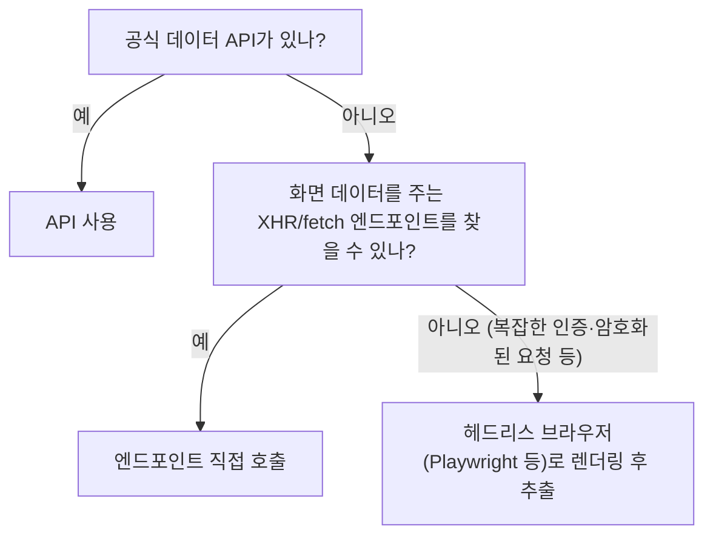

> 「[웹크롤링 좀 더 잘하기](https://www.slideshare.net/wangwonLee/2018-datayanolja-moreeffectivewebcrawling)」(데이터야놀자 2018) 발표 자료를 바탕으로 재구성한 노트다.
> 쿠키·세션 로그인, 브라우저 자동화의 대기, 병렬 크롤링은 Team-Neighborhood 「[I want to study Data Science](https://github.com/Team-Neighborhood/I-want-to-study-Data-Science/wiki/%EA%B3%B5%EB%B6%80%ED%95%98%EB%A9%B4-%EC%A2%8B%EC%9D%80-List)」 위키가 추천하는 「[나만의 웹 크롤러 만들기](https://beomi.github.io/gb-crawling/)」 시리즈(로그인, 멀티프로세싱, 헤드리스 크롬, Implicit vs Explicit wait 편)로 보강했다.

## 먼저 판별한다: 정적 페이지인가

크롤링 방법은 데이터가 HTML 응답에 들어 있는가로 갈린다.

| 확인 | 방법 | 뜻 |
| --- | --- | --- |
| 받은 HTML에 원하는 데이터가 있다 | `requests`로 받은 소스와 브라우저 화면 비교 | **정적 페이지**. HTML을 파싱하면 끝 |
| 받은 소스가 브라우저와 다르다 | `User-Agent` 헤더를 브라우저 것으로 바꿔 다시 요청 | 서버가 클라이언트 종류에 따라 다른 HTML을 준 것일 수 있다 |
| JS를 끄면 브라우저에서도 데이터가 안 보인다 | DevTools 명령 메뉴의 「Disable JavaScript」 | **동적 페이지**. JS가 나중에 데이터를 불러온다 |

정적 페이지는 HTTP GET → BeautifulSoup 같은 파서로 태그·`class`·`id`를 골라 추출한다.

## 동적 페이지: 가벼운 방식부터



| 방식 | 장점 | 단점 |
| --- | --- | --- |
| 공식 API | 데이터 신뢰도, 빠름, 약관상 안전 | API 키·쿼터, 사용법 학습, 필요한 필드가 없을 수 있다 |
| 엔드포인트 직접 호출(네트워크 리버싱) | 브라우저 없이 JSON을 바로 받아 훨씬 빠르다. 의존성이 적다 | 엔드포인트 분석 시간. 사이트가 바뀌면 깨진다 |
| 브라우저 자동화 | 사람이 보는 그대로 동작해 만들기 쉽다 | 느리고 무겁고 네트워크 상태에 민감하다 |

### 네트워크 리버싱

DevTools Network 패널의 Fetch/XHR 필터를 켜고 스크롤·「더 보기」·페이지 이동을 해 보면, 화면을 채우는 데이터 요청이 보인다. 요청 URL, 쿼리 파라미터(페이지 번호·커서), 필요한 헤더를 확인한 뒤 같은 요청을 코드로 재현한다. 패널 사용법은 [[devtools-network|DevTools Network 패널]]에 있다.

- HTML 틀만 있고 데이터를 전부 JS로 그리는 페이지는 로드 시점부터 요청 흐름을 따라간다. 목록 요청 → 항목별 상세 요청처럼 단계가 나뉘어 있는 경우가 많다.
- 요청을 「Copy as cURL」로 복사해 재현해 보면 어떤 헤더·쿠키가 필수인지 빨리 가려낼 수 있다.

## 로그인이 필요한 페이지: 쿠키와 세션

HTTP는 요청마다 연결이 끊기는 무상태(stateless) 프로토콜이라, 서버는 로그인한 사용자를 쿠키로 알아본다. 쿠키는 브라우저에 저장되는 키-값이라 변조·탈취될 수 있으므로, 서버는 보통 사용자 정보를 서버 쪽 세션에 두고 브라우저에는 긴 임의 문자열인 세션 ID만 준다.

```python
import requests

with requests.Session() as s:                      # 쿠키를 요청 사이에 자동으로 들고 다닌다
    page = s.get("https://example.com/login")       # 로그인 폼의 CSRF 토큰을 먼저 받는다
    token = parse_csrf(page.text)                   # 폼의 hidden input(_csrf 등)에서 꺼낸다
    s.post("https://example.com/auth", data={"_csrf": token, "userID": ID, "userPassword": PW})
    html = s.get("https://example.com/mypage").text  # 같은 세션으로 로그인 뒤 페이지 요청
```

- 로그인 폼의 `input` 이름(name)과 제출 주소는 DevTools의 요소 검사와 Network 패널로 확인한다. 폼은 `name: 값` 쌍을 주로 POST로 보낸다.
- **CSRF 토큰**: 요청이 그 사이트의 폼에서 왔는지 확인하는 일회용 값이다. 로그인 페이지를 먼저 GET해 토큰을 받아 함께 보내야 한다.
- `with` 블록 안에서 세션을 쓰면 끝날 때 연결이 정리된다.
- 로그인 뒤의 데이터는 약관과 개인정보 문제가 따르므로 본인 계정의 본인 데이터처럼 허용된 범위에서만 수집한다.

## 브라우저 자동화: 요소를 기다리는 법

JS가 그리는 요소는 페이지를 연 직후에는 아직 없을 수 있다. Selenium에서 바로 찾으면 `NoSuchElementException`이 난다.

| 방식 | 동작 | 한계 |
| --- | --- | --- |
| 암묵적 대기(implicit wait) | `driver.implicitly_wait(3)`: 요소를 찾을 때마다 최대 3초까지 다시 시도한다. 기본값은 0초 | 네트워크가 유난히 느리면 정한 시간을 넘겨 실패한다. ajax로 구조가 바뀌는 페이지에는 적당한 값을 정하기 어렵다 |
| 명시적 대기(explicit wait) | `WebDriverWait(driver, 10).until(EC.presence_of_element_located((By.CSS_SELECTOR, "div.intro > h3")))`: 그 요소가 나타날 때까지 기다린다 | 기다릴 조건을 요소마다 적어야 한다 |

ajax로 화면을 바꾸는 SPA가 대부분이므로 명시적 대기를 기본으로 쓴다. Playwright는 클릭·입력 같은 동작 전에 요소가 보이고 활성화될 때까지 **자동으로 기다리므로** 이 구분이 거의 필요 없다. 화면 없이 브라우저를 돌리는 헤드리스(headless) 모드는 두 도구 모두 기본으로 지원한다. 과거 Selenium의 `find_element_by_css_selector` 같은 메서드는 Selenium 4에서 없어졌고 `find_element(By.CSS_SELECTOR, ...)`를 쓴다.

## 병렬로 빠르게

크롤링 시간은 대부분 계산이 아니라 **네트워크 응답을 기다리는 시간**이다. 그래서 요청을 동시에 여러 개 띄우면 거의 그 배수만큼 빨라진다.

| 방법 | 특징 |
| --- | --- |
| `multiprocessing.Pool(4).map(crawl, urls)` | 프로세스를 여러 개 띄운다. GIL의 영향을 받지 않고 파싱이 무거울 때도 좋다. 페이지 목록을 직접 나눌 필요 없이 풀이 나눠 준다 |
| 스레드(`concurrent.futures.ThreadPoolExecutor`) | 네트워크 대기 중에는 GIL이 풀리므로 I/O 위주 크롤링에는 스레드로도 충분하다 |
| 비동기(`asyncio` + `httpx`·`aiohttp`) | 스레드 하나로 수백 개 요청을 동시에 기다린다. 대량 수집에 가장 가볍다 |

동시 요청 수를 늘릴수록 대상 서버의 부담과 차단 위험도 커진다. 동시성 상한과 요청 간격을 함께 정한다.

## 라이브러리로 배포할 때

남이 쓸 크롤러는 API 키나 브라우저 드라이버 같은 외부 의존성을 줄이는 편이 낫다. 개발 시간이 더 들어도 엔드포인트 호출 방식이 설치와 실행 모두 가볍다. 대량 수집은 멀티스레딩·비동기 I/O로 병렬화해 더 빨라질 수 있지만, 요청 간격을 두어 대상 서버에 부담을 주지 않는다.

## 지킬 것

- `robots.txt`와 이용 약관을 확인한다. 로그인 뒤 데이터, 개인정보, 유료 콘텐츠 수집은 법적 문제가 될 수 있다.
- 요청 간격(rate limit)을 두고, 같은 데이터는 캐시해 다시 받지 않는다.
- 엔드포인트 방식은 사이트 개편에 약하므로 응답 구조가 바뀌면 바로 알아채도록 검증 코드를 둔다.

## 정리

- 정적인지 동적인지부터 판별한다. User-Agent와 JS 끄기 테스트로 확인한다.
- 동적 페이지는 공식 API → 숨은 데이터 엔드포인트 → 헤드리스 브라우저 순으로 가벼운 방식을 고른다.
- 브라우저 자동화는 최후의 수단이다. 엔드포인트를 찾으면 대개 훨씬 빠르다.
- 로그인이 필요하면 세션 객체로 쿠키를 유지하고 CSRF 토큰을 함께 보낸다. 브라우저 자동화는 명시적 대기(또는 Playwright 자동 대기)를 쓴다.
- 크롤링은 네트워크 대기가 대부분이라 병렬화 효과가 크다. 동시성 상한과 요청 간격을 같이 정한다.

관련 노트: [[naver-blog-crawling|네이버 블로그 크롤링]], [[newspaper-article-scraping|newspaper로 기사 본문 추출하기]], [[web-crawler-at-scale|대규모 웹 크롤러 설계]], [[devtools-network|DevTools Network 패널]]
