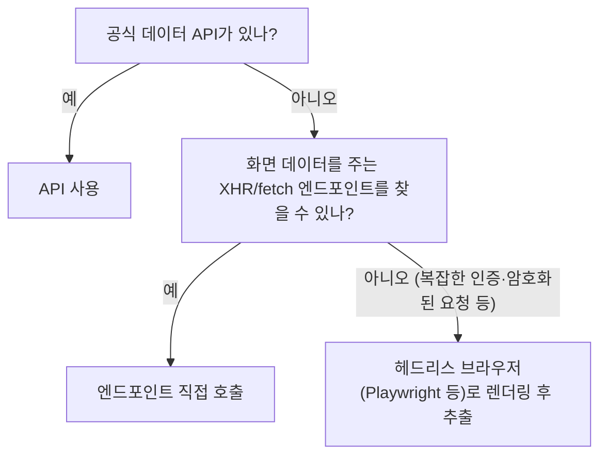

> 「[웹크롤링 좀 더 잘하기](https://www.slideshare.net/wangwonLee/2018-datayanolja-moreeffectivewebcrawling)」(데이터야놀자 2018) 발표 자료를 바탕으로 재구성한 노트다.

## 먼저 판별한다: 정적 페이지인가

크롤링 방법은 데이터가 HTML 응답에 들어 있는가로 갈린다.

| 확인 | 방법 | 뜻 |
| --- | --- | --- |
| 받은 HTML에 원하는 데이터가 있다 | `requests`로 받은 소스와 브라우저 화면 비교 | **정적 페이지**. HTML을 파싱하면 끝 |
| 받은 소스가 브라우저와 다르다 | `User-Agent` 헤더를 브라우저 것으로 바꿔 다시 요청 | 서버가 클라이언트 종류에 따라 다른 HTML을 준 것일 수 있다 |
| JS를 끄면 브라우저에서도 데이터가 안 보인다 | DevTools 명령 메뉴의 「Disable JavaScript」 | **동적 페이지**. JS가 나중에 데이터를 불러온다 |

정적 페이지는 HTTP GET → BeautifulSoup 같은 파서로 태그·`class`·`id`를 골라 추출한다.

## 동적 페이지: 가벼운 방식부터

| 방식 | 장점 | 단점 |
| --- | --- | --- |
| 공식 API | 데이터 신뢰도, 빠름, 약관상 안전 | API 키·쿼터, 사용법 학습, 필요한 필드가 없을 수 있다 |
| 엔드포인트 직접 호출(네트워크 리버싱) | 브라우저 없이 JSON을 바로 받아 몇 배 빠르다. 의존성이 적다 | 엔드포인트 분석 시간. 사이트가 바뀌면 깨진다 |
| 브라우저 자동화 | 사람이 보는 그대로 동작해 만들기 쉽다 | 느리고 무겁고 네트워크 상태에 민감하다 |

### 네트워크 리버싱

DevTools Network 패널의 Fetch/XHR 필터를 켜고 스크롤·「더 보기」·페이지 이동을 해 보면, 화면을 채우는 데이터 요청이 보인다. 요청 URL, 쿼리 파라미터(페이지 번호·커서), 필요한 헤더를 확인한 뒤 같은 요청을 코드로 재현한다. 패널 사용법은 [[devtools-network|DevTools Network 패널]]에 있다.

- HTML 틀만 있고 데이터를 전부 JS로 그리는 페이지는 로드 시점부터 요청 흐름을 따라간다. 목록 요청 → 항목별 상세 요청처럼 단계가 나뉘어 있는 경우가 많다.
- 요청을 「Copy as cURL」로 복사해 재현해 보면 어떤 헤더·쿠키가 필수인지 빨리 가려낼 수 있다.

## 라이브러리로 배포할 때

남이 쓸 크롤러는 API 키나 브라우저 드라이버 같은 외부 의존성을 줄이는 편이 낫다. 개발 시간이 더 들어도 엔드포인트 호출 방식이 설치와 실행 모두 가볍다. 대량 수집은 멀티스레딩·비동기 I/O로 병렬화해 더 빨라질 수 있지만, 요청 간격을 두어 대상 서버에 부담을 주지 않는다.

## 지킬 것

- `robots.txt`와 이용 약관을 확인한다. 로그인 뒤 데이터, 개인정보, 유료 콘텐츠 수집은 법적 문제가 될 수 있다.
- 요청 간격(rate limit)을 두고, 같은 데이터는 캐시해 다시 받지 않는다.
- 엔드포인트 방식은 사이트 개편에 약하므로 응답 구조가 바뀌면 바로 알아채도록 검증 코드를 둔다.

## 정리

- 정적인지 동적인지부터 판별한다. User-Agent와 JS 끄기 테스트로 확인한다.
- 동적 페이지는 공식 API → 숨은 데이터 엔드포인트 → 헤드리스 브라우저 순으로 가벼운 방식을 고른다.
- 브라우저 자동화는 최후의 수단이다. 엔드포인트를 찾으면 대개 몇 배 빠르다.

관련 노트: [[naver-blog-crawling|네이버 블로그 크롤링]], [[newspaper-article-scraping|newspaper로 기사 본문 추출하기]], [[web-crawler-at-scale|대규모 웹 크롤러 설계]], [[devtools-network|DevTools Network 패널]]
