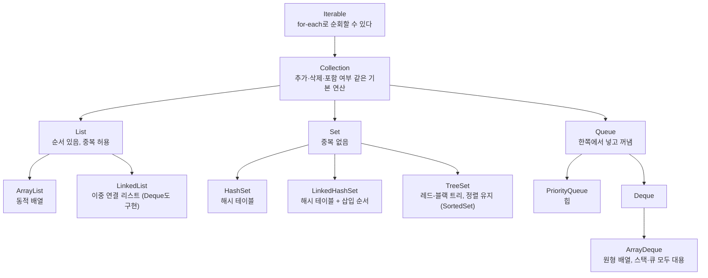
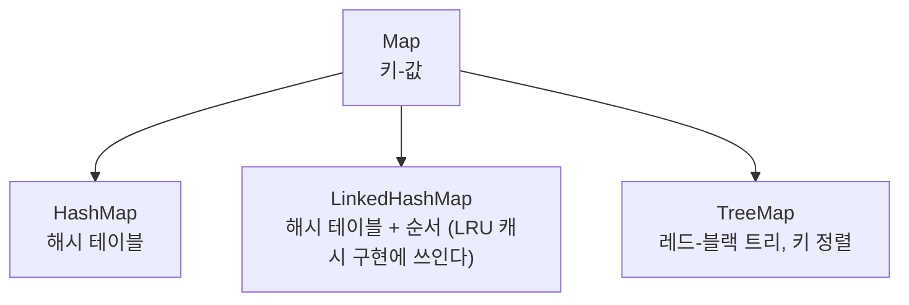

> 하버드 CS50의 자료구조 강의와 고무오리 CS 스터디의 CS50 정리 노트를 바탕으로 재구성한 노트다. 배열과 연결 리스트 비교는 팔만코딩경(42Seoul 커뮤니티 위키)의 「배열과 리스트 중 어떤 것을 사용해야 할까?」, 「[Push Swap 완전 정복] 00. 문제 분석 - locality.」, 트라이의 삽입·자동 완성은 「ALV tree 찢어버리기」를 바탕으로 보강했다. 언어 라이브러리 속 자료구조는 ByteByteGo의 System Design 101 가이드 「[Java Collection Hierarchy](https://bytebytego.com/guides/java-collection-hierarchy)」, 「[10 Key Data Structures We Use Every Day](https://bytebytego.com/guides/10-key-data-structures-we-use-every-day)」로 보강했다.
> 「다차원 배열과 구조체」 절과 배열 인덱스·연결 리스트 끝 표시·연결 리스트로 만든 스택과 큐 등 일부 설명은 CrashCourse의 「Crash Course Computer Science」 강의를 바탕으로 보강했다.
> 배열 문제의 요령, 행렬 다루기, 연결 리스트 문제 기법, 트라이의 연산 복잡도는 Tech Interview Handbook의 「[Array](https://www.techinterviewhandbook.org/algorithms/array/)」, 「[Matrix](https://www.techinterviewhandbook.org/algorithms/matrix/)」, 「[Linked list](https://www.techinterviewhandbook.org/algorithms/linked-list/)」, 「[Trie](https://www.techinterviewhandbook.org/algorithms/trie/)」 치트시트를 바탕으로 보강했다.
> 스킵 리스트 절은 fru1tworld/cs-basic 모의 면접 질문 목록의 「[자료구조](https://github.com/fru1tworld/cs-basic/blob/main/interview/cs/ds.md)」 질문이 묻는 개념으로 보강했다.

자료구조는 데이터를 메모리에 어떻게 배치하고 연결하느냐의 문제다. 배열처럼 연속된 공간을 쓰면 접근은 빠르지만 크기를 바꾸기 어렵고, [[pointers-and-memory|포인터]]로 흩어진 공간을 이으면 크기는 자유롭지만 접근이 느려진다. 예제는 C와 Kotlin으로 든다.

## 배열 (Array)

- 고정된 크기의 메모리 덩어리다. 원소들이 **이웃한 공간(contiguous memory)** 에 할당된다.
- 배열의 시작 주소(base address)는 첫 번째 원소가 있는 주소다. 인덱스는 시작 주소에서 몇 칸 떨어졌는지를 뜻하는 오프셋이라 `i`번 원소의 주소는 `시작 주소 + i × 원소 크기`로 바로 계산된다. 그래서 **임의 접근(random access)** 이 O(1)이고, 첫 원소의 오프셋이 0이므로 대부분의 언어가 인덱스를 0부터 센다(인덱스 5는 여섯 번째 원소다).
- 정렬되어 있다면 [[binary-search|이진 탐색]]으로 O(log n)에 찾을 수 있다.
- C에서 `int arr[10];`처럼 선언한 배열은 한 번 만들면 크기를 바꿀 수 없다. 크기를 키우려면 `malloc`·`realloc`으로 힙에 공간을 잡아야 한다.

### 크기를 늘리면 무슨 일이 생기나

연속된 공간 바로 뒤가 다른 데이터로 차 있을 수 있으므로, 원소 하나를 추가하려 해도

1. 더 큰 메모리 공간을 새로 할당하고
2. 기존 원소를 모두 복사한 뒤 새 원소를 넣어야 한다.

원소 n개를 읽고 쓰는 작업이 필요하므로 **O(n)** 이다.

```c
int *list = malloc(3 * sizeof(int));
// ... list[0] ~ list[2] 사용

int *tmp = realloc(list, 4 * sizeof(int)); // 더 큰 공간을 잡고 기존 값을 옮겨 줌
if (tmp == NULL)
{
    free(list);
    return 1;
}
list = tmp;
list[3] = 4;
free(list);
```

`realloc`이 복사를 대신해 줄 뿐, 뒤 공간이 비어 있지 않으면 새 공간을 잡고 원소를 모두 옮기는 비용은 그대로다.

### 배열 문제의 기본 요령

배열은 거의 모든 알고리즘 문제의 입력 형태다. 문자열도 문자 배열이라 같은 요령이 통한다.

| 용어 | 뜻 | `[2, 3, 6, 1, 5, 4]`에서 |
| --- | --- | --- |
| 부분 배열(subarray) | **연속된** 구간 | `[3, 6, 1]`은 부분 배열, `[3, 1, 5]`는 아니다 |
| 부분 수열(subsequence) | 원래 순서를 지키며 일부를 지운 것. 연속일 필요는 없다 | `[3, 1, 5]`는 부분 수열, `[3, 5, 1]`은 아니다 |

| 요령 | 내용 |
| --- | --- |
| 슬라이스 대신 인덱스 | 슬라이싱·이어 붙이기는 새 배열을 만들어 O(n)이다. 재귀나 반복문 안에서는 시작·끝 인덱스로 구간을 넘긴다 |
| 정렬돼 있으면 이분 탐색 | 입력이 정렬(또는 부분 정렬)돼 있다는 조건은 O(n)보다 빠른 풀이를 기대한다는 신호다([[binary-search\|이분 탐색]]) |
| 먼저 정렬하기 | 원소의 원래 순서가 답에 상관없다면 정렬 O(n log n) 한 번으로 문제가 단순해질 때가 많다. 구간 병합이 대표적이다 |
| 미리 계산하기 | 부분 배열의 합·곱이 반복해서 필요하면 접두사·접미사 합(곱)을 만들어 둔다([[prefix-sum\|접두사 합]]) |
| 오른쪽부터 훑기 | 「오른쪽에서 처음 나오는 더 큰 값」처럼 뒤쪽 정보가 필요하면 끝에서부터 훑는다. 흔히 단조 스택과 함께 쓴다([[stack\|스택]]) |
| 여러 번 훑기 | 배열을 두세 번 훑어도 상수 번이면 O(n)이다. 한 번에 하려다 막히면 왼쪽→오른쪽, 오른쪽→왼쪽 두 번으로 나눈다 |
| 두 인덱스 함께 움직이기 | 연속 구간이나 정렬된 배열의 쌍은 [[two-pointers\|투 포인터·슬라이딩 윈도우]]로 O(n)에 훑는다 |

중복 값이 있는지, 중복이 답을 바꾸는지는 먼저 확인할 조건이다.

### 다차원 배열과 구조체

배열을 바탕으로 두 가지 복합 구조를 만든다.

| 구조 | 뜻 | 메모리 배치 |
| --- | --- | --- |
| 행렬(matrix), 다차원 배열 | 배열의 배열. 3×3 행렬은 길이 3짜리 배열 세 개이고, `m[2][1]`은 세 번째 줄의 두 번째 칸이다. 차원은 몇 개든 늘릴 수 있다 | C의 다차원 배열은 줄을 차례로 이어 붙인 **행 우선(row-major)** 연속 공간이다. 그래서 순회 순서가 성능을 가른다([[cache-friendly-code\|캐시를 고려한 코드]]). Java·Python의 배열의 배열(리스트의 리스트)은 줄마다 따로 할당된다 |
| 구조체(struct) | 계좌 번호와 잔액처럼 관련된 변수 여러 개를 한 덩어리로 묶은 복합 자료형 | 구조체 배열도 원소가 연속 공간에 놓이고, `accounts[0]`으로 구조체 전체를 꺼낸 뒤 필드를 읽는다 |

### 행렬 다루기

2차원 배열(행렬) 문제는 대개 칸을 정점으로 보는 그래프 탐색([[bfs\|BFS]]·[[dfs\|DFS]])이거나 [[dynamic-programming\|동적 계획법]]이다. 그 밖에 자주 쓰는 조작은 다음과 같다.

| 조작 | 방법 |
| --- | --- |
| 같은 크기의 빈 표 만들기 | 방문 표시·DP 표용. Python `[[0] * m for _ in range(n)]`. `[[0] * m] * n`은 모든 행이 같은 리스트를 공유한다 |
| 복사 | Python `[row[:] for row in matrix]`. 바깥 리스트만 복사하면 행은 공유된다(얕은 복사) |
| 1차원 ↔ 2차원 인덱스 | 열이 C개인 행렬의 1차원 인덱스 i는 `(i // C, i % C)`, 반대로 `(r, c)`는 `r * C + c`다. 행이 이어서 정렬된 행렬을 길이 R·C인 배열처럼 이분 탐색할 때 쓴다 |
| 전치(transpose) | 행과 열을 바꾼다. Python `[list(col) for col in zip(*matrix)]`. 틱택토·사목처럼 가로·세로를 모두 검사하는 게임은 가로 검사 함수를 짠 뒤 전치한 행렬에 다시 돌려 세로를 검사한다 |
| 90도 회전 | 전치한 뒤 각 행을 뒤집으면 시계 방향 회전이다. 정사각 행렬이면 추가 공간 없이 제자리에서 할 수 있다 |

빈 행렬은 행이 0개인 경우와 행은 있지만 첫 행의 길이가 0인 경우를 모두 걸러야 `matrix[0]`에서 오류가 나지 않는다.

배열과 구조체 배열은 크기가 고정이고 중간에 끼워 넣기 어렵다. 구조체 안에 **다른 구조체를 가리키는 포인터**를 넣으면 이 제약을 벗어난다. 포인터가 하나면 연결 리스트, 둘 이상이면 트리, 아무 노드나 가리키면 그래프가 된다.

## 연결 리스트 (Linked List)

원소를 연속된 곳에 두지 않고 아무 빈 공간에 할당한 뒤, 다음 원소의 주소를 가리키게 연결한다. 각 노드는 값과 다음 노드를 가리키는 포인터를 가진다. C에서는 구조체와 포인터로 노드를 만든다.

```c
typedef struct node
{
    int number;
    struct node *next;
} node;
```

Kotlin에서는 객체 참조가 C의 포인터 역할을 한다.

```kotlin
class Node(val value: String, var next: Node? = null)

// prev 다음에 새 노드 끼워 넣기: 포인터 두 개만 바꾸면 된다
fun addAfter(prev: Node, value: String) {
    prev.next = Node(value, prev.next)
}
```

마지막 노드의 `next`는 `NULL`(Kotlin은 `null`)로 끝을 표시한다. 마지막 노드가 다시 첫 노드를 가리키면 **원형 연결 리스트(circular linked list)** 다. 노드가 다음(`next`)과 이전(`prev`) 노드를 모두 가리키면 **이중 연결 리스트(doubly linked list)** 로, 노드 하나만 쥐고도 그 노드를 지울 수 있고 양방향으로 순회한다. 노드들은 만들어진 시점에 따라 메모리 여기저기에 흩어져 있고, 순서는 오직 포인터가 정한다. 그래서 순서 바꾸기·자르기·나누기·뒤집기도 포인터만 고치면 된다.

| 장점 | 단점 |
| --- | --- |
| 공간이 부족해도 더 큰 공간을 잡고 전부 복사할 필요 없이, 새 노드를 만들어 포인터만 연결하면 된다 | 임의 접근이 안 된다. 특정 위치를 찾으려면 처음부터 따라가야 하므로 **탐색 O(n)** |
| 중간 삽입·삭제 자체는 포인터 변경만으로 끝난다 | 순서를 지켜 삽입하려 해도 위치를 찾는 탐색 때문에 **O(n)** |
| | 포인터를 저장할 추가 메모리가 든다 |

### 배열과 연결 리스트, 언제 무엇을

| 기준 | 배열 | 연결 리스트 |
| --- | --- | --- |
| 인덱스로 접근 | O(1) | O(n) |
| 맨 끝 삽입·삭제 | O(1) (동적 배열은 분할 상환 O(1)) | O(1) (꼬리 포인터가 있을 때) |
| 중간 삽입·삭제 | 뒤 원소를 밀고 당기므로 O(n) | 위치를 알면 O(1) |
| 값으로 탐색 | O(n), 정렬돼 있으면 O(log n) | O(n) |
| 캐시 효율 | 연속 메모리라 **지역성(locality)이 높다** | 노드가 흩어져 캐시 미스가 잦다 |

임의 접근이 많고 끝에서만 넣고 빼면 배열, 위치를 이미 쥔 상태에서 중간 삽입·삭제가 잦으면 연결 리스트를 쓴다. 실제로는 캐시 효율 때문에 이론상 연결 리스트가 유리한 경우에도 배열이 더 빠른 일이 많아서 기본 선택은 동적 배열이다. 크기 상한이 정해진 양쪽 끝 삽입·삭제는 배열 기반 [[queue-deque|원형 버퍼]]로 해결할 수 있다.

### 연결 리스트 문제를 푸는 기법

Java(`LinkedList`)와 C++(`std::list`)는 표준 라이브러리에 연결 리스트가 있지만, Python과 JavaScript에는 없어 노드 클래스를 직접 만든다. 문제는 대개 **추가 공간 없이 제자리에서** 포인터를 고치라고 요구한다. 새 리스트를 만들어 결과를 담으면 쉽지만 공간이 O(n) 든다.

| 기법 | 내용 |
| --- | --- |
| 더미(sentinel) 노드 | 머리 앞(필요하면 꼬리 뒤)에 가짜 노드를 하나 둔다. 실제 머리를 지우거나 바꾸는 경우도 「어떤 노드의 다음」으로 똑같이 처리되어 `head`가 `null`인지 따지는 분기가 사라진다. 반환할 때는 `dummy.next`를 돌려준다 |
| 빠른·느린 포인터 | 사이클 판별, 가운데 노드, 뒤에서 k번째 노드를 공간 O(1)에 찾는다([[two-pointers\|투 포인터]]) |
| 제자리 뒤집기 | `prev`, `cur`, `next` 세 포인터로 링크 방향을 하나씩 바꾼다. 회문 판정, k개씩 뒤집기 등 많은 문제의 부품이다 |
| 포인터 조작 | 자르기는 마지막 노드의 `next`를 `null`로, 두 리스트 잇기는 앞 리스트 꼬리의 `next`를 뒤 리스트 머리로 바꾼다. 두 노드를 맞바꿀 때는 링크 대신 값만 바꿔도 된다 |

```python
def reverse(head):
    prev = None
    cur = head
    while cur:
        cur.next, prev, cur = prev, cur, cur.next   # 링크를 뒤로 돌리고 한 칸 전진
    return prev
```

자주 조합되는 부품은 노드 수 세기, 제자리 뒤집기, 가운데 노드 찾기, 정렬된 두 리스트 병합 네 가지다. 빈 리스트, 노드 1개·2개, 사이클이 있을 수 있는지를 먼저 확인한다.

## 스킵 리스트 (Skip List)

정렬된 연결 리스트는 위치를 찾느라 탐색이 O(n)이다. 스킵 리스트는 그 위에 일부 노드만 이은 「급행」 리스트를 여러 층 쌓아 멀리 건너뛰며 찾는다. 균형 트리처럼 정렬 순서를 유지하면서 탐색·삽입·삭제가 **기대 O(log n)** 이다.

```text
레벨 3: head ─────────────────────────────▶ 50 ──────────────▶ NIL
레벨 2: head ──────────▶ 20 ──────────────▶ 50 ──────────────▶ NIL
레벨 1: head ──▶ 10 ──▶ 20 ──────▶ 35 ──▶ 50 ──────▶ 70 ──▶ NIL
레벨 0: head ──▶ 10 ──▶ 20 ──▶ 30 ──▶ 35 ──▶ 50 ──▶ 60 ──▶ 70 ──▶ NIL   (모든 원소)
```

| 연산 | 방법 |
| --- | --- |
| 탐색 | 맨 위 레벨의 head에서 출발한다. **다음 노드의 키가 찾는 키보다 작으면 오른쪽으로, 아니면 한 레벨 아래로** 내려간다. 레벨 0에서 멈춘 자리의 다음 노드가 찾는 키(또는 그보다 큰 첫 키)다 |
| 삽입 | 탐색하며 레벨마다 마지막으로 머문 노드(update 배열)를 기록한다. 새 노드의 높이를 **동전 던지기**로 정한다(확률 p로 한 층씩 올라간다). 높이까지의 각 레벨에서 update 노드 뒤에 끼워 넣는다 |
| 삭제 | 같은 방식으로 레벨마다 앞 노드를 찾아 링크를 건너뛰게 바꾼다 |

위 그림에서 35를 찾으면 레벨 3에서 head의 다음이 50이라 크므로 내려가고, 레벨 2에서 20으로 간 뒤 다음이 50이라 내려가고, 레벨 1에서 20의 다음이 35라 찾는다. 10과 30은 보지도 않는다.

- 노드가 레벨 i 이상에 있을 확률은 pⁱ이라, 레벨 i에는 기대 n·pⁱ개가 남는다. 층 수는 기대 log_(1/p) n이고, 각 층에서 오른쪽으로 가는 걸음은 기대 1/p번이라 탐색이 기대 O(log n)이다. 높이를 운에 맡기므로 **최악은 O(n)** 이지만 그럴 확률은 n이 커질수록 무시할 만큼 작다.
- 포인터 수는 기대 n/(1-p)개다. p = 1/2면 노드당 평균 2개, p = 1/4면 약 1.33개다.
- 균형 트리와 달리 회전 같은 재배치가 없다. 삽입·삭제가 주변 링크 몇 개만 바꾸므로 구현이 짧고, 잠금 없이(CAS) 동시에 고치기 쉽다. Java `ConcurrentSkipListMap`이 이 성질을 쓴다.
- 레벨 0이 정렬된 연결 리스트라 **범위 조회**는 시작점을 찾은 뒤 옆으로 훑으면 된다.

Redis 정렬 집합(sorted set)은 p = 1/4, 최대 32레벨인 스킵 리스트에 각 노드의 순위(rank)를 위한 구간 길이를 더해 `ZRANGE`·`ZRANK`를 O(log n)에 처리한다. 원소 → 점수 조회는 함께 두는 해시 테이블이 맡는다. LevelDB·RocksDB의 멤테이블도 스킵 리스트다([[database-internals|DB 내부 구조]]).

## 트리와 이진 탐색 트리

연결 리스트를 응용해 **계층 구조**를 만든 것이 트리다. **이진 탐색 트리(BST)** 는 왼쪽에 더 작은 값, 오른쪽에 더 큰 값을 두어 탐색이 평균 O(log n)이지만, 정렬된 순서로 넣으면 한쪽으로 치우친 편향 트리가 되어 O(n)으로 떨어진다. 그래서 AVL·레드-블랙 트리처럼 높이를 제한하는 균형 트리를 쓴다. 용어, 순회, 회전은 [[tree|트리와 이진 탐색 트리]]에 정리했다.

## 해시 테이블 (Hash Table)

배열과 연결 리스트를 조합한 구조다.

1. 키를 **해시 함수**에 넣으면 정수(해시값)가 나온다.
2. 이 값을 정해진 크기의 배열(버킷, bucket)의 인덱스로 써서 바로 그 칸을 찾는다.

그래서 평균 탐색 시간이 **O(1)** 이다. 키-값 쌍을 키로 조회하는 딕셔너리(Python `dict`, Java·Kotlin `Map`)가 대개 해시 테이블로 구현된다.

### 해시 충돌 (Collision)

서로 다른 키가 같은 해시값을 가지면 충돌이 생긴다. 같은 칸에 들어온 값들을 연결 리스트로 이어 붙여(체이닝) 해결한다.

- 특정 칸에만 데이터가 몰리면 그 리스트를 순회해야 하므로 최악의 경우 **O(n)** 이 된다.
- 충돌을 줄이려면 값을 고르게 분산하는 좋은 해시 함수를 쓰거나 버킷 수를 늘린다.

개방 주소법과의 비교, 적재율과 리사이즈, Java `HashMap`·Python `dict`의 실제 구현은 [[hash-table|해시 테이블]]에 정리했다.

## 트라이 (Trie)

문자열 검색에 특화된 트리다. 알파벳이라면 각 노드가 a~z 26칸짜리 배열을 갖고, 각 칸이 다음 글자의 노드를 가리킨다.

- "Harry"를 찾으려면 H → a → r → r → y 다섯 단계면 된다.
- 탐색 시간은 저장된 단어 수가 아니라 **찾는 단어의 길이 k**에 비례한다(O(k)). 단어 길이에는 현실적인 상한이 있으므로 사실상 **O(1)** 로 볼 수 있다.
- 대신 노드마다 26칸 배열을 두므로 메모리를 많이 쓴다. 시간과 공간의 트레이드오프다.
- 삽입은 글자마다 자식이 없으면 만들며 내려가고, 단어가 끝나는 노드에 **끝 표시**를 단다. 그래야 `ab`와 `abc`처럼 접두사 관계인 단어를 구분한다.
- 접두사까지 내려간 뒤 그 아래 서브트리를 훑으면 그 접두사로 시작하는 단어를 모두 얻는다. 검색창 **자동 완성**이 이 원리다.
- 삽입·탐색·삭제가 모두 단어 길이 m에 비례하는 O(m)이다. 삭제는 끝 표시를 지운 뒤, 자식도 끝 표시도 없어진 노드를 아래에서 위로 거슬러 지운다.
- 단어 목록을 한 번 트라이로 만들어 두면, 단어 하나를 찾을 때 목록 n개를 모두 비교하는 대신 O(m)이면 된다. 같은 사전으로 질의를 반복하는 문제에서 쓴다.
- 빈 문자열을 넣으면 루트에 끝 표시가 붙는다. 빈 트라이에서의 탐색과 함께 경계 사례로 확인한다.

## 스택과 큐

둘 다 연결 리스트 위에 얹을 수 있다. 큐는 머리 노드를 가리키는 포인터를 다음 노드로 옮겨 꺼내고(dequeue), 꼬리에 노드를 이어 넣는다(enqueue). 꼬리 포인터를 따로 두지 않으면 넣을 때마다 끝까지 따라가야 해 O(n)이 된다. 스택은 머리 한쪽에서만 넣고(push) 꺼낸다(pop). LIFO의 스택과 FIFO의 큐는 [[stack|스택]], [[queue-deque|큐와 덱]]에 따로 정리했다.

## 얕은 복사와 깊은 복사

C에서 `char *t = s;`가 문자열이 아니라 **주소만 복사**하는 것과 같은 문제가 객체에서도 생긴다.

| 구분 | 동작 | 결과 |
| --- | --- | --- |
| 얕은 복사 (Shallow Copy) | 원본의 **참조(주소)** 를 복사 | 같은 메모리를 공유해 한쪽을 바꾸면 다른 쪽도 바뀐다 |
| 깊은 복사 (Deep Copy) | 원본의 **값**을 새 메모리에 복사 | 서로 독립적이다 |

Kotlin data class의 `copy()`나 `super.clone()`처럼 언어가 주는 복사는 대개 얕은 복사다. 리스트 같은 참조 타입 필드는 직접 새로 복사해야 깊은 복사가 된다.

## 언어 라이브러리 속 자료구조: Java 컬렉션

실무에서는 자료구조를 직접 짜기보다 언어가 주는 구현을 고른다. Java 컬렉션 프레임워크(JCF)는 인터페이스로 연산을 정하고 구현 클래스로 내부 자료구조를 정하는 구조라 이 관계가 잘 보인다.



Map (Collection과 별개 계층):



- 고르는 기준은 이 노트의 복잡도 표와 같다. 인덱스 접근이 많으면 `ArrayList`, 정렬된 순회가 필요하면 `TreeMap`·`TreeSet`, 순서가 상관없으면 `HashMap`·`HashSet`이다.
- `Stack`·`Vector`·`Hashtable`은 초기 버전의 동기화된 클래스라 지금은 `ArrayDeque`, `ArrayList`, `HashMap`(동시성이 필요하면 `ConcurrentHashMap`)을 쓴다.
- Java 21부터는 처음·끝 원소 접근을 통일한 `SequencedCollection`·`SequencedMap` 인터페이스가 계층에 들어갔다.
- 변수 타입은 인터페이스(`List<String> list = new ArrayList<>()`)로 선언해 구현을 바꾸기 쉽게 한다.

자료구조가 실제 소프트웨어의 어디에 쓰이는지는 [[real-world-algorithms|현실 시스템을 움직이는 알고리즘과 자료구조]]에 있다.

## 핵심 정리

| 자료구조 | 탐색 | 삽입 | 특징 |
| --- | --- | --- | --- |
| 배열 | O(1) 접근 / 정렬 시 O(log n) 탐색 | 크기 조정 시 O(n) | 연속 메모리 |
| 연결 리스트 | O(n) | 위치를 알면 O(1), 찾으려면 O(n) | 포인터로 연결 |
| 이진 탐색 트리 | 평균 O(log n), 편향 시 O(n) | 평균 O(log n) | 균형 유지가 관건 |
| 해시 테이블 | 평균 O(1), 최악 O(n) | 평균 O(1) | 해시 함수 + 충돌 처리 |
| 트라이 | O(k) ≈ O(1) | O(k) | 메모리를 많이 씀 |

복잡도 표기 자체는 [[big-o|빅오 표기법과 시간 복잡도]]에 정리했다.

## 더 읽을거리

- [VisuAlgo](https://visualgo.net): 정렬, 연결 리스트, 힙, BST, 그래프 탐색, 최단 경로, 네트워크 플로까지 자료구조·알고리즘의 동작을 애니메이션으로 단계별로 보여 준다.
- [Dictionary of Algorithms and Data Structures](https://xlinux.nist.gov/dads/): 미국 NIST가 운영하는 알고리즘·자료구조·대표 문제 용어 사전. 용어의 정확한 정의를 찾을 때 쓴다.
