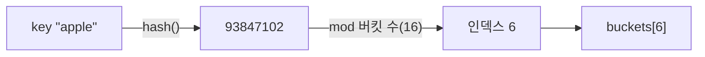

> jbee의 「[Interview Question for Beginner](https://github.com/jbee37142/Interview_Question_for_Beginner)」 저장소 자료구조 문서의 Hash Table 절을 바탕으로 재구성하고, 언어별 구현은 각 언어의 공식 문서·소스 기준으로 최신화한 노트다.
> 「문제 풀이에서 쓰는 패턴」은 Tech Interview Handbook의 「[Hash table cheatsheet](https://www.techinterviewhandbook.org/algorithms/hash-table/)」, 「[String cheatsheet](https://www.techinterviewhandbook.org/algorithms/string/)」의 글자 세기·애너그램 절을 바탕으로 보강했다.
> 해시 함수 설계 방식, 이중 해싱의 단점과 해결, 언어별 적재율, LRU·LFU 캐시 구현은 fru1tworld/cs-basic 모의 면접 질문 목록의 「[자료구조](https://github.com/fru1tworld/cs-basic/blob/main/interview/cs/ds.md)」 질문이 묻는 개념으로 보강했다.

## 해시 테이블이란

해시 테이블(Hash Table)은 키를 해시 함수에 넣어 나온 값을 배열 인덱스로 쓰는 자료구조다. 키만 알면 그 칸으로 바로 가므로 탐색·삽입·삭제가 **평균 O(1)** 이다. 다른 원소를 밀거나 당길 필요가 없다는 점이 배열·연결 리스트와 다르다.



| 용어 | 뜻 |
| --- | --- |
| 해시 함수(hash function) | 임의의 키를 고정 범위의 정수로 바꾸는 함수 |
| 해시값(hash code) | 해시 함수가 돌려준 정수 |
| 버킷(bucket) | 데이터를 담는 배열의 한 칸 |
| 충돌(collision) | 서로 다른 키가 같은 버킷으로 가는 일 |
| 적재율(load factor) | 저장된 원소 수 ÷ 버킷 수 |

평균이 O(1)이고 최악이 O(n)인 이유는 충돌이다. 키가 한 버킷에 몰리면 그 안을 순서대로 뒤져야 한다.

## 좋은 해시 함수

키의 공간은 버킷 수보다 훨씬 크므로 충돌을 없앨 수는 없다. 1:1 대응을 만들려면 키 공간만큼 배열이 필요해 해시 테이블을 쓰는 의미가 사라진다. 그래서 목표는 충돌을 줄이는 함수와, 생긴 충돌을 싸게 처리하는 방법 두 가지다.

| 조건 | 이유 |
| --- | --- |
| 키 **전체**를 참조한다 | 일부만 보면 그 부분이 같은 키들이 모두 충돌한다 |
| 결과가 고르게 퍼진다 | 특정 버킷에 몰리지 않아야 평균 O(1)이 유지된다 |
| 계산이 빠르다 | 모든 연산이 해시 계산부터 시작한다 |
| 같은 키에는 늘 같은 값 | `equals`가 같으면 `hashCode`도 같아야 한다(Java 규약) |

| 설계 | 식 | 특징 |
| --- | --- | --- |
| 나눗셈법(division) | `h(k) = k mod m` | 가장 빠르다. m이 2의 거듭제곱이면 하위 비트만 쓰게 되므로, 2의 거듭제곱에서 먼 **소수**를 m으로 고른다 |
| 곱셈법(multiplication) | `h(k) = ⌊m · frac(k · A)⌋`, A ≈ (√5 − 1)/2 | 키의 모든 비트가 결과에 섞여 m을 2의 거듭제곱으로 둬도 된다 |
| 다항(롤링) 해시 | `s₀·p^(n−1) + s₁·p^(n−2) + … + s_(n−1)` mod M | 문자열의 **모든 글자와 순서**를 반영한다. Java `String.hashCode`가 p = 31인 이 꼴이다 |
| 보편 해싱(universal hashing) | `h(k) = ((a·k + b) mod p) mod m`, a·b를 무작위로 고른다 | 함수를 실행마다 무작위로 뽑아, 어떤 입력이 와도 두 키가 충돌할 확률이 약 1/m이다. 특정 입력으로 최악을 유도할 수 없다 |

**보조 해시 함수(supplemental hash)** 는 키의 해시값을 한 번 더 섞어 버킷 인덱스가 고르게 나오게 한다. 버킷 수가 2의 거듭제곱이면 `hash & (n - 1)`로 하위 비트만 쓰게 되는데, 상위 비트가 버려지지 않도록 섞는 것이다. Java `HashMap`은 `h ^ (h >>> 16)`으로 상위 16비트를 하위에 섞는다.

공격자가 같은 버킷으로 가는 키를 대량으로 보내 서버를 O(n²)로 떨어뜨리는 **해시 플러딩(hash flooding)** 도 있다. 그래서 Python `str`·Rust `HashMap`은 실행마다 바뀌는 시드를 넣은 SipHash 계열 함수를 쓴다.

## 충돌 해결

### 개방 주소법 (Open Addressing)

충돌이 나면 배열 안의 다른 빈 버킷을 찾아 넣는다. 원소가 모두 배열 안에 있다. 다음 칸을 고르는 규칙(탐사, probing)에 따라 나뉜다.

| 탐사 방식 | 다음 위치 | 특징 |
| --- | --- | --- |
| 선형 탐사(linear probing) | `h, h+1, h+2, …` | 구현이 쉽고 캐시에 유리하지만 원소가 덩어리로 뭉친다(1차 군집) |
| 이차 탐사(quadratic probing) | `h, h+1², h+2², …` | 1차 군집은 줄지만 같은 시작점끼리는 같은 경로를 탄다(2차 군집) |
| 이중 해싱(double hashing) | `h1 + i·h2(key)` | 두 번째 해시로 간격을 정해 군집이 가장 적다. 계산이 더 든다 |

이중 해싱은 키마다 탐사 간격이 달라 군집이 거의 없다는 것이 장점이다. 단점과 해결은 다음과 같다.

| 단점 | 해결 |
| --- | --- |
| `h2(key)`가 0이면 같은 칸만 계속 본다 | `h2(k) = 1 + (k mod (m − 1))`처럼 0이 나오지 않게 만든다 |
| 간격이 테이블 크기 m과 서로소가 아니면 일부 칸만 돌아 빈칸이 있어도 못 찾는다 | m을 소수로 둔다. m이 2의 거듭제곱이면 `h2`가 늘 홀수가 되게 한다 |
| 해시를 두 번 계산하고, 탐사 위치가 멀리 흩어져 캐시 미스가 잦다 | 실무 구현은 캐시에 강한 선형 탐사에 좋은 해시 함수를 붙이거나, Swiss Table처럼 연속된 칸 묶음을 한 번에 검사한다 |

- 삭제한 칸을 그냥 비우면 그 뒤로 이어지던 탐사가 끊긴다. 그래서 「지워졌음」 표시(tombstone)를 남긴다.
- 적재율이 높아지면 빈칸을 찾는 길이가 급격히 늘어난다. 보통 0.5~0.9 사이에서 리사이즈한다.

### 분리 연결법 (Separate Chaining)

각 버킷이 원소 목록을 따로 가지고, 충돌한 원소는 그 목록에 붙는다.

| 버킷 구조 | 특징 |
| --- | --- |
| 연결 리스트 | 삽입·삭제가 간단하다. 노드마다 포인터가 붙어 작은 데이터에는 오버헤드가 크다 |
| 균형 트리(레드-블랙 트리) | 한 버킷에 원소가 많을 때 최악 탐색이 O(n)에서 O(log n)으로 줄어든다. 노드가 무거워 원소가 적을 때는 손해다 |

### 두 방식 비교

| 기준 | 개방 주소법 | 분리 연결법 |
| --- | --- | --- |
| 저장 위치 | 배열 안 | 배열 + 버킷별 목록 |
| 캐시 효율 | 높다(연속 메모리) | 낮다(포인터를 따라간다) |
| 적재율 한계 | 1을 넘을 수 없고, 1에 가까울수록 급격히 느려진다 | 1을 넘어도 동작한다. 확장을 더 늦출 수 있다 |
| 삭제 | tombstone 관리가 필요하다 | 목록에서 빼면 끝난다 |
| 최악 | O(n) | O(n), 트리 버킷이면 O(log n) |

원소가 작고 적재율을 낮게 유지할 수 있으면 개방 주소법이 빠르다. 최신 고성능 해시 테이블(Google의 Swiss Table, Rust `hashbrown`, Go 1.24 이후 `map`)은 개방 주소법에 메타데이터 바이트와 SIMD 비교를 더해 한 번에 여러 칸을 검사한다.

## 적재율과 리사이즈

버킷이 적으면 메모리는 아끼지만 충돌이 늘어난다. 그래서 적재율이 임계값을 넘으면 버킷 배열을 보통 2배로 늘리고 모든 원소를 새 인덱스로 다시 넣는다(rehash). 리사이즈 한 번은 O(n)이지만 드물게 일어나므로 삽입의 **분할 상환(amortized) 비용은 O(1)** 이다.

```text
버킷 16개, 적재율 0.75 → 원소 12개를 넘는 순간 32개로 확장 → 다음 임계값 24개
```

원소 수를 미리 알면 처음부터 충분한 크기로 만들어 리사이즈를 피한다(`new HashMap<>(expected / 0.75f + 1)`, Java 19 이상은 `HashMap.newHashMap(expected)`).

## 언어별 구현

| 구현 | 충돌 해결 | 주요 수치·특징 |
| --- | --- | --- |
| Java `HashMap` | 분리 연결법 | 기본 버킷 16개, 적재율 0.75, 2배 확장. 한 버킷이 8개를 넘으면 레드-블랙 트리로 바꾸고(treeify), 6개 이하로 줄면 다시 연결 리스트로 돌린다. 버킷 수가 64개 미만이면 트리로 바꾸는 대신 먼저 리사이즈한다 |
| Python `dict` | 개방 주소법(의사 난수 탐사) | 적재율이 **2/3**에 닿으면 확장한다. 인덱스 배열과 원소 배열을 나눈 압축 구조라 메모리가 적고, 3.7부터 **삽입 순서 보존**이 언어 사양이다 |
| C++ `std::unordered_map` | 분리 연결법 | 표준이 버킷 인터페이스(`bucket_count`, `max_load_factor` 기본 1.0)를 노출해 사실상 체이닝을 강제한다 |
| Go `map` | 개방 주소법(Swiss Table, 1.24부터) | 8칸짜리 그룹의 평균 적재율이 7/8을 넘으면 확장한다. 순회 순서는 일부러 무작위다 |
| JavaScript `Map` | 명세는 구현을 정하지 않는다. V8은 버킷마다 체인을 두는 결정적 해시 테이블 | **삽입 순서 보존**이 명세다. 키가 문자열·심벌로 바뀌는 `Object`와 달리 아무 값이나 키로 쓰고, 잦은 추가·삭제에 맞는다 |

트리 전환 기준이 8과 6으로 벌어져 있는 것은 경계에서 원소 하나가 들고 날 때마다 리스트와 트리를 오가는 비용을 막기 위해서다. 7개 언저리에서는 지금 구조를 그대로 유지한다. Java 7까지는 연결 리스트만 썼고, Java 8에서 트리 버킷이 들어왔다.

## 문제 풀이에서 쓰는 패턴

알고리즘 문제에서 가장 자주 쓰는 자료구조다. 막히면 「해시 테이블로 무엇을 O(1)에 조회하면 풀리나」부터 따져 본다. 면접에서는 평균 O(1)을 기준으로 이야기한다.

| 패턴 | 내용 |
| --- | --- |
| 본 것 기억하기 | 한 번 훑으며 값(또는 `target - 값`)을 넣어 두면 「이전에 나왔나」를 O(1)에 확인한다. 이중 반복문 O(n²)이 O(n)이 된다 |
| 빈도 세기 | 원소·글자별 개수를 센다(Python `collections.Counter`). 글자 종류가 소문자 26개처럼 고정이면 카운터의 공간은 입력 길이와 무관한 **O(1)** 이다. O(n)이라고 답하는 실수가 잦다 |
| 애너그램 판정 | 두 문자열을 각각 정렬해 비교하면 O(n log n), 글자 빈도를 세어 비교하면 O(n)이다 |
| 애너그램 묶기 | 정렬한 문자열이나 26칸 빈도 튜플을 키로 써서 같은 키끼리 모은다. 키를 만드는 함수와 묶는 함수를 나누어 생각한다 |
| 다른 구조와 조합 | 해시 맵은 「어디 있나」만 O(1)로 답한다. 순서가 필요하면 연결 리스트를 붙인다. 아래 LRU·LFU 캐시가 대표 예다 |

### 해시 맵 + 연결 리스트: LRU·LFU 캐시

캐시가 꽉 찼을 때 무엇을 버릴지 정하는 정책 중 **LRU(Least Recently Used)** 는 가장 오래 안 쓴 것을, **LFU(Least Frequently Used)** 는 가장 적게 쓴 것을 버린다. 정책의 장단점은 [[caching-strategies|캐시 전략]], 페이지 교체에서의 쓰임은 [[virtual-memory|가상 메모리]]에 있다. 여기서는 두 정책을 모든 연산 O(1)로 만드는 자료구조 조합만 다룬다.

| | LRU | LFU |
| --- | --- | --- |
| 구조 | 해시 맵(키 → 노드) + 사용 순서대로 이은 **이중 연결 리스트** | 해시 맵(키 → 값·빈도) + 해시 맵(빈도 → 그 빈도의 키들을 LRU 순서로 담은 리스트) + 현재 **최소 빈도** 변수 |
| 조회 `get` | 맵으로 노드를 찾아 리스트 맨 앞으로 옮긴다 | 빈도를 1 올리고 키를 `빈도+1` 리스트로 옮긴다. 옛 리스트가 비었고 그것이 최소 빈도였다면 최소 빈도도 1 올린다 |
| 삽입 `put` | 맨 앞에 넣는다. 용량을 넘으면 **맨 뒤** 노드를 지우고 맵에서도 뺀다 | 꽉 찼으면 **최소 빈도 리스트의 가장 오래된 키**를 지운다. 새 키는 빈도 1 리스트에 넣고 최소 빈도를 1로 둔다 |
| 복잡도 | 모두 O(1) | 모두 O(1). 빈도를 힙으로 관리하면 O(log n) |

이중 연결 리스트가 필요한 이유는 노드 하나를 쥔 채로 O(1)에 떼어 내기 위해서다. 단일 연결 리스트는 앞 노드를 찾느라 O(n)이 든다. 맵의 값이 리스트 노드를 가리키므로 「찾기」는 맵이, 「순서 바꾸기」는 리스트가 맡는다.

```python
from collections import OrderedDict    # 해시 맵 + 이중 연결 리스트를 묶어 둔 타입

class LRUCache:
    def __init__(self, capacity):
        self.cap, self.data = capacity, OrderedDict()

    def get(self, key):
        if key not in self.data:
            return -1
        self.data.move_to_end(key)          # 가장 최근으로
        return self.data[key]

    def put(self, key, value):
        self.data[key] = value
        self.data.move_to_end(key)
        if len(self.data) > self.cap:
            self.data.popitem(last=False)   # 가장 오래된 것 제거
```

Java는 `new LinkedHashMap<>(16, 0.75f, true)`(접근 순서 모드)에 `removeEldestEntry`를 재정의하면 같은 캐시가 된다. 면접에서는 이 라이브러리 없이 노드 클래스와 머리·꼬리 더미 노드로 직접 짜기를 기대하는 경우가 많다.

해시는 원소의 순서를 기억하지 않는다. 회문처럼 순서가 답을 정하는 문제에는 [[two-pointers|투 포인터]]가 맞다.

## 정리

- 해시 테이블 = 해시 함수로 인덱스를 계산하는 배열. 평균 O(1), 충돌이 몰리면 최악 O(n)
- 충돌은 피할 수 없다. 고르게 퍼지는 해시 함수와 충돌 처리 방식이 성능을 정한다
- 개방 주소법은 캐시에 강하고 적재율에 민감하다. 분리 연결법은 적재율에 너그럽고 포인터 비용이 든다
- 적재율 임계값에서 2배로 리사이즈해 삽입을 분할 상환 O(1)로 유지한다
- Java `HashMap`은 체이닝 + 8/6 기준 트리 버킷, Python `dict`·Go `map`은 개방 주소법이다

관련 노트: [[data-structures|기초 자료구조: 배열에서 트라이까지]], [[tree|트리와 이진 탐색 트리]], [[big-o|빅오 표기법]], [[java-idioms|Java 관용구]]
