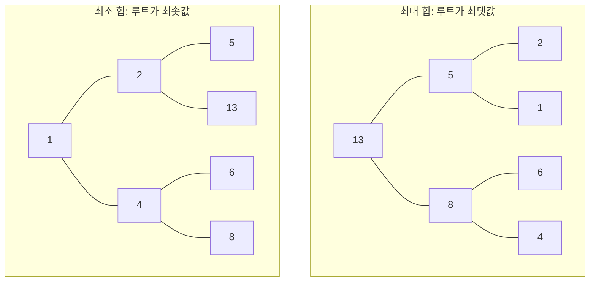
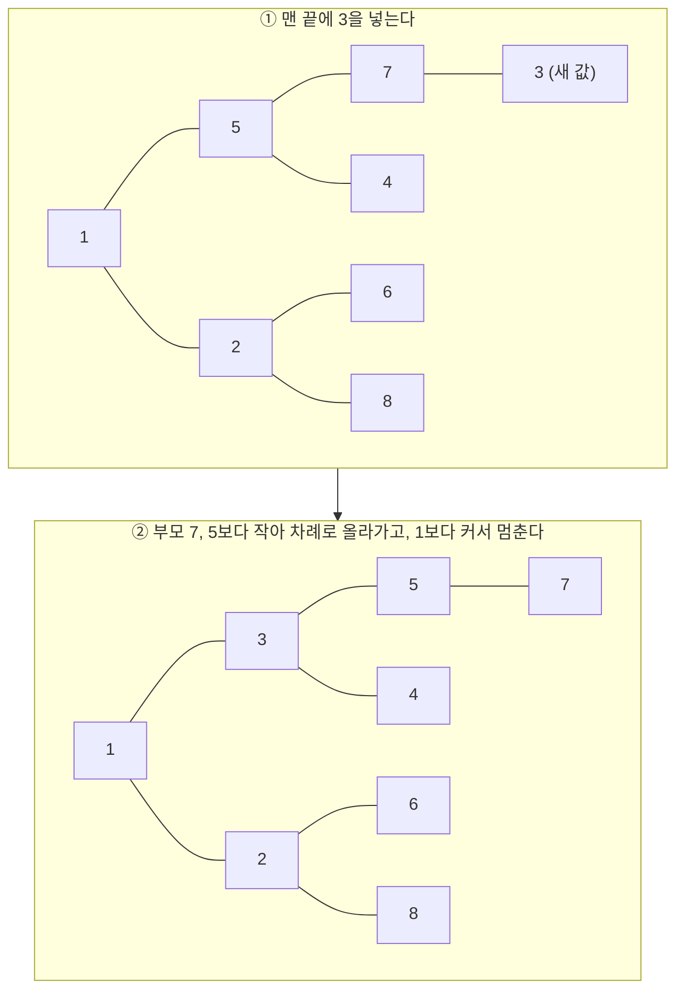
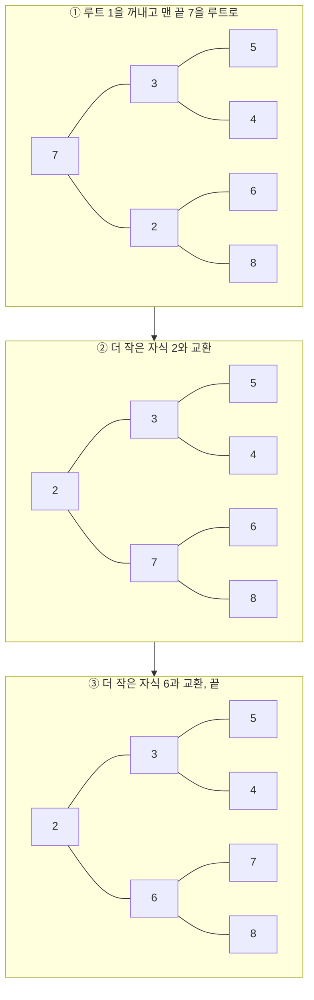

> 구현 방식 비교와 O(n) 힙 만들기는 팔만코딩경(42Seoul 커뮤니티 위키)의 「[자료구조] 우선순위큐와 힙」을 바탕으로 보강했다.
> 상위 k개를 크기 k짜리 힙으로 구하는 절은 Tech Interview Handbook의 「[Heap cheatsheet](https://www.techinterviewhandbook.org/algorithms/heap/)」를 바탕으로 보강했다.
> 편향되지 않는 이유와 힙 정렬의 안정성은 fru1tworld/cs-basic 모의 면접 질문 목록의 「[자료구조](https://github.com/fru1tworld/cs-basic/blob/main/interview/cs/ds.md)」 질문이 묻는 개념으로 보강했다.
> 「K개 병합과 스트림의 중앙값」은 Aaron Xie의 「[What data structures and algorithms should every programmer know?](https://www.educative.io/blog/what-data-structures-and-algorithms-should-every-programmer-know)」(Educative, 2026.03)를 바탕으로 보강했다.
> 힙 정렬의 변형인 스무스 정렬은 cooervo의 「[Big O cheat sheets](https://cooervo.github.io/Algorithms-DataStructures-BigONotation/)」(2015.03)의 정렬 비교표를 바탕으로 보강했다.

## 우선순위 큐

우선순위 큐(Priority Queue)는 큐처럼 원소를 넣고 꺼내지만, 들어온 순서가 아니라 우선순위가 높은 원소부터 꺼내는 자료구조다. 최소한 두 연산을 지원해야 한다.

1. `push`: 원소를 우선순위와 함께 추가
2. `pop`: 우선순위가 가장 높은 원소를 제거하고 반환

구현 방법에 따라 비용이 다르다.

| 구현 | 삽입 | 최우선 원소 삭제 | 최우선 원소 확인 |
| --- | --- | --- | --- |
| 정렬 안 된 배열·리스트 | O(1) | O(n) (매번 탐색) | O(n) |
| 정렬된 배열·리스트 | O(n) (자리 찾아 끼우기) | O(1) | O(1) |
| 균형 이진 탐색 트리 | O(log n) | O(log n) | O(log n) |
| **이진 힙** | O(log n) | O(log n) | **O(1)** |

힙은 배열 하나로 구현되어 메모리와 상수 비용이 작고, 꺼낼 원소만 빨리 알면 되는 경우에 가장 알맞다. 다익스트라·프림 알고리즘, 허프만 코딩, 이벤트 시뮬레이션, 운영체제 작업 스케줄링, k번째 원소 찾기에 쓰인다.

## 힙 (Heap)

힙은 **완전 이진 트리(Complete Binary Tree)** 이면서 다음 조건을 만족하는 자료구조다.

- **최대 힙(Max Heap)**: 모든 부모 노드의 값 ≥ 자식 노드의 값 → 루트가 최댓값
- **최소 힙(Min Heap)**: 모든 부모 노드의 값 ≤ 자식 노드의 값 → 루트가 최솟값

형제 노드끼리의 순서는 정해져 있지 않다. 완전 이진 트리라서 배열로 표현할 수 있는데, 0-based 인덱스에서 노드 k의 자식은 `2k+1`, `2k+2`, 부모는 `(k-1)//2`다.



### 삽입 (push): 아래에서 위로

1. 새 값을 트리의 맨 끝(배열의 마지막)에 넣는다.
2. 부모와 비교해 힙 조건을 어기면 자리를 바꾼다.
3. 조건을 만족하거나 루트에 닿을 때까지 반복한다.



최소 힙에 3을 넣는 예다. 3이 7과, 이어서 5와 자리를 바꾸고, 부모 1보다는 크므로 멈춘다.

### 삭제 (pop): 위에서 아래로

1. 루트(우선순위가 가장 높은 값)를 꺼낸다.
2. 맨 끝 노드를 비어 있는 루트 자리로 옮긴다.
3. 자식들과 비교해 더 우선순위가 높은 자식과 자리를 바꾼다.
4. 조건을 만족할 때까지 아래로 내려간다.



위 삽입 결과에서 루트를 꺼내는 예다. 두 자식 중 **더 작은 쪽**(최대 힙이면 더 큰 쪽)과 바꿔야 바뀐 뒤에도 부모가 두 자식보다 작다.

트리의 높이가 log n이므로 삽입·삭제 모두 O(log n), 최솟값(최댓값) 확인은 O(1)이다.

### 이진 탐색 트리와 달리 편향되지 않는 이유

BST는 **값이 위치를 정한다.** 정렬된 순서로 넣으면 새 값이 매번 같은 쪽 끝으로 가서 한쪽으로 뻗는다. 힙은 반대로 **위치가 먼저 정해진다.** 삽입은 언제나 배열의 다음 칸(마지막 레벨의 왼쪽부터 빈자리)에, 삭제는 언제나 마지막 칸의 원소를 루트로 옮기는 것으로 시작한다. 그 뒤 값은 부모-자식 사이의 순서만 맞추며 위아래로 자리를 바꿀 뿐 트리 모양은 바꾸지 않는다. 그래서 어떤 순서로 넣어도 모양이 늘 완전 이진 트리이고 높이가 ⌊log₂ n⌋로 고정된다. 대신 힙은 형제 사이에 순서가 없어 임의 값 탐색이 O(n)이다. 「가장 큰(작은) 것」만 빨리 알면 되는 구조다.

### 힙 정렬

배열을 O(n)에 최대 힙으로 만든 뒤(아래 절), 루트(최댓값)를 배열 끝 원소와 맞바꾸고 힙 크기를 1 줄여 루트에서 sift down하기를 n-1번 반복하면 오름차순 정렬이 된다.

- 시간은 최선·평균·최악 모두 **O(n log n)**, 추가 공간 O(1)인 제자리 정렬이다.
- **불안정 정렬**이다. 루트와 끝 원소를 맞바꾸는 장거리 교환 때문에 값이 같은 원소의 앞뒤가 바뀔 수 있다.
- 최악이 보장되는 대신 메모리를 띄엄띄엄 오가 캐시 효율이 낮아, 실제로는 퀵 정렬보다 느리다. 그래서 인트로 정렬이 퀵 정렬의 재귀가 너무 깊어질 때의 대비책으로 쓴다([[merge-quick-sort|병합 정렬과 퀵 정렬]]).
- **스무스 정렬(smoothsort)** 은 다익스트라(Dijkstra)가 1981년에 낸 변형이다. 이진 힙 하나 대신 크기가 레오나르도 수(1, 1, 3, 5, 9, 15, 25, …, L(k) = L(k-1) + L(k-2) + 1)인 힙 여러 개를 배열에 나란히 둔다. 이미 정렬된 입력에서는 힙을 거의 고치지 않아 O(n)에 가까워지고, 최악은 힙 정렬과 같은 O(n log n)이다. 추가 공간 O(1)인 불안정 정렬이고, 구현이 복잡해 표준 라이브러리에서는 거의 쓰이지 않는다.

### 배열을 한 번에 힙으로 만들기: O(n)

원소 n개를 하나씩 push하면 O(n log n)이다. 대신 배열을 그대로 둔 채 마지막 내부 노드 `(n-2)//2`부터 루트까지 거꾸로 내려가며 각 노드에 "아래로 내리기(sift down)"를 하면 O(n)에 힙이 된다. 노드의 대부분은 아래쪽에 있어 내려갈 거리가 짧기 때문이다. 파이썬 `heapq.heapify`가 이 방식이다.

```python
def sift_down(a, i, n):              # 최대 힙 기준
    while True:
        big, l, r = i, 2 * i + 1, 2 * i + 2
        if l < n and a[l] > a[big]: big = l
        if r < n and a[r] > a[big]: big = r
        if big == i:
            return
        a[i], a[big] = a[big], a[i]
        i = big

def build_heap(a):
    for i in range((len(a) - 2) // 2, -1, -1):
        sift_down(a, i, len(a))
```

C처럼 배열 크기가 고정된 언어에서는 가득 차면 두 배 크기로 새로 할당해 옮긴다. 분할 상환하면 삽입당 O(1) 추가 비용이다.

## 파이썬의 `heapq`

`heapq` 모듈은 일반 리스트를 **최소 힙**으로 다룬다.

- 모든 k에 대해 `heap[k] <= heap[2*k+1]` 그리고 `heap[k] <= heap[2*k+2]`가 성립한다.
- 가장 작은 원소는 항상 `heap[0]`에 있다.

```python
import heapq

hq = []
heapq.heappush(hq, 4)
heapq.heappush(hq, 1)
heapq.heappush(hq, 3)
heapq.heappush(hq, 7)

print(hq[0])               # 1 (꺼내지 않고 확인)
print(heapq.heappop(hq))   # 1 (빈 힙에서 호출하면 IndexError)

x = [4, 3, 1, 2, 5, 6]
heapq.heapify(x)           # 리스트를 제자리에서 힙으로 변환, O(n)
print(x)  # [1, 2, 4, 3, 5, 6]
```

### 최대 힙과 (우선순위, 값) 쌍

`heapq`는 최소 힙만 제공하므로 최대 힙이 필요하면 값의 부호를 뒤집어 넣는다. 튜플은 첫 원소부터 비교되므로 `(우선순위, 값)` 형태로 넣으면 우선순위 큐가 된다.

```python
import heapq

# 최대 힙
max_heap = []
for v in [3, 10, 5]:
    heapq.heappush(max_heap, -v)
print(-heapq.heappop(max_heap))  # 10

# 우선순위 큐
tasks = []
heapq.heappush(tasks, (2, "write"))
heapq.heappush(tasks, (1, "read"))
print(heapq.heappop(tasks))  # (1, 'read')
```

> Python 3.14부터는 `heapq`에 최대 힙 함수(`heapify_max`, `heappush_max`, `heappop_max`, `heappushpop_max`, `heapreplace_max`)가 추가되어 부호를 뒤집지 않아도 된다. 채점 환경의 파이썬이 3.14보다 낮으면 이 함수가 없으므로, 음수로 넣는 방법이 호환 범위가 가장 넓다. ([Python 문서: heapq](https://docs.python.org/3/library/heapq.html))
>
> ```python
> import heapq  # Python 3.14+
>
> max_heap = []
> for v in [3, 10, 5]:
>     heapq.heappush_max(max_heap, v)
> print(heapq.heappop_max(max_heap))  # 10
> ```

### `queue.PriorityQueue`

`queue.PriorityQueue`도 있지만, 스레드 간 동기화(락)를 위한 클래스라 단일 스레드인 코딩 테스트에서는 `heapq`보다 느리다.

```python
from queue import PriorityQueue

q = PriorityQueue(maxsize=10)  # maxsize로 크기 제한 가능
q.put((1, "apple"))
q.put((3, "banana"))
print(q.get()[1])  # apple
```

## 상위 k개: 크기 k짜리 힙

문제에 「가장 큰(작은) k개」, 「k번째로 큰 값」, 「가장 가까운 k개 점」이 나오면 힙을 떠올린다. 반대쪽 힙을 크기 k로 유지하면 된다.

- 가장 **큰** k개를 구할 때는 **최소** 힙에 하나씩 넣고, 크기가 k를 넘으면 가장 작은 것을 뺀다. 끝까지 남은 k개가 답이고, 루트가 k번째로 큰 값이다.
- 전체를 정렬하면 O(n log n)이지만 이 방식은 **O(n log k)**, 공간 O(k)다. 데이터가 스트림으로 들어와도 그대로 쓸 수 있다.

```python
import heapq

def k_largest(nums, k):
    heap = []
    for x in nums:
        heapq.heappush(heap, x)
        if len(heap) > k:
            heapq.heappop(heap)        # 가장 작은 값을 버린다
    return heap                        # heap[0]이 k번째로 큰 값
```

`heapq.nlargest(k, nums)`, `heapq.nsmallest(k, nums, key=...)`가 같은 일을 한다. 데이터가 모두 메모리에 있고 k번째 값 하나만 필요하면 퀵 정렬의 분할을 한쪽에만 적용하는 **퀵 셀렉트**가 평균 O(n)으로 더 빠르다([[merge-quick-sort|병합 정렬과 퀵 정렬]]). 「빈도 상위 k개」는 [[hash-table|해시 테이블]]로 빈도를 센 뒤 (빈도, 값) 쌍으로 같은 방법을 쓴다.

## K개 병합과 스트림의 중앙값

여러 줄기로 들어오는 데이터에서 매번 「지금 가장 작은 값」이나 「가운데 값」만 알면 될 때도 힙을 쓴다.

**정렬된 리스트 K개 병합**: 각 리스트의 맨 앞 원소를 (값, 리스트 번호)로 최소 힙에 넣고, 루트를 꺼낼 때마다 그 리스트의 다음 원소를 넣는다. 힙 크기가 K를 넘지 않으므로 전체 원소 N개에 O(N log K)다. 모두 이어 붙여 정렬하는 O(N log N)보다 빠르다. 외부 정렬의 k-way 병합 단계가 같은 방법이다([[merge-quick-sort|병합 정렬과 퀵 정렬]]). 파이썬은 `heapq.merge(*iterables)`가 이 일을 지연 평가로 해 준다.

**스트림의 중앙값**: 작은 절반은 최대 힙, 큰 절반은 최소 힙에 나눠 담고 두 힙의 크기 차를 1 이하로 유지한다. 새 값은 최대 힙에 넣은 뒤 그 루트를 최소 힙으로 옮기고, 최소 힙이 더 커지면 루트 하나를 되돌린다. 삽입은 O(log n), 중앙값은 두 루트만 보면 되므로 O(1)이다. 값이 들어올 때마다 정렬해 두면 삽입마다 O(n)이 든다.

```python
import heapq

class MedianFinder:
    def __init__(self):
        self.low = []    # 작은 절반, 최대 힙(음수로 저장)
        self.high = []   # 큰 절반, 최소 힙

    def add(self, x):
        heapq.heappush(self.low, -x)
        heapq.heappush(self.high, -heapq.heappop(self.low))
        if len(self.high) > len(self.low):
            heapq.heappush(self.low, -heapq.heappop(self.high))

    def median(self):
        if len(self.low) > len(self.high):
            return -self.low[0]
        return (-self.low[0] + self.high[0]) / 2
```

## 핵심 정리

- 우선순위 큐는 힙으로 구현하며 삽입·삭제 O(log n), 최솟값 확인 O(1)
- 파이썬 `heapq`는 기본이 최소 힙. 최대 힙은 음수로 바꿔 넣는다(3.14+는 `heappush_max` 등도 가능).
- 다익스트라 최단 경로, 상위 K개 구하기, 정렬된 리스트 K개 병합(O(N log K)), 스트림의 중앙값(힙 두 개), 작업 스케줄링 등에 쓰인다.

관련 노트: [[dijkstra|다익스트라]], [[queue-deque|큐와 덱]], [[merge-quick-sort|정렬 알고리즘 비교(힙 정렬)]]
