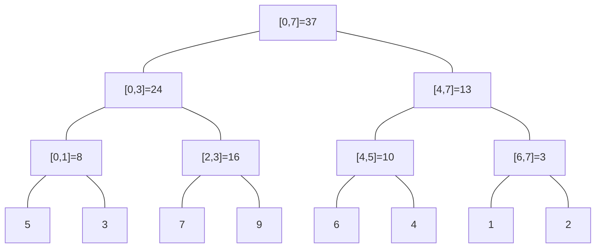

> 고려사이버대학교 「컴퓨터 알고리즘」(2024-2학기) 강의 내용을 바탕으로 정리했다.

[[prefix-sum|접두사 합]]을 미리 구해 두면 구간 합을 O(1)에 답할 수 있다. 그런데 중간 값 하나가 바뀌면 그 뒤의 접두사 합을 전부 다시 구해야 해서 갱신이 O(n)이다. 질의와 갱신이 섞여 많이 들어오면 둘 다 빨라야 한다. **세그먼트 트리(Segment Tree)** 는 둘을 모두 O(log n)으로 맞춘다.

## 구조

배열 `a[0..n-1]`을 반씩 계속 나누고, 나눈 구간마다 노드를 하나 둔다.

- 루트는 전체 구간 `[0, n-1]`을 맡는다.
- 구간 `[l, r]`을 맡은 노드의 왼쪽 자식은 `[l, mid]`, 오른쪽 자식은 `[mid+1, r]`을 맡는다.
- 리프는 원소 하나를 맡는다.
- 각 노드에는 자기 구간의 **요약값**(합, 최솟값, 최댓값 등)을 저장한다.

`a = [5, 3, 7, 9, 6, 4, 1, 2]`의 합 트리는 이렇다.



요약 연산은 **결합 법칙**이 성립하면 무엇이든 된다. 합, 곱, 최솟값, 최댓값, 최대공약수, XOR가 대표적이다. 두 자식의 값을 합쳐 부모 값을 만들 수 있어야 하기 때문이다.

## 배열 크기 잡기

[[heap-priority-queue|힙]]처럼 트리를 배열 하나에 담는다. 노드 `i`의 자식은 `2i`, `2i+1`이다(루트를 1번으로).

- n이 2의 거듭제곱 `2^k`이면 트리는 포화 이진 트리이고 노드 수는 `2^(k+1) - 1`이다.
- 그렇지 않으면 n 이상인 가장 작은 `2^k`를 기준으로 `2^(k+1)` 칸을 잡는다.
- 계산이 귀찮으면 `4n`을 잡는다. 항상 충분하다.

높이는 `⌈log₂ n⌉`이므로 루트에서 리프까지 O(log n)단계다.

## 구현

```python
class SegmentTree:
    def __init__(self, a):
        self.n = len(a)
        self.t = [0] * (4 * self.n)
        self._build(a, 1, 0, self.n - 1)

    def _build(self, a, node, l, r):
        if l == r:
            self.t[node] = a[l]
            return
        m = (l + r) // 2
        self._build(a, 2 * node, l, m)
        self._build(a, 2 * node + 1, m + 1, r)
        self.t[node] = self.t[2 * node] + self.t[2 * node + 1]

    def query(self, ql, qr, node=1, l=0, r=None):
        """a[ql..qr]의 합"""
        if r is None:
            r = self.n - 1
        if qr < l or r < ql:          # 겹치지 않음
            return 0                  # 합의 항등원
        if ql <= l and r <= qr:       # 완전히 포함
            return self.t[node]
        m = (l + r) // 2              # 일부만 겹침 → 양쪽으로
        return (self.query(ql, qr, 2 * node, l, m)
                + self.query(ql, qr, 2 * node + 1, m + 1, r))

    def update(self, idx, val, node=1, l=0, r=None):
        """a[idx] = val"""
        if r is None:
            r = self.n - 1
        if l == r:
            self.t[node] = val
            return
        m = (l + r) // 2
        if idx <= m:
            self.update(idx, val, 2 * node, l, m)
        else:
            self.update(idx, val, 2 * node + 1, m + 1, r)
        self.t[node] = self.t[2 * node] + self.t[2 * node + 1]

st = SegmentTree([5, 3, 7, 9, 6, 4, 1, 2])
st.query(2, 5)    # 7+9+6+4 = 26
st.update(3, 0)   # a[3]을 0으로
st.query(2, 5)    # 17
```

최솟값 트리로 바꾸려면 `+`를 `min`으로, 겹치지 않을 때 돌려주는 항등원 `0`을 `float('inf')`로 바꾸면 된다.

### 왜 O(log n)인가

- **갱신**: 바뀐 리프에서 루트까지 한 경로만 다시 계산한다. 높이만큼, O(log n).
- **질의**: 질의 구간의 경계가 지나가는 노드만 쪼개 내려간다. 한 깊이에서 "일부만 겹치는" 노드는 많아야 2개라서 방문 노드는 깊이당 상수 개, 전체 O(log n)이다.
- **구축**: 노드마다 한 번씩, O(n).

## 지연 전파: 구간 전체를 한 번에 바꿀 때

"`a[l..r]`에 모두 `v`를 더하라" 같은 구간 갱신을 리프마다 하면 O(n log n)이다. **지연 전파(lazy propagation)** 는 구간을 완전히 덮는 노드에서 멈추고 "자식들에게 `v`를 더해야 함"이라는 메모(`lazy[node]`)만 남긴다. 나중에 그 노드 아래로 내려갈 일이 생길 때 메모를 자식에게 넘긴다. 이렇게 하면 구간 갱신도 O(log n)이 된다.

## 펜윅 트리: 배열 하나로 접두사 합 갱신하기

펜윅 트리(Fenwick Tree)는 Peter Fenwick이 1994년 논문 「A New Data Structure for Cumulative Frequency Tables」에서 소개한 자료구조로, 이진 인덱스 트리(Binary Indexed Tree, BIT)라고도 한다. 세그먼트 트리처럼 갱신과 접두사 합을 O(log n)에 하지만, 크기 n+1짜리 배열 하나와 몇 줄의 반복문이면 된다.

**핵심은 인덱스의 최하위 1비트다.** `i & -i`는 i를 이진수로 썼을 때 가장 낮은 1비트의 값이다(2의 보수에서 `-i`는 그 비트까지 같고 위는 뒤집힌다). 칸 `tree[i]`에는 i에서 끝나고 길이가 `i & -i`인 구간, 곧 `a[i - (i & -i) + 1] … a[i]`의 합을 저장한다.

| i | 이진수 | `i & -i` | `tree[i]`가 담는 구간 |
| --- | --- | --- | --- |
| 1 | 0001 | 1 | a[1] |
| 2 | 0010 | 2 | a[1..2] |
| 3 | 0011 | 1 | a[3] |
| 4 | 0100 | 4 | a[1..4] |
| 6 | 0110 | 2 | a[5..6] |
| 8 | 1000 | 8 | a[1..8] |

- **접두사 합** `prefix(i)`: `tree[i]`를 더하고 i에서 최하위 1비트를 뺀다(`i -= i & -i`). 1비트가 하나씩 지워지므로 많아야 log n번이다. `prefix(7)`은 `tree[7] + tree[6] + tree[4]`다.
- **갱신** `add(i, delta)`: `tree[i]`에 더하고 최하위 1비트를 더한다(`i += i & -i`). i를 포함하는 위쪽 칸들을 차례로 고친다.

```python
class Fenwick:
    def __init__(self, n):
        self.tree = [0] * (n + 1)           # 1부터 쓴다

    def add(self, i, delta):                # a[i] += delta
        while i < len(self.tree):
            self.tree[i] += delta
            i += i & -i                     # 나를 포함하는 다음 칸으로

    def prefix(self, i):                    # a[1] + ... + a[i]
        s = 0
        while i > 0:
            s += self.tree[i]
            i -= i & -i                     # 앞 구간으로
        return s

    def range_sum(self, l, r):              # a[l] + ... + a[r]
        return self.prefix(r) - self.prefix(l - 1)
```

시스템 설계에서는 **실시간 순위**에 쓴다. 점수의 범위가 정해져 있으면(0~100만점) 점수마다 그 점수인 사람 수를 펜윅 트리에 세어 둔다. 「내 점수보다 높은 사람 수」는 전체 인원에서 내 점수까지의 접두사 합을 뺀 값이고, 점수가 바뀌면 옛 점수 칸에서 1을 빼고 새 점수 칸에 1을 더한다. 둘 다 O(log 점수 범위)다. 점수 범위가 넓으면 구간을 묶어 근사하거나, 트리 노드마다 자식 수를 둔 순위 트리를 쓴다.

## 다른 방법과 비교

| 방법 | 구간 질의 | 점 갱신 | 구간 갱신 | 메모리 | 쓰기 좋은 경우 |
| --- | --- | --- | --- | --- | --- |
| 접두사 합 | O(1) | O(n) | O(n) | n | 배열이 바뀌지 않음 |
| 펜윅 트리(BIT) | O(log n) | O(log n) | 변형 필요 | n | 합처럼 역연산이 있는 연산, 짧은 코드 |
| 세그먼트 트리 | O(log n) | O(log n) | O(log n)(지연 전파) | 약 2n~4n | 최솟값·최댓값처럼 역연산이 없는 연산, 구간 갱신 |

펜윅 트리는 구간 합을 "접두사 합끼리의 차"로 구하므로 뺄셈 같은 역연산이 필요하다. 최솟값에는 역연산이 없어 펜윅 트리로는 임의 구간 최솟값을 구하기 어렵고, 세그먼트 트리가 맞다.

## 언제 떠올리나

- 문제에 "구간 합/최솟값을 구하라"와 "값을 바꿔라"가 **섞여** 수만~수십만 번 나온다.
- [[sweep-line|스위핑]]과 함께 직사각형 합집합 넓이, 겹치는 구간 세기 같은 문제를 푼다.
- 값이 바뀌지 않으면 접두사 합이나 희소 테이블(sparse table)이 더 간단하다.

## 정리

- 세그먼트 트리는 구간을 반씩 나눈 이진 트리에 구간 요약값을 저장한다.
- 요약 연산은 결합 법칙만 성립하면 된다.
- 배열 크기는 넉넉히 `4n`, 질의·갱신은 O(log n), 구축은 O(n).
- 구간 갱신은 지연 전파로, 역연산이 있는 합 문제는 펜윅 트리로도 풀 수 있다.
- 펜윅 트리는 `tree[i]`에 길이 `i & -i`인 구간 합을 저장해, 최하위 1비트를 빼며 접두사 합을, 더하며 갱신을 한다. 배열 하나와 짧은 반복문이면 되고, 점수별 인원을 세어 실시간 순위를 구하는 데 쓴다.

관련 노트: [[prefix-sum|구간 합과 접두사 합]], [[tree|트리와 이진 탐색 트리]], [[heap-priority-queue|힙과 우선순위 큐]], [[sweep-line|스위핑]], [[divide-and-conquer|분할 정복]], [[bit-manipulation|비트 연산 기법]], [[real-world-algorithms|현실 시스템을 움직이는 알고리즘과 자료구조]]
