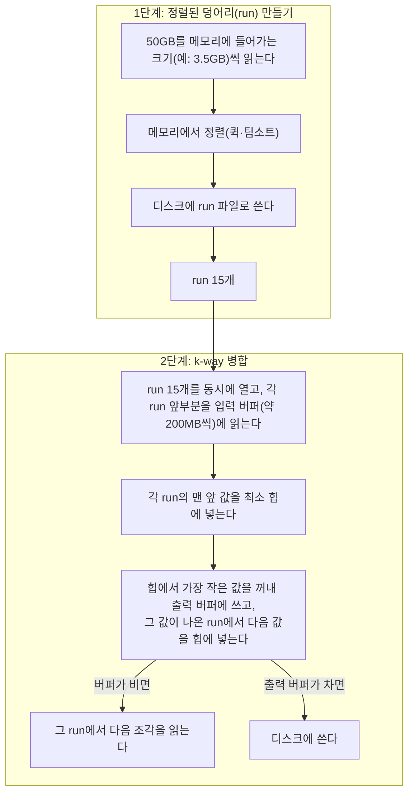

> 자바 정렬 부분은 팔만코딩경(42Seoul 커뮤니티 위키)의 「[JAVA] Sort 사용 (Arrays, Collections)」을 바탕으로 보강했다.
> 퀵 정렬의 피벗 선택과 실전 개선은 「[퀵 정렬 (Quick Sort)](https://johngrib.github.io/wiki/algorithm/quick-sort/)」를 바탕으로 보강했다.
> 상향식 병합 정렬, 퀵 셀렉트, 다른 언어의 표준 정렬, 외부 정렬은 fru1tworld/cs-basic 모의 면접 질문 목록의 「[자료구조](https://github.com/fru1tworld/cs-basic/blob/main/interview/cs/ds.md)」, 「[기타](https://github.com/fru1tworld/cs-basic/blob/main/interview/cs/etc.md)」(손코딩) 질문이 묻는 개념으로 보강했다.
> 로무토 분할, 정렬 전에 정할 것은 cooervo의 「[Big O cheat sheets](https://cooervo.github.io/Algorithms-DataStructures-BigONotation/)」(2015.03)를, 비교표의 셸·스무스·트리·버킷·큐브 정렬은 Eric Rowell의 「[Big-O Cheat Sheet](https://www.bigocheatsheet.com/)」를 바탕으로 보강했다.

병합 정렬과 퀵 정렬은 모두 분할 정복으로 리스트를 나눠 정렬한다. 차이는 실제 작업이 어디서 일어나느냐다. 병합 정렬은 **합치는 단계**에서, 퀵 정렬은 **나누는 단계**에서 정렬이 이뤄진다.

## 병합 정렬 (Merge Sort)

리스트를 균등한 크기의 두 부분으로 나누고, 각각을 재귀적으로 정렬한 뒤, 정렬된 두 리스트를 하나로 합친다.

```python
def merge_sort(arr):
    if len(arr) < 2:
        return arr

    mid = len(arr) // 2
    low = merge_sort(arr[:mid])
    high = merge_sort(arr[mid:])

    merged = []
    l = h = 0
    while l < len(low) and h < len(high):
        if low[l] <= high[h]:      # <= 로 비교해야 안정 정렬이 된다
            merged.append(low[l])
            l += 1
        else:
            merged.append(high[h])
            h += 1
    merged += low[l:]
    merged += high[h:]
    return merged

print(merge_sort([5, 3, 8, 1, 9, 2]))  # [1, 2, 3, 5, 8, 9]
```

- 리스트를 반씩 나누므로 깊이는 log n, 각 깊이에서 합치는 데 O(n) → 항상 O(n log n)
- 합칠 때 추가 배열이 필요해 공간 복잡도 O(n)
- 안정 정렬. 연결 리스트 정렬이나 외부 정렬(아래 절)에도 적합하다.

### 재귀 없이: 상향식 병합 정렬

병합 정렬은 재귀 없이 반복문으로도 짤 수 있다. 크기 1짜리 구간을 이웃끼리 합쳐 크기 2로, 다시 4, 8, …로 폭을 두 배씩 늘리며 합친다(bottom-up). 나누는 단계가 필요 없고, 호출 스택 대신 바깥 반복이 log n번 돈다.

```python
def merge_sort_bottom_up(a):
    n, width = len(a), 1
    while width < n:
        for lo in range(0, n, 2 * width):
            mid, hi = min(lo + width, n), min(lo + 2 * width, n)
            left, right = a[lo:mid], a[mid:hi]
            i = j = 0
            for k in range(lo, hi):            # 두 구간을 a[lo:hi]에 다시 써 넣는다
                if j >= len(right) or (i < len(left) and left[i] <= right[j]):
                    a[k] = left[i]; i += 1
                else:
                    a[k] = right[j]; j += 1
        width *= 2
    return a
```

시간 O(n log n), 추가 공간 O(n)은 같다. 재귀 깊이 걱정이 없고, 연결 리스트를 O(1) 추가 공간으로 정렬하거나 디스크의 정렬된 덩어리(run)를 합치는 외부 정렬이 이 모양이다. 팀소트도 입력에 이미 있는 정렬된 구간을 run으로 삼아 아래에서 위로 합친다.

## 퀵 정렬 (Quick Sort)

피벗(pivot)을 하나 고르고, 피벗보다 작은 값과 큰 값으로 리스트를 나눈 뒤(크기가 같지 않을 수 있다), 각 부분을 재귀적으로 정렬해 이어 붙인다.

```python
def quick_sort(arr):
    if len(arr) <= 1:
        return arr
    pivot = arr[len(arr) // 2]
    lesser = [x for x in arr if x < pivot]
    equal = [x for x in arr if x == pivot]
    greater = [x for x in arr if x > pivot]
    return quick_sort(lesser) + equal + quick_sort(greater)
```

위 코드는 이해하기 쉬운 버전이라 새 리스트를 계속 만든다. 실제 구현은 배열 안에서 원소를 교환해 나누는 제자리(in-place) 분할을 쓴다.

```python
def quick_sort_inplace(arr, start=0, end=None):
    if end is None:
        end = len(arr) - 1
    if start >= end:
        return
    pivot = arr[start]
    left, right = start + 1, end
    while left <= right:
        while left <= end and arr[left] <= pivot:
            left += 1
        while right > start and arr[right] >= pivot:
            right -= 1
        if left > right:
            arr[right], arr[start] = arr[start], arr[right]  # 피벗을 제자리로
        else:
            arr[left], arr[right] = arr[right], arr[left]
    quick_sort_inplace(arr, start, right - 1)
    quick_sort_inplace(arr, right + 1, end)
```

- **평균 O(n log n)**: 피벗이 리스트를 대략 반씩 나눌 때
- **최악 O(n²)**: 피벗이 매번 최솟값이나 최댓값일 때(예: 이미 정렬된 데이터에서 첫 원소를 피벗으로 고르는 경우). 피벗을 무작위나 중간값으로 고르면 완화된다.
- 제자리 분할 시 추가 메모리가 적고, 캐시 효율이 좋아 실제로 매우 빠르다. 잘 구현한 퀵 정렬은 같은 입력에서 병합 정렬·힙 정렬보다 보통 2~3배 빠르다(Skiena, *The Algorithm Design Manual*의 실험).
- 불안정 정렬

### 최악을 피하는 실전 개선

퀵 정렬은 1959년 토니 호어(Tony Hoare)가 고안했다. 위의 제자리 분할처럼 양 끝에서 두 포인터가 다가오며 자리가 틀린 원소를 맞바꾸는 방식이 호어 분할 계열이다. 교재에 자주 나오는 다른 방식은 피벗을 끝으로 보내고 포인터 하나로 왼쪽부터 훑는 **로무토(Lomuto) 분할**이다.

```python
import random

def lomuto_partition(a, lo, hi):
    p = random.randint(lo, hi)           # 무작위 피벗을 끝으로 보낸다
    a[p], a[hi] = a[hi], a[p]
    store = lo                           # a[lo:store]는 피벗 이하
    for i in range(lo, hi):
        if a[i] <= a[hi]:
            a[i], a[store] = a[store], a[i]
            store += 1
    a[store], a[hi] = a[hi], a[store]    # 피벗을 제자리로
    return store                         # 피벗의 최종 위치

def quick_sort_lomuto(a, lo=0, hi=None):
    if hi is None:
        hi = len(a) - 1
    if lo < hi:
        p = lomuto_partition(a, lo, hi)
        quick_sort_lomuto(a, lo, p - 1)
        quick_sort_lomuto(a, p + 1, hi)
```

| 분할 | 움직임 | 특징 |
| --- | --- | --- |
| 호어 | 두 포인터가 양 끝에서 다가오며 자리가 틀린 쌍을 맞바꾼다 | 교환이 로무토보다 평균 약 3배 적다. 경계 조건이 까다롭다 |
| 로무토 | 포인터 하나가 훑으며 피벗 이하 값을 앞쪽에 모은다 | 코드가 짧고 피벗의 최종 위치가 바로 나온다. 값이 모두 같으면 매번 한쪽에 몰려 O(n²)이 된다 |

실제 라이브러리 구현은 여기에 몇 가지를 더한다.

| 개선 | 내용 |
| --- | --- |
| 무작위화 | 피벗을 무작위로 고르거나 입력을 먼저 섞는다. 입력 순서와 무관하게 기대 O(n log n)이 되어, 정렬된 입력으로 최악을 유도하는 공격을 막는다 |
| 세 값의 중앙값(median-of-three) | 처음·가운데·끝 값의 중앙값을 피벗으로. 비교가 조금 늘지만 분할이 고르게 된다 |
| 3-way 분할 | 피벗보다 작음·같음·큼 세 구역으로 나눈다. 중복 키가 많으면 같은 구역을 다시 정렬하지 않아 거의 선형까지 빨라진다(Bentley·McIlroy, 1993) |
| 작은 구간은 삽입 정렬 | 원소가 수~수십 개 이하로 줄면 재귀 비용이 더 크므로 삽입 정렬로 넘긴다 |
| 깊이 제한 | 재귀가 너무 깊어지면 힙 정렬로 바꿔 최악 O(n log n)을 보장한다. C++ `std::sort`가 쓰는 인트로 정렬(introsort)이다 |

### 퀵 셀렉트: 정렬하지 않고 k번째 값 찾기

배열 전체를 정렬하지 않고 k번째로 작은(큰) 값이나 중앙값만 구할 때는 퀵 정렬의 분할을 쓰되 답이 있는 한쪽만 재귀한다. 이것이 퀵 셀렉트(Quickselect, 호어의 선택 알고리즘)다.

```python
import random

def quickselect(a, k):                 # 0-based로 k번째로 작은 값. a를 제자리에서 바꾼다
    lo, hi = 0, len(a) - 1
    while True:
        if lo == hi:
            return a[lo]
        pivot = a[random.randint(lo, hi)]  # 무작위 피벗으로 최악 입력을 피한다
        lt, i, gt = lo, lo, hi         # 3-way 분할: [lo, lt) 작음, [lt, gt] 같음, (gt, hi] 큼
        while i <= gt:
            if a[i] < pivot:
                a[lt], a[i] = a[i], a[lt]
                lt += 1
                i += 1
            elif a[i] > pivot:
                a[i], a[gt] = a[gt], a[i]
                gt -= 1
            else:
                i += 1
        if k < lt:
            hi = lt - 1
        elif k > gt:
            lo = gt + 1
        else:                          # k가 피벗과 같은 구역에 있다
            return pivot

nums = [7, 2, 9, 4, 1, 5]
print(quickselect(nums[:], len(nums) // 2))   # 5 (정렬하면 1 2 4 5 7 9)
```

피벗보다 작은 값만 앞으로 보내는 2-way 분할은 값이 모두 같은 배열에서 한 번에 원소 하나씩만 줄어 무작위 피벗이어도 O(n²)이 된다. 같은 값을 한 구역에 모으면 k가 그 구역에 들 때 바로 끝난다.

| 방법 | 시간 | 특징 |
| --- | --- | --- |
| 정렬 후 인덱스 | O(n log n) | 가장 단순하다 |
| 크기 k짜리 힙 | O(n log k) | 스트림에도 쓴다([[heap-priority-queue\|힙과 우선순위 큐]]) |
| 퀵 셀렉트 | 평균 O(n), 최악 O(n²) | 분할 한 번에 평균 절반만 남아 n + n/2 + n/4 + … ≈ 2n이다 |
| 중앙값의 중앙값(median of medians) | 최악 O(n) | 다섯 개씩 묶은 중앙값들의 중앙값을 피벗으로 써 분할이 일정 비율 이상 고르도록 보장한다. 상수가 커서 실무에서는 퀵 셀렉트를 쓰다 너무 깊어질 때의 대비책으로 둔다 |

k번째로 큰 값은 `n - k`번째로 작은 값이다. 원소 수가 짝수일 때 중앙값이 가운데 두 값의 평균이면 두 번 선택하거나, 한 번 선택한 뒤 오른쪽 구간의 최솟값을 찾는다. C++ `std::nth_element`, NumPy `np.partition`이 이 계열이다.

## 정렬 알고리즘 비교

| 정렬 | 최선 | 평균 | 최악 | 추가 공간 | 안정성 |
| --- | --- | --- | --- | --- | --- |
| 버블 | O(n) | O(n²) | O(n²) | O(1) | 안정 |
| 선택 | O(n²) | O(n²) | O(n²) | O(1) | 불안정 |
| 삽입 | O(n) | O(n²) | O(n²) | O(1) | 안정 |
| 병합 | O(n log n) | O(n log n) | O(n log n) | O(n) | 안정 |
| 퀵 | O(n log n) | O(n log n) | O(n²) | 평균 O(log n), 최악 O(n) (작은 쪽만 재귀하면 O(log n) 보장) | 불안정 |
| 셸 | O(n log n) (Knuth 수열) | 간격 수열에 따라 다르다 | O(n^1.5) (Knuth), O(n log² n) (Pratt) | O(1) | 불안정 |
| 힙 | O(n log n) | O(n log n) | O(n log n) | O(1) | 불안정 |
| 스무스(Smoothsort) | O(n) | O(n log n) | O(n log n) | O(1) | 불안정 |
| 트리 정렬 | O(n log n) | O(n log n) | O(n²) (균형 트리면 O(n log n)) | O(n) | 같은 키를 늘 오른쪽에 넣으면 안정 |
| 팀소트(Timsort) | O(n) | O(n log n) | O(n log n) | O(n) | 안정 |
| 큐브소트(Cubesort) | O(n) | O(n log n) | O(n log n) | O(n) | 안정 |
| 계수 | O(n + k) | O(n + k) | O(n + k) | O(n + k) | 안정 |
| 기수 | O(d·(n + b)) | O(d·(n + b)) | O(d·(n + b)) | O(n + b) | 안정 |
| 버킷 | O(n + k) | O(n + k) | O(n²) | O(n + k) | 버킷 안 정렬이 안정이면 안정 |

계수 정렬의 k는 값의 범위, 기수 정렬의 d는 자릿수, b는 한 자리가 가질 수 있는 값의 수(기수)다. 버킷 정렬의 k는 버킷 수다.

- **셸 정렬**은 간격을 줄여 가며 삽입 정렬을 반복한다. 복잡도가 간격 수열에 달려 있어 한 줄로 적을 수 없다([[elementary-sorts|기본 정렬]]).
- **스무스 정렬**은 다익스트라(Dijkstra)가 1981년에 낸 힙 정렬의 변형으로, 입력이 정렬돼 있을수록 O(n)에 가까워진다([[heap-priority-queue|힙과 우선순위 큐]]의 「힙 정렬」).
- **트리 정렬**은 모든 원소를 이진 탐색 트리에 넣고 중위 순회로 꺼낸다. 이미 정렬된 입력을 평범한 BST에 넣으면 트리가 한쪽으로 뻗어 O(n²)이 된다([[tree|트리와 이진 탐색 트리]]).
- **큐브소트**는 키로 자기 균형 다차원 배열을 쌓는 병렬 정렬이다. 이미 정렬됐거나 역순인 입력은 비교 n번으로 끝난다. 언어 표준 정렬에는 쓰이지 않는다.
- **버킷 정렬**은 값의 구간별로 나눠 담고 버킷마다 정렬해 이어 붙인다. 값이 고르게 퍼져 있을 때만 선형이다([[elementary-sorts|기본 정렬]]).
 비교 기반 정렬은 최악의 경우 Ω(n log n)번의 비교가 필요해 이보다 빠를 수 없다. 계수·기수 정렬은 비교 대신 값의 범위나 자릿수에 기대어 이 하한에 묶이지 않는다.

## 실전에서는

파이썬의 `sorted()`와 `list.sort()`는 병합 정렬과 삽입 정렬을 섞은 Timsort 계열 알고리즘으로, 최악에도 O(n log n)이고 안정 정렬이다. (Python 3.11부터는 run을 합치는 순서를 정하는 규칙만 Powersort 방식으로 바뀌었고, 기본 구조는 같다.) 코딩 테스트에서는 직접 구현하기보다 내장 정렬에 `key`를 주어 쓰는 경우가 대부분이다. 자바스크립트도 ES2019부터 명세가 `Array.prototype.sort`의 안정성을 요구하고, V8은 팀소트로 구현한다.

```python
students = [("kim", 90), ("lee", 85), ("park", 90)]
students.sort(key=lambda s: (-s[1], s[0]))  # 점수 내림차순, 이름 오름차순
```

정렬을 부르기 전에 정할 것은 네 가지다.

| 정할 것 | 예 | 쓰는 도구 |
| --- | --- | --- |
| 방향 | 오름차순·내림차순 | Python `reverse=True`, Java `Comparator.reversed()` |
| 키 | 이름의 사전순, 필드의 숫자, 날짜·생일 | Python `key=`, Java `Comparable`·`Comparator.comparing` |
| 같은 키의 순서 | 이름이 같은 사람은 성으로 다시 나눈다 | 튜플 키, `thenComparing`, 안정 정렬로 보조 키부터 정렬하기 |
| 추가 메모리 | 메모리가 빠듯한 임베디드 환경 | 추가 공간 O(1)인 힙·셸 정렬. 리스트를 제자리에서 바꾸는 `list.sort()`도 팀소트라 내부에 최대 n/2 크기의 임시 공간을 쓴다 |

자바는 대상 타입에 따라 알고리즘이 다르다.

| 호출 | 대상 | 알고리즘 | 특징 |
| --- | --- | --- | --- |
| `Arrays.sort(int[])` 등 | 기본형 배열 | Dual-Pivot Quicksort | 평균 O(n log n), 불안정. 기본형은 같은 값을 구별할 수 없어 안정성이 의미 없다 |
| `Arrays.sort(T[], Comparator)` | 객체 배열 | Timsort | 최악 O(n log n), 안정 |
| `Collections.sort(list)`, `list.sort(c)` | `List` | 배열로 바꿔 `Arrays.sort` 호출 | 객체 정렬과 같다 |

그 밖의 언어 표준 정렬은 다음과 같다.

| 언어 | 불안정 정렬 | 안정 정렬 |
| --- | --- | --- |
| C++ | `std::sort`: 인트로 정렬(퀵 + 힙 + 삽입) | `std::stable_sort`: 병합 정렬 |
| Go | `sort.Sort`, `slices.Sort`: 1.19부터 패턴 무력화 퀵 정렬(pdqsort) | `sort.Stable`, `slices.SortStableFunc`: 삽입 정렬 + 제자리 병합 |
| Rust | `sort_unstable`: ipnsort(pdqsort 계열) | `sort`: driftsort(병합 계열, 1.81부터) |

공통된 흐름은 불안정 정렬은 퀵 정렬 계열에 최악 대비책을 붙이고, 안정 정렬은 병합 정렬 계열에 이미 정렬된 구간 활용을 붙이는 것이다. 작은 구간은 어느 쪽이든 삽입 정렬로 넘긴다.

정렬 기준은 원소 클래스가 `Comparable`(`compareTo`)을 구현해 정하거나, 정렬 호출에 `Comparator`를 넘겨 정한다. 내림차순은 `Collections.reverseOrder()`나 `Comparator.comparing(...).reversed()`를 쓴다. 이 Comparator 방식은 객체 배열에만 쓸 수 있어서 `int[]`를 내림차순으로 정렬하려면 `Integer[]`로 박싱하거나 오름차순 정렬 뒤 뒤집어야 한다.

```java
Integer[] arr = {8, 7, 6, 5, 4};
Arrays.sort(arr, Collections.reverseOrder());                 // 8 7 6 5 4
people.sort(Comparator.comparingInt(Person::score).reversed()
                      .thenComparing(Person::name));          // 점수 내림차순, 이름 오름차순
```

## 외부 정렬: 메모리보다 큰 데이터

50GB 파일을 메모리 4GB로 정렬하듯 데이터가 메모리에 다 들어가지 않으면 디스크와 메모리를 오가는 외부 정렬(external sort)을 쓴다. 디스크는 임의 접근이 느리고 순차 읽기·쓰기가 빠르므로, 순차 접근만으로 끝나는 외부 병합 정렬이 표준이다.



| 요소 | 내용 |
| --- | --- |
| 디스크 패스 수 | 위 예는 읽기·쓰기를 두 번씩만 한다. run이 너무 많아 버퍼를 나눌 수 없으면 병합을 여러 단계로 나눈다. 패스 수는 약 1 + ⌈log_k(run 수)⌉다 |
| 병합 비용 | 힙 크기가 k라 원소 하나에 O(log k), 전체 O(N log k)다 |
| run 늘리기 | 대체 선택(replacement selection)으로 힙에서 내보내며 새 값을 받으면 run 길이가 평균 메모리의 2배가 되어 run 수가 준다 |
| 병렬화 | run 만들기는 덩어리마다 독립이라 여러 코어·장비에서 나눠 한다. 분산 환경의 정렬(MapReduce의 셔플)도 같은 구조다 |

DB가 `ORDER BY`나 인덱스 생성 중 작업 메모리(예: PostgreSQL `work_mem`)를 넘으면 같은 방식으로 임시 파일에 run을 쓰고 병합한다. 리눅스 `sort` 명령도 큰 파일을 임시 파일로 나눠 병합한다.

## 핵심 정리

- 병합 정렬: 나누고 합치며 정렬, 항상 O(n log n), 추가 메모리 O(n), 안정
- 퀵 정렬: 피벗으로 나누며 정렬, 평균 O(n log n)·최악 O(n²), 불안정
- 실전은 내장 정렬(Timsort) + `key` 함수. 자바는 기본형 배열에 Dual-Pivot Quicksort, 객체에 Timsort
- 병합 정렬은 재귀 없이 폭을 두 배씩 늘리는 상향식으로도 짠다. 메모리보다 큰 데이터는 run을 만든 뒤 힙으로 k-way 병합한다
- k번째 값·중앙값은 정렬 대신 퀵 셀렉트로 평균 O(n)

관련 노트: [[divide-and-conquer|분할 정복]], [[heap-priority-queue|힙(힙 정렬)]], [[elementary-sorts|기본 정렬]], [[big-o|빅오 표기법]]
