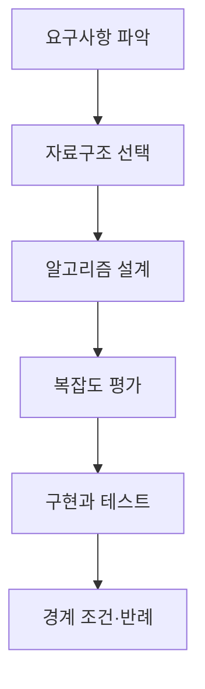

> Oleksii Trekhleb의 공개 저장소 「[JavaScript Algorithms and Data Structures](https://github.com/trekhleb/javascript-algorithms)」를 주제별로 재구성한 노트다.

## 자료구조와 알고리즘을 공부하는 방법

**알고리즘은 답을 계산하는 절차이고, 자료구조는 그 절차가 다루는 데이터를 담는 방식**이다. 이 공개 저장소는 JavaScript로 구현한 자료구조 **19개**와 주제별 알고리즘 **93개**를 설명·코드·테스트로 연결한다. 원본은 학습용 예제로, 개발 환경과 생산 코드의 요구사항은 별도 검증이 필요하다.

## 하위 노트

- [자료구조 19개](Algorithm/javascript-algorithms-data-structures.md): 배열·연결 리스트에서 균형 트리·Bloom Filter·LRU 캐시까지
- [수학·집합 알고리즘 32개](Algorithm/javascript-algorithms-math-sets.md): 정수·조합·점화식·수학적 계산
- [문자열·탐색·정렬 22개](Algorithm/javascript-algorithms-strings-search-sorting.md): 문자열 매칭·검색·정렬
- [순회·그래프 알고리즘 19개](Algorithm/javascript-algorithms-traversal-graphs.md): 리스트·트리 순회, 최단 경로·연결성·MST
- [응용 알고리즘 20개와 설계 패러다임](Algorithm/javascript-algorithms-patterns-applications.md): 암호·ML·이미지·통계·고전 문제, 그리디·분할 정복·DP·백트래킹

## 원본을 따라가는 순서

1. 먼저 빅오 복잡도와 스택·큐·해시 테이블을 이해한다.
2. 탐색·정렬·재귀를 구현하고 테스트한다.
3. 트리·그래프·DP와 더 복잡한 자료구조로 확장한다.
4. 같은 문제를 두 가지 방식으로 풀고 수행시간·메모리·반례를 비교한다.

원본 난이도 표기 `B`는 Beginner, `A`는 Advanced를 뜻한다. [원문 README](https://github.com/trekhleb/javascript-algorithms/blob/85293e3e2b88f4d2ce330d956b139cf628aa1e82/README.md)와 실제 코드 디렉터리 링크를 각 노트에 붙였다. **기존 지식 노트와 중복되는 정의는 여기서 반복하지 않고 링크로 연결한다.** 모든 알고리즘이 동일한 런타임·메모리 특성을 갖는 것은 아니다.

관련 노트: [[big-o|빅오]], [[data-structures|자료구조]], [[real-world-algorithms|실전 알고리즘]], [[ossu-core-theory|OSSU 알고리즘 이론]]
