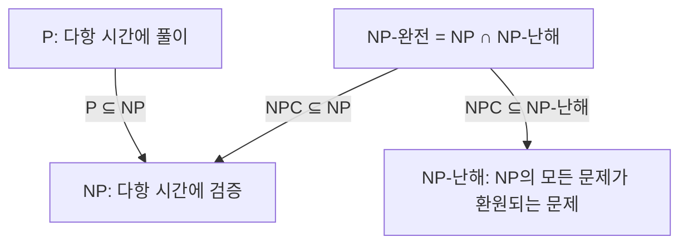

> jwasham의 「[Coding Interview University](https://github.com/jwasham/coding-interview-university)」(CC-BY-SA-4.0) 학습 계획의 「NP, NP-Complete and Approximation Algorithms」 항목을 바탕으로 재구성한 노트다.

## 왜 알아야 하나

어떤 문제는 아무리 머리를 써도 입력이 커지면 지수 시간이 드는 알고리즘밖에 알려져 있지 않다. **문제를 보고 「이건 NP-완전이다」를 알아보면, 다항 시간 정답 알고리즘을 찾느라 시간을 버리지 않고 바로 근사·휴리스틱·입력 제한으로 방향을 바꿀 수 있다.** 면접에서는 외판원 문제나 배낭 문제가 이름을 숨긴 채 나오는 경우가 많아서, 정의를 외우는 것보다 위장된 형태를 알아보는 것이 중요하다.

## 복잡도 클래스

여기서 「문제」는 보통 예/아니오로 답하는 **결정 문제(decision problem)** 로 다룬다. 최적화 문제도 「비용 k 이하인 해가 있나」로 바꾸면 결정 문제가 된다.

| 클래스 | 정의 | 예 |
| --- | --- | --- |
| P | 다항 시간에 **푼다** | 정렬, 최단 경로(음수 사이클 없음), 최소 신장 트리, 이분 매칭 |
| NP | 답이 「예」일 때 그 증거(certificate)가 주어지면 다항 시간에 **검증한다** | P의 모든 문제, SAT, 해밀턴 경로 |
| NP-난해(NP-hard) | NP의 **모든** 문제를 이 문제로 다항 시간에 환원할 수 있다. 이 문제 자체는 NP에 속하지 않아도 된다 | 정지 문제, 최적화 형태의 외판원 문제 |
| NP-완전(NP-complete) | NP에 속하면서 NP-난해 | SAT, 3-SAT, 정점 덮개, 결정형 배낭·외판원 |

- NP는 「Non-deterministic Polynomial」이다. 「다항이 아니다(Not Polynomial)」가 아니다.
- P ⊆ NP는 분명하다(풀 수 있으면 검증도 된다). **P = NP인지는 아직 아무도 증명하지 못했다.** 대부분은 P ≠ NP라고 믿는다.
- NP-완전 문제 하나라도 다항 시간에 풀리면 NP 전체가 P가 된다. 그래서 NP-완전은 「NP에서 가장 어려운 문제들」이다.

## 환원(Reduction)

**문제 A를 문제 B로 환원한다**는 것은 A의 입력을 B의 입력으로 다항 시간에 바꾸고, B의 답을 그대로 A의 답으로 쓰는 변환을 만든다는 뜻이다. 그러면 「B가 쉬우면 A도 쉽다」, 거꾸로 「A가 어려우면 B도 어렵다」.

새 문제 X가 NP-완전임을 보이는 순서는 늘 같다.

1. X가 NP에 속함을 보인다: 해가 주어지면 다항 시간에 확인할 수 있다.
2. 이미 NP-완전으로 알려진 문제 Y를 X로 환원한다: **방향은 Y → X**다. 반대 방향은 아무것도 증명하지 못한다.

출발점은 쿡-레빈 정리(Cook-Levin)가 보인 SAT다. 이후 3-SAT, 클리크, 정점 덮개, 해밀턴 사이클, 외판원처럼 환원 사슬로 수천 개의 문제가 NP-완전으로 밝혀졌다.

## 대표 NP-완전 문제와 위장된 모습

| 문제 | 정의 | 면접·실무에서 보이는 모습 |
| --- | --- | --- |
| 외판원 문제(TSP) | 모든 도시를 한 번씩 돌아 돌아오는 최소 비용 경로 | 배달 경로, 여러 장소를 도는 최단 순서, 드릴 구멍 뚫는 순서 |
| 배낭 문제(0/1 Knapsack) | 무게 한도 안에서 가치 합 최대 | 예산 안에서 기능·광고 고르기, 용량 제한이 있는 묶음 선택 |
| 부분집합 합(Subset Sum)·분할(Partition) | 합이 정확히 k인 부분집합, 합이 같은 두 묶음 | 작업을 두 서버에 똑같이 나누기 |
| SAT, 3-SAT | 불리언 식을 참으로 만드는 변수 할당 | 설정·의존성 충돌 해결, 패키지 버전 선택 |
| 정점 덮개·독립 집합·클리크 | 모든 간선을 덮는 최소 정점, 서로 이웃 아닌 최대 정점, 모두 연결된 최대 정점 | 감시 카메라 배치, 충돌 없는 일정 묶기, 친구 그룹 찾기 |
| 그래프 색칠(k ≥ 3) | 이웃끼리 다른 색으로 k색 칠하기 | 시험 시간표, 레지스터 할당, 주파수 배정 |
| 해밀턴 경로·사이클 | 모든 **정점**을 한 번씩 지나는 경로 | 이름이 비슷한 오일러 경로(모든 **간선**, 다항 시간)와 헷갈리게 낸다 |
| 집합 덮개(Set Cover) | 전체를 덮는 최소 부분집합 개수 | 모든 기술을 갖춘 최소 인원 팀 꾸리기 |

비슷해 보여도 쉬운 짝이 있다. 오일러 경로는 다항 시간([[euler-circuit|오일러 회로]]), 2-색칠(이분 그래프 판별)과 2-SAT도 다항 시간이다. 최단 경로는 쉽지만 **가장 긴 단순 경로**는 NP-난해다. 작은 조건 하나가 경계를 넘긴다.

## NP-완전 문제를 만났을 때

정확한 최적해, 모든 입력, 다항 시간 중 하나를 포기한다.

| 대응 | 포기하는 것 | 예 |
| --- | --- | --- |
| 입력이 작다는 조건 활용 | 큰 입력 | n ≤ 20이면 비트마스크 DP·백트래킹(TSP는 O(2ⁿ·n²)) |
| 의사 다항 시간(pseudo-polynomial) | 수치가 큰 입력 | 0/1 배낭을 무게 한도 W에 대해 O(nW) [[dynamic-programming\|DP]]로 푼다. W가 입력 비트 수에 대해 지수라 다항 시간은 아니다 |
| 근사 알고리즘(approximation) | 최적성, 대신 비율 보장 | 정점 덮개의 2-근사(아무 간선의 양 끝을 모두 고르기), 삼각 부등식이 있는 TSP의 MST 기반 2-근사와 크리스토피데스 1.5-근사, 집합 덮개의 그리디 ln n 근사 |
| 고정 매개변수 알고리즘(FPT) | 매개변수 k가 큰 입력 | 크기 k 정점 덮개를 O(2ᵏ·n)에 찾는다. n이 커도 k가 작으면 빠르다 |
| 휴리스틱·지역 탐색 | 보장 자체 | TSP의 2-opt, 시뮬레이티드 어닐링, 유전 알고리즘. 실무 경로 최적화는 대부분 여기다 |
| 특수한 입력 구조 | 일반성 | 트리·이분 그래프·평면 그래프에서는 다항 시간이 되는 경우가 많다 |
| 정수 계획·SAT 솔버 | 최악 시간 | 문제를 [[integer-programming\|정수 계획]]이나 SAT로 옮겨 상용·오픈소스 솔버에 맡긴다 |

근사 비율(approximation ratio)은 「알고리즘의 해 / 최적해」의 최악값이다(최소화 문제 기준). 모든 NP-완전 문제가 근사하기 쉬운 것은 아니다. 일반 TSP(삼각 부등식 없음)는 P ≠ NP라면 어떤 상수 비율로도 근사할 수 없다.

## 면접에서

- 문제를 듣고 지수 시간 풀이만 떠오르면, 알려진 NP-완전 문제와 닮았는지 먼저 따져 본다. 「이건 배낭 문제의 변형이라 일반적인 다항 해는 없다」고 말할 수 있으면 좋은 신호다.
- 그다음 제약을 묻는다. n이 작은가, 값의 범위가 작은가, 그래프가 특수한가. 답에 따라 비트마스크 DP, 의사 다항 DP, 그리디 근사 중 하나를 고른다.
- 「NP는 다항 시간에 풀 수 없는 문제」라고 말하지 않는다. NP는 검증 가능성의 클래스이고, P도 NP에 들어 있다.

## 정리

- P는 풀이, NP는 검증이 다항 시간인 결정 문제의 클래스다. P = NP는 미해결이다.
- NP-완전은 NP에 속하면서 모든 NP 문제가 환원되는 문제다. 증명은 「NP 소속 + 알려진 NP-완전 문제에서 환원」 두 단계다.
- TSP·배낭·SAT·정점 덮개·그래프 색칠·해밀턴 경로를 알아보면, 위장된 면접 문제도 분류할 수 있다.
- 만나면 정확성·일반성·다항 시간 중 하나를 포기한다: 작은 입력의 지수 풀이, 의사 다항 DP, 근사, FPT, 휴리스틱.

관련 노트: [[big-o|빅오 표기법과 시간 복잡도]], [[dynamic-programming|동적 계획법]], [[greedy|그리디]], [[integer-programming|정수 계획법]], [[euler-circuit|오일러 회로]], [[coding-interview-university|Coding Interview University 학습 계획]]
