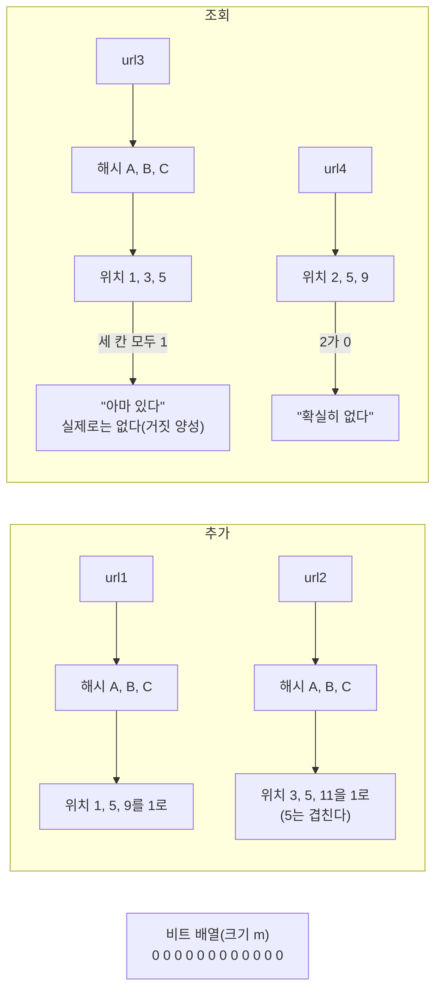

> ByteByteGo의 System Design 101 가이드 「[10 Key Data Structures We Use Every Day](https://bytebytego.com/guides/10-key-data-structures-we-use-every-day)」, 「[Algorithms for System Design Interviews](https://bytebytego.com/guides/algorithms-you-should-know-before-taking-system-design-interviews)」, 「[The 9 Algorithms That Dominate Our World](https://bytebytego.com/guides/the-9-algorithms-that-dominate-our-world)」, 「[How to Avoid Crawling Duplicate URLs at Google Scale?](https://bytebytego.com/guides/how-to-avoid-crawling-duplicate-urls-at-google-scale)」를 바탕으로 재구성한 노트다.
> 블룸 필터의 거짓 음성이 없는 이유와 거짓 양성률 식은 fru1tworld/cs-basic 모의 면접 질문 목록의 「[자료구조](https://github.com/fru1tworld/cs-basic/blob/main/interview/cs/ds.md)」 질문이 묻는 개념으로 보강했다.
> 단일 해시 비트맵과의 비교, 디스크 읽기를 줄이는 쓰임과 LSM 트리와의 관계는 강대명의 발표 자료 「알아도 도움안되는 얕은 개발 지식들」을 바탕으로 더했다.
> 시스템 설계 알고리즘 목록은 GitHub 저장소 「[system-design-algorithms](https://github.com/resumejob/system-design-algorithms)」의 목록(Lossy Counting, Frugal Streaming, S2, 레이 캐스팅, 타이밍 휠, 펜윅 트리, AMS 등)을 더해 분야별로 다시 묶었다. rsync 절은 Tridgell·Mackerras의 기술 보고서 「[The rsync algorithm](https://rsync.samba.org/tech_report/)」(1996)과 rsync 매뉴얼로 확인했다.

알고리즘 공부는 구현에 치우치기 쉽다. 시스템을 설계할 때는 「이 알고리즘이 실제 시스템의 어느 문제를 푸는가」를 아는 것이 구현 세부보다 중요하다. 그래서 자료구조와 알고리즘을 쓰임새 중심으로 묶어 본다.

## 일상 속 자료구조

| 자료구조 | 쓰이는 곳 | 왜 그것인가 |
| --- | --- | --- |
| 리스트 | SNS 피드 | 순서대로 이어 붙이고 훑는다 |
| 배열 | 수학 연산, 이미지 픽셀 | 인덱스로 즉시 접근, 메모리에 연속 배치 |
| 스택 | 편집기의 실행 취소·다시 실행 | 마지막에 한 것을 먼저 되돌린다([[stack\|스택]]) |
| 큐 | 프린터 작업, 게임의 사용자 입력 전송 | 들어온 순서대로 처리한다([[queue-deque\|큐와 덱]]) |
| 해시 테이블 | 캐시 시스템 | 키로 평균 O(1) 조회 |
| 힙 | 작업 스케줄링 | 우선순위가 가장 높은 것을 빨리 꺼낸다([[heap-priority-queue\|힙과 우선순위 큐]]) |
| 트리 | HTML 문서(DOM), AI의 결정 트리 | 계층 구조를 표현한다([[tree\|트리와 이진 탐색 트리]]) |
| 접미사 트리 | 문서 안 문자열 검색 | 모든 접미사를 미리 색인해 부분 문자열을 빠르게 찾는다 |
| 그래프 | 친구 관계, 길 찾기 | 관계와 연결을 표현한다([[graph-basics\|그래프의 기본]]) |
| R-트리 | 가까운 장소 찾기 | 공간을 겹치는 사각형으로 나눠 위치 범위 질의를 빠르게 한다 |
| 버텍스 버퍼 | GPU 렌더링 | 정점 데이터를 GPU 메모리에 한 번에 보낸다 |

기초 자료구조의 구현은 [[data-structures|기초 자료구조]]에 있다.

## 시스템 설계에 자주 나오는 알고리즘

설계 문제마다 반복해서 나오는 알고리즘과 자료구조를 푸는 문제별로 묶었다. 각 행의 마지막 칸이 자세한 설명이 있는 노트다.

### 분산과 복제

| 알고리즘 | 푸는 문제 | 핵심 아이디어 | 쓰이는 곳 |
| --- | --- | --- | --- |
| **일관된 해싱(Consistent Hashing)** | 노드가 늘거나 줄 때 다시 옮길 키를 줄인다 | 키와 노드를 같은 해시 링에 올리고, 키를 시계 방향으로 처음 만나는 노드에 둔다. 노드가 바뀌면 이웃 구간의 키만 옮겨진다. 가상 노드로 쏠림을 줄인다 | Dynamo·Cassandra 파티셔닝, 분산 캐시([[database-sharding\|데이터베이스 샤딩]], [[classic-distributed-systems\|고전 분산 시스템 설계]]) |
| **머클 트리(Merkle Tree)** | 두 복제본에서 다른 부분만 빨리 찾는다 | 데이터 블록의 해시를 잎에, 자식 해시들의 해시를 부모에 둔다. 루트가 같으면 전체가 같고, 다르면 다른 가지로만 내려간다 | 복제본 비교(anti-entropy), Git, 블록체인([[classic-distributed-systems\|고전 분산 시스템 설계]]) |
| Raft·Paxos | 여러 노드가 하나의 값에 합의한다 | 과반수가 동의한 값만 확정한다. 노드가 일부 죽어도 과반이 살아 있으면 진행한다 | 리더 선출, etcd(Raft), ZooKeeper(Zab, Paxos와 다른 원자적 브로드캐스트) |
| 2단계 커밋(2PC) | 여러 DB에 걸친 트랜잭션을 모두 커밋하거나 모두 취소한다 | 준비 단계에서 참여자 전원이 「커밋할 수 있다」고 답해야 커밋을 지시한다. 조정자가 멈추면 참여자가 잠금을 쥔 채 기다린다 | 분산 트랜잭션, XA([[transaction\|트랜잭션]]의 2PC와 사가) |
| 지수 백오프와 지터 | 실패한 요청을 다시 보낼 때 상대를 더 무너뜨리지 않는다 | 재시도 간격을 2배씩 늘리고 무작위로 흩어, 실패한 클라이언트들이 동시에 다시 몰리지 않게 한다 | 클라이언트 재시도, 재연결([[resiliency-patterns\|장애 확산을 막는 복원력 패턴]]) |

### 저장과 색인

| 알고리즘·자료구조 | 푸는 문제 | 핵심 아이디어 | 쓰이는 곳 |
| --- | --- | --- | --- |
| B-트리(B+트리) | 디스크에 있는 대량의 키를 적은 읽기로 찾는다 | 한 노드(디스크 페이지)에 키를 수백 개 담아 트리 높이를 3~4로 낮춘 균형 트리 | 관계형 DB 인덱스, 파일 시스템([[database-internals\|DB 내부 구조]]) |
| LSM 트리와 SSTable | 쓰기가 아주 많은 저장소 | 쓰기를 메모리(memtable)에 모았다가 정렬된 불변 파일(SSTable)로 내리고, 뒤에서 파일을 병합(compaction)한다 | Cassandra, RocksDB, Bigtable([[database-internals\|DB 내부 구조]]) |
| 스킵 리스트(Skip List) | 정렬된 집합에서 빠른 탐색·삽입 | 정렬된 연결 리스트 위에 확률적으로 층을 쌓아, 위층에서 크게 건너뛰고 아래층에서 좁힌다. 평균 O(log n) | Redis Sorted Set, LevelDB·RocksDB의 memtable([[data-structures\|기초 자료구조]], [[redis\|Redis]]) |
| 역색인(Inverted Index) | 단어로 문서를 찾는다 | 문서 → 단어가 아니라 단어 → 그 단어가 든 문서 목록(포스팅 리스트)을 미리 만든다 | 검색 엔진, Lucene·Elasticsearch([[search-engine-basics\|검색엔진의 원리]]) |
| 트라이(Trie) | 접두사로 문자열을 찾는다 | 문자열을 글자 단위 경로로 저장해 접두사가 같은 문자열을 한 가지에 모은다 | 검색어 자동 완성, 맞춤법 검사, IP 라우팅의 최장 접두사 일치([[data-structures\|기초 자료구조]]) |
| LRU·LFU 캐시 교체 | 캐시가 찼을 때 무엇을 버릴지 정한다 | LRU는 해시 맵과 이중 연결 리스트로 가장 오래 안 쓴 항목을 O(1)에 찾는다. LFU는 사용 횟수가 가장 적은 것을 버린다 | 캐시 서버, 브라우저·OS 캐시([[caching-strategies\|캐시 전략]]) |

### 확률적 자료구조와 스트림 근사

정확한 답 대신 아주 적은 메모리로 근사하는 자료구조다. 오차의 크기와 방향을 미리 정할 수 있다.

| 알고리즘 | 푸는 문제 | 핵심 아이디어 | 쓰이는 곳 |
| --- | --- | --- | --- |
| **블룸 필터(Bloom Filter)** | 원소가 집합에 「확실히 없다」를 적은 메모리로 판정한다 | 해시 k개가 가리키는 비트를 세운다. 한 칸이라도 0이면 없다(아래 절) | 크롤러의 중복 URL, LSM 트리의 불필요한 디스크 읽기 줄이기 |
| HyperLogLog | 서로 다른 원소의 개수를 근사한다 | 해시의 앞쪽 0 길이를 레지스터마다 최댓값으로 남기고 조화 평균으로 추정한다. Redis는 12 KB로 오차 0.81% | 고유 방문자 수([[streaming-sketches\|스트림 근사 집계]]) |
| Count-Min Sketch | 키별 빈도를 근사한다 | 행마다 다른 해시로 카운터를 올리고, 질의할 때 행들의 최솟값을 답한다. 과대 추정만 있다 | 실시간 인기 검색어, 상위 K개([[streaming-sketches\|스트림 근사 집계]]) |
| Lossy Counting | 빈도가 임계값을 넘는 원소를 찾는다 | 스트림을 너비 1/ε의 버킷으로 나누고, 버킷 경계마다 드문 원소를 지운다. 거짓 음성이 없다 | 인기 항목, 남용 키 탐지([[streaming-sketches\|스트림 근사 집계]]) |
| Frugal Streaming | 그룹이 아주 많을 때 그룹별 분위수를 추정한다 | 그룹마다 추정값 하나만 두고, 새 값이 크면 확률 q로 올리고 작으면 확률 1−q로 내린다 | 키별 응답 시간 중앙값([[streaming-sketches\|스트림 근사 집계]]) |
| AMS | 빈도 분포의 쏠림(빈도 제곱합 F2)을 근사한다 | 원소마다 ±1을 주는 해시로 합계를 쌓고, 그 제곱의 평균이 F2가 되는 성질을 쓴다 | 조인 크기 추정, 쏠림 감지([[streaming-sketches\|스트림 근사 집계]]) |

### 공간 데이터

| 알고리즘·자료구조 | 푸는 문제 | 핵심 아이디어 | 쓰이는 곳 |
| --- | --- | --- | --- |
| **지오해시(Geohash)** | 「근처에 무엇이 있나」를 일반 DB 인덱스로 찾는다 | 경도와 위도를 번갈아 반씩 나눈 비트를 섞어 Base32 문자열로 만든다. 접두사가 같으면 가깝다 | 주변 가게 찾기([[location-based-service\|위치 기반 서비스 설계]]) |
| S2 Geometry | 구면 위의 영역을 셀로 나눠 색인한다 | 지구를 정육면체 여섯 면에 투영하고 면마다 사분할한 셀에 힐베르트 곡선 순서로 64비트 ID를 매긴다. 가까운 셀은 ID도 가깝다 | 지오펜싱, 영역 덮기(region covering)([[location-based-service\|위치 기반 서비스 설계]]) |
| **쿼드트리(Quadtree)** | 밀도가 고르지 않은 점들을 범위 검색한다 | 점이 기준보다 많은 칸만 네 칸으로 쪼개는 트리 | 차량 호출, 주변 검색([[location-based-service\|위치 기반 서비스 설계]]) |
| R-트리 | 점뿐 아니라 선·다각형까지 범위 검색한다 | 가까운 객체들을 감싸는 최소 경계 사각형(MBR)을 겹쳐도 되게 계층으로 묶는다 | PostGIS 공간 인덱스, 지도 검색([[database-internals\|DB 내부 구조]]의 공간 인덱스) |
| 레이 캐스팅(Ray Casting) | 점이 다각형 안에 있는지 판정한다 | 점에서 한 방향으로 반직선을 쏴 경계와 만나는 횟수가 홀수면 안, 짝수면 밖 | 배달 가능 구역, 지오펜싱([[location-based-service\|위치 기반 서비스 설계]]) |

### 트래픽과 시간

| 알고리즘 | 푸는 문제 | 핵심 아이디어 | 쓰이는 곳 |
| --- | --- | --- | --- |
| 토큰 버킷·누출 버킷 | 요청 속도를 제한한다 | 토큰 버킷은 일정 속도로 차는 토큰을 요청마다 써서 순간 몰림을 허용하고, 누출 버킷은 큐에서 일정 속도로만 내보내 흐름을 평탄하게 한다 | API 속도 제한([[api-security\|API 보안 체크리스트]], [[resiliency-patterns\|장애 확산을 막는 복원력 패턴]]) |
| 해시·계층적 타이밍 휠(Timing Wheels) | 수많은 타이머를 싸게 관리한다 | 원형 배열의 칸마다 그 시각에 만료될 타이머 목록을 둔다. 해시 휠은 칸 수보다 먼 타이머에 바퀴 수를 적고, 계층적 휠은 큰 단위 휠에서 작은 단위 휠로 옮겨 담는다. 시작·중지가 O(1)이다 | Kafka의 요청 대기(purgatory, 계층적), Netty `HashedWheelTimer`(해시)([[time-and-timers\|운영체제의 시간과 타이머]]) |

### 동기화와 협업

| 알고리즘 | 푸는 문제 | 핵심 아이디어 | 쓰이는 곳 |
| --- | --- | --- | --- |
| rsync 알고리즘 | 이미 비슷한 파일이 있는 쪽에 바뀐 부분만 보낸다 | 받는 쪽 블록의 체크섬을 보내 주면, 보내는 쪽이 롤링 체크섬으로 모든 위치를 훑어 같은 블록을 찾는다(아래 절) | 파일 동기화·백업 |
| 운영 변환(OT)·CRDT | 동시에 일어난 편집을 충돌 없이 합친다 | OT는 남의 연산에 맞춰 내 연산의 위치를 변환하고, CRDT는 어떤 순서로 합쳐도 같은 결과가 나오는 자료구조를 쓴다 | 공동 문서 편집([[collaborative-editing\|실시간 공동 편집]]) |

### 범위 질의

| 자료구조 | 푸는 문제 | 핵심 아이디어 | 쓰이는 곳 |
| --- | --- | --- | --- |
| 펜윅 트리(Fenwick Tree, BIT) | 값이 바뀌는 배열에서 접두사 합을 빨리 구한다 | 인덱스 i의 칸에 최하위 1비트(`i & -i`)만큼의 구간 합을 저장해 갱신과 질의를 모두 O(log n)에, 배열 하나로 한다 | 점수별 인원으로 순위 구하기, 누적 집계([[segment-tree\|세그먼트 트리]]) |

이 중 일관된 해싱, 블룸 필터, 지오해시·쿼드트리처럼 여러 설계 문제에 반복해서 나오는 것을 먼저 이해한다. 합의 알고리즘이나 CRDT는 원리를 알아 두면 되고, 스트림 근사 알고리즘은 「정확도를 조금 내주고 메모리를 크게 아끼는」 선택지가 있다는 것을 기억한다.

## 블룸 필터: 중복 URL 걸러 내기

블룸 필터는 「이 원소가 집합에 있는가」를 묻는 **멤버십 질의**(membership query)에 답하는 **확률적 자료구조**(probabilistic data structure)다. 「없다」고 하면 정말 없고, 「있다」고 하면 없을 수도 있다. 이 성질은 비싼 확인을 건너뛸 때 쓸모 있다. 메모리 접근(약 100ns)은 SSD 임의 읽기(수십~수백 µs)보다 1,000배 안팎 빠르므로, 메모리의 작은 필터가 「없다」고 하면 디스크를 읽지 않아도 된다.

웹 크롤러는 수십억 개의 URL 중 이미 본 것을 다시 넣지 않아야 한다. 선택지는 넷이다.

| 방법 | 장점 | 단점 |
| --- | --- | --- |
| 메모리의 집합(Set) | 빠르고 정확하다 | URL 전체를 저장해 메모리가 감당이 안 된다 |
| DB에 저장하고 조회 | 정확하다 | 조회마다 DB 부하가 크다 |
| 해시 하나 + 비트맵 | 해시값 자리의 비트 하나만 본다. 비트가 0이면 확실히 없다 | 해시값을 그대로 자리로 쓰면 크기가 해시 범위로 고정된다. CRC16이면 2^16비트(8KB)지만 충돌이 잦고, CRC32면 2^32비트(512MB)를 원소 수와 상관없이 늘 차지한다. `h(x) % m`으로 크기를 줄일 수는 있지만, 그러면 해시가 1개(k = 1)인 블룸 필터가 된다 |
| **블룸 필터** | 비트 배열만 써서 메모리가 매우 적고 빠르다 | 가끔 "있다"고 잘못 답한다 |



- **거짓 음성은 없고 거짓 양성만 있다.** 비트는 0에서 1로 세우기만 하고 되돌리지 않으므로, 한 번 넣은 원소의 k칸은 언제까지나 1이다. 그래서 "없다"(어느 한 칸이 0)는 답은 항상 맞다. 반대로 "있다"는 다른 원소들이 세운 비트가 우연히 k칸을 모두 덮었을 때도 나오므로 틀릴 수 있다. 크롤러가 새 URL을 가끔 놓치는 것은 감수할 수 있으므로 잘 맞는다.
- 거짓 양성률은 비트 배열 크기 m, 해시 함수 개수 k, 넣은 원소 수 n으로 정해진다. 근사식은 p ≈ (1 - e^(-kn/m))^k이고, 가장 낮아지는 k는 (m/n)·ln 2다. 이때 원소당 약 9.6비트면 1%, 14.4비트면 0.1%다. 원소가 기대보다 많이 들어오면 비율이 급격히 나빠지므로 기대 원소 수에 맞춰 크기를 미리 잡는다.
- 해시를 k개 쓰는 이유는 충돌이 한 해시에서 나도 k개 모두에서 동시에 나기는 어렵기 때문이다. 크기 m은 해시가 하나여도 `% m`으로 정할 수 있으므로, 블룸 필터의 이점은 같은 메모리(m)와 원소 수(n)에서 k를 최적값으로 골라 거짓 양성률을 낮추는 데 있다.
- 해시 함수는 고르게 퍼지고 빨라야 한다. 암호 해시 대신 MurmurHash, xxHash 같은 비암호 해시를 쓴다.
- 기본 블룸 필터는 원소를 지울 수 없다. 지우려고 비트를 0으로 되돌리면 그 비트를 함께 쓰던 다른 원소가 "없다"로 나와 거짓 음성이 생긴다. 삭제가 필요하면 칸마다 비트 대신 카운터를 두는 카운팅 블룸 필터나 쿠쿠 필터를 쓴다.
- 삭제가 안 되는 제약은 **LSM 트리**와 잘 맞는다. Cassandra·HBase·RocksDB는 한 번 쓰면 바꾸지 않는 SSTable 파일마다 블룸 필터를 만들어 두고, 키를 찾을 때 「없다」고 답한 파일은 디스크에서 읽지 않는다. 파일이 병합되면 필터도 새로 만든다([[database-internals|DB 내부 구조]]의 B-트리와 LSM 트리). MySQL(InnoDB)은 행을 클러스터드 B-트리에 두고 제자리에서 고치고, PostgreSQL은 행을 힙 테이블에 두고 고칠 때마다 새 행 버전을 쌓으며 B-트리 인덱스를 따로 둔다. 어느 쪽이든 키 하나는 인덱스를 따라 한 곳에서 찾으므로, 여러 파일을 뒤져야 하는 LSM 트리와 달리 블룸 필터가 기본 구성 요소로 들어가지 않는다. PostgreSQL은 여러 열의 동등 조건을 거르는 `bloom` 확장 인덱스를 따로 제공한다.
- 그 밖의 쓰임: 없는 키 요청이 DB까지 가지 않게 막는 캐시 앞단([[caching-strategies|캐시 전략]]의 캐시 관통), 크롤러의 방문 여부 확인, 이미 본 추천 항목 거르기. Redis 8은 블룸 필터를 기본 자료형으로 제공한다([[redis|Redis]]).

크롤러 전체 설계에서 블룸 필터가 놓이는 자리는 [[web-crawler-at-scale|대규모 웹 크롤러 설계]]에 있다.

## rsync: 바뀐 블록만 보내기

서버 A에 새 파일이, 서버 B에 그 파일의 옛 버전이 있을 때 파일 전체를 보내지 않고 차이만 보내는 알고리즘이다(Tridgell·Mackerras, 1996). 어느 쪽도 상대 파일을 미리 갖고 있지 않다는 점이 핵심이다.

1. **B(옛 파일)**가 파일을 크기 S의 겹치지 않는 블록으로 나누고, 블록마다 약한 체크섬(32비트 롤링 체크섬)과 강한 체크섬을 계산해 A에 보낸다.
2. **A(새 파일)**는 약한 체크섬을 해시 테이블에 넣고, 새 파일의 **모든 바이트 위치**에서 길이 S짜리 창의 약한 체크섬을 구해 표를 찾는다.
3. 약한 체크섬이 맞으면 강한 체크섬으로 확인한다. 같으면 「B의 n번 블록」이라는 참조만 보내고 창을 S만큼 건너뛴다. 아니면 한 바이트를 그대로 보낼 데이터로 넘기고 창을 한 칸 민다.
4. B는 참조와 원본 데이터를 이어 붙여 새 파일을 만든다.

모든 위치를 훑어도 빠른 이유는 **롤링 체크섬**에 있다. 창을 한 바이트 밀 때 빠지는 바이트와 들어오는 바이트만으로 새 체크섬을 O(1)에 계산한다.

```python
M = 1 << 16

def weak(block):
    a = sum(block) % M
    b = sum((len(block) - i) * x for i, x in enumerate(block)) % M
    return a, b

def roll(a, b, out_byte, in_byte, size):
    a = (a - out_byte + in_byte) % M
    b = (b - size * out_byte + a) % M
    return a, b
```

- 앞부분에 몇 바이트를 끼워 넣어도 뒤의 블록은 위치만 밀렸을 뿐이라 롤링 검색이 다시 찾아낸다. 블록 경계를 고정 위치로만 비교하면 끼워 넣기 한 번에 뒤의 모든 블록이 달라 보인다.
- 블록 크기는 파일 크기에 따라 정한다. 작으면 차이를 정밀하게 잡지만 체크섬 목록이 길어진다.
- 강한 체크섬은 원래 MD4였다. rsync 3.2.0(2020.06)부터는 양쪽이 지원하는 것 중 가장 강한 것을 협상하며, 목록에 xxh128·xxh3·xxh64·MD5·MD4·SHA-1이 있다.
- 백업 도구(restic, Borg)의 내용 기반 분할(content-defined chunking)도 롤링 해시를 쓴다. 고정 크기 대신 롤링 해시값이 특정 조건을 만족하는 지점에서 파일을 자르므로, 끼워 넣기가 앞뒤 몇 조각에만 영향을 준다.

## 세상을 움직이는 아홉 가지 알고리즘

검색 엔진, SNS, Wi-Fi, 휴대폰, 위성까지 일상 기술 밑에는 다음 알고리즘이 있다.

| 알고리즘 | 하는 일 | 쓰이는 곳 |
| --- | --- | --- |
| 정렬 | 데이터를 순서대로 놓는다 | 검색 결과, 데이터베이스, 거의 모든 곳([[merge-quick-sort\|병합 정렬과 퀵 정렬]]) |
| 다익스트라 | 그래프에서 최단 경로를 찾는다 | 지도 길 찾기, 네트워크 라우팅([[dijkstra\|다익스트라 최단 경로]]) |
| 트랜스포머 | 어텐션으로 시퀀스의 관계를 학습한다 | 대규모 언어 모델, 번역 |
| 링크 분석(PageRank) | 링크 구조로 페이지의 중요도를 매긴다 | 검색 순위 |
| RSA | 공개키로 암호화하고 개인키로 푼다 | HTTPS 인증서 서명([[encoding-encryption-hashing\|인코딩·암호화·해시]]). TLS 1.3은 RSA 키 교환을 없애고 키 교환을 (EC)DHE로만 한다 |
| 정수 인수분해 | 큰 수를 소인수로 나눈다. 어렵다는 사실 자체가 RSA의 안전 근거다 | 암호학 |
| 합성곱 신경망(CNN) | 이미지의 지역 패턴을 학습한다 | 이미지 인식, 얼굴 인식 |
| 허프만 부호화 | 자주 나오는 기호에 짧은 부호를 준다 | 압축(ZIP, JPEG, PNG의 일부 단계) |
| 보안 해시(SHA) | 임의 데이터를 고정 길이 지문으로 만든다 | 무결성 검사, 디지털 서명, Git, 블록체인 |

## 정리

- 자료구조는 쓰임새로 기억한다. 실행 취소는 스택, 캐시는 해시 테이블, 스케줄링은 힙, 위치 검색은 R-트리다.
- 대규모 시스템의 단골 알고리즘은 분산·복제(일관된 해싱, 머클 트리, 합의, 2PC), 저장·색인(B-트리, LSM, 스킵 리스트, 역색인, 트라이), 근사 집계(블룸 필터, HyperLogLog, Count-Min, Lossy Counting), 공간(지오해시, S2, 쿼드트리, R-트리, 레이 캐스팅), 트래픽·시간(토큰 버킷, 타이밍 휠), 동기화(rsync, OT·CRDT)로 묶인다.
- rsync는 받는 쪽 블록의 체크섬을 보내고, 보내는 쪽이 롤링 체크섬으로 모든 위치를 훑어 같은 블록을 찾는다. 끼워 넣기가 있어도 뒤 블록을 다시 찾는다.
- 블룸 필터는 "확실히 없다"를 싸게 판정한다. 거짓 양성을 감수할 수 있는 곳에 쓴다.
- 설계에서는 구현보다 어떤 문제를 어떤 대가로 푸는지를 설명할 수 있어야 한다.

관련 노트: [[data-structures|기초 자료구조]], [[web-crawler-at-scale|대규모 웹 크롤러 설계]], [[database-sharding|데이터베이스 샤딩]], [[system-design-choices|시스템 설계의 선택지와 흔한 문제의 해법]], [[big-o|빅오 표기법과 시간 복잡도]], [[data-compression|데이터 압축: 무손실과 손실]], [[trending-topics|실시간 트렌딩과 Top-K 집계]], [[javascript-algorithms-overview|JavaScript Algorithms 학습 지도]], [[streaming-sketches|스트림 근사 집계]], [[location-based-service|위치 기반 서비스 설계]], [[collaborative-editing|실시간 공동 편집]]
