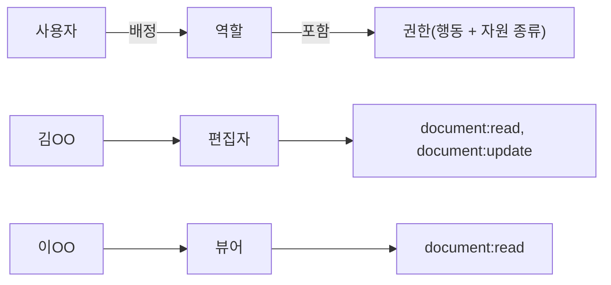

> ByteByteGo의 System Design 101 가이드 「[Designing a Permission System](https://bytebytego.com/guides/how-do-we-design-a-permission-system)」을 바탕으로 재구성한 노트다.

## 권한 시스템이란

인가(authorization)는 인증된 사용자가 **어떤 자원(resource)에 어떤 행동(action)을 할 수 있나**를 정한다. 모든 권한 판단은 결국 이 질문이다.

```text
허용?( 주체(subject), 행동(action), 자원(resource), [환경(context)] )
예: 허용?( 김OO, 수정, 문서#42, [사내망, 업무 시간] )
```

모델은 이 질문에 답하는 **규칙을 어디에, 어떤 단위로 적어 두느냐**의 차이다. 인가 로직을 코드 어디에 두는지는 [[auth-placement|인증·인가 로직은 어디에 두나]]에 있다.

## 모델 비교

| 모델 | 규칙의 단위 | 장점 | 단점 | 예 |
| --- | --- | --- | --- | --- |
| ACL(Access Control List) | 자원마다 "누가 무엇을 할 수 있나" 목록 | 이해하기 쉽다 | 자원·사용자가 늘면 목록이 폭발한다. 빠뜨리기 쉽고 관리 비용이 크다 | 파일·버킷 ACL, 네트워크 ACL |
| DAC(Discretionary) | 자원 소유자가 ACL을 직접 정한다 | 쉽고 유연하다 | 권한 관리가 흩어지고 소유자 권한이 너무 크다 | 리눅스 파일 권한 `rwx` |
| MAC(Mandatory) | 주체와 자원에 등급 라벨, 시스템이 강제 | 엄격하고 단순하다 | 유연하지 않다 | 군·정부 기밀 등급, SELinux |
| **RBAC(Role-Based)** | 권한을 역할에 묶고 사용자에게 역할을 준다 | 역할 배정만으로 관리. 감사하기 쉽다 | 예외가 늘면 역할이 폭발한다 | 관리자·편집자·뷰어 |
| ABAC(Attribute-Based) | 주체·행동·자원·환경 속성에 대한 조건식 | 가장 유연하다 | 규칙이 복잡해지고 디버깅이 어렵다 | "같은 부서 + 업무 시간 + 기밀 아님" |
| ReBAC(Relationship-Based) | 주체와 자원 사이의 관계 그래프 | 공유·소유·조직 계층을 자연스럽게 표현 | 별도 권한 저장소와 그래프 탐색이 필요하다 | "문서의 폴더의 편집자는 문서 편집 가능" |

DAC와 MAC의 운영체제 쪽 구현은 [[linux-access-control|리눅스 접근 제어: DAC, MAC, sudo]]에 있다.

## RBAC

대부분의 서비스가 출발점으로 삼는 모델이다.



| 테이블 | 내용 |
| --- | --- |
| `users` | 사용자 |
| `roles` | 역할(관리자, 편집자, 뷰어) |
| `permissions` | 행동 + 자원 종류(`document:update`) |
| `user_roles` | 사용자 ↔ 역할 (조직·프로젝트 범위를 함께 두면 "프로젝트 A의 편집자") |
| `role_permissions` | 역할 ↔ 권한 |

- 코드에서는 역할 이름(`if role == 'admin'`)이 아니라 **권한**(`can('document:update')`)으로 검사한다. 역할 구성이 바뀌어도 코드는 그대로다.
- 역할 계층(관리자 ⊃ 편집자 ⊃ 뷰어)을 두면 중복이 준다.
- **역할 폭발**: "서울 지사의 금요일만 편집 가능한 계약직 편집자" 같은 예외마다 역할을 만들면 역할 수가 사용자 수에 가까워진다. 이때 속성 조건(ABAC)이나 관계(ReBAC)를 더한다.

## ABAC와 ReBAC

**ABAC**는 규칙을 조건식으로 쓴다.

```text
허용 if  subject.department == resource.department
     and resource.classification != "기밀"
     and context.time in 업무시간
```

정책을 코드에서 떼어 정책 엔진(OPA의 Rego, AWS Cedar 등)에 두면 서비스 코드는 "허용?"만 묻고, 정책은 따로 버전 관리·테스트한다.

**ReBAC**는 "누가 무엇과 어떤 관계인가"를 튜플로 저장하고 그래프를 따라가 판단한다. 구글 문서 공유처럼 "폴더 편집자는 그 안 문서도 편집", "팀 멤버는 팀 자원 읽기"가 많은 서비스에 맞다. Google Zanzibar 논문과 이를 따른 OpenFGA·SpiceDB가 대표 구현이다.

## 설계 원칙

- **기본은 거부**한다. 명시적으로 허용된 것만 통과한다.
- **최소 권한**: 필요한 만큼만, 가능하면 기한을 두고 준다.
- **직무 분리**: 결제 요청자와 승인자처럼 한 사람이 둘 다 하면 안 되는 권한은 나눈다.
- 권한 변경과 거부 이벤트를 감사 로그로 남긴다.
- 목록 조회에도 권한을 적용한다. 단건 조회만 막고 목록 API에서 남의 데이터가 섞여 나오는 실수가 흔하다.

## 정리

- 모든 인가는 "주체가 자원에 행동을 해도 되나"이고, 모델은 그 규칙을 적는 단위의 차이다.
- ACL·DAC는 단순하지만 흩어지고, MAC는 엄격하지만 경직된다.
- 대부분 RBAC로 시작하고, 역할이 폭발하면 ABAC(속성)나 ReBAC(관계)를 더한다.
- 코드는 역할이 아니라 권한으로 검사하고, 기본 거부·최소 권한을 지킨다.

관련 노트: [[auth-placement|인증·인가 로직은 어디에 두나: 필터, 인터셉터, API 게이트웨이]], [[linux-access-control|리눅스 접근 제어: DAC, MAC, sudo]], [[secure-system-design|보안 시스템 설계: 원칙과 민감 데이터 관리]], [[oauth2|OAuth 2.0]], [[security|정보 시스템 보안]]
