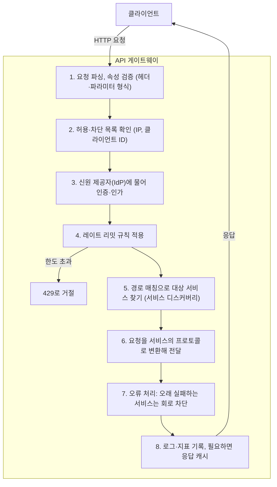
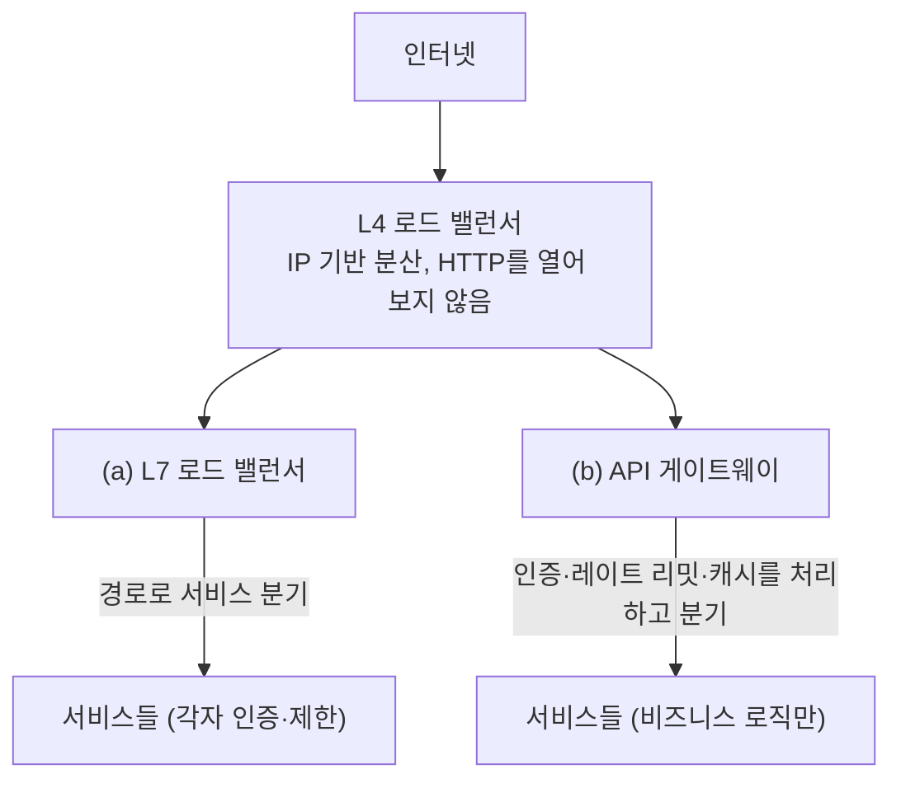

> ByteByteGo의 System Design 101 가이드 「[API Gateway 101](https://bytebytego.com/guides/api-gateway-101)」, 「[What Does an API Gateway Do?](https://bytebytego.com/guides/what-does-api-gateway-do)」, 「[Top 3 API Gateway Use Cases](https://bytebytego.com/guides/top-3-api-gateway-use-cases)」, 「[Load Balancer vs. API Gateway](https://bytebytego.com/guides/what-are-the-differences-between-a-load-balancer-and-an-api-gateway)」, 「[Reverse Proxy vs. API Gateway vs. Load Balancer](https://bytebytego.com/guides/reverse-proxy-vs-api-gateway-vs-load-balancer)」를 바탕으로 재구성한 노트다. 서비스 메시·공통 라이브러리와의 비교는 「fru1tworld/cs-basic 모의 면접 질문 목록」이 묻는 개념을 채워 넣었다. 외부·내부 게이트웨이 분리와 대용량 전송, 오케스트레이션을 빼는 이유는 「[documents.docker.co.kr](https://github.com/remotty/documents.docker.co.kr)」에 모인 2016 OpenContainer Korea 발표 「MSA, Docker and Kubernetes」로 보강했다.

## API 게이트웨이란

API 게이트웨이(API gateway)는 **클라이언트의 API 요청을 받는 앞단 서버**다. 요청을 받아 보안·제한 정책을 적용하고, 알맞은 백엔드 서비스로 넘긴 뒤, 결과를 클라이언트에 돌려준다. 서비스가 여러 개로 쪼개진 마이크로서비스 구조에서 **클라이언트가 서비스마다 주소를 알 필요 없게 하는 단일 진입점**이다.

모든 요청이 지나가는 자리라서, 서비스마다 반복해야 할 공통 관심사(인증, 레이트 리밋, 로깅)를 한곳에 모을 수 있다.

## 기능

| 기능 | 설명 |
| --- | --- |
| 요청 라우팅 | 경로·헤더를 보고 맞는 백엔드 서비스로 보낸다 |
| 인증·인가 | 토큰을 검증하고 신원 정보를 뒤 서비스로 넘긴다. 세부 배치는 [[auth-placement\|인증·인가 로직은 어디에 두나]] |
| 레이트 리밋·스로틀링 | 클라이언트별로 일정 시간에 보낼 수 있는 요청 수를 제한한다 |
| 요청 검증·차단 | 형식이 틀린 요청, 허용·차단 목록(allow/deny list)에 걸린 요청을 앞에서 거른다 |
| 프로토콜 변환 | 외부의 REST+JSON을 내부의 gRPC 등으로 바꿔 보낸다 |
| 응답 조합(API composition) | 여러 백엔드 호출 결과를 하나의 응답으로 합친다 |
| 캐시 | 자주 오는 요청의 응답을 잠시 저장해 뒤 서비스를 덜 부른다 |
| 장애 처리 | 타임아웃, 재시도, 회로 차단기(circuit breaker)로 느린 서비스가 전체를 끌어내리지 않게 한다 |
| 관측 | 모든 요청의 로그·지표를 모은다 |
| 로드 밸런싱 | 같은 서비스의 인스턴스 여러 개에 나눠 보낸다 |

## 요청 하나가 지나는 순서

앞의 검사들은 **싼 것부터, 그리고 거절할 수 있는 것부터** 둔다. 형식이 틀린 요청에 인증 서버를 부를 필요는 없다.

## 쓰임

| 쓰임 | 설명 |
| --- | --- |
| 마이크로서비스의 입구 | 내부 서비스 구조를 숨기고, 서비스가 쪼개지거나 합쳐져도 외부 주소는 유지한다 |
| 생태계 구축 | 파트너가 게이트웨이를 통해 자사 기능에 붙어 함께 통합 기능을 만든다 |
| API 마켓플레이스 | 기본 기능을 API 상품으로 공개하고, 개발자가 이를 조합하거나 자기 API를 올려 판매한다. 키 발급, 요금제별 한도, 사용량 집계를 게이트웨이가 맡는다 |
| 다중 플랫폼 호환 | 웹·모바일·외부 파트너처럼 요구가 다른 클라이언트와 복잡한 내부 구조 사이에서 변환층 역할을 한다 |

## 리버스 프록시, 로드 밸런서와의 차이

세 가지 모두 클라이언트와 서버 사이에 서므로 기능이 겹친다. **무엇을 주된 목적으로 두느냐**로 구분한다.

| 구분 | 리버스 프록시 | 로드 밸런서 | API 게이트웨이 |
| --- | --- | --- | --- |
| 비유 | 대리인: 서버 대신 나선다 | 교통 경찰: 고르게 나눈다 | 우체국: 맞는 곳으로 배달한다 |
| 주된 목적 | 서버를 숨기고 보호, TLS 종료, 캐시 | 같은 서버 여러 대에 트래픽 분산, 장애 서버 우회 | 여러 서비스로 가는 API 요청의 라우팅과 정책 |
| 보는 단위 | HTTP 요청 | 연결(L4) 또는 HTTP 요청(L7) | API 호출과 그 호출자(클라이언트, 키, 사용자) |
| 고유 기능 | 정적 자원 서빙, 압축 | 헬스 체크, 분산 알고리즘 | 인증, 클라이언트별 레이트 리밋, 요청 변환, 응답 조합, API 키·요금제 |
| 예 | Nginx | AWS NLB·ALB, HAProxy | Kong, AWS API Gateway, Apigee |

로드 밸런서는 [[load-balancer|로드 밸런서]], 리버스 프록시는 [[proxy|프록시]]에 따로 정리했다. 하나의 제품이 셋을 겸하기도 한다. Nginx나 Envoy는 설정에 따라 세 역할을 모두 한다.

### 서비스 메시, 공통 라이브러리와의 차이

**서비스 메시(service mesh)** 는 서비스와 서비스 사이(east-west) 통신을 맡는 인프라 계층이다. 각 서비스 옆의 프록시(Envoy 같은 사이드카, 또는 Istio 앰비언트 모드처럼 노드 단위 프록시)가 **데이터 평면**으로 트래픽을 대신 주고받고, **제어 평면**(Istio의 istiod 등)이 라우팅 규칙·인증서·정책을 내려 준다. 애플리케이션 코드는 그대로 두고 mTLS, 재시도·타임아웃·서킷 브레이커, 트래픽 분할(카나리), 지표·트레이스를 얻는다.

| 비교 | API 게이트웨이 | 서비스 메시 | 공통 라이브러리 (Spring Cloud 등) |
| --- | --- | --- | --- |
| 다루는 트래픽 | 외부 클라이언트 → 시스템(north-south) | 서비스 ↔ 서비스(east-west) | 서비스 ↔ 서비스 |
| 위치 | 시스템 입구 한 곳 | 모든 서비스 옆(사이드카·노드 프록시) | 애플리케이션 프로세스 안 |
| 주된 기능 | 인증, API 키·요금제, 클라이언트별 속도 제한, 요청 변환·조합 | 서비스 간 mTLS와 신원, 재시도·타임아웃·서킷 브레이커, 트래픽 분할, 균일한 관측 | 서비스 발견(Eureka), 클라이언트 부하 분산, 서킷 브레이커(Resilience4j), 설정 |
| 언어 의존 | 없다 | 없다. 어떤 언어의 서비스든 같은 정책 | 있다. 언어·프레임워크마다 따로 구현 |
| 바꾸는 방법 | 게이트웨이 설정 | 제어 평면 정책. 앱 재배포 없이 바뀐다 | 라이브러리 버전을 올리고 모든 서비스를 다시 배포 |
| 비용 | 홉 하나와 단일 진입점 관리 | 프록시 홉마다 지연과 자원, 제어 평면 운영 | 앱 코드와 결합, 버전 파편화 |

셋은 대체재가 아니라 층이 다르다. 외부 요청은 게이트웨이가 받고, 내부 호출은 메시나 라이브러리가 다룬다. 서비스가 한 언어로 몇 개뿐이면 라이브러리로 충분하고, 여러 언어의 서비스가 많아져 공통 정책을 코드 밖에서 강제해야 할 때 메시를 들인다. 사이드카와 제어 평면의 구조는 [[load-balancer|로드 밸런서]], 마이크로서비스의 공통 관심사 처리는 [[microservices-architecture|마이크로서비스 아키텍처]]에 있다.

## 함께 쓰는 배치

| 배치 | 장점 | 대가 |
| --- | --- | --- |
| (a) L7 로드 밸런서로 서비스 분기 | 서비스마다 인증·제한 방식을 자유롭게 정한다 | 같은 코드가 서비스마다 반복된다 |
| (b) API 게이트웨이로 분기 | 공통 관심사를 한곳에서 처리해 서비스가 가벼워진다 | 게이트웨이 규칙에 맞춰야 해서 유연성이 줄고, 게이트웨이가 병목·단일 장애점이 될 수 있다 |

작고 단순한 서비스는 로드 밸런서 하나로 충분하다. 서비스와 클라이언트 종류가 늘면 게이트웨이를 들인다.

게이트웨이 설계에서 자주 정하는 것들이다.

- **외부용과 내부용을 나눈다.** 인터넷에서 오는 요청을 받는 외부 게이트웨이(인증, 레이트 리밋, 과금)와 서비스끼리 부르는 내부 게이트웨이(라우팅, 관측)는 정책과 부하가 다르다.
- **큰 파일은 게이트웨이를 거치지 않는다.** 게이트웨이는 짧은 요청에 맞춰져 있어 수백 MB 업로드·다운로드가 연결과 메모리를 오래 붙잡는다. 게이트웨이는 임시 토큰이 붙은 다운로드 URL만 발급하고, 파일은 스토리지나 CDN에서 직접 받게 한다(S3 사전 서명 URL과 같은 방식).
- **오케스트레이션을 넣지 않는다.** 여러 서비스 호출 순서와 비즈니스 규칙을 게이트웨이에 넣으면, ESB(엔터프라이즈 서비스 버스)에 로직을 몰아 넣었다가 중앙 병목과 변경 지옥이 된 SOA 시절을 되풀이한다. 게이트웨이는 「똑똑한 끝점, 단순한 파이프」에서 파이프 쪽에 머문다.
- **유료 API면 계량(metering)이 게이트웨이의 일이다.** 키별 호출 수를 세어 요금제 한도와 청구에 쓴다.

## 한계와 위험

- **단일 장애점과 병목.** 모든 요청이 지나가므로 여러 인스턴스로 띄우고 용량을 피크 기준으로 잡는다.
- **지연 한 홉.** 모든 요청에 네트워크 홉과 처리 시간이 더해진다.
- **비즈니스 로직이 스며들기 쉽다.** 응답 조합과 변환이 늘면 게이트웨이가 또 하나의 모놀리스가 된다. 화면별 조합은 [[bff|BFF]]로 빼는 편이 낫다.
- **우회 경로.** 서비스가 게이트웨이를 거치지 않고도 열려 있으면 게이트웨이의 인증이 무의미해진다. 내부망 격리나 mTLS로 막는다.

## 정리

- API 게이트웨이는 마이크로서비스 앞의 단일 입구로, 라우팅과 공통 정책(인증·제한·변환·관측)을 맡는다.
- 요청은 검증 → 차단 목록 → 인증 → 레이트 리밋 → 라우팅 → 변환 순으로 지나간다.
- 리버스 프록시는 숨기기, 로드 밸런서는 나누기, 게이트웨이는 API 호출 관리가 주목적이다.
- 게이트웨이가 무거워지면 단일 장애점이자 새 모놀리스가 된다. 얇게 유지한다.

관련 노트: [[load-balancer|로드 밸런서]], [[proxy|프록시: 포워드 프록시와 리버스 프록시]], [[auth-placement|인증·인가 로직은 어디에 두나]], [[bff|BFF (Backend For Frontend)]], [[high-traffic-resilience|대규모 트래픽에서 서비스를 지키는 설계]], [[kubernetes-request-path|쿠버네티스 위 웹 서비스의 요청 경로]], [[api-layer-evolution|아키텍처와 API 계층의 진화]]
