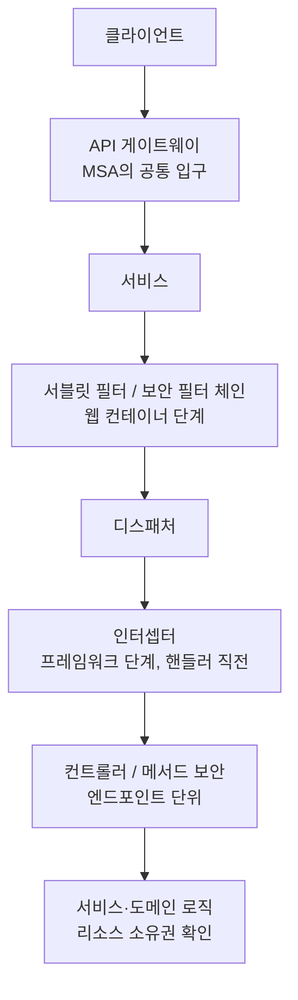
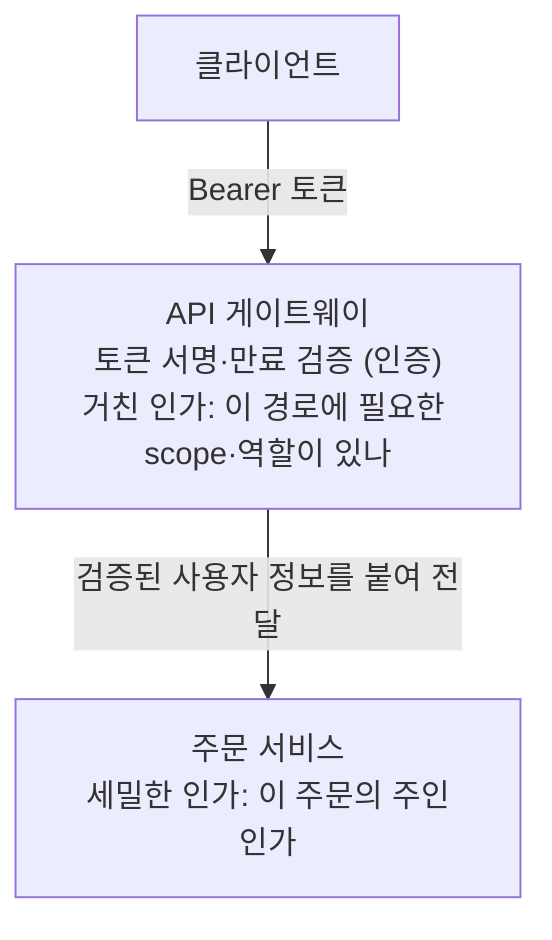

> G마켓 기술 블로그의 「[인증/인가는 어디에 어떻게 구현해야 할까?](https://dev.gmarket.com/45)」(2022.09)를 바탕으로 재구성하고, Microsoft Azure 아키텍처 센터의 「Gateway Offloading」 패턴으로 MSA 쪽 주의점을 보탠 노트다.

## 무엇을 정하는 문제인가

**인증(authentication)** 은 「누구인가」를 확인하고, **인가(authorization)** 는 「그 사람이 이 자원에 이 동작을 해도 되는가」를 확인한다. 인증 상태를 무엇으로 들고 다닐지(세션 ID, JWT)는 [[session-vs-token-auth|세션 기반 인증과 토큰 기반 인증]]에서 다룬다. 이 노트는 그 검증 로직을 **요청 경로의 어느 지점에 둘지**를 다룬다.

## 컨트롤러 안에 두면 생기는 문제

로그인 확인 코드를 컨트롤러 메서드마다 넣으면 동작은 한다. 하지만 다음 문제가 생긴다.

- **중복**: 같은 검증 코드가 수십 곳에 복사된다. 정책이 바뀌면 모두 고쳐야 한다.
- **누락**: 새 엔드포인트에 검증을 빠뜨리면 그대로 열린다. 보안은 「기본이 막힘」이어야 하는데, 이 방식은 「기본이 열림」이다.
- **관심사 혼합**: 비즈니스 로직 사이에 인증 코드가 섞여 읽기 어렵다.

그래서 인증은 요청이 핸들러에 닿기 **전에** 공통 계층에서 처리한다.

## 단일 서버 안의 선택지 (Spring 기준)

| 위치 | 실행 시점 | 잘 맞는 일 |
| --- | --- | --- |
| 서블릿 필터(Filter) | 디스패처 서블릿에 닿기 전·응답이 떠난 뒤. 웹 컨테이너가 관리 | 모든 요청에 걸리는 인증, 헤더 가공, CORS. Spring Security가 이 단계의 보안 필터 체인(`SecurityFilterChain`)으로 동작한다 |
| 인터셉터(HandlerInterceptor) | 디스패처 이후, 컨트롤러 전(`preHandle`)·후(`postHandle`)·뷰 렌더링 뒤(`afterCompletion`). 스프링 컨텍스트가 관리 | 특정 경로에만 거는 전후 처리, 어떤 핸들러가 불릴지 안 뒤의 판단 |
| 메서드 보안(`@PreAuthorize` 등) | 메서드 호출 직전(AOP) | 엔드포인트·메서드별 역할 검사 |
| 도메인 로직 | 데이터를 읽은 뒤 | 「이 주문이 이 사용자의 것인가」 같은 리소스 소유권 확인 |

- 필터는 스프링 MVC 바깥이라 컨트롤러 정보를 모른다. 인터셉터는 어떤 핸들러로 가는지 안다. **인증은 필터, 경로·핸들러별 세부 규칙은 인터셉터나 메서드 보안**으로 나누는 것이 보통이다.
- 직접 필터를 짜기보다 Spring Security를 쓰는 편이 안전하다. 세션 고정 방지, CSRF, 예외 처리 같은 빠뜨리기 쉬운 부분이 들어 있다. 메서드 보안은 `@EnableMethodSecurity`로 켠다.
- NestJS에서는 같은 역할을 미들웨어와 가드(Guard)가 나눠 맡는다([[interceptor-aop|NestJS Middleware와 Interceptor]], [[auth-jwt-passport|NestJS JWT 인증과 Passport]]).

**리소스 소유권 확인은 공통 계층으로 끌어올릴 수 없다.** 필터는 「로그인한 사용자인가」까지만 안다. 「남의 주문을 ID만 바꿔 조회하는가」는 데이터를 본 도메인 로직만 판단할 수 있다.

## MSA에서: API 게이트웨이

**API 게이트웨이**는 클라이언트에게 단일 진입점을 주고 뒤의 마이크로서비스로 요청을 나눠 보낸다. 모든 요청이 지나가므로 TLS 종료, 레이트 리밋, 로깅과 함께 **인증을 한곳에서 처리하기 좋다**(게이트웨이 오프로딩 패턴).

| 장점 | 대가 |
| --- | --- |
| 서비스마다 인증 코드를 두지 않는다. 인증 로직과 서비스 로직의 결합이 줄어든다 | 게이트웨이가 무거워지고, 모든 요청에 한 홉과 처리 시간이 더해진다 |
| 정책·인증서·키 교체를 한곳에서 한다 | 게이트웨이가 단일 장애점·병목이 된다. 여러 인스턴스로 띄우고 피크 기준으로 용량을 잡는다 |
| 보안 전문 팀이 따로 관리할 수 있다 | 게이트웨이가 뚫리면 뒤가 전부 노출된다. 가장 비싼 공격 표적이다 |

### 게이트웨이에 맡길 것과 서비스에 남길 것

| 게이트웨이 | 각 서비스 |
| --- | --- |
| 토큰 검증(서명, 만료, 발급자) | 리소스 소유권, 상태에 따른 권한(예: 결제 완료 주문은 취소 불가) |
| 경로 단위의 거친 인가(scope, 역할) | 비즈니스 규칙에 묶인 인가 |
| 레이트 리밋, 로깅, 상관관계 ID 발급 | - |

**비즈니스 로직은 게이트웨이에 넣지 않는다.** 서비스가 바뀔 때마다 게이트웨이를 다시 배포해야 하는 결합이 생긴다.

### 꼭 막아야 할 구멍

- **게이트웨이 우회**: 서비스가 게이트웨이를 거치지 않은 요청도 받으면, 직접 호출해 인증을 건너뛸 수 있다. 네트워크로 막고, 서비스는 게이트웨이에서 온 요청만 받는다.
- **위조된 헤더**: 게이트웨이가 `X-User-Id` 같은 헤더로 사용자 정보를 넘길 때, 서비스가 검증 없이 그 헤더를 믿으면 누구나 헤더를 붙여 위장할 수 있다. 게이트웨이와 서비스 사이도 따로 인증(mTLS 등)하고, 외부에서 들어온 같은 이름의 헤더는 게이트웨이에서 지운다.
- **신원 전달 방식**: 서비스가 원래 사용자를 기준으로 인가해야 하면 원 토큰이나 서명된 클레임을 넘긴다. 게이트웨이 자신의 신원만 넘기면 서비스는 누가 요청했는지 모른다.
- **내부 구간 암호화**: 게이트웨이에서 TLS를 끝냈더라도 서비스까지는 다시 TLS로 보낸다. 내부망도 믿지 않는다(제로 트러스트).

서비스가 원 토큰을 받아 **스스로 한 번 더 검증**하면 게이트웨이가 뚫려도 피해가 줄어든다. JWT는 공개키만 있으면 각 서비스가 저장소 조회 없이 검증할 수 있어 이 방식과 잘 맞는다.

## 어떻게 고르나

| 상황 | 기본 선택 |
| --- | --- |
| 모놀리식, 서버 한 종류 | 보안 프레임워크의 필터 체인으로 인증, 메서드 보안으로 역할, 도메인 로직에서 소유권 |
| 서비스 여러 개, 공통 입구 있음 | 게이트웨이에서 인증과 거친 인가, 서비스에서 세밀한 인가 |
| 보안 요구가 높은 MSA | 위에 더해 서비스도 토큰을 다시 검증하고, 서비스 간 통신에 mTLS |

## 정리

- 인증은 핸들러에 닿기 전 공통 계층에서 처리한다. 컨트롤러마다 넣으면 중복되고 언젠가 빠진다.
- 필터는 모든 요청, 인터셉터·메서드 보안은 경로·메서드별 규칙, 도메인 로직은 리소스 소유권을 맡는다.
- MSA에서는 게이트웨이가 토큰 검증과 거친 인가를, 각 서비스가 자기 데이터의 인가를 맡는다.
- 게이트웨이를 쓰면 우회 차단, 전달 헤더 검증, 게이트웨이 가용성을 반드시 함께 설계한다.

관련 노트: [[session-vs-token-auth|세션 기반 인증과 토큰 기반 인증]], [[api-security|API 보안 체크리스트]], [[bff|BFF (Backend For Frontend)]], [[web-scalability-components|웹 확장성의 구성 요소]], [[oauth2|OAuth 2.0]], [[proxy|프록시: 포워드 프록시와 리버스 프록시]]
