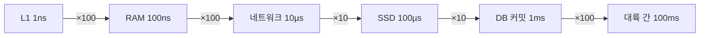
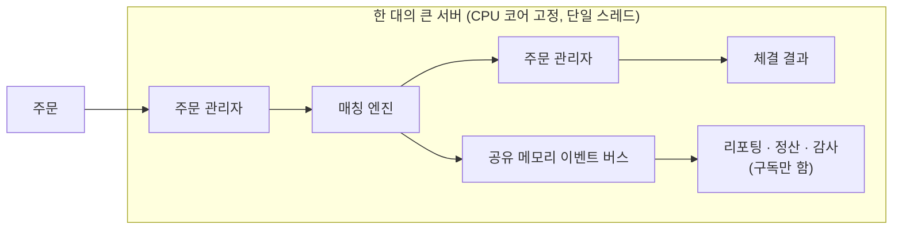
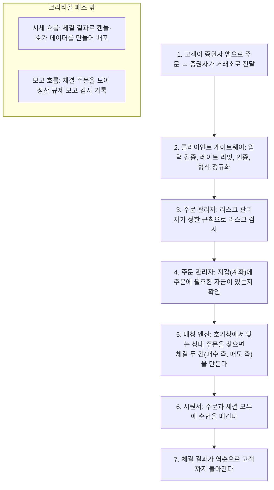
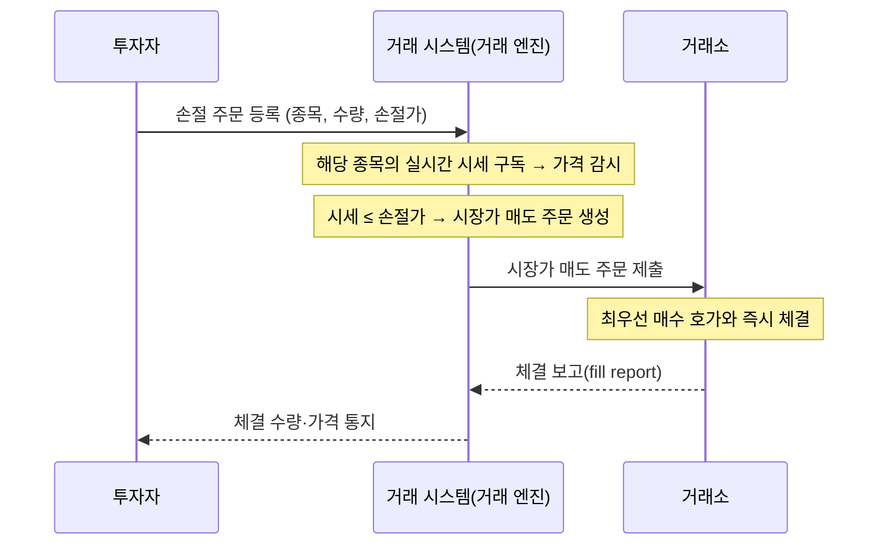

> ByteByteGo의 System Design 101 가이드 「[Which Latency Numbers Should You Know?](https://bytebytego.com/guides/which-latency-numbers-should-you-know)」, 「[Top 5 Common Ways to Improve API Performance](https://bytebytego.com/guides/top-5-common-ways-to-improve-api-performance)」, 「[Top 5 Strategies to Reduce Latency](https://bytebytego.com/guides/top-5-strategies-to-reduce-latency)」, 「[Low Latency Stock Exchange](https://bytebytego.com/guides/low-latency-stock-exchange)」, 「[What is a Stop-Loss Order?](https://bytebytego.com/guides/what-is-a-stop-loss-order-and-how-does-it-work)」를 바탕으로 재구성한 노트다.
> 거래소 주문의 단계별 흐름은 같은 가이드의 「[Design Stock Exchange](https://bytebytego.com/guides/design-stock-exchange)」를 바탕으로 보탰다.
> 원형 표와 봉투 뒷면 계산은 Jonas Bonér의 gist 「[Latency Numbers Every Programmer Should Know](https://gist.github.com/jboner/2841832)」, Jeff Dean의 LADIS 2009 기조연설 「[Designs, Lessons and Advice from Building Large Distributed Systems](https://www.cs.cornell.edu/projects/ladis2009/talks/dean-keynote-ladis2009.pdf)」, 연도별 추세는 「[Interactive Latency Infographics](https://people.eecs.berkeley.edu/~rcs/research/interactive_latency.html)」를 바탕으로 보강했다.

## 왜 숫자 감각이 필요한가

설계를 비교할 때 정확한 값은 필요 없다. **자릿수**만 알면 된다. 「Redis를 한 번 더 부르는 것」과 「DB에 한 번 더 쓰는 것」과 「다른 대륙을 한 번 왕복하는 것」은 각각 마이크로초, 밀리초, 수백 밀리초로 서로 천 배씩 차이 난다. 이 감각이 있으면 어디를 줄여야 하는지 측정 전에도 짐작할 수 있다.

지연은 사용자 경험과 전환율에 바로 이어진다. 사용자를 직접 마주하는 대규모 서비스일수록 응답이 느려지는 만큼 매출이 줄어든다.

## 지연 시간 자릿수

하드웨어마다 다르므로 **대략의 크기**로 읽는다. 원형은 Jeff Dean이 정리한 「모든 프로그래머가 알아야 할 지연 시간 숫자」다.

| 작업 | 자릿수 | 감 잡기 |
| --- | --- | --- |
| L1 · L2 캐시 접근 | 1ns · 수 ns | CPU 칩 안. 하드웨어를 직접 다루지 않으면 신경 쓸 일이 적다([[cache-friendly-code\|캐시 친화적 코드]]) |
| 메인 메모리(RAM) 접근 | 약 100ns | Redis 같은 인메모리 저장소의 데이터 접근 비용 |
| 1Gbps 네트워크로 1KB 보내기 | 약 10µs | 같은 데이터센터의 캐시 서버에서 작은 값 받기 |
| SSD 무작위 읽기 | 수십~100µs | RocksDB 같은 디스크 기반 키-값 저장소의 읽기 |
| DB 쓰기 · 커밋 | 약 1ms | 데이터 저장, 인덱스 갱신, 로그 플러시(fsync)가 모두 들어간다 |
| 대륙 간 왕복(예: 미국 서부 ↔ 유럽) | 100ms 이상 | 원거리 화상 통화가 살짝 어긋나는 정도 |
| 재시도 · 새로 고침 간격 | 1~10초 | 모니터링 대시보드의 갱신 주기 |

단위는 1ns = 10⁻⁹초, 1µs = 1,000ns, 1ms = 1,000µs다.



### 원형 표

Jeff Dean이 2009년 강연에서 「모두가 알아야 할 숫자」로 내놓고 Peter Norvig의 표를 이어받은 원형은 이렇다. 공개 gist가 지금도 갱신되며, 2026년에는 LLM 행이 더해졌다.

| 작업 | 지연 | 비교 |
| --- | --- | --- |
| L1 캐시 참조 | 0.5ns | |
| 분기 예측 실패 | 5ns | |
| L2 캐시 참조 | 7ns | L1의 14배 |
| 뮤텍스 잠금·해제 | 25ns | |
| 메인 메모리 참조 | 100ns | L2의 20배, L1의 200배 |
| 1KB를 Snappy(구 Zippy)로 압축 | 3µs | |
| 1Gbps 네트워크로 1KB 보내기 | 10µs | |
| SSD에서 4KB 무작위 읽기 | 150µs | |
| 메모리에서 1MB 순차 읽기 | 250µs | |
| 같은 데이터센터 안 왕복 | 500µs | |
| SSD에서 1MB 순차 읽기 | 1ms | 메모리의 4배 |
| 디스크 탐색(seek) | 10ms | 데이터센터 왕복의 20배 |
| 로컬 LLM이 토큰 하나 생성(소비자 GPU) | 15ms | |
| 디스크에서 1MB 순차 읽기 | 20ms | 메모리의 80배, SSD의 20배 |
| 프런티어 LLM이 출력 토큰 하나 생성 | 20ms | |
| 캘리포니아 → 네덜란드 → 캘리포니아 패킷 왕복 | 150ms | |
| 프런티어 LLM 첫 토큰까지(짧은 프롬프트, 캐시 없음) | 1s | |
| 프런티어 LLM 짧은 응답(출력 약 100토큰) | 3s | |
| 프런티어 LLM 긴 컨텍스트 프리필(입력 약 10만 토큰, 캐시 없음) | 10s | |

LLM 호출 하나는 같은 데이터센터 왕복보다 수천~수만 배 느리다. 에이전트가 LLM을 순서대로 여러 번 부르면 그 자체가 워터폴이 되므로, 지연을 줄이려면 호출 수를 줄이거나 병렬로 돌리고 프롬프트 캐시를 쓴다.

### 숫자는 해마다 다르게 변한다

표의 값은 하드웨어 세대에 따라 바뀌지만 **모든 칸이 같은 속도로 줄지는 않는다.** 연도별로 값을 다시 그려 보는 [인터랙티브 버전](https://people.eecs.berkeley.edu/~rcs/research/interactive_latency.html)은 이 차이를 보여 준다.

| 항목 | 추세 |
| --- | --- |
| CPU 클럭(캐시 참조) | 2005년 무렵까지 약 2년마다 두 배로 빨라지다가 약 3GHz에서 멈췄다. 이후 성능은 코어 수와 병렬성에서 나온다 |
| 메모리 지연 | 약 100ns 근처에서 거의 그대로다. 대역폭만 는다 |
| SSD 무작위 읽기 | 크게 줄다가 수십 µs 수준에서 평평해졌다 |
| 디스크 탐색 | 10년에 절반 정도로 아주 느리게 준다. 기계 장치이기 때문이다 |
| 네트워크·디스크·SSD **대역폭** | 꾸준히 늘어 「1MB 보내기·읽기」 칸은 계속 짧아진다 |
| 데이터센터·대륙 간 **왕복** | 거의 변하지 않는다. 빛의 속도와 거리가 정하기 때문이다 |

그래서 **대역폭 문제는 시간이 풀어 주지만 지연 문제는 풀어 주지 않는다.** 왕복 횟수를 줄이는 설계(배치, 병렬 요청, 사용자 가까이 두기)가 오래 유효하다. 같은 관점이 [[distributed-time-and-failure|분산 시스템의 시간과 장애]]의 「지연은 0이다」라는 착각이다.

### 봉투 뒷면 계산

숫자를 외우는 목적은 **만들어 보기 전에 설계를 비교**하는 것이다. 이미지 검색 결과 페이지에 썸네일 30개를 만드는 두 설계를 디스크 탐색 10ms, 디스크 읽기 30MB/s로 어림하면 이렇다.

```text
설계 1: 순서대로 읽어서 즉석에서 256KB 이미지의 썸네일 생성
  30 × 10ms(탐색) + 30 × 256KB ÷ 30MB/s ≈ 560ms

설계 2: 30개를 병렬로 읽기
  10ms + 256KB ÷ 30MB/s ≈ 18ms   (편차를 감안하면 실제로는 30~60ms)
```

여기서 썸네일을 캐시할지, 미리 만들어 둘지 같은 변형을 다시 어림해 가장 유망한 설계를 고른다. 어림이 맞으려면 쓰는 부품(언어 라이브러리, 자료구조, DB, 저장소)의 **인터페이스뿐 아니라 구현도 대략 알아야** 한다. 감각을 기르는 데는 마이크로벤치마크를 직접 돌려 보는 것이 좋다.

브라우저 쪽 숫자(렌더링 프레임 예산, 체감 한계, CDN 왕복)는 [[frontend-latency-numbers|프론트엔드 개발자가 알아야 할 지연 시간 숫자]]에 있다.

## 지연을 줄이는 기법

기법은 **무엇을 줄이느냐**로 나눠 보면 고르기 쉽다.

| 기법 | 줄이는 것 | 방법 | 주의 |
| --- | --- | --- | --- |
| **DB 인덱스** | 읽는 데이터 양 | 전체 테이블 스캔을 인덱스 탐색으로 바꾼다 | 쓰기마다 인덱스도 갱신되므로 쓰기가 느려진다 |
| **캐시** | 원본 접근 횟수 | 자주 읽는 결과를 메모리(Redis 등)에 둔다 | 일관성·만료·장애 패턴을 함께 설계한다([[caching-strategies\|캐시 전략]]) |
| **페이지네이션** | 한 번에 보내는 양 | 큰 결과를 쪽 단위로 나누거나 스트리밍한다 | 깊은 오프셋은 느리므로 커서 방식을 쓴다 |
| **비동기 로깅** | 요청 경로의 디스크 I/O | 로그를 락 없는 버퍼에 넣고 즉시 반환, 별도 스레드가 주기적으로 디스크에 쓴다 | 프로세스가 죽으면 버퍼의 로그를 잃을 수 있다 |
| **비동기 처리** | 응답 전에 끝내야 하는 일 | 메일 발송·썸네일 생성 같은 일은 메시지 큐에 넣고 바로 응답한다 | 결과를 나중에 알려 줄 방법(폴링·웹훅·알림)이 필요하다 |
| **페이로드 압축** | 전송 바이트 | 요청·응답을 gzip·Brotli·zstd로 압축한다 | 작은 응답은 압축 비용이 이득보다 클 수 있다 |
| **커넥션 풀** | 연결 수립 비용 | DB 연결을 미리 열어 두고 빌려 쓴다. TCP·TLS·인증 핸드셰이크를 매번 하지 않는다 | 풀 크기가 DB의 최대 연결 수를 넘지 않게 한다. 서버리스는 프록시형 풀러를 둔다 |
| **로드 밸런싱** | 한 서버의 대기열 | 요청을 여러 서버로 고르게 나눠 큐잉 지연을 줄인다 | 상태를 서버에 두면 분산이 어렵다 |
| **CDN** | 물리적 거리 | 사용자 가까운 엣지에서 응답한다 | 동적·개인화 응답은 캐시하기 어렵다([[cdn\|CDN]]) |

평균이 아니라 **꼬리 지연**(p95·p99)을 본다. 요청 하나가 여러 내부 호출로 퍼지면, 그중 가장 느린 하나가 전체 응답 시간을 정한다.

## 극단적 저지연: 크리티컬 패스에서 일을 줄인다

증권 거래소처럼 마이크로초 단위를 다투는 시스템의 원칙은 하나다. **크리티컬 패스(critical path)에서 일을 덜 한다.**

- 크리티컬 패스의 작업 수를 줄인다.
- 각 작업에 드는 시간을 줄인다.
- 네트워크 홉을 줄인다.
- 디스크를 쓰지 않는다.

거래소라면 크리티컬 패스는 「주문이 들어옴 → 필수 리스크 검사 → 체결 → 체결 결과가 나감」뿐이다. 나머지(보고, 정산, 감사 로그)는 모두 경로 밖으로 뺀다.



| 설계 | 없애는 비용 |
| --- | --- |
| 모든 구성 요소를 **한 서버**에 둔다(컨테이너도 쓰지 않는다) | 네트워크 홉, 가상화 오버헤드 |
| **공유 메모리**를 이벤트 버스로 쓴다 | 디스크 I/O, 소켓 통신 |
| 핵심 구성 요소를 **단일 스레드**로 두고 **CPU 코어에 고정**(pinning)한다 | 문맥 교환, 락 경합 |
| 단일 스레드 루프가 일을 순서대로 하나씩 처리한다 | 동기화 |
| 나머지 구성 요소는 이벤트 버스를 구독해 따로 반응한다 | 크리티컬 패스의 부가 작업 |
| 시세는 UDP 멀티캐스트로 여러 수신자에게 한 번에 보낸다 | 수신자마다 연결을 맺는 비용([[transport-layer\|전송 계층]]) |

### 주문 하나의 여정

거래소 안에서 주문은 아래 단계를 거친다. 1~7이 지연 요구가 엄격한 **거래 흐름(크리티컬 패스)** 이고, 시세 배포와 보고는 그 밖에서 따로 돈다.



- **순번을 매기는 이유는 결정성**이다. 같은 순서로 다시 넣으면 매칭 엔진이 늘 같은 결과를 내므로, 장애가 나도 기록을 재생해 상태를 그대로 복원하고 대기 서버를 같은 상태로 맞출 수 있다.
- 게이트웨이와 주문 관리자의 검사는 크리티컬 패스 위에 있으므로 최소한으로 둔다. 무거운 검증은 사후 보고 흐름으로 보낸다.

락 없이 단일 스레드로 빠르게 처리하는 발상은 [[redis|Redis]]와 [[event-loop-server|이벤트 루프 서버]]에도 그대로 있다.

### 조건부 주문: 손절매(stop-loss)는 시세를 구독하다 시장가로 바뀐다

손절매 주문은 「가격이 정해 둔 값(손절가) 이하로 떨어지면 판다」는 조건부 주문이다. 조건이 맞는 순간 **시장가 주문(market order)으로 바뀌어** 그때의 최우선 호가로 체결된다.



- 시장가로 바뀌므로 **체결 가격은 손절가보다 낮을 수 있다**(급락·갭 하락 시 미끄러짐). 가격 하한을 지키려면 지정가로 바뀌는 스톱 리밋(stop-limit) 주문을 쓰지만, 이때는 체결되지 않을 수 있다.
- 조건 감시는 시세 이벤트를 구독하는 별도 구성 요소가 맡고, 조건이 맞으면 일반 주문으로 크리티컬 패스에 들어온다.

## 정리

- 지연은 자릿수로 기억한다. RAM 100ns, 데이터센터 내 네트워크 µs, SSD 100µs, DB 커밋 1ms, 대륙 간 100ms.
- 기법은 「무엇을 줄이나」로 고른다. 읽는 양(인덱스), 접근 횟수(캐시), 전송량(페이지네이션·압축), 경로 위의 일(비동기), 연결 비용(커넥션 풀), 거리(CDN).
- 평균보다 p99를 본다.
- **가장 빠른 일은 하지 않는 일이다.** 응답 전에 꼭 해야 하는 일만 크리티컬 패스에 남긴다.

관련 노트: [[frontend-latency-numbers|프론트엔드 개발자가 알아야 할 지연 시간 숫자]], [[caching-strategies|캐시 전략]], [[high-traffic-resilience|대규모 트래픽에서 서비스를 지키는 설계]], [[web-scalability-components|웹 확장성의 구성 요소]], [[event-loop-server|이벤트 루프 서버]]
