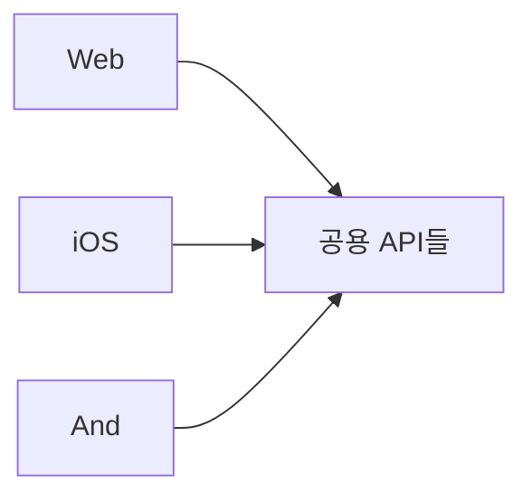
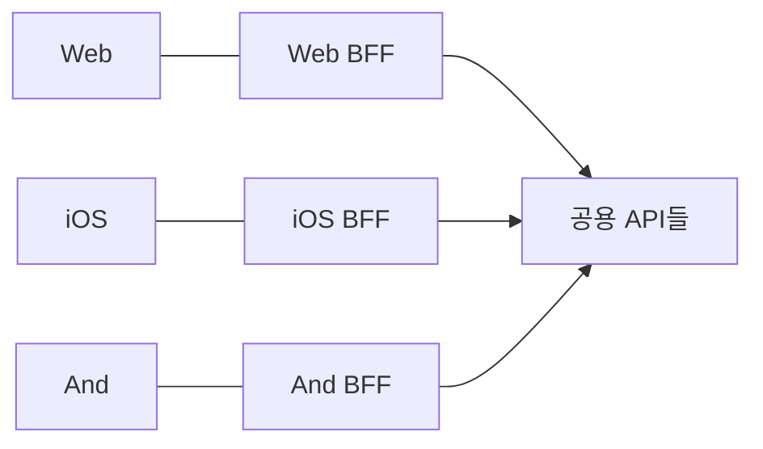

> 카카오엔터테인먼트 박수빈(cheese)의 글 「[카카오페이지는 BFF(Backend For Frontend)를 어떻게 적용했을까?](https://tech.kakaoent.com/front-end/2022/220310-kakaopage-bff/)」(2022.03)를 요약·재구성한 노트다. SSR·캐시 역할은 「[모바일 줌 SpringBoot → NodeJS 전환기 (feat. VueJS SSR)](https://zuminternet.github.io/ZUM-Mobile-NodeJS/)」를 바탕으로 더했다.

## BFF란

**BFF(Backend For Frontend)는** 프론트엔드 하나마다 그 화면에 맞춰 두는 **중간 서버**다. 데이터를 통합·가공해 프론트엔드를 백엔드에서 떼어 놓고, 이상적으로는 프론트엔드 개발자가 만든다.

일반 구조



BFF 구조



**프론트엔드 하나에 BFF 하나**가 원칙이라, 지원하는 플랫폼이 하나뿐이면 굳이 둘 이유가 약하다.

## BFF가 흡수하는 문제

MSA 환경에서 Web·Android·iOS가 공용 API에 직접 붙으면, 각 플랫폼에 필요한 데이터를 맞추는 계산과 비즈니스 로직이 프론트엔드에 쌓인다. UI 스레드에서 렌더링과 경쟁해 화면이 느려지기도 한다.

| 문제 | 직접 의존할 때 | BFF가 하는 일 |
| --- | --- | --- |
| 과다한 응답 | 모든 플랫폼용 필드가 섞여 온다 | 화면에 쓰는 필드만 골라 내려 준다 |
| 여러 번 호출 | 한 화면에서 API를 여러 번 부른다 | 서버에서 묶어 한 번에 응답한다 |
| MSA 엔드포인트 변경 | 서비스가 쪼개질 때마다 프론트엔드가 따라간다 | BFF 안에서 바꾸고 화면 계약은 유지한다 |
| CORS | 다른 출처 API를 브라우저가 직접 부른다 | 같은 출처의 BFF가 대신 부른다 |
| 인증 | 플랫폼마다 다른 인증을 억지로 통합한다 | 플랫폼별 BFF가 각자 처리한다 |
| 조율 비용 | 여러 플랫폼 스펙을 API 하나에 맞춘다 | 플랫폼마다 자기 BFF를 고친다 |
| 첫 화면과 SEO | 브라우저가 JS를 받은 뒤에야 데이터를 부른다 | 조합한 데이터로 HTML을 서버에서 그려 보낸다([[spa-csr-ssr\|SSR]]) |
| 반복 호출 비용 | 같은 API 응답을 요청마다 다시 받는다 | 화면용 응답을 캐시한다 |

**비즈니스 로직은 도메인 API에 두고, BFF는 조합·가공·표현 로직만 맡는다.** 그래야 BFF가 가벼워지고 플랫폼별로 늘려도 규칙이 갈라지지 않는다. BFF마다 반복되는 API 응답 캐시(키, 갱신 주기, 캐시하지 않을 조건)는 데코레이터나 공용 모듈로 한 번 표준화해 둔다. Express처럼 자유도가 높은 프레임워크로 BFF를 여럿 만들면 구조가 프로젝트마다 갈리므로 TypeScript와 공용 규약으로 맞춘다([[express-project-architecture|Express 프로젝트 구조]]).

## 예시: 두 API를 하나로

화면에 프로필과 캐시 잔액이 필요하다. REST로는 `GET /user/get_profile`, `GET /store/view/cash`를 따로 부르고, 응답에는 `create_dt`, `user_id`처럼 화면에 안 쓰는 값이 섞여 온다.

GraphQL BFF에서는 리졸버가 두 API를 부르고 **화면용 타입으로 가공해** 돌려준다.

```js
// user.resolver
const resolvers = {
  user: async () => {
    const response = await kakaopageApi.getProfile()
    return createUserWithUserVo(response.profile) // 필요한 필드만, camelCase로
  },
}
```

```graphql
query userAndCash {
  userAndCash {
    user { uid nickname email }
    cash { totalBalance }
  }
}
```

브라우저 요청은 하나로 준다. 불필요한 필드 제거, snake_case → camelCase, 날짜 포맷 변환, 공통 에러 객체 감싸기를 BFF가 맡는다.

## Next.js를 BFF로

Next.js 문서는 「Backend for Frontend」 가이드에서 **Route Handler**(`app/**/route.ts`), Proxy, rewrites로 Next.js를 BFF로 쓰는 법을 안내하고, 완전한 백엔드 대체가 아니라 **공개된 API 계층**이라고 선을 긋는다. 서버 컴포넌트도 렌더링 중에 여러 API를 서버에서 불러 필요한 값만 클라이언트로 넘기므로, GraphQL 없이도 BFF의 상당 부분을 대신한다. 여러 플랫폼이 같은 BFF 계층을 공유해야 하면 GraphQL BFF가 여전히 선택지다.

## 함정: 정규화 캐시와 인자별 데이터

GraphQL BFF 앞에서는 **가져오기(fetching)와 화면 상태 저장은 목적이 다르다.** 추가 로딩·무한 스크롤처럼 그린 뒤 중간 데이터를 고치는 일은 GraphQL 클라이언트 캐시만으로 다루기 복잡해, 응답을 정규화해 별도 상태 저장소에 두기도 한다.

| 증상 | 원인 | 해결 |
| --- | --- | --- |
| 탭(필터)을 바꿔도 엉뚱한 하위 데이터가 보인다 | Apollo Client는 객체를 `__typename:id`로 정규화해 저장한다. 같은 id인데 인자(`categoryFilter`)에 따라 하위 데이터가 다르면 나중 응답이 앞 결과를 덮어쓴다 | 인자별로 구분되는 id를 주거나 `keyFields`로 캐시 식별 기준을 바꾼다. 또는 urql처럼 쿼리(문서) 단위로 캐시하는 클라이언트를 쓴다 |

## 정리

- BFF는 **프론트엔드 하나를 위한 중간 서버**다. 여러 API를 묶고, 화면에 맞게 가공하고, CORS·인증·MSA 변화를 흡수한다.
- 핵심 이점은 **비즈니스 로직 구현과 화면용 데이터 가공을 분리**해 복잡도를 낮추는 것이다.
- 플랫폼이 하나뿐이면 굳이 둘 필요가 없을 수 있다. Next.js라면 Route Handler와 서버 컴포넌트가 가벼운 BFF가 된다.
- GraphQL 캐시를 쓸 땐 정규화 캐시가 인자별 결과를 덮어쓰는지 확인한다.

관련 노트: [[web-scalability-components|웹 확장성의 구성 요소]], [[db-fetching-patterns|빠르고 유지보수하기 좋은 DB 조회 패턴]], [[server-client-components|서버 컴포넌트와 클라이언트 컴포넌트 조합 규칙]], [[nextjs-app-router|Next.js App Router의 내비게이션과 데이터 가져오기]]
