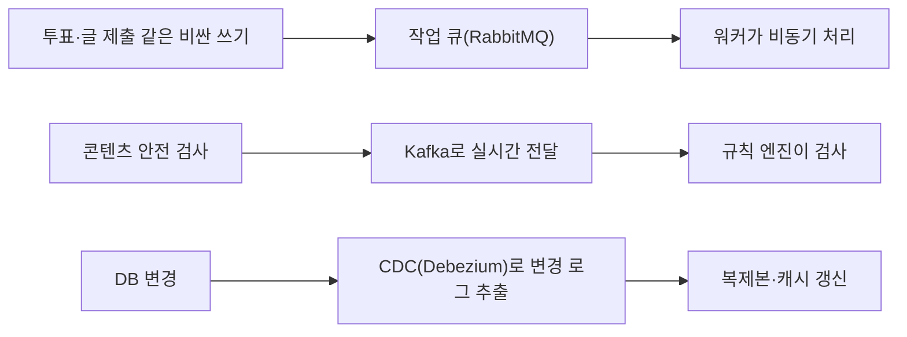
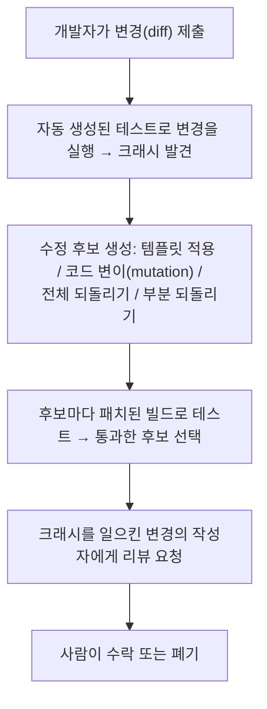

> ByteByteGo의 System Design 101 가이드 중 실제 사례(real-world case studies) 묶음, 「[Netflix's Overall Architecture](https://bytebytego.com/guides/netflixs-overall-architecture)」, 「[Netflix's Tech Stack](https://bytebytego.com/guides/netflixs-tech-stack)」, 「[Netflix Tech Stack - Databases](https://bytebytego.com/guides/netflix-tech-stack-databases)」, 「[4 Ways Netflix Uses Caching](https://bytebytego.com/guides/4-ways-netflix-uses-caching-to-hold-user-attention)」, 「[Netflix Tech Stack - CI/CD Pipeline](https://bytebytego.com/guides/netflix-tech-stack-cicd-pipeline)」, 「[Uber Tech Stack](https://bytebytego.com/guides/uber-tech-stack)」, 「[Uber Tech Stack - CI/CD](https://bytebytego.com/guides/uber-tech-stack-cicd)」, 「[Reddit's Core Architecture](https://bytebytego.com/guides/reddit's-core-architecture)」, 「[Twitter 1.0 Tech Stack](https://bytebytego.com/guides/twitter-10-tech-stack)」, 「[Twitter Architecture 2022 vs. 2012](https://bytebytego.com/guides/twitter-architecture-2022-vs-2012)」, 「[McDonald's Event-Driven Architecture](https://bytebytego.com/guides/mcdonald's-event-driven-architecture)」, 「[Fixing Bugs Automatically at Meta Scale](https://bytebytego.com/guides/fixing-bugs-automatically-at-meta-scale)」, 「[How YouTube Handles Massive Video Uploads](https://bytebytego.com/guides/how-does-youtube-handle-massive-video-content-upload)」, 「[Top 9 Engineering Blogs](https://bytebytego.com/guides/top-9-engineering-blog-favorites)」를 바탕으로 재구성한 노트다. 2008~2015년 성장기 사례는 High Scalability의 아키텍처 글 「[YouTube Architecture](http://highscalability.com/youtube-architecture)」, 「[Flickr Architecture](http://highscalability.com/flickr-architecture)」, 「[Amazon Architecture](http://highscalability.com/amazon-architecture)」, 「[Stack Overflow Architecture](http://highscalability.com/blog/2009/8/5/stack-overflow-architecture.html)」, 「[Scaling Pinterest](http://highscalability.com/blog/2013/4/15/scaling-pinterest-from-0-to-10s-of-billions-of-page-views-a.html)」, 「[Instagram Architecture](http://highscalability.com/blog/2011/12/6/instagram-architecture-14-million-users-terabytes-of-photos.html)」, 「[TripAdvisor Architecture](http://highscalability.com/blog/2011/6/27/tripadvisor-architecture-40m-visitors-200m-dynamic-page-view.html)」, 「[Scaling Mailbox](http://highscalability.com/blog/2013/6/18/scaling-mailbox-from-0-to-one-million-users-in-6-weeks-and-1.html)」, 「[Salesforce Architecture](http://highscalability.com/blog/2013/9/23/salesforce-architecture-how-they-handle-13-billion-transacti.html)」, 「[ESPN's Architecture at Scale](http://highscalability.com/blog/2013/11/4/espns-architecture-at-scale-operating-at-100000-duh-nuh-nuhs.html)」, 「[Scaling Twitter](http://highscalability.com/scaling-twitter-making-twitter-10000-percent-faster)」, 「[Tumblr Architecture](http://highscalability.com/blog/2012/2/13/tumblr-architecture-15-billion-page-views-a-month-and-harder.html)」, 「[Google Architecture](http://highscalability.com/google-architecture)」로 보강했다.

## 왜 남의 스택을 보나

큰 회사의 기술 스택은 그대로 따라 할 목록이 아니다. 여러 회사의 스택을 겹쳐 보면 **같은 문제에 비슷한 설계 원칙이 반복**되는데, 그 원칙이 쓸모 있다. 구체 제품은 자주 바뀌므로 제품명보다 「어느 층에 어떤 성질의 도구를 두었나」를 본다.

## 계층별로 겹쳐 보기

| 계층 | 반복되는 선택 | 사례 |
| --- | --- | --- |
| 클라이언트 | 모바일은 네이티브(Swift·Kotlin), 웹은 React. 플랫폼 공통 구조를 위해 자체 모바일 아키텍처를 만들기도 한다 | 모바일 크로스플랫폼 구조(Uber RIBs), React 기반 자체 웹 프레임워크 |
| 앞단 | CDN → 로드 밸런서 → 게이트웨이 | Reddit은 CDN을 앱 앞에 두고 로드 밸런서가 서비스로 라우팅한다 |
| 클라이언트-서버 통신 | 화면 단위 집계는 GraphQL(페더레이션), 서비스 간은 gRPC·Thrift | [[api-layer-evolution\|API 계층의 진화]] 참고 |
| 서비스 | JVM(Spring Boot) 또는 Go 마이크로서비스, 서비스 디스커버리, 동적 설정 저장소 | 모놀리스(Python, Rails)에서 Go·Java 서비스로 옮겨 간 경로가 흔하다. 초기 Twitter처럼 클러스터 스케줄러 위에 자체 RPC 프레임워크(Finagle)로 서비스를 묶고, 자체 캐시·분산 키-값 저장소를 만든 경우도 있다 |
| 비동기 | Kafka(스트림), RabbitMQ 등(작업 큐), 워크플로 엔진 | 오래 걸리는 비즈니스 흐름은 워크플로 오케스트레이션 엔진(Cadence, Temporal)에 맡긴다 |
| 데이터 | 데이터 성격별 여러 DB(아래 폴리글랏 저장) | |
| 빅데이터 | 객체 스토리지 + 테이블 포맷(Iceberg, Hudi) + Spark·Flink + 데이터 웨어하우스 | |
| 관측 | 자체 시계열 지표 저장소, 이상 탐지, 온콜 관리 | |
| 인프라 | 퍼블릭 클라우드 + Kubernetes, IaC(Terraform), 모노레포 + Bazel 같은 빌드 시스템 | |

## 폴리글랏 저장: 데이터마다 맞는 DB

**모든 데이터를 한 DB에 넣지 않는다.** 데이터의 일관성 요구, 접근 패턴, 크기에 따라 DB를 고른다.

| 데이터 성격 | DB 종류 | 예 |
| --- | --- | --- |
| 돈이 걸린 트랜잭션(결제, 구독, 세금) | 관계형 DB(MySQL, PostgreSQL) | 강한 일관성이 필요하다 |
| 여러 리전에 걸친 전역 트랜잭션 | 분산 SQL(CockroachDB 등) | 멀티 리전 액티브-액티브 |
| 대량 쓰기, 높은 가용성(시청 기록, 기기 정보, 메시지) | 와이드 컬럼 DB(Cassandra) | [[wide-column-database\|와이드 컬럼 DB]] 참고 |
| 홈 화면, 개인화 결과, 세션 | 키-값 캐시(Memcached 기반 EVCache, Redis) | 아래 캐시 활용 참고 |
| 지표 | 시계열 DB | 메모리 기반 자체 시계열 저장소 |
| 분석 | 컬럼형 DB·데이터 웨어하우스(Redshift, Druid, Pinot) | |
| 이미지·영상·로그 | 객체 스토리지(S3) + 테이블 포맷 | |

관계형 DB 앞에 캐시를 두고, 새 기능에는 가용성이 높은 와이드 컬럼 DB를 쓰는 조합(Reddit)이 전형적이다.

## 캐시의 네 가지 쓰임

분산 키-값 캐시는 조회 가속 외에도 쓰인다. 영상 스트리밍 사례(Netflix의 EVCache)는 하나의 캐시 플랫폼을 네 용도로 쓴다.

| 용도 | 방식 |
| --- | --- |
| 룩어사이드 캐시(look-aside) | 캐시에 없으면 서비스·DB에서 읽어 오고 캐시를 채운다. 가장 일반적인 캐시 어사이드 패턴이다 |
| 일시 데이터 저장소(transient store) | 재생 세션처럼 여러 서비스가 차례로 열고·갱신하고·닫는 짧은 수명의 상태를 둔다 |
| 기본 저장소(primary store) | 밤마다 배치로 모든 프로필의 홈 화면을 **미리 계산해 캐시에 써 두고**, 온라인 서비스는 캐시만 읽는다 |
| 대량 조회 데이터 | UI 문구·번역처럼 모든 요청이 읽는 데이터를 별도 프로세스가 비동기로 계산해 캐시에 게시한다 |

**미리 계산해 캐시에 넣어 두기(precompute)** 는 요청 시점의 계산을 없애 지연을 줄인다. 캐시 전략 일반은 [[caching-strategies|캐싱 전략]]에서 다룬다.

## 비싼 작업은 미루고, 캐시는 변경 로그로 맞춘다

소셜 커뮤니티 사례(Reddit)에서 볼 수 있는 패턴이다.

- **사용자 응답 경로에서 비싼 작업을 빼면** 요청이 빨라지고 부하 폭증을 큐가 흡수한다.
- 애플리케이션이 캐시와 DB에 이중 쓰기를 하면 둘이 어긋나기 쉽다. **DB의 변경 로그를 원천으로 삼아 캐시·복제본을 갱신**하면 일관성을 맞추기 쉽다.

## 이벤트 플랫폼 표준화

이벤트 기반 아키텍처를 여러 팀이 쓰기 시작하면 이벤트 형식과 오류 처리가 제각각이 된다. 패스트푸드 주문 플랫폼 사례(McDonald's)는 이벤트를 다음 요소로 표준화했다.

| 요소 | 역할 |
| --- | --- |
| 이벤트 레지스트리 | 이벤트 스키마를 한곳에 정의한다 |
| 공용 SDK | 이벤트 발행·소비와 오류 처리를 라이브러리로 통일한다 |
| 이벤트 게이트웨이 | 외부에서 들어오는 이벤트의 인증·인가를 맡는다 |
| 운영 도구 | 잘못된 이벤트 수정, 클러스터 상태 관리 |

확장은 **리전별 구성**으로 전역 가용성을 확보하고, 리전 안에서는 **도메인별로 이벤트를 나눠** 도메인마다 관리형 Kafka 클러스터가 처리하며, CPU 같은 지표로 자동 확장한다. Kafka 자체는 [[message-queue-kafka|메시지 큐와 Kafka]]에서 다룬다.

## CI/CD: 운영 환경에서 검증한다

대규모 서비스의 배포 파이프라인은 비슷한 단계로 이뤄진다.

| 단계 | 반복되는 선택 |
| --- | --- |
| 계획·문서 | 이슈 트래커, 위키 |
| 코드 품질 | 자체 정적 분석(널 안전성 검사기, 린터), **오래된 기능 플래그 자동 정리** |
| 저장소·빌드 | 모노레포 + 대규모 빌드 도구(Gradle, Bazel), 컨테이너·머신 이미지로 패키징 |
| 테스트 | 짧게 쓰고 버리는 테스트 환경, **운영 트래픽을 복제해 재생하는 부하 테스트**, 카오스 엔지니어링 |
| 배포 | 다중 클라우드 배포 도구(Spinnaker)로 **카나리 배포**, 지표 기반 자동 판정(Kayenta) |
| 관측·대응 | 중앙 지표 저장소, 이상 탐지, 우선순위별 장애 호출(PagerDuty) |

배포 전략은 [[deployment-strategies|배포 전략]], 파이프라인 일반은 [[ci-cd|CI/CD]]에서 다룬다.

### 자동 버그 수정

대규모 코드베이스에서는 크래시 수정까지 자동화한다. Meta의 SapFix가 대표 사례다.

이 흐름은 **자동화가 고치고, 맥락을 가장 잘 아는 사람이 승인하는** 분업이다. 지금은 LLM 기반 코딩 에이전트가 같은 역할을 넓게 맡지만, 「테스트로 검증한 후보만 사람에게 올린다」는 원칙은 같다.

## 소프트웨어로 안 되면 전용 하드웨어

영상 플랫폼은 업로드된 원본을 기기별 해상도·압축률로 **트랜스코딩**해야 한다. 업로드 양이 늘면 범용 CPU의 소프트웨어 인코딩은 느리고 비싸다. YouTube는 영상 인코딩·디코딩만 하는 전용 가속기(VCU, Video transCoding Unit)를 만들어 클러스터 단위로 배치했다. GPU가 그래픽을, TPU가 머신 러닝을 맡는 것과 같은 발상이다. **특정 연산이 전체 비용을 지배하면 전용 하드웨어가 답이 된다.**

## 성장기 사례에서 반복되는 교훈

웹 서비스가 폭발적으로 크던 2008~2015년의 사례들은 제품은 낡았어도 판단의 근거가 지금도 통한다.

| 교훈 | 사례 |
| --- | --- |
| **검증된 단순한 기술 몇 가지로 버틴다** | Pinterest는 급성장 중 DB 기술을 다섯 가지까지 늘렸다가 모두 각자의 방식으로 무너지는 것을 겪고, 샤딩한 MySQL·Redis·Memcached·Solr 넷으로 줄였다. 고르는 기준은 성숙함, 단순함, 널리 쓰임, 좋은 커뮤니티다. Instagram(엔지니어 3명)도 「단순하게, 바퀴를 다시 만들지 말고, 검증된 기술로」를 원칙으로 Django·PostgreSQL·Redis·Memcached·Gearman 큐로 시작했다. Mailbox도 다룰 기술 수를 최소로 묶었다 |
| **같은 것을 더해서 커지게 만든다** | 이상적인 구조에서는 성장이 「같은 서버를 더 놓는 일」이다. 돈으로 확장을 살 수 있어야 한다 |
| **요청 경로의 언어는 대개 병목이 아니다** | YouTube의 Python 웹 코드는 대부분의 시간을 RPC 대기로 보냈다. Twitter도 Rails 자체보다 캐시와 큐가 관건이었다. CPU가 무거운 부분(암호화 등)만 C 확장으로 뺀다 |
| **긴 꼬리에는 캐시가 덜 듣는다** | YouTube는 인기 영상을 CDN 메모리에서 내보내고, 하루 1~20회 보는 영상은 자체 서버에서 무작위 디스크 읽기로 낸다. 접근이 퍼진 콘텐츠에 캐시를 더 사는 것은 낭비일 수 있다 |
| **작은 파일이 많으면 파일 시스템을 피한다** | 영상당 썸네일이 4개쯤이라 썸네일 수가 영상보다 훨씬 많다. 디렉터리당 파일 수 한계, inode·페이지 캐시 압박, 새 서버 준비 24시간, 재부팅 뒤 캐시 데우기 6~10시간을 겪은 YouTube는 작은 파일을 묶어 저장하는 Bigtable로 옮겼다. 같은 문제의 일반 해법은 [[block-file-object-storage\|청크 기반 BLOB 저장소]]다 |
| **값을 앱 서버 메모리에 미리 뿌린다** | 자주 쓰는 계산 결과를 모든 앱 서버에 보내 로컬 메모리에 둔다. 가장 빠른 캐시는 앱 서버 안에 있다 |
| **개인화는 캐시를 무력하게 만든다** | ESPN은 「캐시가 왕」인 페이지 캐시 구조(URI별 TTL)로 버텼지만, 콘텐츠가 사용자마다 달라지면 1:다 캐시가 1:1이 되어 효과가 떨어진다. 그래서 만료 대신 변경을 밀어 넣는 푸시형 캐시로 옮겼다 |
| **서비스와 팀을 함께 나눈다** | Amazon은 2001년 무렵 2계층 모놀리스가 한계에 이르자 서비스 플랫폼으로 갔다. 페이지 하나에 서비스 100~150개를 호출하고, 데이터는 서비스 인터페이스로만 접근한다. 팀은 피자 두 판으로 먹일 수 있는 8~10명이고, 기능은 고객 쪽 보도자료부터 써서 거꾸로 설계한다. TripAdvisor도 기능 영역(리뷰, 회원, 미디어)마다 업무용 API를 가진 서비스 묶음을 두고, 서블릿이 URL을 해석해 서비스들에서 모은 결과를 템플릿에 붓는 단순한 흐름을 썼다 |
| **셀·포드로 장애 반경을 자른다** | Salesforce는 고객 조직(org)들을 독립된 인스턴스(포드)에 나눠 담았다. Tumblr도 사용자 범위마다 저장소·서비스·캐시를 모두 갖춘 셀을 뒀다. 한 셀의 장애가 전체로 번지지 않는다 |
| **수직 확장도 선택지다** | Stack Overflow는 소수의 큰 서버로 버텼다. 메모리는 싸니 최대로 꽂고, DB 서버는 CPU 클럭에 거의 비례해 빨라졌다. 단, 상용 DB 라이선스는 서버 수에 비례해 수평 확장을 비싸게 만들고, 큰 서버 하나는 이중화가 약하다. 「DB는 수직, 앱은 수평」으로 역할을 나눠 각자 확장하는 절충이 흔하다 |
| **처음부터 관측한다** | Twitter 초기에는 모니터링·그래프가 없어 병목을 찾지 못했다. 크롤러가 하루에 친구 9,000명을 추가하는 식의 이상 사용도 도구가 있어야 잡힌다 |
| **백업은 시점을 엇갈려 여러 벌** | Flickr는 1일·2일·10일·30일 전 백업을 따로 뒀다. 며칠 뒤에야 발견되는 손상에 대비한다. 운영 중인 저장 장치에 대용량 백업을 쓰면 복제 때문에 몇 시간 성능이 떨어진다 |
| **출시 전에 실제 부하로 시험하고, 유입을 조절한다** | Mailbox는 IMAP 시험 시스템으로 운영 부하를 걸어 병목을 미리 찾고, 예약 대기열로 신규 사용자 유입 속도를 조절했다 |

구글은 이런 원칙을 플랫폼으로 만들었다. 제품팀은 GFS·MapReduce·Bigtable 위에서 새 서비스를 띄우고, 저장 비용을 데이터 성격에 따라 다르게 매긴다(잃으면 안 되는 로그에는 더 쓰고, 다른 데이터에는 덜 쓴다). 그 인프라의 설계는 [[classic-distributed-systems|고전 분산 시스템 설계]]에 있다.

## 사례를 더 찾을 곳

설계 사례는 각 회사의 엔지니어링 블로그가 1차 자료다. Netflix TechBlog, Uber Engineering, Cloudflare Blog, Engineering at Meta, LinkedIn Engineering, Discord Blog, AWS Architecture Blog, Slack Engineering, Stripe Blog가 자주 인용된다.

## 정리

- 남의 스택에서는 제품명이 아니라 계층별로 반복되는 설계 원칙을 가져온다.
- 데이터 성격마다 DB를 따로 고르고(폴리글랏 저장), 캐시는 미리 계산한 결과를 담는 기본 저장소로도 쓴다.
- 비싼 쓰기는 큐로 미루고, 캐시·복제본은 CDC 변경 로그로 맞춘다.
- 이벤트는 레지스트리·공용 SDK·게이트웨이로 표준화하고 도메인별로 나눠 확장한다.
- 배포는 카나리와 지표 판정으로 운영 환경에서 검증하고, 반복되는 수정은 자동화하되 승인은 사람이 한다.

관련 노트: [[api-layer-evolution|아키텍처와 API 계층의 진화]], [[microservices-architecture|마이크로서비스 아키텍처]], [[wide-column-database|와이드 컬럼 DB]], [[caching-strategies|캐싱 전략]], [[message-queue-kafka|메시지 큐와 Kafka]], [[ci-cd|CI/CD]], [[deployment-strategies|배포 전략]]
