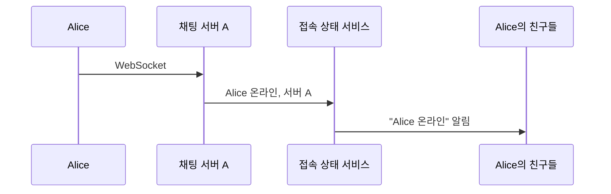
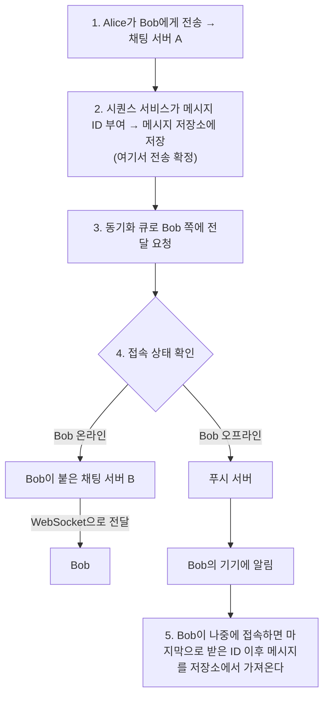
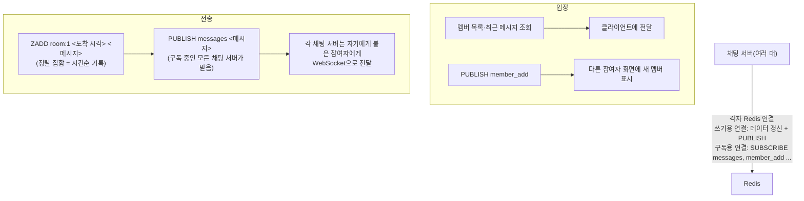

> ByteByteGo의 System Design 101 가이드 「[How do we design a chat application like WhatsApp, Facebook Messenger or Discord?](https://bytebytego.com/guides/how-do-we-design-a-chat-application-like-whatsapp-facebook-messenger-or-discord)」, 「[Build a Simple Chat Application](https://bytebytego.com/guides/build-a-simple-chat-application)」을 바탕으로 재구성한 노트다. 대규모 사례는 High Scalability의 「[The WhatsApp Architecture](http://highscalability.com/blog/2014/2/26/the-whatsapp-architecture-facebook-bought-for-19-billion.html)」와 Facebook 채팅 발표 「[Erlang at Facebook](http://www.erlang-factory.com/upload/presentations/31/EugeneLetuchy-ErlangatFacebook.pdf)」(2009)로 보강했다. 접속 상태의 비용과 다크 런치는 Facebook의 「[Facebook Chat](https://www.facebook.com/note.php?note_id=14218138919&id=9445547199&index=0)」(2008)로 보강했다.
> karanpratapsingh의 「[System Design](https://github.com/karanpratapsingh/system-design)」 강의 저장소를 바탕으로 메신저의 요구 사항·규모 추정, 데이터 모델과 API, 서비스 분할, 마지막 접속 시각, 수신 확인, 미디어 저장을 보강했다.

## 무엇이 어려운가

채팅은 요청-응답이 아니라 **서버가 먼저 보내야 하는** 서비스다. 그래서 세 가지를 풀어야 한다.

| 문제 | 해법 |
| --- | --- |
| 서버가 클라이언트에 먼저 보내기 | 클라이언트마다 WebSocket 같은 지속 연결 유지 → [[websocket\|WebSocket]] |
| 받는 사람이 다른 서버에 붙어 있음 | 서버 간 메시지 전달 계층(pub/sub, 메시지 큐) |
| 받는 사람이 오프라인 | 메시지를 저장해 두고 푸시 알림, 재접속 시 동기화 |

클라이언트 쪽에서 REST와 WebSocket의 역할을 나누는 방법은 [[realtime-chat-app|실시간 채팅 앱의 데이터 흐름]]에 있다.

## 요구 사항과 규모 추정

WhatsApp 같은 메신저를 면접에서 설계할 때의 전형적인 범위다.

| 구분 | 내용 |
| --- | --- |
| 기능 | 1:1 채팅, 그룹 채팅(최대 100명 같은 상한), 파일 공유(이미지·동영상) |
| 비기능 | 고가용성과 낮은 지연, 확장성 |
| 확장 | 보냄·받음·읽음 표시, 마지막 접속 시각, 푸시 알림 |

```text
DAU 5천만 × 하루 40건(10건씩 4명에게) = 하루 20억 메시지
초당 요청: 20억 / 86,400초 ≈ 2.4만
텍스트 저장: 20억 × 100B ≈ 하루 200GB
미디어: 메시지의 5% = 하루 1억 개 × 100KB ≈ 하루 10TB
10년 저장: (10TB + 0.2TB) × 365 × 10 ≈ 38PB
수신 대역폭: 하루 10.2TB / 86,400초 ≈ 초당 120MB
```

저장량의 대부분은 미디어다. 그래서 텍스트 메시지 저장소와 미디어 저장소를 처음부터 나눠 설계한다.

## 구성 요소

| 구성 요소 | 역할 |
| --- | --- |
| 채팅 서버 | 클라이언트 WebSocket을 들고 메시지를 주고받는다. 연결을 들고 있어 상태가 있는 서버다 |
| 접속 상태(presence) 서비스 | 누가 온라인인지, 어느 채팅 서버에 붙어 있는지 기록하고 친구에게 알린다 |
| 시퀀스 서비스 | 메시지마다 고유하고 정렬 가능한 ID를 붙인다 |
| 메시지 저장소 | 대화별 메시지 기록. 쓰기가 많고 최근 것 위주로 읽으므로 와이드 컬럼 DB 등이 쓰인다 |
| 메시지 동기화 큐 | 보낸 사람의 서버에서 받는 사람의 서버로 메시지를 넘긴다 |
| 푸시 서버 | 오프라인 사용자에게 모바일 푸시를 보낸다 → [[notification-system\|알림 시스템 설계]] |

## 흐름

로그인



1:1 메시지



**저장이 먼저, 전달은 그다음**이다. 실시간 전달은 실패할 수 있으므로, 재접속 때 "마지막으로 받은 메시지 ID 이후"를 조회하는 동기화가 최종 안전망이다.

## 데이터 모델과 API

| 테이블 | 내용 |
| --- | --- |
| `users` | 이름, 전화번호 등 |
| `messages` | 종류(텍스트·이미지·동영상), 내용, 보낸·받은·읽은 시각, 속한 `chatID` 또는 `groupID` |
| `chats` | 두 사용자 사이의 1:1 대화 |
| `users_chats` | 사용자와 대화의 N:M 연결 |
| `groups` | 여러 사용자로 된 그룹 |
| `users_groups` | 사용자와 그룹의 N:M 연결 |

관계형으로 보이지만 한 DB에 모두 두면 금방 병목이 된다. 테이블마다 소유 서비스를 정해 나누고, 서비스별로 PostgreSQL이나 Cassandra 같은 분산 NoSQL을 고른다. 메시지는 대화 ID로 샤딩한다.

```text
getAll(userID): Chat[] | Group[]                  내가 속한 대화·그룹 목록
getMessages(userID, channelID, cursor?): Message[]  채널(대화·그룹)의 메시지, 페이지 단위
sendMessage(userID, channelID, message): boolean
joinGroup(userID, channelID) / leaveGroup(userID, channelID): boolean
```

서비스는 사용자(인증·프로필, HTTP), 채팅(WebSocket 연결과 메시지), 알림, 접속 상태, 미디어로 나눈다. 그룹이 커지면 그룹 관리를 채팅 서비스에서 떼어 낸다. 서비스 사이는 gRPC, 찾기는 서비스 디스커버리·서비스 메시로 한다. HTTP·WebSocket·TCP처럼 프로토콜이 여럿이라 프로토콜마다 로드 밸런서를 따로 두기보다 여러 프로토콜을 받는 **API 게이트웨이** 하나로 받고, 게이트웨이는 대기 복제본으로 이중화한다.

## 메시지 순서와 ID

- 서버가 여러 대면 서버 시계로 순서를 정할 수 없다. 시퀀스 서비스나 Snowflake류 ID(시각 + 서버 번호 + 일련번호)로 **정렬 가능한 고유 ID**를 만든다 → [[distributed-unique-id|분산 환경의 고유 ID 생성]]
- 전체 순서가 아니라 **대화(채널) 안의 순서**만 지키면 된다. 그래서 채널별 카운터를 쓰기도 한다.
- 클라이언트가 보낼 때 자체 ID를 붙이면 재전송으로 생긴 중복을 서버가 걸러 낼 수 있다(멱등성).

## Redis로 만드는 간단한 버전

작은 규모에서는 Redis 하나로 서버 간 전달과 기록을 함께 처리할 수 있다.



- 구독 연결은 구독 상태에서 다른 명령을 못 쓰므로 쓰기용과 구독용 연결을 나눈다.
- **Redis pub/sub은 전달을 보장하지 않는다.** 그 순간 구독 중이 아니던 서버는 메시지를 영영 못 받는다. 그래서 기록은 정렬 집합(또는 Redis Streams)에 따로 남기고, 놓친 것은 재접속 때 기록에서 채운다.
- 규모가 커지면 서버 간 전달은 Kafka 같은 내구성 있는 큐로, 저장은 전용 메시지 저장소로 옮긴다. 채널 서버를 일관된 해싱으로 나누고 연결은 지역 게이트웨이가 드는 대규모 구조는 [[notification-system|알림 시스템 설계]]의 실시간 전달 섹션에 있다.

## 접속 상태

- 클라이언트가 주기적으로 하트비트를 보내고, 일정 시간 없으면 오프라인으로 본다. 연결이 끊긴 순간 바로 오프라인으로 바꾸면 잠깐의 네트워크 흔들림에도 상태가 깜빡인다.
- 친구가 많은 사용자의 상태 변경은 알림이 폭발한다. 큰 그룹은 상태를 밀어 주지 않고, 화면을 열 때 조회하게 한다.

- 순진하게 접속·이탈 때마다 모든 친구에게 알리면 초당 메시지 수가 **평균 친구 수 × 피크 동시 접속자 × 이탈률**에 비례한다. 친구가 수백 명, 동시 접속이 수백만이면 메시지 전송보다 접속 상태 알림이 훨씬 비싸다. 「1분·5분·10분 유휴」 같은 세부 상태를 보여 주면 아무것도 안 하는 사용자도 부하를 만든다. 그래서 Facebook 채팅은 상태를 밀지 않고, 접속 상태 서버가 메모리에 모아 둔 것을 클라이언트가 주기적으로 **끌어가게** 했다.
- 오래 붙들고 있는 롱 폴링 요청을 일반 웹 서버(요청당 OS 프로세스)로 받으면 1분 동안 놀다가 「메시지 없음」을 돌려주는 프로세스 하나가 일반 페이지 60여 개를 처리할 자원을 묶는다. 연결 계층을 웹 계층과 따로 둬야 하는 이유다.
- **다크 런치**: 화면에 채팅을 보이기 전에, 페이지가 몰래 채팅 서버에 연결해 접속 상태를 조회하고 가짜 메시지를 보내게 해서 실제 사용자 규모의 부하를 미리 검증했다. 그다음 몇 주에 걸쳐 점진 출시했다.

### 마지막 접속 시각

- **하트비트 방식**: 클라이언트가 주기적으로 핑을 보내고, 접속 상태 서비스가 `사용자 → 마지막 활동 시각`을 Redis·Memcached 같은 캐시에 덮어쓴다. 값 하나라 쓰기가 가볍다.
- **마지막 행동 방식**: 핑 대신 사용자의 마지막 행동 시각만 기록하고, 「30초 동안 행동이 없으면」 오프라인으로 보고 그 시각을 마지막 접속으로 보여 준다. 더 게으르지만 부하가 적다.

## 수신 확인과 미디어

- **보냄·받음·읽음**: 서버가 저장하면 「보냄」이다. 받는 기기가 메시지를 받아 확인 응답(ACK)을 보내면 `deliveredAt`을, 사용자가 화면에서 보면 다시 ACK를 보내 `readAt`을 기록하고 보낸 사람에게 알린다. 그룹은 구성원마다 상태가 있어 「모두 읽음」을 집계한다.
- **오프라인 알림**: 받는 사람이 활성 연결도 최근 접속도 없으면, 채팅 서비스가 기기 플랫폼 정보를 붙인 이벤트를 메시지 큐에 넣고 알림 서비스가 FCM·APNs로 보낸다. 모바일 OS와 브라우저마다 푸시 방식이 달라 일반 발행·구독 대신 플랫폼별 전송을 쓴다. 정확히 한 번 전달과 순서가 중요하면 Kafka·NATS 같은 전용 브로커로 알림 경로를 튼튼하게 한다([[notification-system|알림 시스템 설계]]).
- **캐시와 페이지**: 사용자는 최신 메시지를 기대하므로 캐시는 조심해서 쓴다. 그룹 채팅에서 여럿이 같은 옛 메시지를 읽는 경우가 많아 **오래된 메시지**를 캐시하고(LRU), 수천 개 메시지를 한 번에 보내지 않도록 API에 페이지네이션을 넣는다. 대역폭이 적은 사용자는 요청할 때만 옛 메시지를 받는다.
- **미디어**: 미디어 서비스가 업로드를 받아 오브젝트 스토리지(S3 등)에 두고 CDN으로 내려 준다. 메시지에는 미디어 URL만 담는다. 업로드 시 압축·변환으로 저장 비용을 줄이고, WhatsApp처럼 받는 쪽이 내려받은 뒤 서버에서 지우는 정책도 있다([[media-processing-pipeline|이미지·동영상 처리 서버 설계]]).

## 사례: 적은 서버로 많은 연결 붙들기

채팅 서버의 자원은 대부분 **놀고 있는 연결**에 쓰인다. 수백만 연결이 대부분 아무것도 보내지 않는다. 그래서 연결 하나의 비용을 줄이는 것이 확장의 핵심이다.

| 사례 | 설계 | 배울 점 |
| --- | --- | --- |
| Facebook 채팅(2009) | 브라우저는 일반 AJAX로 메시지를 보내고, **롱 폴링**(서버가 메시지가 생길 때까지 응답을 붙들었다 돌려준다)으로 받는다. 탭마다 활성 요청 하나. 백엔드는 PHP 웹 계층과 Erlang 채널 서버로 나뉜다. 채널 서버는 사용자별로 순번을 매긴 짧은 메시지 큐를 들고, 사용자 ID 공간을 나눠 파티션마다 클러스터가 맡는다. 접속 상태는 채널 서버가 권위를 갖고, 주기적으로 접속 상태 서버로 보내 친구 목록 요청이 거기서 **끌어가게(pull)** 한다 | 사용자들은 서로 독립이고 동시적이어서, OS 스레드보다 경량 프로세스 모델에 잘 맞는다. 재시작 없는 코드 교체로 무중단 배포를 한다 |
| WhatsApp(2014) | 서버 대부분이 Erlang(ejabberd를 고쳐 쓰다 자체 프로토콜로 바꿈), FreeBSD. 서버당 동시 TCP 연결을 20만에서 한 달 만에 200만으로 늘렸다. 메시지는 전달하면 서버에서 지우고 대화 기록을 서버에 두지 않는다 | 사용자 4억 5천만 명을 엔지니어 32명이 운영했다. 병목은 측정으로 찾는다(에뮬레이터 루프 시간 비율, 락 경합). 세계적 사건·장비 장애를 견딜 여유분을 두고 운영한다 |

오늘날 브라우저 채팅은 롱 폴링 대신 [[websocket|WebSocket]]을 쓰지만, 「연결 계층과 메시지 큐 계층의 분리, 사용자 ID 기준 분할, 접속 상태의 끌어가기」라는 구조는 같다.

## 정리

- 채팅의 핵심은 지속 연결(WebSocket), 서버 간 전달(pub/sub·큐), 오프라인 처리(저장 + 푸시)다.
- 메시지는 먼저 ID를 붙여 저장하고, 그다음 접속 상태에 따라 소켓이나 푸시로 보낸다.
- 순서는 대화 안에서만 지키면 되고, 재전송 중복은 클라이언트 ID로 거른다.
- Redis pub/sub은 간단하지만 전달을 보장하지 않으므로 기록과 재동기화를 함께 둔다.

관련 노트: [[websocket|WebSocket]], [[realtime-chat-app|실시간 채팅 앱의 데이터 흐름: REST와 WebSocket 역할 나누기]], [[notification-system|알림 시스템 설계: 푸시·이메일·SMS와 실시간 메시지 전달]], [[wide-column-database|와이드 컬럼 DB와 대규모 메시지 저장]], [[collaborative-editing|실시간 공동 편집: OT와 CRDT]], [[realtime-websocket-server|실시간 웹소켓 서버 설계]], [[news-feed-design|뉴스 피드 설계]]
