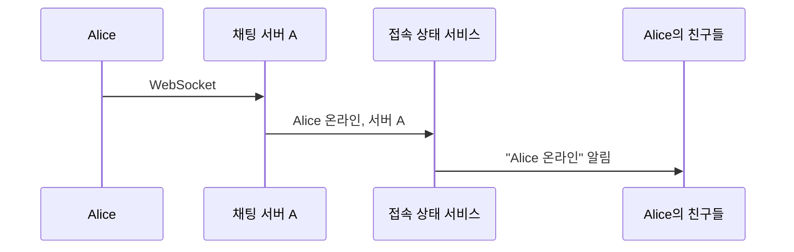
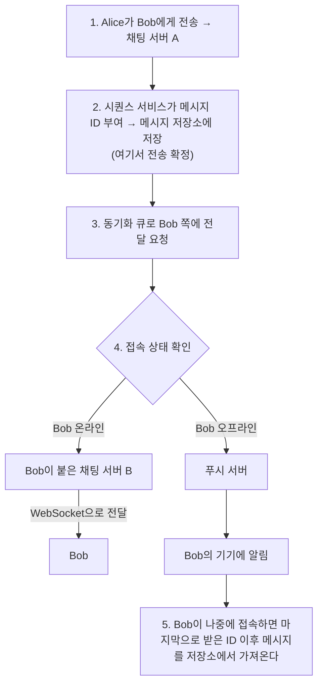
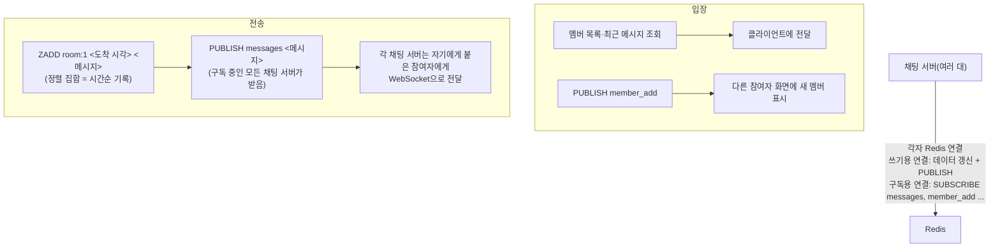

> ByteByteGo의 System Design 101 가이드 「[How do we design a chat application like WhatsApp, Facebook Messenger or Discord?](https://bytebytego.com/guides/how-do-we-design-a-chat-application-like-whatsapp-facebook-messenger-or-discord)」, 「[Build a Simple Chat Application](https://bytebytego.com/guides/build-a-simple-chat-application)」을 바탕으로 재구성한 노트다.

## 무엇이 어려운가

채팅은 요청-응답이 아니라 **서버가 먼저 보내야 하는** 서비스다. 그래서 세 가지를 풀어야 한다.

| 문제 | 해법 |
| --- | --- |
| 서버가 클라이언트에 먼저 보내기 | 클라이언트마다 WebSocket 같은 지속 연결 유지 → [[websocket\|WebSocket]] |
| 받는 사람이 다른 서버에 붙어 있음 | 서버 간 메시지 전달 계층(pub/sub, 메시지 큐) |
| 받는 사람이 오프라인 | 메시지를 저장해 두고 푸시 알림, 재접속 시 동기화 |

클라이언트 쪽에서 REST와 WebSocket의 역할을 나누는 방법은 [[realtime-chat-app|실시간 채팅 앱의 데이터 흐름]]에 있다.

## 구성 요소

| 구성 요소 | 역할 |
| --- | --- |
| 채팅 서버 | 클라이언트 WebSocket을 들고 메시지를 주고받는다. 연결을 들고 있어 상태가 있는 서버다 |
| 접속 상태(presence) 서비스 | 누가 온라인인지, 어느 채팅 서버에 붙어 있는지 기록하고 친구에게 알린다 |
| 시퀀스 서비스 | 메시지마다 고유하고 정렬 가능한 ID를 붙인다 |
| 메시지 저장소 | 대화별 메시지 기록. 쓰기가 많고 최근 것 위주로 읽으므로 와이드 컬럼 DB 등이 쓰인다 |
| 메시지 동기화 큐 | 보낸 사람의 서버에서 받는 사람의 서버로 메시지를 넘긴다 |
| 푸시 서버 | 오프라인 사용자에게 모바일 푸시를 보낸다 → [[notification-system\|알림 시스템 설계]] |

## 흐름

로그인

1:1 메시지

**저장이 먼저, 전달은 그다음**이다. 실시간 전달은 실패할 수 있으므로, 재접속 때 "마지막으로 받은 메시지 ID 이후"를 조회하는 동기화가 최종 안전망이다.

## 메시지 순서와 ID

- 서버가 여러 대면 서버 시계로 순서를 정할 수 없다. 시퀀스 서비스나 Snowflake류 ID(시각 + 서버 번호 + 일련번호)로 **정렬 가능한 고유 ID**를 만든다 → [[distributed-unique-id|분산 환경의 고유 ID 생성]]
- 전체 순서가 아니라 **대화(채널) 안의 순서**만 지키면 된다. 그래서 채널별 카운터를 쓰기도 한다.
- 클라이언트가 보낼 때 자체 ID를 붙이면 재전송으로 생긴 중복을 서버가 걸러 낼 수 있다(멱등성).

## Redis로 만드는 간단한 버전

작은 규모에서는 Redis 하나로 서버 간 전달과 기록을 함께 처리할 수 있다.

- 구독 연결은 구독 상태에서 다른 명령을 못 쓰므로 쓰기용과 구독용 연결을 나눈다.
- **Redis pub/sub은 전달을 보장하지 않는다.** 그 순간 구독 중이 아니던 서버는 메시지를 영영 못 받는다. 그래서 기록은 정렬 집합(또는 Redis Streams)에 따로 남기고, 놓친 것은 재접속 때 기록에서 채운다.
- 규모가 커지면 서버 간 전달은 Kafka 같은 내구성 있는 큐로, 저장은 전용 메시지 저장소로 옮긴다. 채널 서버를 일관된 해싱으로 나누고 연결은 지역 게이트웨이가 드는 대규모 구조는 [[notification-system|알림 시스템 설계]]의 실시간 전달 섹션에 있다.

## 접속 상태

- 클라이언트가 주기적으로 하트비트를 보내고, 일정 시간 없으면 오프라인으로 본다. 연결이 끊긴 순간 바로 오프라인으로 바꾸면 잠깐의 네트워크 흔들림에도 상태가 깜빡인다.
- 친구가 많은 사용자의 상태 변경은 알림이 폭발한다. 큰 그룹은 상태를 밀어 주지 않고, 화면을 열 때 조회하게 한다.

## 정리

- 채팅의 핵심은 지속 연결(WebSocket), 서버 간 전달(pub/sub·큐), 오프라인 처리(저장 + 푸시)다.
- 메시지는 먼저 ID를 붙여 저장하고, 그다음 접속 상태에 따라 소켓이나 푸시로 보낸다.
- 순서는 대화 안에서만 지키면 되고, 재전송 중복은 클라이언트 ID로 거른다.
- Redis pub/sub은 간단하지만 전달을 보장하지 않으므로 기록과 재동기화를 함께 둔다.

관련 노트: [[websocket|WebSocket]], [[realtime-chat-app|실시간 채팅 앱의 데이터 흐름: REST와 WebSocket 역할 나누기]], [[notification-system|알림 시스템 설계: 푸시·이메일·SMS와 실시간 메시지 전달]], [[wide-column-database|와이드 컬럼 DB와 대규모 메시지 저장]], [[collaborative-editing|실시간 공동 편집: OT와 CRDT]], [[realtime-websocket-server|실시간 웹소켓 서버 설계]]
