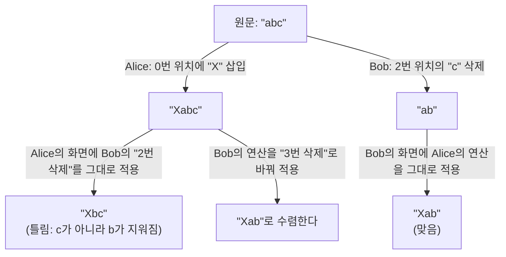
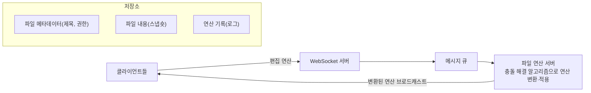

> ByteByteGo의 System Design 101 가이드 「[How to Design Google Docs](https://bytebytego.com/guides/how-to-design-google-docs)」를 바탕으로 재구성한 노트다. 차등 동기화는 Neil Fraser의 「[Differential Synchronization](https://neil.fraser.name/writing/sync/)」과 그 구현인 「[MobWrite](https://code.google.com/p/google-mobwrite/)」로 보강했다.

## 무엇이 어려운가

두 사람이 같은 문장을 동시에 고치면, 각자의 화면에서는 자기 편집이 먼저 적용된 상태다. 서로의 편집을 그냥 받아 적용하면 **위치가 어긋나** 두 화면의 결과가 달라진다.



공동 편집의 목표는 **모든 참여자의 문서가 결국 같은 상태로 수렴**하고, 각자의 의도가 보존되는 것이다.

## 시스템 구조



- 클라이언트는 문서 전체가 아니라 **연산(삽입·삭제·서식)** 을 보낸다. 작고 자주 보낼 수 있다.
- 실시간 전달은 WebSocket 서버가 맡는다 → [[websocket|WebSocket]]
- 연산은 큐에 순서대로 쌓아 유실 없이 파일 연산 서버가 처리한다.
- 저장은 **스냅숏 + 연산 로그**다. 로그를 재생하면 어느 시점이든 되살릴 수 있어 버전 기록과 되돌리기가 자연스럽다. 로그가 길어지면 주기적으로 스냅숏을 새로 만든다.

## 충돌 해결 알고리즘

| 방식 | 원리 | 장점 | 단점 |
| --- | --- | --- | --- |
| OT(Operational Transformation, 운영 변환) | 동시에 일어난 연산을 서로에 맞게 **변환**해 적용한다. 보통 중앙 서버가 순서를 정한다 | 오래 검증됐다. 연산이 작다 | 변환 함수를 연산 종류마다 정확히 짜기 어렵다. 중앙 서버가 필요하다 |
| CRDT(Conflict-free Replicated Data Type) | 문자마다 고유 ID를 붙이는 등 자료구조 자체를 **어떤 순서로 합쳐도 같은 결과**가 나오게 설계한다 | 중앙 서버 없이도 수렴한다. 오프라인 편집·P2P에 맞다 | 메타데이터가 커질 수 있다. 의도 보존이 미묘한 경우가 있다 |
| 차등 동기화(Differential Synchronization) | 상대 사본과의 **차이(diff)** 를 계산해 주고받고 패치한다 | 구현이 단순하다 | 충돌이 잦으면 패치가 실패하고 정밀도가 떨어진다 |

- 구글 문서는 OT 계열로 알려져 있다.
- CRDT는 Yjs·Automerge 같은 라이브러리로 널리 쓰인다. 로컬 우선(local-first) 앱, 오프라인 후 동기화, 여러 서버 간 복제에 특히 맞는다.
- 텍스트 외에 커서 위치·선택 영역 같은 **현재 상태(presence)** 는 저장하지 않고 실시간으로만 브로드캐스트한다.

### 차등 동기화

OT·CRDT가 **연산**을 주고받는다면, **차등 동기화(differential synchronization)** 는 문서의 **차이(diff)** 를 주고받는다. 클라이언트와 서버가 각자 상대 쪽 마지막 상태의 사본인 **섀도(shadow)** 를 들고, 끝없이 이 순환을 돈다.

```text
1. diff(클라이언트 문서, 클라이언트 쪽 섀도) → 편집 목록
2. 클라이언트 섀도 = 클라이언트 문서 (복사)
3. 편집 목록을 서버로 보낸다
4. 서버: 서버 섀도에 정확히 패치, 서버 문서에는 퍼지 패치
5. 이제 같은 절차를 서버 → 클라이언트 방향으로 반복
```

- 핵심은 **퍼지 패치**다. 문서가 그사이 바뀌었어도 주변 문맥으로 위치를 찾아 패치를 적용한다. 일부 패치가 실패해도 다음 diff에 「되돌림」으로 나타나 자동으로 정리된다.
- 편집 이벤트를 하나도 빠짐없이 잡을 필요가 없다(잘라내기, 붙여넣기, 자동 완성, 맞춤법 교정까지 diff에 다 드러난다). 메시지 하나를 잃어도 다음 순환에서 다시 맞춰지므로 불안정한 네트워크에 강하다.
- 소유권 방식(문서나 구획을 잠가 한 명만 편집)은 실시간 협업이 안 되고, 이벤트 전달 방식은 이벤트 하나를 잃으면 이후 편집의 위치가 어긋나 갈라지며, 문서를 통째로 보내 3방향 병합하는 방식은 타이핑 중에 상대 변경을 받지 못하는 반이중이다. 차등 동기화는 이 셋의 약점을 피한다.
- 대신 diff 계산 비용이 문서 크기에 비례하고, 서버가 클라이언트마다 섀도를 들어야 한다. 폼·스프레드시트처럼 구조화된 데이터에는 더 효율적인 방법이 있다.

## 정리

- 공동 편집은 문서가 아니라 연산을 주고받고, 동시에 일어난 연산을 합쳐 모두가 같은 결과로 수렴하게 하는 문제다.
- 구조는 WebSocket(실시간) + 큐(순서·유실 방지) + 연산 서버(충돌 해결) + 스냅숏·연산 로그 저장이다.
- OT는 중앙에서 변환하고, CRDT는 자료구조가 순서와 무관하게 수렴한다. 오프라인·분산이 중요하면 CRDT를 본다.

관련 노트: [[websocket|WebSocket]], [[chat-system-design|채팅 시스템 설계: 연결, 접속 상태, 메시지 전달]], [[real-world-algorithms|현실 시스템을 움직이는 알고리즘과 자료구조]], [[message-queue-kafka|메시지 큐와 Kafka]]
