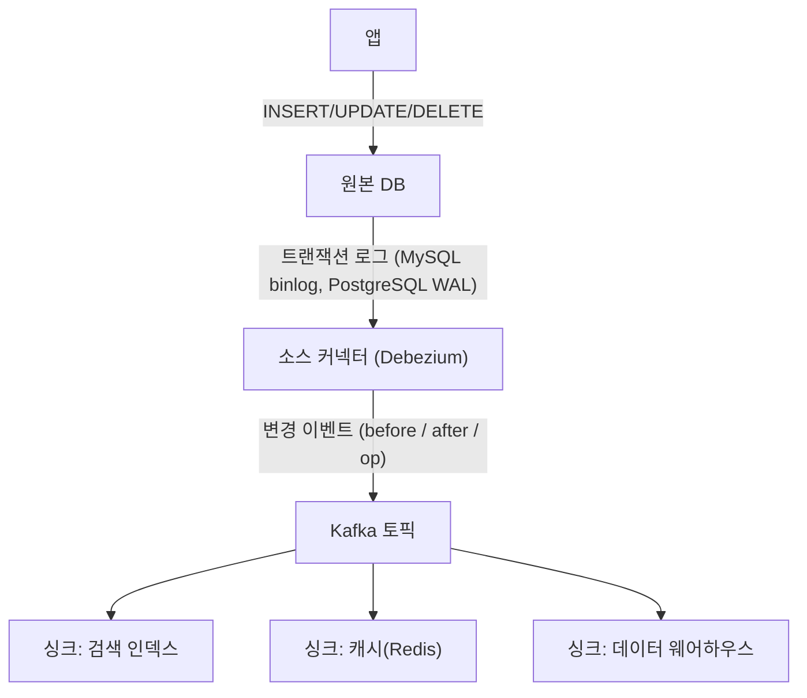
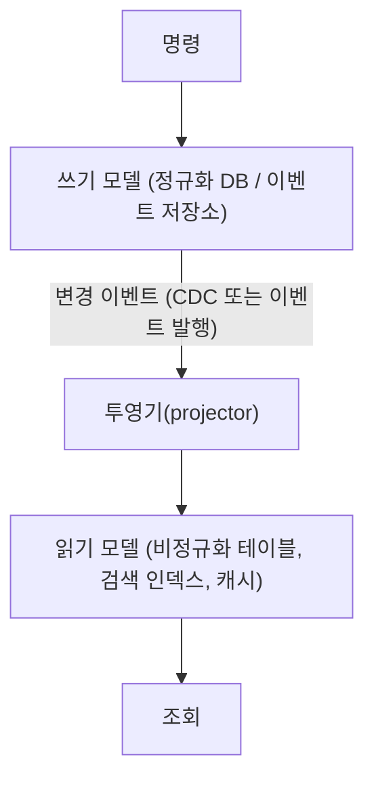

> ByteByteGo의 System Design 101 가이드 「[How Do We Manage Data?](https://bytebytego.com/guides/how-do-we-manage-data)」, 「[Change Data Capture](https://bytebytego.com/guides/change-data-capture-key-to-leverage-real-time-data)」, 「[Differences in Event Sourcing System Design](https://bytebytego.com/guides/differences-in-event-sourcing-system-design)」, 「[Top Eventual Consistency Patterns](https://bytebytego.com/guides/top-eventual-consistency-patterns-you-must-know)」, 「[Smooth Data Migration with Avro](https://bytebytego.com/guides/smooth-data-migration-with-avro)」를 바탕으로, Debezium·Avro 공식 문서로 확인해 재구성한 노트다. 아웃박스 릴레이 방식, 스냅숏 주기, CQRS의 동기화·조회 모델·이벤트 소싱과의 관계, 스키마 호환성 규칙은 「fru1tworld/cs-basic 모의 면접 질문 목록」이 묻는 개념을 채워 넣었다.

## 왜 패턴이 필요한가

서비스가 하나의 DB를 쓸 때는 트랜잭션 하나로 정합성을 지킨다. 서비스가 나뉘고 캐시·검색 엔진·데이터 웨어하우스가 붙으면 **같은 사실이 여러 저장소에 복사**된다. 이때 문제는 둘이다.

1. 한 곳의 변경을 다른 곳에 **어떻게 빠짐없이 전달하나**
2. 전달되는 동안 저장소끼리 어긋나는 것을 **어떻게 다루나**

| 패턴 | 푸는 문제 | 한 줄 요약 |
| --- | --- | --- |
| 캐시 어사이드(cache-aside) | 반복 조회 부하 | 캐시에 없으면 DB에서 읽어 캐시에 넣는다. 읽기가 많고 쓰기가 적을 때. [[caching-strategies\|캐시 전략]] |
| 구체화된 뷰(materialized view) | 무거운 집계 쿼리 | 쿼리 결과를 미리 계산해 저장한다. [[database-scaling\|데이터베이스 확장과 성능 최적화]] |
| 인덱스 테이블(index table) | 기본 키가 아닌 조건의 조회 | 자주 쓰는 조회 조건을 키로 하는 테이블을 따로 둔다. 보조 인덱스를 지원하지 않는 NoSQL에서 특히 쓴다 |
| 샤딩 | 한 서버를 넘는 데이터·쓰기 | [[database-sharding\|데이터베이스 샤딩]] |
| CDC | 변경 전달 | DB 트랜잭션 로그를 읽어 다른 시스템으로 흘린다 |
| 이벤트 소싱 | 변경 이력·감사·재현 | 현재 상태 대신 일어난 이벤트를 저장한다 |
| CQRS | 읽기·쓰기 요구가 다를 때 | 쓰기 모델과 읽기 모델을 나눈다 |

## CDC: 변경 데이터 캡처

**CDC(Change Data Capture)** 는 DB에서 일어난 삽입·수정·삭제를 잡아 다른 시스템으로 실시간 전달하는 기법이다. 애플리케이션은 평소처럼 DB에 쓰기만 하고, 나머지는 CDC가 맡는다.



| 방식 | 동작 | 특징 |
| --- | --- | --- |
| **로그 기반** | DB의 트랜잭션 로그를 읽는다 | 원본 DB 부하가 적고 삭제까지 정확히 잡는다. 표준이다 |
| 쿼리 기반(polling) | `updated_at`으로 주기적으로 조회한다 | 단순하지만 삭제를 놓치고 지연이 길다 |
| 트리거 기반 | DB 트리거가 변경을 별도 테이블에 쓴다 | 원본 쓰기마다 비용이 붙는다 |

대표 도구 Debezium은 MySQL, PostgreSQL, Oracle, SQL Server, MongoDB 등의 커넥터를 제공하고, 보통 Kafka Connect 위에서 돌린다. Kafka 없이 쓰는 Debezium Server도 있다. 샤드 클러스터로 데이터를 옮길 때 CDC를 쓰는 흐름은 [[database-sharding|데이터베이스 샤딩]]에 있다.

### 이중 쓰기 대신 아웃박스

「DB에 쓰고, 이어서 메시지 큐에도 발행」하는 **이중 쓰기(dual write)** 는 둘 중 하나만 성공하면 어긋난다. DB와 브로커는 한 트랜잭션으로 묶이지 않기 때문이다.

| 순서 | 실패하면 |
| --- | --- |
| 커밋 → 발행 | 커밋 뒤 발행 전에 프로세스가 죽거나 브로커가 응답하지 않으면 **이벤트가 사라진다** |
| 발행 → 커밋 | 발행 뒤 커밋이 실패·롤백되면 **일어나지 않은 일이 이벤트로 나간다** |
| 트랜잭션 안에서 발행 | 위와 같고, 브로커 지연이 DB 트랜잭션을 붙잡아 잠금이 길어진다 |

**트랜잭셔널 아웃박스(transactional outbox)** 는 업무 데이터와 함께 **같은 트랜잭션으로** `outbox` 테이블에 이벤트를 쓰고, 별도 릴레이(message relay)가 그 테이블을 읽어 브로커로 보낸다. DB 트랜잭션 하나로 「상태 변경」과 「발행할 이벤트」가 함께 확정되고, 발행은 그 뒤에 언제든 다시 시도할 수 있다.

```text
BEGIN
  UPDATE orders SET status = 'PAID' WHERE id = 7;
  INSERT INTO outbox (id, aggregate_type, aggregate_id, type, payload, created_at)
       VALUES ('evt-91', 'order', 7, 'OrderPaid', '{...}', now());
COMMIT
                 ↓ 릴레이 (폴링 또는 CDC)
           Kafka 토픽 order (키 = aggregate_id)
```

| 릴레이 방식 | 동작 | 장점 | 단점 |
| --- | --- | --- | --- |
| 폴링 발행기(polling publisher) | 주기적으로 `SELECT … WHERE published = false ORDER BY id`로 읽어 보내고 표시하거나 지운다. 여러 인스턴스가 돌면 `FOR UPDATE SKIP LOCKED`로 나눠 잡는다 | 추가 인프라가 없다. 어떤 DB에서도 된다 | 폴링 주기만큼 지연, DB에 조회 부하. 동시 커밋이 순서와 다르게 보이면 순서가 섞일 수 있다 |
| 로그 테일링(transaction log tailing, CDC) | Debezium 같은 CDC가 binlog·WAL에서 `outbox` 삽입을 읽어 보낸다. Debezium에는 아웃박스 행을 토픽·키로 바꿔 주는 이벤트 라우터가 있다 | 지연이 짧고 DB를 조회하지 않는다. 커밋 순서대로 읽는다 | CDC 인프라(Kafka Connect 등)를 운영해야 한다 |

- 릴레이는 보낸 뒤 표시하기 전에 죽으면 같은 이벤트를 다시 보낸다. 즉 아웃박스는 **최소 한 번** 발행이므로, 이벤트 ID를 넣어 소비자가 중복을 거른다.
- 순서는 집합체(aggregate) ID를 메시지 키로 써서 집합체 단위로 지킨다.
- 발행이 끝난 행은 지우거나 보존 기간 뒤 정리해 테이블이 무한히 커지지 않게 한다.
- 브로커가 죽어도 이벤트는 DB에 남아 있다가 복구 뒤 나간다. 아웃박스는 브로커 장애를 업무 장애와 떼어 놓는 장치이기도 하다.

## 이벤트 소싱

일반적인 CRUD 설계는 **현재 상태**를 저장하고 덮어쓴다. **이벤트 소싱(event sourcing)** 은 상태를 바꾼 **이벤트를 추가 전용으로 저장**하고, 현재 상태는 이벤트를 처음부터 차례로 적용해 계산한다.

```text
CRUD                         이벤트 소싱
orders 테이블                 order_events (추가만 한다)
┌────┬────────┐               1. OrderPlaced   {id: 7, amount: 30000}
│ id │ status │               2. PaymentDone   {id: 7}
│  7 │ PAID   │ ← 덮어씀       3. OrderShipped  {id: 7}
└────┴────────┘               현재 상태 = fold(이벤트들) → SHIPPED
```

| 항목 | CRUD | 이벤트 소싱 |
| --- | --- | --- |
| 저장 대상 | 현재 상태 | 상태를 바꾼 사건의 순서 |
| 과거 상태 | 별도 이력 테이블이 없으면 잃는다 | 어느 시점이든 이벤트를 다시 적용해 재현한다 |
| 감사 추적 | 따로 만든다 | 이벤트 로그 자체가 감사 기록이다 |
| 버그 수정 후 | 이미 망가진 상태를 고쳐야 한다 | 로직을 고친 뒤 이벤트를 다시 재생해 상태를 다시 만든다 |
| 조회 | 테이블을 바로 읽는다 | 이벤트를 읽기용 모델로 투영(projection)해야 한다. 그래서 보통 CQRS와 함께 쓴다 |

이벤트 소싱은 **결정성(determinism)** 을 전제로 한다. 같은 이벤트를 같은 순서로 적용하면 언제나 같은 상태가 나와야 한다. 그래서 이벤트 적용 로직 안에서 현재 시각·난수·외부 호출을 쓰지 않고, 필요한 값은 이벤트에 담는다.

| 다루어야 할 것 | 방법 |
| --- | --- |
| 이벤트가 많아 재생이 느리다 | 주기적으로 **스냅숏**을 저장하고 그 뒤 이벤트만 적용한다. 아래 「스냅숏」 |
| 이벤트 형식이 바뀐다 | 이벤트는 고치지 않는다. 버전을 붙이고 읽을 때 변환(upcasting)한다 |
| 개인 정보 삭제 요구 | 지울 수 없는 로그와 충돌한다. 개인 정보는 암호화해 두고 키를 버리는 방식(crypto-shredding)을 쓴다 |

### 현재 상태와 스냅숏

현재 상태는 집합체(aggregate) 하나의 이벤트를 순서대로 읽어 적용(fold)해 계산한다. 이벤트 저장소는 집합체 ID와 버전(순번)으로 이벤트를 찾으므로, 전체 로그가 아니라 **그 집합체의 이벤트만** 읽는다. 버전은 쓰기 때의 낙관적 동시성 제어에도 쓴다. 「버전 5를 읽고 결정했으니 6번으로 추가」가 다른 쓰기와 겹치면 거절된다.

**스냅숏(snapshot)** 은 특정 버전까지 적용한 상태를 저장해 둔 것이다. 상태를 만들 때 가장 최근 스냅숏을 읽고 그 뒤 이벤트만 적용한다.

```text
이벤트:  1 2 3 … 200 [스냅숏 v200] 201 202 203
현재 상태 = 스냅숏(v200) + 이벤트 201~203 적용
```

| 주기 결정 기준 | 내용 |
| --- | --- |
| 이벤트 개수 | 「100개마다」처럼 마지막 스냅숏 뒤 이벤트 수가 기준을 넘으면 만든다. 가장 흔하다 |
| 재생 시간 | 상태를 읽는 지연이 목표(예: 수십 ms)를 넘기 시작하는 이벤트 수를 재서 기준으로 삼는다 |
| 시간·업무 경계 | 일 마감, 회계 기간 마감처럼 업무상 의미 있는 시점 |
| 쓰기 비용 | 스냅숏이 크거나 쓰기가 잦은 집합체는 너무 자주 만들면 저장 비용이 재생 절약보다 커진다 |

- 스냅숏은 **캐시**다. 진실의 원천은 여전히 이벤트이므로, 스냅숏은 지우고 다시 만들 수 있어야 한다.
- 상태 구조나 적용 로직이 바뀌면 옛 스냅숏을 버리고 이벤트에서 다시 만든다. 그래서 스냅숏에 스키마 버전을 붙인다.
- 대부분의 집합체는 이벤트가 적어 스냅숏이 필요 없다. 재생이 실제로 느린 집합체에만 둔다.

## CQRS

**CQRS(Command Query Responsibility Segregation)** 는 데이터를 바꾸는 명령(command) 모델과 읽는 조회(query) 모델을 분리한다. 쓰기 쪽은 정규화와 불변식 검증에, 읽기 쪽은 화면에 맞춘 비정규화 뷰에 최적화한다.

### CQS에서 CQRS로

| 비교 | CQS (Command Query Separation) | CQRS |
| --- | --- | --- |
| 단위 | 메서드 | 모델·저장소·서비스 |
| 규칙 | 메서드는 상태를 바꾸는 명령이거나 값을 돌려주는 조회 중 하나만 한다. 「질문이 답을 바꾸면 안 된다」 | 명령을 처리하는 모델과 조회를 처리하는 모델을 따로 둔다. 저장소까지 나눌 수 있다 |
| 출처 | Bertrand Meyer의 객체 설계 원칙 | Greg Young이 CQS를 아키텍처 수준으로 넓힌 패턴 |
| 비용 | 거의 없다 | 모델 둘, 동기화, 최종 일관성 |

CQS는 코드 수준 규칙이라 어디에나 적용해도 해가 없지만, CQRS는 구조를 나누는 결정이라 쓸 곳을 고른다.



### 쓰는 이유와 비용

| 쓰는 이유 | 내용 |
| --- | --- |
| 모양이 다르다 | 쓰기는 집합체 단위의 검증·트랜잭션, 읽기는 여러 집합체를 조인한 화면 단위다. 한 모델로 둘을 다 맞추면 어느 쪽도 잘 안 된다 |
| 부하가 다르다 | 읽기가 쓰기보다 수십~수백 배 많으면 읽기 저장소만 따로 늘린다 |
| 저장소가 다르다 | 전문 검색은 검색 엔진, 대시보드는 집계 테이블, 상세 조회는 문서 DB처럼 조회마다 맞는 저장소를 고른다 |
| 장애 격리 | 원천 시스템이 죽어도 이미 만든 읽기 모델로 조회는 계속된다 |

| 늘어나는 복잡도 | 내용 |
| --- | --- |
| 코드와 저장소 | 모델·저장소·투영기를 각각 만들고 운영한다 |
| 동기화 경로 | 이벤트 발행, 메시지 브로커, 투영기의 유실·중복·순서를 다뤄야 한다 |
| 최종 일관성 | 쓰고 바로 읽으면 옛 값이 보인다 |
| 재구축 | 투영 로직이 바뀌거나 이벤트를 잘못 처리하면 읽기 모델을 처음부터 다시 만드는 경로가 필요하다 |

### 동기화와 지연

| 방식 | 동작 | 특징 |
| --- | --- | --- |
| 같은 트랜잭션 | 쓰기와 읽기 테이블을 한 DB 트랜잭션에서 함께 갱신한다 | 즉시 일관되지만 저장소를 나누지 못하고 쓰기가 무거워진다 |
| 도메인 이벤트 | 쓰기 쪽이 아웃박스로 이벤트를 발행하고 투영기가 구독해 갱신한다 | 가장 흔하다. 최종 일관성 |
| CDC | 쓰기 DB의 로그를 읽어 갱신한다 | 쓰기 쪽 코드를 고치지 않는다. 대신 테이블 구조에 묶인다 |
| 이벤트 소싱 | 이벤트 저장소 자체가 쓰기 모델이고 투영기가 읽는다 | 읽기 모델을 언제든 이벤트 재생으로 다시 만든다 |

투영기는 같은 이벤트를 두 번 받아도 결과가 같게(이벤트 ID·버전 기록) 만들고, 읽기 모델에 「어느 버전까지 반영했나」를 남긴다.

동기화 지연(lag) 때문에 생기는 「방금 쓴 게 안 보인다」는 다음으로 다룬다.

| 대응 | 방법 |
| --- | --- |
| 쓴 결과를 응답으로 | 명령 응답에 바뀐 값이나 새 버전을 담아 화면이 그것으로 바로 그린다. 낙관적 UI도 같은 생각이다 |
| 자기 쓰기 읽기 보장 | 방금 쓴 사용자의 조회만 잠시 쓰기 모델(또는 주 DB)에서 읽는다 |
| 버전 기다리기 | 명령 응답의 버전을 조회에 실어 보내, 읽기 모델이 그 버전까지 따라왔을 때 응답하거나 짧게 기다린다 |
| 진행 중 표시 | 「반영 중」 상태를 보여 주고 알림·폴링으로 갱신한다 |
| 지연 관측 | 투영 지연(마지막 이벤트 시각과 반영 시각의 차)을 지표로 두고 경보한다 |

일관성 모델의 종류(자기 쓰기 읽기, 단조 읽기)는 [[distributed-time-and-failure|분산 시스템의 시간과 장애]]에 있다.

### 조회 모델의 저장소

| 저장소 | 맞는 조회 |
| --- | --- |
| RDB의 비정규화 테이블·구체화된 뷰 | 목록·페이지네이션·정렬, 조인을 미리 풀어 둔 화면. 가장 무난한 시작점 |
| 문서 DB (MongoDB 등) | 상세 화면 하나를 문서 하나로. 화면 구조가 자주 바뀔 때 |
| 키-값 저장소·캐시 (Redis 등) | ID로 바로 찾는 조회, 카운터, 랭킹 |
| 검색 엔진 (Elasticsearch 등) | 전문 검색, 다중 조건 필터, 패싯 |
| 컬럼형·OLAP 저장소 | 대시보드, 대량 집계 |
| 그래프 DB | 관계 탐색(추천, 친구의 친구) |

조회마다 저장소를 다르게 둘 수 있다는 것이 CQRS의 이점이지만, 저장소가 늘면 운영 부담도 는다. 하나로 시작해 필요한 조회만 떼어 낸다.

### 맞는 곳과 맞지 않는 곳

| 맞는 곳 | 맞지 않는 곳 |
| --- | --- |
| 읽기·쓰기 부하와 모양이 크게 다르다 | 화면이 테이블 구조와 거의 같은 단순 CRUD |
| 여러 원천 데이터를 모아 보여 주는 화면 | 쓰자마자 모든 조회에 정확한 값이 보여야 한다(잔액 확인 후 즉시 이체) |
| 도메인 규칙이 복잡해 쓰기 모델을 지키고 싶다 | 팀이 작고 메시징·투영을 운영할 여력이 없다 |
| 감사·이력이 중요해 이벤트 소싱을 함께 쓴다 | 시스템 전체에 일괄 적용. CQRS는 **경계 맥락(bounded context) 단위**로 필요한 곳에만 쓴다 |

### CQRS와 이벤트 소싱

**CQRS는 이벤트 소싱이 아니다.** 둘은 독립된 패턴이다.

| 조합 | 모습 |
| --- | --- |
| CQRS만 | 쓰기는 일반 RDB에 현재 상태를 저장하고, CDC나 이벤트로 읽기 모델을 따로 만든다. 가장 흔하다 |
| 이벤트 소싱만 | 이벤트 저장소에서 집합체 상태를 재생해 쓰고 읽는다. 목록·검색 같은 조회가 불편해서 실제로는 드물다 |
| 둘 다 | 이벤트 저장소가 쓰기 모델, 그 이벤트 스트림이 읽기 모델들의 입력이다 |

함께 쓰면 역할이 맞물린다. 이벤트 소싱은 「무엇이 일어났나」를 잃지 않는 쓰기 모델을 주고, CQRS는 그 이벤트로 조회에 맞는 뷰를 여러 개 만든다. 이벤트 소싱의 약점인 조회를 CQRS가 메우고, CQRS의 「읽기 모델을 어떻게 동기화·재구축하나」를 이벤트 재생이 푼다. 새 화면이 필요하면 새 투영기를 만들어 처음부터 이벤트를 재생하면 과거 데이터까지 담긴 읽기 모델이 생긴다. ETL·스트림 처리와 함께 본 데이터 흐름 패턴 지도는 [[distributed-system-patterns|분산 시스템의 통신·데이터 흐름 패턴]]에 있다.

## 최종 일관성을 만드는 네 가지 방법

**최종 일관성(eventual consistency)** 은 새 쓰기가 없으면 모든 복제본이 결국 같은 값에 수렴한다는 약속이다. 그 사이에는 저장소마다 다른 값이 보일 수 있다. 비동기 복제가 대표적인 예다.

| 패턴 | 동작 | 장점 | 단점 |
| --- | --- | --- | --- |
| 이벤트 기반 | 서비스가 이벤트를 발행하고, 다른 서비스가 구독해 자기 DB를 갱신한다 | 서비스끼리 느슨하게 결합된다 | 이벤트 전파만큼 일관성이 늦어진다. 유실·중복 처리가 필요하다 |
| 백그라운드 동기화 | 배치 작업이 주기적으로 저장소를 비교해 맞춘다 | 단순하다. 다른 패턴의 누락을 보정하는 안전망이 된다 | 실행 주기만큼 늦다 |
| 사가(saga) | 긴 업무를 서비스별 로컬 트랜잭션의 연쇄로 나누고, 중간에 실패하면 앞 단계를 **보상 트랜잭션**으로 되돌린다 | 분산 트랜잭션(2PC) 없이 여러 서비스에 걸친 작업을 끝낸다 | 중간 상태가 외부에 보인다. 보상 로직을 따로 설계해야 한다. [[distributed-transaction\|분산 트랜잭션: 2PC와 사가]] |
| CQRS | 읽기·쓰기 저장소를 나누고 비동기로 맞춘다 | 각 모델을 따로 최적화한다 | 쓰고 바로 읽으면 옛 값이 보일 수 있다 |

2PC와 사가의 비교, 보상 트랜잭션 설계, 중간 상태 대응, 오케스트레이션·코레오그래피 구현은 [[distributed-transaction|분산 트랜잭션: 2PC와 사가]]에 있다.

이벤트를 전달받는 쪽은 같은 이벤트를 두 번 받을 수 있다고 가정한다. 메시지 시스템의 전달 보장 수준과 유실 대책은 [[message-queue-kafka|메시지 큐와 Kafka]]에 있다.

## 데이터 이전과 스키마 진화: Avro

데이터를 다른 저장소로 옮기거나 이벤트를 오래 보관하면, 그 사이에 **스키마가 바뀐다.** 옛 데이터와 새 데이터를 함께 읽을 수 있어야 한다.

**Apache Avro** 는 데이터 직렬화와 RPC를 위한 형식으로, Hadoop 생태계에서 시작했다. 스키마를 JSON으로 정의하고 데이터는 압축된 바이너리로 쓴다.

| 특징 | 이전에 주는 이점 |
| --- | --- |
| 객체 컨테이너 파일에 **스키마를 데이터와 함께** 저장한다 | 파일을 받은 쪽이 별도 정의 없이도 읽는 법을 안다 |
| 읽을 때 **쓴 쪽 스키마(writer schema)** 와 **읽는 쪽 스키마(reader schema)** 를 맞춰 본다 | 필드가 추가·삭제돼도 기본값 규칙에 따라 옛 데이터와 새 데이터를 모두 읽는다 |
| 코드 생성 없이 스키마만으로 동적으로 읽을 수 있다 | 컬럼이 바뀐 테이블을 내보낼 때 새 스키마를 만들어 새 데이터와 함께 쓰면 된다 |

Protobuf·Thrift는 필드 번호를 붙인 스키마로 코드를 미리 생성하는 쪽이라 RPC에 강하고, Avro는 스키마를 데이터와 함께 다니게 해 대량 이전과 파이프라인에 강하다. Kafka에서는 스키마를 **스키마 레지스트리(schema registry)** 에 등록하고 메시지에는 스키마 ID만 실어, 호환성 규칙(backward, forward, full)을 어기는 스키마 변경을 등록 단계에서 막는다. Protobuf 쪽은 [[grpc|gRPC: Protocol Buffers로 정의하는 RPC]]에 있다.

### 호환성 규칙

이벤트와 메시지는 생산자와 소비자가 따로 배포되고, 저장된 옛 데이터는 새 코드가 다시 읽는다. 그래서 스키마 변경은 **누가 먼저 배포되느냐**에 맞춰 호환성을 정한다.

| 호환성 | 보장 | 먼저 올리는 쪽 | 허용되는 변경 (Avro 기준) |
| --- | --- | --- | --- |
| 하위 호환(backward) | 새 스키마로 옛 데이터를 읽는다 | 소비자 | 기본값 있는 필드 추가, 필드 삭제 |
| 상위 호환(forward) | 옛 스키마로 새 데이터를 읽는다 | 생산자 | 필드 추가, 기본값 있는 필드 삭제 |
| 완전 호환(full) | 둘 다 | 어느 쪽이든 | 기본값 있는 필드의 추가·삭제만 |
| 전이(transitive) 변형 | 직전 버전뿐 아니라 **모든 과거 버전**과 호환 | - | 오래 보관한 이벤트를 재생할 때 필요하다 |

Confluent Schema Registry의 기본값은 직전 버전과의 하위 호환(`BACKWARD`)이다. 안전한 변경 습관은 다음과 같다.

- 필드는 **기본값과 함께 추가**하고, 소비자는 모르는 필드를 무시한다(tolerant reader).
- 필드 이름·타입·의미를 바꾸지 않는다. 바꿔야 하면 새 필드를 추가하고 옛 필드를 한동안 함께 채운 뒤 걷어 낸다.
- 필수 필드를 없애거나 의미를 뒤집는 변경은 호환되지 않는다. **새 이벤트 타입이나 새 버전 토픽**(`OrderPlaced.v2`)을 만들고, 한동안 두 버전을 함께 발행한다.
- 이벤트 소싱처럼 옛 이벤트를 영원히 읽어야 하면 읽을 때 새 형식으로 바꾸는 업캐스터(upcaster)를 둔다.

## 정리

- 저장소가 여럿이면 「변경을 빠짐없이 전달」과 「전달 중 어긋남」을 함께 설계한다.
- 변경 전달은 로그 기반 CDC가 표준이고, 이중 쓰기 대신 아웃박스로 상태 변경과 이벤트 발행을 한 트랜잭션에 묶는다.
- 이벤트 소싱은 상태 대신 사건을 저장해 재현과 감사를 얻고, 그 대가로 투영·스냅숏·스키마 버전을 관리한다.
- CQRS와 이벤트·사가 기반 연동은 최종 일관성을 받아들이는 대신 확장성과 결합도를 얻는다.
- 오래 사는 데이터는 스키마 진화 규칙(Avro, 스키마 레지스트리, 하위·상위·완전 호환)을 처음부터 정해 둔다.
- 2PC 대신 사가로 서비스 사이 트랜잭션을 풀고, CQRS는 이벤트 소싱 없이도 쓸 수 있는 독립된 패턴이다.

관련 노트: [[distributed-transaction|분산 트랜잭션: 2PC와 사가]], [[message-queue-kafka|메시지 큐와 Kafka]], [[database-sharding|데이터베이스 샤딩]], [[database-scaling|데이터베이스 확장과 성능 최적화]], [[web-scalability-components|웹 확장성의 구성 요소: 한 장으로 보는 웹 아키텍처]], [[transaction|트랜잭션과 회복]], [[distributed-system-patterns|분산 시스템의 통신·데이터 흐름 패턴]], [[caching-strategies|캐시 전략: 계층, 읽기·쓰기 패턴, 교체 정책, 장애 패턴]], [[event-driven-architecture|이벤트 기반 아키텍처 설계]]
